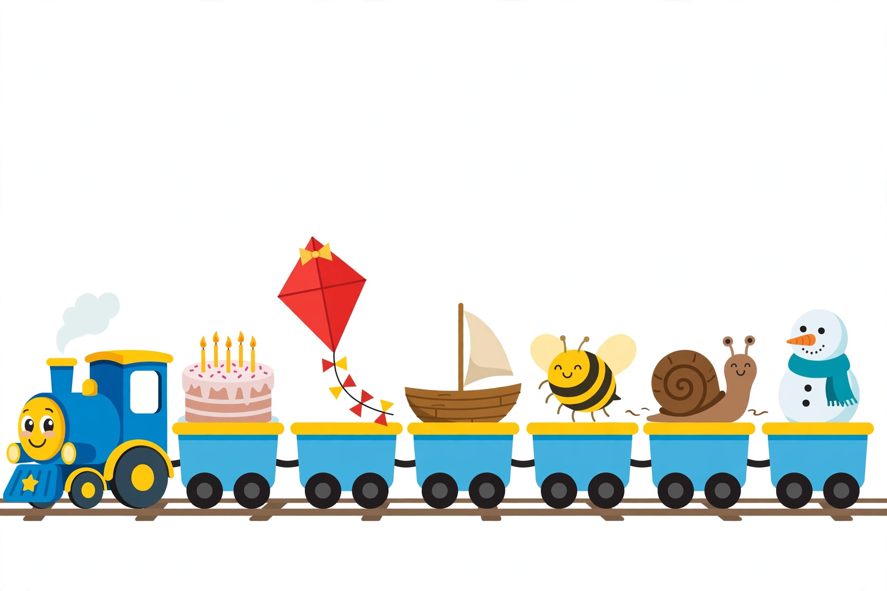

# Lesson 04 — oa and ow Say Long o

**Goal (learner hears):** "I can read words where oa and ow team up
to say long o — like *boat* and *snow*."
**Time:** 20–25 minutes · **Materials:** letter tiles (lowercase),
8 word cards: *boat, road, coat, soap, snow, blow, low, grow*; the
generated illustration
[`assets/long-vowel-train.png`](../assets/long-vowel-train.png).
**Standards:** RF.1.3.c.

## Readiness check (1–2 min)

"Say the long o sound: /ō/ — o says its name. Now read *beach*."
If the learner reads the ea word with a long e, the team idea is
still there. Then: "Today two new teams make the /ō/ sound."

## Explicit teaching

For long o, the teams are **oa** and **ow**. Same walking rule:
the first vowel talks (/ō/), the second walks quietly. In *boat*,
o talks and a walks. In *snow*, o talks and w walks.

Position clue, like ai/ay: **oa usually hides in the middle**
(*boat, road, coat*). **ow usually plays at the end** (*snow,
blow, low*). When the learner is unsure, the position clue plus
the "real word?" check settles it.

*Adult writes the teams on a card while the learner watches:*
**oa (middle) · ow (end)** — both say /ō/.

### Modeled example 1 — *boat*, step by step

*Adult points at tiles b-o-a-t:* "Point: /b/. Now the team: o and
a walk together. The first one talks — /ō/. The a walks quietly.
Finish: /t/ — **boat!** Check: is it a real word? A boat is real
— check!" *Adult mimes rocking waves.*

### Modeled example 2 — *snow*, and the growl note

*Adult points at s-n-o-w:* "Point: /s/ ... /n/. Team at the END:
o talks, /ō/, w walks quietly — **snow!**"
"Honest note: ow SOMETIMES growls like *cow* and *now*. That is
ow's other sound, and it comes later. Today, ow says long o, and
every word on our cards follows the rule."

## Guided practice (adult does it with the learner; 5 tasks)

1. Tiles **b-o-a-t**. "Find the team. Who talks? Read the word."
   (*boat*, oa)
2. Card **snow**: "Find the team. Where does it live?" (ow, at the
   end)
3. Train picture: point to the sailboat car. "What is it? *Boat.*
   Which team?" (oa)
4. Sort: *coat* goes to the oa pile, *blow* goes to the ow pile.
5. "Which team — *road* or *grow* — has ow?" (*grow*)

## Independent practice (4–6 short tasks; adult checks same day)

1. Read the cards *goat, slow, toast, crow* aloud with pointing.
2. Adult segments "/s/ /n/ /ō/"; the learner says the word.
   (*snow*)
3. Learner segments "boat" for the adult; adult blends it back.
4. Draw a boat and copy its word card under the drawing (adult
   scribes if the learner only dictates).

## Application

**Train station sort:** show the Long-Vowel Train picture. The
learner names all six pictures in order — a cake, a kite, a boat,
a bee, a snail, a snowman (the snowman stands for *snow*) — and
says each word's long-vowel pattern: *cake* (a_e), *kite* (i_e),
*boat* (oa), *bee* (ee), *snail* (ai), *snow* (ow).

*Caption: An AI-generated Long-Vowel Train. Six cars, no words —
your ears must find each word's long-vowel pattern.*

*Text-only alternative: The train's six cars carry, in order, a
birthday cake, a red kite, a wooden sailboat, a bumblebee, a snail,
and a snowman. The words are cake, kite, boat, bee, snail, and
snow.*

## Exit check

Adult shows three cards: *boat, snow, coat*. The learner reads all
three, naming the team in each ("oa," "ow," "oa"). Success: 3/3
with long o heard in every word.

## Supports

- **Seated-table variant:** tiles laid in a row; learner covers the
  walking letter and reads only the talking vowel, then the whole
  word.
- **Floor-play variant:** big team cards on the floor; learner
  hops from the talking vowel to the walking letter, whispering
  the second one.
- **Language access:** name each picture card before reading its
  word ("This is a boat. It says boat. Where is the oa team?");
  act out verbs (blow, grow, show).
- **Alternate response mode:** learner points to the team and nods
  at the talking vowel instead of saying the rule, if speech is
  still forming.
- **Extension:** *foam, roam, flow, glow, tow* — read and sort by
  team; the learner explains the position clue for each.

## Teacher note — misconceptions

- **ow read as /ow/ (cow) by default:** if the learner growls
  *snow* as "sn-ow," go back to the position clue (ow at the end
  in this unit says long o) and the real-word check — "sn-ow" is
  not a word we know; "snow" is.
- **oa at the end:** oa almost never ends a word in grade-1
  reading; if a learner writes *bot* for *boat*, praise the long
  o and show the team.
- **Team order swapped** (*bo* for *boat* is a phonetic attempt):
  praise the long o, then show the team letters in order.

**Answer key:** [answer-key.md](../answer-key.md#lesson-04--oa-and-ow-say-long-o)
