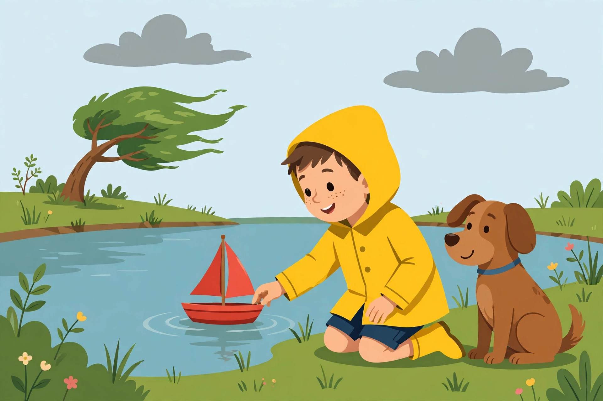

# Practice — Unit 04: Fluency, Retelling, Characters, and Key Details

Each session is 20–25 minutes. Oral, pointing, and drawing
responses are accepted everywhere; the adult reviews short written
practice the same day. Stories are in the
[unit README](README.md#unit-stories-original-written-for-this-unit).

## Session A — Echo and partner reread

1. Adult reads the Milo story aloud with expression; learner
   follows, pointing at each word.
2. Echo read: adult reads one sentence, learner echoes it with
   the same voice and phrasing (6 sentences).
3. Partner read: learner reads the first six sentences while the
   adult reads softly along; then the learner reads them alone.
4. Learner picks the smoothest sentence and reads it a third
   time, "like a storyteller."
5. Adult praises one specific fluency win ("You paused at the
   exclamation mark that time!").

## Session B — Question cards

1. Adult lays out Who? What? Where? When? How? cards.
2. Learner draws a card and asks the adult a story question
   starting with that word (about the Milo story); adult answers
   from the story. Switch roles. Three rounds each.
3. Trick round: adult asks "What does Milo eat for lunch?"
   Learner answers: "The story does not say!" (a question with
   no story answer is not a key-detail question).
4. Learner writes or dictates two questions of their own for
   tomorrow's reread.

## Session C — Retelling rope

1. Learner retells the Milo story using the rope boxes
   (Beginning / Middle / End) from Lesson 03.
2. Adult retells the Ana story with the middle missing; learner
   catches the gap and supplies it.
3. Learner builds a rope for the Ana story: one drawing per box.
4. Learner retells the Ana story from the rope, without looking
   at the story text.

## Session D — Picture retell

Uses the generated illustration
[`assets/milo-red-boat-pond.png`](assets/milo-red-boat-pond.png).

*Caption: An AI-generated illustration for "Milo and the Red
Boat": the launch at the pond, before the wind tips the boat.*

1. Learner names what the picture shows: characters (boy, dog),
   setting (pond, windy tree), event (launching the red boat).
2. Learner answers: "Which part of the story is this — beginning,
   middle, or end?" (*Beginning — the boat has not tipped over yet.*)
3. Learner tells what happens next in the story (wind blows,
   boat tips, Pip rescues it).
4. Text-only alternative (the activity works without the image):
   "A boy in a yellow raincoat kneels at a pond and launches a
   small red sailboat; a brown dog sits beside him watching; a
   tree bends in the wind on the far bank."

## Session E — Feeling and sense word hunt

1. Adult reads the three stories aloud; learner claps on every
   feeling word (*sad, happy*) and taps the table on every sense
   word (*splash, soft, cold, fast*).
2. Learner sorts word cards into Feeling / Sense piles: sad,
   happy, splash, soft, cold, warm, fast, hard.
3. Learner acts out three words (splash, soft, sad) while the
   adult guesses.
4. Challenge: find a word that fits both piles (*cold, warm*) and
   explain both uses.

## Session F — Narrator and illustration detective

1. Adult reads two sentences: "Ana has a soft red mitten."
   (narrator) and '"Slow and steady wins the race," says
   Turtle.' (character speaking). Learner says who tells each.
2. Learner hunts the Milo story for one narrator sentence and
   one character-spoken sentence ("Go, boat, go!" / "Good dog,
   Pip!").
3. Illustration detective: learner finds three details in the
   Session D picture and matches each to a story sentence
   (red boat; pond; wind bending the tree).
4. Learner answers: "Does the picture show the middle or the
   beginning? How do you know?" (*Beginning — boat still upright.*)

## Session G — Compare two adventures

1. Learner completes the Same/Different chart for Milo and Ana:
   same — lose something, feel sad, end happy; different —
   pond vs. snow, dog helper vs. cat helper, boat tips over vs.
   mitten hides.
2. Learner compares Hare and Turtle: fast vs. slow, naps vs.
   keeps walking, loses vs. wins.
3. Storybook or information book sort: "Milo and the Red Boat"
   (storybook), "All About Ponds" (information), "The Slow Race"
   (storybook), "All About Snow" (information).
4. Learner explains one sort choice with a reason ("It has
   characters and a problem, so it is a storybook").

## Session H — Midyear review games and re-teach

1. Fluency relay: learner rereads a favorite unit story twice;
   adult notes the smoother read.
2. Retelling chain: adult starts a retelling ("Milo and Pip go
   to the pond..."), learner adds the next part, back and forth
   to the end.
3. Quick sorts: long-vowel word cards from Unit 03 (cake, kite,
   boat, bee, snail, snow) sorted by pattern; heart words read
   by sight (said, was, have, some, come, they, what, want).
4. Re-teach: the adult re-teaches the unit's weakest objective
   from the quiz results (most often: retelling order, or
   narrator vs. character speech) with one fresh modeled example
   before the unit assessment.
