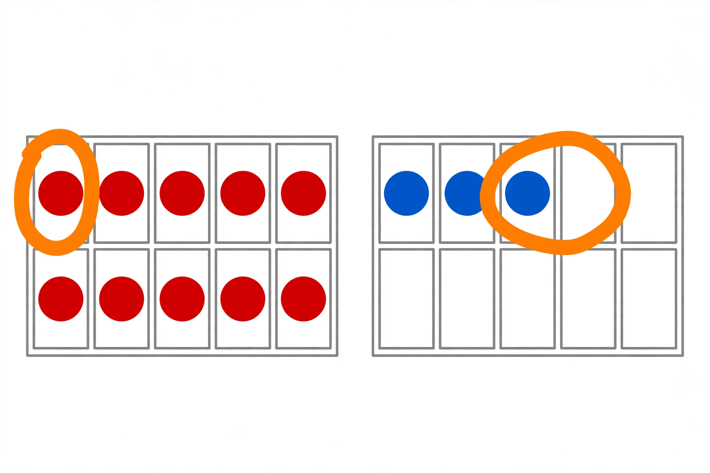

# Lesson 02 — Count Back, or Count Up?

**Student goal:** I can count back when the number taken away is small,
and count up when the two numbers are close — and I can say why I chose
the one I did.
**Time:** 20–25 minutes · **Unit:** [U03](../README.md) · **Session 5 of 16**

## Materials

- A number line to 20 (print or draw), 20 counters, two ten frames
- The generated illustration
  [`assets/count-back-ten-frames.png`](../assets/count-back-ten-frames.png)

## Readiness check (2 minutes)

"Count back from 12 by 3 hops." (Expected: "11, 10, 9.") Then "count up
from 11 to 14." (Expected: "12, 13, 14 — 3 hops.") Backward counting must
not include the start number — that off-by-one slip is today's trap.

## Teaching

Yesterday's flipped question is powerful, but it is not always the
fastest tool. Two counting moves cover the rest:

- **Count back** when the number taken away is *small*: start at the big
  number and step backward that many hops. 12 − 3: "11, 10, 9."
- **Count up** when the two numbers are *close together*: start at the
  smaller number and step forward to the bigger one; the hops are the
  answer. 14 − 12: "13, 14" — 2 hops, so the difference is 2.

> "Look at the size of the hop-count before you choose. Taking away 2 or
> 3? Count back — it's short. Numbers like 14 and 12, nearly neighbors?
> Count up — it's shorter than counting back 12 hops."

**Key vocabulary:** *count back* (step backward on the number line),
*count up* (step forward to the bigger number), *difference* (how far
apart the numbers are, or how many are left).

*Caption:* An AI-generated picture of two ten frames. Left: 10 red dots.
Right: 3 blue dots. Two dots have orange loops around them — one red, one
blue. How many dots are left if the looped dots are taken away?

*Text-only alternative (carries every count the activities need):* The
picture shows 10 red dots in the left ten frame and 3 blue dots in the
right ten frame — 13 dots in all. Two dots are looped in orange: one red
dot and one blue dot. Taking those 2 away leaves 11 dots: 13 − 2 = 11.

## Worked example 1 — 12 − 3 by counting back

The adult stands a counter on 12 on the number line.

> "Take away 3 — that's small, so count back. Hop: 11 (one), 10 (two),
> 9 (three). Land on **9**. So 12 − 3 = 9."

**Reasoning to name aloud:** the start number 12 is where we stand, not a
hop. Three hops back from 12 land on 9. Check by counting up: 9 + 3 = 12. ✓

## Worked example 2 — 14 − 12 by counting up

> "Take away 12 — that's big, so counting back would take forever. But
> 12 and 14 are close: count up from 12: 13 (one), 14 (two). Two hops, so
> 14 − 12 = **2.** The difference is only 2."

**Reasoning to name aloud:** counting up answers "how far apart?" When
numbers are neighbors, the gap is small — count the gap, not the whole
journey back.

## Guided practice (adult stays close, hints allowed)

Do 4–6 short rounds.

1. 15 − 2, count back: "14, 13." (Expected: 13.)
2. 11 − 9, count up: "10, 11" — 2 hops. (Expected: 2. Counting back 9
   hops would work but is much longer.)
3. 16 − 3, count back: "15, 14, 13." (Expected: 13.)
4. Look at the generated picture: "How many dots in all? How many are
   looped? Take the looped dots away — how many are left?"
   (Expected: 13 dots; 2 looped; 13 − 2 = 11 left.)
5. Error analysis: the adult solves 13 − 3 by counting "13, 12, 11" and
   announces 11. Ask: "Did I count right?" (Expected: no — 13 is the
   start, not a hop. The hops are 12, 11, 10, so 13 − 3 = 10.)
6. The learner solves two alone: 17 − 2 by counting back ("16, 15" → 15)
   and 18 − 16 by counting up ("17, 18" — 2 hops → 2), and says which
   move they chose and why.

## Independent practice

The learner gets 14 − 3 (count back: 13, 12, 11 → 11) and 15 − 13 (count
up: 14, 15 — 2 hops → 2). They say each hop aloud and name the strategy
before starting. The adult observes silently: do they choose the shorter
move, and do they skip the start number?

*Alternate response mode:* hop a toy car along a table number line
instead of saying hops; adult scribes the equations.

## Application

Snack count: "You have 19 grapes. You eat 2. How many are left?" (Count
back: 18, 17 → 17.) Then: "Your friend has 12 marbles and you have 10.
How many more does your friend have?" (Count up from 10: 11, 12 — 2 hops
→ 2 more. This is the same subtraction as 12 − 10 = 2, read as a
difference.)

## Exit check

"16 − 14. Which move, and what is the answer?" Expected: "Count up — the
numbers are close. 15, 16 — 2 hops, so 16 − 14 = 2." Record: secure /
developing / not yet.

## Supports

- **Language access:** "count back" is shown by walking backward on a
  floor number line before it is ever written. "Difference" is introduced
  as "how far apart" with two standing positions.
- **Alternate response mode:** point to hop numbers on the number line
  instead of saying them; use fingers to track hop counts.
- **Floor-play variant:** the learner stands on the start number and
  hops backward, or stands on the smaller number and hops forward to the
  bigger one.

## Extension

Solve 20 − 18 two ways (count up: 19, 20 → 2; count back would need 18
hops — explain why nobody should). Or: invent a pair of numbers where
counting back is the better move and a pair where counting up wins, and
defend both choices.

## Teacher note

**Likely misconceptions:** (1) counting the start number as a hop
(off-by-one, both directions); (2) always counting back, even for
19 − 17 — praise the "shorter move" choice explicitly; (3) reading
14 − 12 as "take 14 away from 12" — re-anchor: subtraction starts at the
bigger number.

**Answer-key reference:** [answer-key.md](../answer-key.md#lesson-02) has
the expected responses for the guided rounds (including the picture
study) and exit check.
