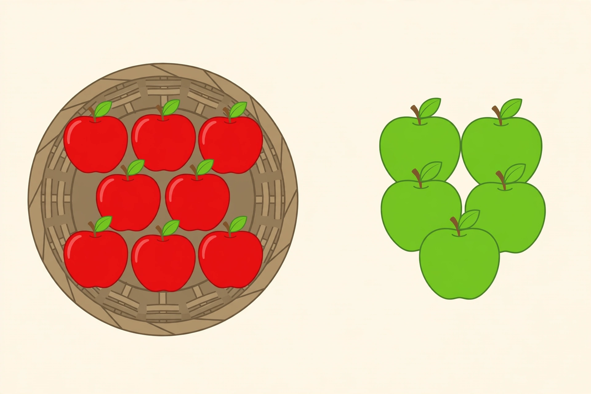

# Lesson 03 — Putting Together, Taking Apart, and Comparing

**Student goal:** I can solve stories where nothing joins or leaves —
stories about parts of a whole, and stories about how two groups
compare.
**Time:** 20–25 minutes · **Unit:** [U04](../README.md) · **Session 9 of 16**

## Materials

- 20 counters in two colors, a ten frame, a number line to 20
- The generated illustration
  [`assets/apple-basket-story.png`](../assets/apple-basket-story.png)

## Readiness check (2 minutes)

"13 − 8, by back-to-ten." The learner: 13 − 3 = 10, − 5 = 5.
"8 + 5, by make-ten." The learner: 8 + 2 = 10, + 3 = 13.
Both answers appear in today's picture activity — the learner will
meet them again as story answers, not bare facts.

## Teaching

Not every story has an action. Some stories describe a **whole and its
parts**: "9 pencils and 6 crayons" are two parts of one desk set. Some
stories **compare** two groups that never touch: "Ben has 13 cars, Ana
has 8" — nobody gives anything away, yet the question "how many more?"
still wants subtraction. The counters still decide: build both groups,
match them up, and see what is left over.

> "Put-together: 'There are 9 pencils and 6 crayons on a desk. How
> many things are on the desk in all?' No action — just two parts.
> 9 + 6 = **15.** Take-apart: 'There are 16 blocks. 9 are red. The rest
> are blue. How many blue blocks?' The whole is 16, one part is 9, so
> the other part is 16 − 9 = **7.** Compare: 'Ben has 13 cars. Ana has
> 8 cars. How many more cars does Ben have?' Match them: 8 pairs, and
> 5 cars left over. 13 − 8 = **5.**"

**Key vocabulary:** *put together* (two parts make a whole),
*take apart* (a whole split into parts), *compare* (match two groups),
*how many more*, *how many fewer*, *the rest*.

**Why "more" does not always mean add (say it aloud):** "Ben has 5
more than Ana" can be an addition story (Ana has 8, so Ben has 8 + 5 =
13) or a subtraction story (Ben has 13 and has 5 more than Ana, so Ana
has 13 − 5 = 8). The same words, two different unknowns. Matching
counters — not key words — tells you which one you have.

## Worked example 1 — Put-together, total unknown: 9 + 6 = 15

> "There are 9 pencils and 6 crayons on a desk. How many things are on
> the desk in all? Build 9 red counters and 6 blue counters. Push them
> together and count: 15. Equation: 9 + 6 = **15.** Check by make-ten:
> 9 + 1 = 10, + 5 = 15."

**Reasoning to name aloud:** nothing joined and nothing left — the
story just describes parts. Parts + parts = whole, so we add.

## Worked example 2 — Compare, difference unknown: 13 − 8 = 5

> "Ben has 13 cars. Ana has 8 cars. How many more cars does Ben have
> than Ana? Build 13 red counters and 8 blue counters in two rows.
> Match them one to one: 8 pairs. Count the red counters with no
> partner: 5. Equation: 13 − 8 = **5.** Check by counting up from 8:
> 9, 10, 11, 12, 13 — five hops."

**Reasoning to name aloud:** matching is subtraction you can see.
The leftover row is the difference, and the difference is the answer
to "how many more."

## Picture activity — Apples in a basket (generated illustration)

Look at the picture together:

*Caption: A basket of 8 red apples and a pile of 5 green apples —
count each group, then answer the three questions.*

*Text-only alternative: There are 8 red apples in a woven basket on
the left, and 5 green apples in a pile on the right. No apples are
hidden. Use these counts for all three questions.*

1. Put-together: "How many apples are there in all?"
   (Expected: 8 + 5 = 13.)
2. Compare: "How many more red apples are there than green apples?"
   (Expected: 8 − 5 = 3.)
3. Take-apart: "There are 13 apples. 8 are red. The rest are green.
   How many green apples are there?"
   (Expected: 13 − 8 = 5 — and it matches the picture, which is the
   check.)

## Guided practice (adult stays close, hints allowed)

Do 4–6 short rounds. For each, name the story type before solving.

1. Take-apart, addend unknown: "There are 16 blocks. 9 are red. The
   rest are blue. How many blue blocks are there?"
   (Expected: 16 − 9 = 7.)
2. Compare, bigger unknown: "Ana has 8 cars. Ben has 5 more cars than
   Ana. How many cars does Ben have?"
   (Expected: 8 + 5 = 13 — here "more" means add, because Ben's
   number is the unknown and it is the bigger one.)
3. Compare, smaller unknown: "Ben has 13 cars. He has 5 more cars than
   Ana. How many cars does Ana have?"
   (Expected: 13 − 5 = 8 — here "more" means subtract, because Ana's
   number is the unknown and it is the smaller one. Same words as
   round 2, different story.)
4. Take-apart, both addends unknown: "There are 14 pieces of fruit.
   Some are apples and the rest are bananas. Name two ways the 14
   could split." (Expected: any two pairs summing to 14, e.g. 7 + 7
   and 9 + 5, or 10 + 4 — the story does not pick one, and that is
   correct.)
5. Error analysis: the adult solves "Mia has 12 ribbons. Jon has 7.
   How many more ribbons does Mia have?" as 12 + 7 = 19. Ask: "Does
   matching agree?" (Expected: no — match 7 pairs and 5 ribbons are
   left over, so 12 − 7 = 5. Adding counts Jon's ribbons twice: once
   inside Mia's 12 as matches, once on their own.)
6. The learner models "Sara read 15 pages. Leo read 9 pages. How many
   more pages did Sara read?" alone with counters while the adult
   watches. (Expected: compare; 15 − 9 = 6.)

## Independent practice

The learner gets two fresh stories, names the type, and solves. The
adult observes silently: do they match counters for the compare story
instead of grabbing the numbers?

1. "A box has 17 crayons. 10 are blue. The rest are red. How many red
   crayons are in the box?" (Expected: take-apart; 17 − 10 = 7.)
2. "Zoe has 6 dolls. Mia has 11 dolls. How many fewer dolls does Zoe
   have than Mia?" (Expected: compare; 11 − 6 = 5.)

*Alternate response mode:* draw two rows and cross out matches
instead of moving counters; adult scribes the equations.

## Application

The picture activity above is this lesson's application: three
questions, one picture, three story types. A learner who answers all
three has used the same 8 and 5 as a total, a difference, and a missing
part — the whole point of the lesson.

## Exit check

"Tom has 18 marbles. Sam has 11 marbles. How many more marbles does
Tom have than Sam? Match them, then tell me the equation." Expected:
"Match 11 pairs, 7 left over — 18 − 11 = 7." Record: secure /
developing / not yet.

## Supports

- **Language access:** "how many more" and "how many fewer" are
  taught as matching questions: build both rows, match, count the
  leftover. Never as "more means add."
- **Alternate response mode:** two ten frames side by side — fill
  one per group, then compare full and empty spaces.
- **Floor-play variant:** two rows of floor counters; the learner
  walks the rows pairing them off and stands on the leftover row.

## Extension

A compare story with a start-unknown twist: "Mia has 4 more ribbons
than Jon. Jon has 9 ribbons. Mia gave 3 ribbons away. How many does
Mia have now?" (Expected: Mia starts with 9 + 4 = 13, then 13 − 3 =
10.) Or: invent a compare story where the answer is 0 and defend it
("both have 12").

## Teacher note

**Likely misconceptions:** (1) adding in every compare story because
of the word "more"; (2) in bigger/smaller-unknown stories, solving
for the wrong person — always ask "whose number are we finding, and
is it the bigger or the smaller one?"; (3) treating take-apart
addend-unknown as result-unknown addition (16 blocks, 9 red → the
answer is not 16 + 9; the 9 is already inside the 16).

**Answer-key reference:** [answer-key.md](../answer-key.md#lesson-03) has
the expected responses for the picture activity, guided rounds, and
exit check.
