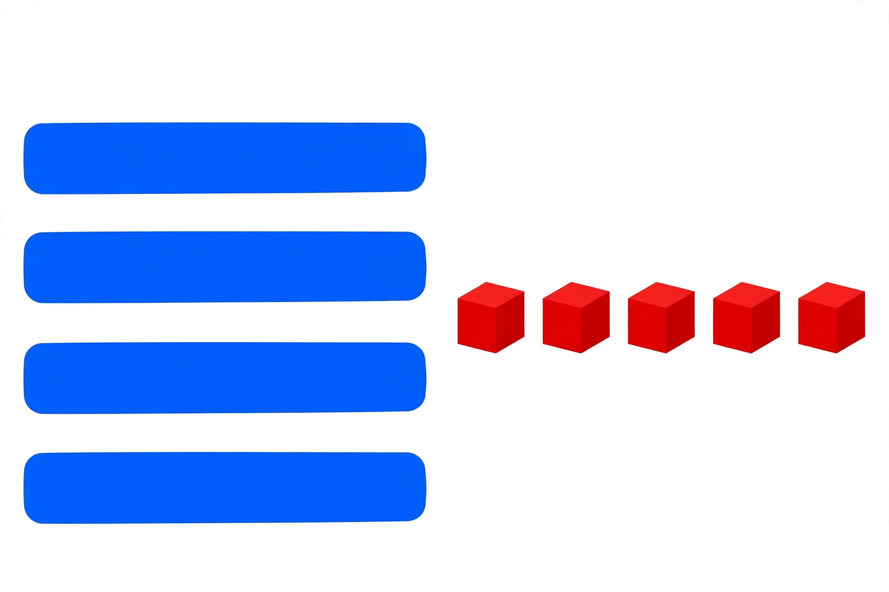

# Lesson 01 — Adding Ones, No New Ten

**Student goal:** I can add a few ones to a two-digit number when the
ones do not reach ten: the tens stay the same, only the ones change.
**Time:** 20–25 minutes · **Unit:** [U05](../README.md) · **Session 1 of 16**

## Materials

- Tens rods (or bundled straws) and ones cubes (or small counters)
- The generated illustration
  [`assets/tens-and-ones-blocks.png`](../assets/tens-and-ones-blocks.png)

## Readiness check (2 minutes)

"34 is how many tens and how many ones?" The learner builds 3 tens
rods and 4 ones cubes and says "3 tens and 4 ones." Then: "4 ones plus
2 ones?" — "6 ones." If the tens/ones split is shaky, re-run Unit 01's
build-a-number trays before continuing.

## Teaching

A two-digit number is really two piles: a tens pile and a ones pile.
When we add only a few ones, we touch **only the ones pile**. The tens
pile does not move, so the tens digit does not change.

> "Here is 34: 3 tens rods and 4 ones cubes. Add 2 ones. The ones pile
> grows: 4 ones and 2 more ones is 6 ones. The tens pile is untouched:
> still 3 tens. So 34 + 2 = **36** — 3 tens and 6 ones."

**Key vocabulary:** *tens*, *ones*, *tens rod*, *ones cube*. Say the
sentence every time: "Tens stay the same, ones change."

## Worked example 1 — 34 + 2 with rods and cubes

The adult builds 34, then slides 2 ones cubes beside the ones pile.

> "Count the ones first: 4 ones, plus 2 ones, is 6 ones. Count the
> tens: still 3 tens. Tens and ones together: 3 tens and 6 ones is 36.
> So 34 + 2 = **36**."

**Reasoning to name aloud:** we did not recount the tens. Adding ones
never touches the tens pile — unless the ones reach ten, which is
tomorrow's lesson.

## Worked example 2 — 46 + 3, and the zero-ones case 50 + 4

> "46 is 4 tens and 6 ones. Add 3 ones: 6 ones + 3 ones = 9 ones. Tens
> unchanged: 4 tens. So 46 + 3 = **49**."
>
> "50 is 5 tens and 0 ones. Add 4 ones: 0 ones + 4 ones = 4 ones. Tens
> unchanged: 5 tens. So 50 + 4 = **54**. Zero ones is a real pile —
> an empty ones pile that we can add to."

## Picture study — the generated illustration

Look at
[`assets/tens-and-ones-blocks.png`](../assets/tens-and-ones-blocks.png)
together.

*Caption: An AI-generated picture of tens and ones blocks. Four blue
bars stand for four tens; five red cubes stand for five ones. What
number is shown, and what happens when 3 more ones are added?*

**Text-only alternative:** "The picture shows 4 long blue bars and 5
small red cubes. Each blue bar stands for one ten and each red cube
stands for one one. That is 4 tens and 5 ones, which is 45."

Ask: "How many tens? How many ones? What number is it? Now add 3 ones
— what changes?" (Expected: 4 tens, 5 ones, 45; adding 3 ones makes
8 ones, tens unchanged, so 45 + 3 = **48**. No new ten is made,
because 5 + 3 = 8, which is less than 10.)

## Guided practice (adult stays close, hints allowed)

Do 4–6 short rounds, with rods and cubes on the table.

1. 25 + 3: 5 ones + 3 ones = 8 ones; 2 tens unchanged. (Expected: 28.)
2. 61 + 7: 1 one + 7 ones = 8 ones; 6 tens unchanged. (Expected: 68.)
3. 40 + 6: 0 ones + 6 ones = 6 ones; 4 tens unchanged. (Expected: 46.)
4. 73 + 5: 3 ones + 5 ones = 8 ones; 7 tens unchanged. (Expected: 78.)
5. Error analysis: the adult solves 38 + 1 by saying "add 1 to the
   tens: 3 tens + 1 ten = 4 tens, so 48." Ask: "Did I add to the right
   pile?" (Expected: no — the 1 is ones, not tens. 8 ones + 1 one =
   9 ones, tens unchanged, so 38 + 1 = **39**. Adding to the wrong
   pile is today's classic slip.)
6. The learner models 52 + 4 alone: 2 ones + 4 ones = 6 ones, 5 tens
   unchanged. (Expected: 56.)

## Independent practice

The learner gets 27 + 2 and 64 + 5, with rods and cubes available.
They say the tens/ones sentence before writing each answer. The adult
observes silently: do they add only to the ones pile?

*Alternate response mode:* point to the ones pile and say the new ones
count; adult scribes the equations.

## Application

Sticker sheet: "Mia has 43 stickers. Her friend gives her 5 more. How
many stickers does Mia have now?" The learner builds 43, adds 5 ones:
3 ones + 5 ones = 8 ones, 4 tens unchanged. (Expected: 48 stickers;
43 + 5 = 48.)

## Exit check

"56 + 3. Tens stay the same, ones change — what is it?" Expected:
"6 ones + 3 ones = 9 ones, 5 tens unchanged, so 56 + 3 = **59**."
Record: secure / developing / not yet.

## Supports

- **Language access:** teach "tens stay the same, ones change" by
  acting it out first, then naming the piles *tens* and *ones*.
- **Alternate response mode:** cover the tens pile with a cloth while
  adding ones, then uncover it to prove it never moved.
- **Floor-play variant:** a floor tens/ones mat; the learner stands
  beside the ones pile and adds cubes there only.

## Extension

Add ones to a number just below a decade boundary without crossing it
(for example 29 + 0 = 29, and predict what 29 + 1 would do — it makes
a new ten, which is Lesson 02's job). Or: invent a problem where the
ones pile ends exactly on 9, and prove the tens never moved.

## Teacher note

**Likely misconceptions:** (1) adding the ones number to the tens
digit (38 + 1 = 48); (2) recounting everything from one instead of
trusting the piles; (3) treating 50 + 4 as "54? or 504?" — the empty
ones pile confuses learners, so name zero ones explicitly. **Answer-key
reference:** [answer-key.md](../answer-key.md#lesson-01).
