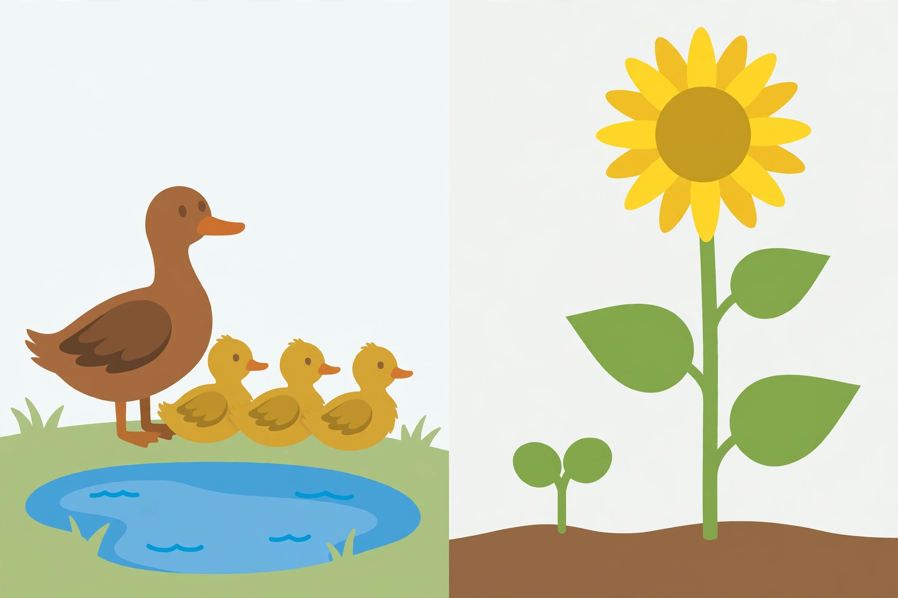

# Practice, Observation, Game, and Review Sessions — Unit 05

Named sessions from the [unit pacing](README.md#16-session-pacing).
The adult reads every prompt aloud; oral, pointing, drawing, or
adult-scribed responses count. Solutions are in
[answer-key.md](answer-key.md) only — never beside a student question.

## Session 2 — Practice: Baby–adult matching game (animals)

**Goal:** match 6 animal pairs and give a reason for at least 4 matches.

1. Lay out the parent cards in a row: mother dog, mother cat, mother
   duck, hen, cow, mother elephant (use the cards you have; 6 pairs
   is the target, 4 is the minimum if cards are short).
2. Shuffle the baby cards: puppy, kitten, duckling, chick, calf,
   elephant calf. The learner places each baby under its parent.
3. For each pair, the adult asks: "What is alike? What is different?"
   The learner answers for at least 4 pairs; the adult scribes one
   alike trait and one difference per pair in the journal.
4. Error round: the adult deliberately swaps two babies (for example,
   the chick under the mother duck). "Is this right? How do you know?"
   The learner must catch the swap by body parts, not by color.
5. Speed-free finish: there is no timer. The game ends when all pairs
   are matched and checked, or when the session time ends — unfinished
   pairs carry to Session 4's review, not to homework pressure.

*Alternate mode:* the learner points instead of placing cards; the
adult moves them. *Floor variant:* parents in a row on the floor, the
learner walks each baby to its parent.

## Session 3 — Observation: Bean-in-a-bag setup

**Goal:** plant 2–3 bean seeds in a damp bag, predict "root first, then
shoot," and record the prediction by drawing.

1. The adult soaks 2–3 dry bean seeds briefly and places each between a
   damp paper towel and the side of a clear bag or cup, where it can be
   seen. The learner watches; the adult handles the seeds.
2. The adult asks: "What will happen first — a root growing down, or a
   shoot growing up?" The learner predicts (the expected pattern is
   root first, then shoot; any prediction is accepted and recorded,
   because the check — not the guess — is the science).
3. The learner draws the bag as it looks today (seeds, damp towel) and
   draws what they predict for next time (a root, or a shoot). The
   adult labels both drawings from dictation.
4. The bag goes on a sunny windowsill. The adult notes the date in the
   journal. The learner waters nothing — the towel stays damp, and the
   adult re-damps it if it dries.
5. Honest-wait note: if nothing sprouts by Session 6, the lesson uses
   the picture seedling and the wait itself becomes evidence: "Plants
   take their time. Our prediction is still open."

*Safety:* seeds are adult-handled; nothing goes near the mouth; hands
washed after. *Alternative:* a learner who cannot handle seeds watches
the adult set up the bag and draws from observation only.

## Session 4 — Review: Like / different chart + Unit 04 retrieval

**Goal:** sort 8 trait cards into "alike" and "different" and name one
plant part and one animal part from Unit 04.

1. Trait cards (adult-read): "both have fur," "puppy is smaller,"
   "both have a flat beak," "duckling is yellower," "both have four
   legs," "chick is fluffier," "both have feathers," "hen is bigger."
   The learner sorts each card under "Alike" or "Different." (Sorting
   by the card's meaning, not by reading it, is fine — the adult reads
   each card aloud.)
2. Unit 04 retrieval: "Name one plant part from last unit and what it
   does." *(For example: roots drink water and hold the plant steady.)*
   "Name one animal part and what it does." *(For example: a beak
   helps a bird eat; webbed feet help a duck swim.)*
3. Chart check: the learner re-reads (with the adult) the Lesson 01
   chart and fixes any card placed in the wrong column, with a reason.
4. Journal check: the adult reviews the Lesson 01 drawing the same day
   (or now, if not yet reviewed) and notes: size difference shown?
   Alike/different labels present?

## Session 6 — Observation: Seedling check + picture investigation

**Goal:** measure/draw the bean seedling (or the picture seedling if the
bag has not sprouted) and answer 5 questions from the generated
illustration or its text alternative.

**Part A — Seedling check (10 minutes).**

1. Look at the bean bag together. "What do you see today — a root, a
   shoot, leaves, or nothing yet?" Record the true observation by
   drawing.
2. If a shoot is up, measure it in finger-widths with the paper strip
   and record the number. If nothing has sprouted, record "not yet"
   and the date — that is a real observation, not a failure.
3. Compare with the Session 3 prediction: "Did the root come first?"
   (If the root is visible through the bag: yes. If not visible yet:
   "We cannot tell yet — the prediction stays open.")

**Part B — Picture investigation (10 minutes).** Use the generated
illustration
[`assets/parent-offspring-families.png`](assets/parent-offspring-families.png)
or its text alternative in [assets/README.md](assets/README.md).

*Caption: Two families, side by side. Left: a mother duck and her
ducklings by a pond. Right: a grown sunflower and its seedling. This is
an AI-generated illustration, not a photograph.*

Answer by looking, pointing, or from the text alternative:

1. "How many ducklings are with the mother duck?" *(Three.)*
2. "What is alike about the mother duck and her ducklings?" *(They
   have the same body shape, a flat beak, and feathers — accept any one.)*
3. "What is different about them?" *(The mother is bigger and brown;
   the ducklings are smaller and yellow — accept any one.)*
4. "What is alike about the grown sunflower and its seedling?" *(They
   both have a green stem and green leaves — accept either.)*
5. "What is different about them?" *(The grown sunflower is much
   taller and has a big yellow flower; the seedling is tiny with two
   small round leaves and no flower — accept any one.)*

## Session 7 — Practice: Whose baby is it? (mixed sort)

**Goal:** sort 8 mixed baby cards to the right adult (animal or plant)
and explain 2 matches with evidence.

1. Baby cards: puppy, kitten, duckling, chick, calf, bean seedling,
   sunflower seedling, and one repeat baby (a second puppy or duckling
   picture) — 8 cards.
2. Adult cards: mother dog, mother cat, mother duck, hen, cow, grown
   bean plant, grown sunflower — 7 cards (the repeat baby matches an
   adult already on the table).
3. The learner sorts each baby to its adult. For 2 matches of the
   learner's choice, the adult asks: "How do you know? What is alike?
   What is different?" and scribes the explanation sentence.
4. Plant check: for each seedling match, the adult asks: "Is the
   seedling the same kind of plant, or a different kind?" *(Same kind —
   it is young, not different.)*
5. Error round: the adult places the sunflower seedling under the bean
   plant. "Is this right?" *(No — the seedling's leaves and growth
   belong to a sunflower; the adult confirms with the picture cards.
   Accept any body-part or leaf-shape reason.)*

## Session 8 — Review: Journal check + seedling measure 2

**Goal:** record a second seedling measurement and state whether it
grew taller, with the numbers/drawings as evidence.

1. Measure the bean shoot again in finger-widths (or draw it at its new
   size if no ruler strip is to hand). Record the new number next to
   the Session 6 number.
2. "Did it grow taller, stay the same, or is it not up yet?" The
   learner answers from the two records, not from memory: "It was 2
   finger-widths, now it is 4, so it grew taller." If it has not
   sprouted, the answer is "not up yet — we keep watching."
3. Journal check: the adult reviews Lessons 01–02 drawings and the
   Session 3 prediction drawing, and notes which objectives are
   secure, developing, or not yet (see
   [teacher-guide.md](teacher-guide.md)).
4. Retrieval game: the adult names a behavior word (feed, warm,
   shelter, protect, guide) and the learner mimes or points to a card
   showing it — a preview of Lesson 03, kept light and quick.

## Session 10 — Practice: Behavior pattern sort

**Goal:** sort 6 behavior cards into feed / shelter-or-warm / protect /
guide and give the "helps the baby…" reason for each.

1. Behavior cards (adult-read, with pictures): (a) mother bird feeding
   chicks; (b) penguin parent keeping an egg warm; (c) mother duck
   leading ducklings to water; (d) mother cat in a den with kittens;
   (e) elephants surrounding a calf; (f) a chick cheeping with its
   beak open.
2. Sort bins: FEED, SHELTER-or-WARM, PROTECT, GUIDE. The learner sorts
   each card into a bin. Card (f) is the signal card: it belongs with
   FEED as the baby's call for food, or the adult accepts "signal"
   as its own answer — the point is that the baby's cheep starts the
   pattern, not that it fits one bin perfectly.
3. For each card, the adult asks: "What does this help the baby do?"
   and scribes the reason: feeding helps the chick grow; warming keeps
   the egg alive; guiding helps ducklings find water; the den keeps
   kittens safe; the herd protects the calf; cheeping tells the parent
   the baby needs help.
4. Pattern statement: together, the learner finishes the sentence:
   "Parents help babies survive by ___." (Any two behaviors count.)

## Session 12 — Project: Family album, Part 1

See [project.md](project.md). The learner chooses 4 album pairs and
draws the first 2 pairs with alike/different labels.

## Session 14 — Project: Family album, Part 2

See [project.md](project.md). The learner finishes all 4 album pages,
adds one "parent helps" note per page, and shares one page aloud (or by
pointing).

## Session 15 — Review: Matching fair + formative quiz

**Goal:** re-match the fair cards and complete the formative quiz.

1. Matching fair: all baby and parent cards from Sessions 2 and 7 are
   laid out as a fair. The learner re-matches every pair without help,
   then checks each pair with one alike trait and one difference for 3
   pairs of the adult's choice.
2. Behavior fair: the adult flashes the 6 behavior cards from Session
   10 one at a time; the learner names the behavior word and the help
   ("feeding — helps the chick grow") for at least 4 of 6.
3. Then the learner completes the
   [formative quiz](assessments/week-04_quiz.md) (oral/observed plus a
   4-item recording task). The adult records the score and the missed
   objectives for Session 16's re-teach time.
