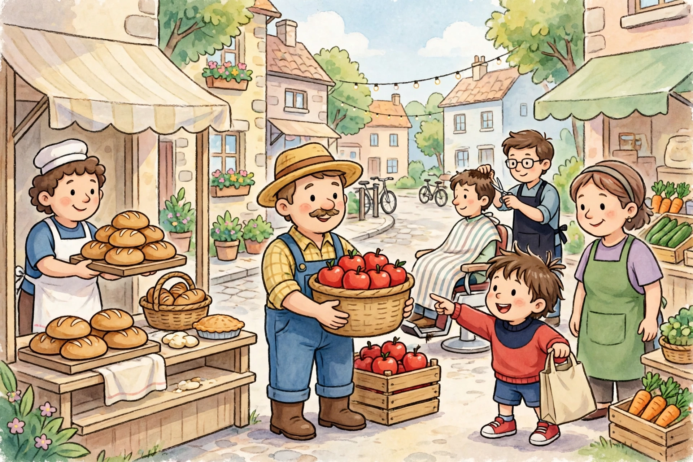

# Unit 05 — Practice Sessions

**Sessions 2, 4, 6, 8, 10 · about 15–20 minutes each · oral / pointing /
drawing; adult-scribed.** Each practice states its session, its materials,
and its success criterion. Solutions are in [answer-key.md](answer-key.md)
§Practice — **for the guiding adult only.**

## Practice A — Needs/wants sort (Session 2, Week 19)

**Materials:** the 6 Lesson 1 cards plus 6 new cards (a bed, a glass of
milk, a warm hat, a kite, a candy, a toy drum); *need* and *want* mats.

**Steps:**

1. The adult shuffles the 12 cards. The learner sorts them, one at a time,
   saying "must have it" or "would like it" for each.
2. The learner draws one need and one want of their own choosing in two
   boxes, and dictates one sentence for each ("Water is a need because
   ___." / "A kite is a want because ___."). The adult scribes.
3. The adult asks the trap question: "A second kite, exactly the same as
   the kite you have — need or want?" (Want — a second one is extra.)

**Success criterion:** at least 10 of 12 cards sorted correctly, with the
bed, milk, and warm hat on the *need* mat and the kite, candy, and toy
drum on the *want* mat.

## Practice B — Scarcity game: three apples, four friends (Session 4, Week 19)

**Materials:** 3 apple cards, 4 place mats, one swing picture card, two
choice cards (sticker sheet, balloon).

**Steps:**

1. The adult lays out 3 apple cards and 4 mats. "Four friends, three
   apples. Count with me: are there enough apples for everyone to have a
   whole apple?" (No — scarcity.)
2. The learner picks a fair plan — share (cut one apple), take turns
   (three eat today, one eats first tomorrow), or wait — and acts it out
   with the cards, naming what is given up.
3. The swing round: one swing card, four mats. The learner assigns turn
   order (first, second, third, fourth) and says what the fourth friend
   gives up while waiting (swinging now).
4. The two-want round: sticker sheet or balloon. The learner chooses one
   and completes the frame: "I choose ___; I give up ___."

**Success criterion:** the learner names scarcity ("not enough for
everyone"), picks a fair plan for the apples and the swing, and names a
give-up for the two-want choice.

## Practice C — Two-choice boards and earn–spend–save jars (Session 6, Week 20)

**Materials:** Lesson 3's two choice boards; 6 play tokens; 3 jars
labeled with pictures: *earn*, *spend*, *save*; read-aloud A below.

**Steps:**

1. The adult reads read-aloud A, "Maya and the Three Jars," aloud, pausing
   after Maya's choice. The learner answers: "What did Maya save for? What
   did she give up today?" (She is saving toward the big puzzle; she gave
   up getting the puzzle today.)
2. Choice board 1 (spend now or save): the learner places a benefit card
   and a cost card for each side, then chooses a side and says why.
3. Choice board 2 (share or keep crayons): same — benefit card, cost card,
   choice, reason.
4. Jar sort: the learner is given 6 tokens "earned" for sorting apple
   cards. The learner puts 2 tokens in *spend* (a paper apple), 3 in
   *save* (a bigger project later), and 1 in the share cup, dictating one
   reason per jar. The adult scribes the three reasons.

**Success criterion:** a benefit and a cost for both choice boards, and a
jar sort with a reason for each jar (saved tokens described as "kept for
later," not lost).

## Practice D — Market-picture activity (Session 8, Week 20)

**Materials:** the unit illustration
[willow-street-market.png](assets/willow-street-market.png) (or its
text-only alternative below); Lesson 4's 6 producer cards; *good* and
*service* mats.

**Say this out loud first:** "This picture is a drawing someone made up
to help us practice. It is not a photograph of real people, and Willow
Street is a pretend town."

*Caption: The Willow Street market — a baker with bread, a farmer with
apples, a barber giving a haircut, a child choosing apples, and a
shopkeeper with vegetables. A practice illustration, not a photograph.*

**Questions (adult reads aloud; learner answers by pointing and speaking):**

1. "Point to the baker. What does the baker make — a good or a service?
   How do you know?" (Bread — a good; you can hold it.)
2. "Point to the farmer. What does the farmer grow — a good or a
   service?" (Apples — a good; you can hold one.)
3. "Point to the barber. What is the barber doing — a good or a service?
   How do you know?" (A haircut — a service; help someone does, not a
   thing you can hold.)
4. "Point to the child with the shopping bag. Is the child a producer or
   a consumer right now? Why?" (A consumer — the child is choosing
   apples to use.)
5. "Point to the shopkeeper with the vegetables. Producer or consumer?
   What good is on the stall?" (Producer — selling carrots, cucumbers,
   and greens, all goods.)
6. "Name one more producer in the picture and one good or service they
   make or do." (Any of: baker/bread, farmer/apples, barber/haircut,
   shopkeeper/vegetables.)

**Then:** the learner sorts the 6 Lesson 4 producer cards onto the *good*
and *service* mats (goods: baker, farmer, carpenter; services: barber,
teacher, bus driver).

**Text-only alternative (same six questions, no picture needed):** "On
Willow Street market day, the baker holds a tray of bread loaves; the
farmer holds a basket of red apples; the barber trims a seated customer's
hair; a child with a cloth shopping bag points at the apples; and a
shopkeeper stands beside crates of carrots, cucumbers, and greens." Every
question above is answerable from this paragraph.

**Success criterion:** the learner names 4 people in the picture (or the
paragraph) and gives a good/service verdict for 3 of them, plus a correct
6-card sort.

## Practice E — Journey strips (Session 10, Week 21)

**Materials:** Unit 03 timeline strips; apple journey cards (orchard,
truck, market stall, child eating); bread journey cards (wheat field,
baker baking, shop stall, family eating); read-aloud B below.

**Steps:**

1. The adult reads read-aloud B, "The Apple That Traveled," aloud. The
   learner answers: "Where did the apple start? What moved it? Who ate it
   at the end?" (An orchard; a truck; Maya.)
2. The learner orders the 4 apple journey cards on a timeline strip and
   names one producer (the farmer) and one consumer (Maya).
3. The learner orders the 4 bread journey cards and names one producer
   (the baker, or the wheat farmer) and one consumer (the family).
4. The adult swaps two cards in the apple strip (market stall before the
   truck). "Does this order work? Why not?" (No — the apple must arrive
   in town before it can be sold.)

**Success criterion:** both journeys in order, a producer and a consumer
named for each, and the swapped-order error caught with a reason.

## Read-aloud A — Maya and the Three Jars (original story, for Practice C)

*Adult reads aloud. About 3 minutes. No family roles are named; Maya is a
child on Willow Street, and the market stall is the class's pretend
market.*

Maya helped sort apples at the market stall all morning. Sorting, stacking,
counting — one, two, three, four. At the end of the morning, the
shopkeeper gave Maya six shiny play tokens for her work. Six! Maya held
them tight.

At the next stall, Maya saw sticker sheets. Oh, stickers! She could spend
three tokens right now and stick stickers all afternoon. But at the last
stall, Maya saw a big puzzle — a puzzle with a hundred pieces, of the
whole Willow Street market. The puzzle needed six tokens.

Maya thought. If I spend three tokens on stickers, I will have three
tokens left. Three is not six. The puzzle will have to wait. If I save all
six tokens, I can get the puzzle today — but no stickers today.

Maya put three tokens in her save jar. She put two tokens in her spend
jar, for a small pack of stickers. And she put one token in a little cup
for sharing, for a friend who had no tokens at all.

"I chose stickers *and* saving," Maya said. "I gave up the big puzzle
today. But my save jar is growing. Next market day, the puzzle will be
mine."

*Response questions:* (1) "What did Maya earn her tokens for?" (Sorting
apples.) (2) "What did she save for?" (The big puzzle, later.) (3) "What
did she give up today?" (The puzzle today, and most of her tokens for
stickers.) (4) "Are her saved tokens lost?" (No — they are in the save
jar, waiting.)

## Read-aloud B — The Apple That Traveled (original story, for Practice E)

*Adult reads aloud. About 3 minutes.*

Once, on a tree in an orchard outside Willow Street, a red apple grew.
Sun warmed it. Rain watered it. The farmer picked it — pluck! — and put
it gently in a basket with its brother and sister apples.

Then came the truck. Vroom, vroom, down the long road to town. The apples
bumped and jostled, but they did not bruise. At the market, the shopkeeper
lifted the basket onto the stall. "Fresh apples!" called the shopkeeper.
"Red and sweet!"

Maya came to the market with a cloth shopping bag. She pointed at the red
apples. She chose one — the roundest, reddest apple in the basket. She
carried it home, washed it, and — crunch! — ate it.

The apple's journey was: grown on a tree, moved by a truck, sold at the
market, eaten by Maya. The farmer grew it. The truck moved it. The
shopkeeper sold it. Maya used it. And Maya, who ate the apple, was the
consumer at the end of the journey.

*Response questions:* (1) "Where did the apple start?" (On a tree in an
orchard.) (2) "What moved it to town?" (A truck.) (3) "Who sold it?"
(The shopkeeper.) (4) "Who was the consumer, and how do you know?"
(Maya — she used the apple by eating it.)
