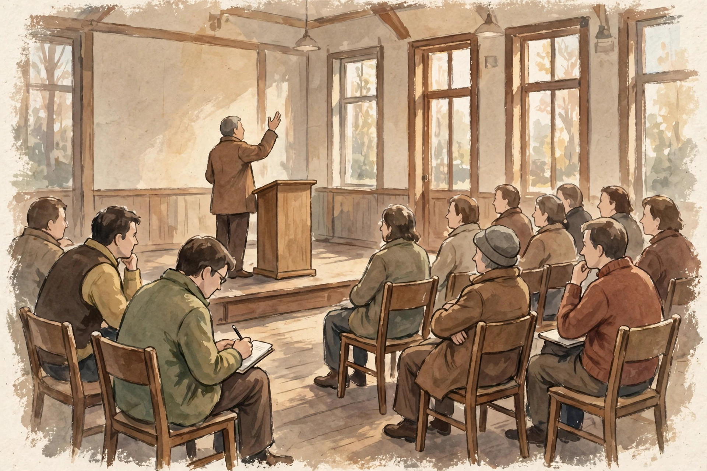

# Lesson 06 — Accounts in Different Mediums, and Evaluating a Speaker

**Goal:** By the end of this lesson you can compare accounts of one
subject in different mediums, integrate information across them, evaluate
each source's credibility and accuracy, and evaluate a speaker's point of
view, reasoning, and use of evidence and rhetoric.

**Time:** ~50 minutes. **Materials:** all four unit texts, the generated
illustration ([`town-hall-speaker.png`](../assets/town-hall-speaker.png)),
Practice Set F, a notebook.

## Readiness check (5 minutes)

1. One subject, four accounts: an editorial, a counter-editorial, a
   speech, and a data table. Which account would you trust most for the
   question "Did evening use grow during the trial?" Which for "Should
   the trial continue?" Why are those different questions?
2. A speaker's *tone of voice* can carry meaning that a transcript
   loses. What does a listener gain that a reader does not — and what
   does a listener lose?

## Teaching

### Medium is part of the message

The same subject looks different in different mediums, and each medium
hides something:

| Account | What it shows well | What it hides |
|---|---|---|
| Editorial ("Keep the Doors Open") | A full argument with reasons, objections, and a principle | Whether its examples are typical; the author's evidence is chosen, not complete |
| Counter-editorial ("The Library Can Wait") | The opposition's strongest worries, stated plainly | Its weak inferences (Lesson 04); it offers no data of its own |
| Speech (Delgado) | Purpose, emphasis, and audience relationship — what the speaker wants *you* to feel and do | Checkability: spoken claims pass quickly, and applause is not evidence |
| Data table (practice data) | Counts over time, comparable month to month | Who the visitors were, why they came, and what anything cost |

The integration rule: **no single account answers the whole question.**
The data table answers "did use grow?" (yes, from 412 to 655 evening
visitors). The editorials answer "what should we value?" The speech
answers "what does this mean to the people in the room?" A good
evaluation says which account it is using for which question, and does
not let one account smuggle answers to questions it cannot answer.

### Evaluating a speaker (SL.9-10.3)

Listen (or read aloud) to the speech as a *performance*, not just a
text. Evaluate four things:

1. **Point of view:** whose interests does the speaker represent, and
   whose does she leave out? (Delgado speaks as a lifelong resident and
   council member; she never addresses the librarians' working
   conditions — a gap worth naming.)
2. **Reasoning:** does each reason support its claim? (The community
   center log supports "evening hours need not bring trouble"; it does
   not prove the library will be safe — different building, different
   crowd.)
3. **Evidence:** is it checkable, relevant, and sufficient? (The sign-up
   sheet is real within the fiction but small; the cost comparison is
   vivid but not a budget.)
4. **Rhetoric:** does the persuasion help or replace the reasoning?
   (The closing repetition is powerful rhetoric attached to a real
   argument — it amplifies rather than substitutes. Contrast a purely
   emotional close with no argument behind it.)

### The image activity

*Caption: AI-generated illustration of a town-hall meeting — the speaker
at the podium, one listener taking notes, another listening with arms
crossed. This is an invented scene, not a record of a real meeting, and
not evidence about any real speaker.*

**Text-only alternative (same information):** A speaker stands at a
wooden podium on a low stage in a community hall with tall windows,
one hand raised mid-sentence. Rows of seated listeners face the stage:
one listener in the foreground writes in a notebook; another sits with
arms crossed, listening. No signs or words appear in the scene.

**Questions:** (1) Which listener in the image is behaving most like a
source evaluator, and why — the note-taker or the arms-crossed listener?
(2) What can the image show about a speech that a transcript cannot?
(3) What can the image *not* show — and why must it never be cited as
evidence that a real speech happened?

### Worked example 1 — integrating across accounts

*Question: "Should the trial continue?"*

A weak answer picks one account: "Yes, because the speech was moving."
A strong answer integrates: "Evening visits grew from 412 to 655 across
the trial (data table), which answers the 'nobody will come' worry; the
counter-editorial's cost worry is unanswered by the table, which records
no costs; the speech's promise — 'if the rooms sit empty, I will vote to
end it myself' — gives the trial a built-in review. On balance, the
evidence supports continuing with a cost review, not continuing
blindly." Notice the structure: each account contributes only what it
can actually show, and the gap (cost) is named rather than hidden.

### Worked example 2 — evaluating a speaker's weak spot fairly

*Delgado's claim: "Fear is not evidence. A logbook is."*

The line is rhetorically strong, but as reasoning it overreaches: the
community center's logbook is evidence about the *community center*,
not the library. Evening crowds, staffing, and exits differ. The fair
evaluation credits the move (replacing fear with a checkable record is
exactly the right instinct) and limits it (the record checks a similar
case, not this case). That is SL.9-10.3 done properly: point of view,
reasoning, evidence, and rhetoric each judged separately, so that one
strong line does not launder a weak inference.

## Guided practice (with the adult)

With the adult reading the speech aloud (pauses and emphasis included),
complete a speaker-evaluation chart: point of view, reasoning, evidence,
rhetoric — one row each, with a quotation or observed moment per row.

## Independent practice

Practice Set F, items 1–6: the medium-comparison set — answer the same
two questions ("Did use grow?" / "Should the trial continue?") from each
account separately, then write the integrated answer.

## Applied task

You are advising a friend who will vote on the trial. Write a 150-word
briefing that uses all four accounts, names one gap no account fills,
and ends with a recommendation that follows from the evidence rather
than from your prior opinion.

## Exit check

Name one thing each medium (editorial, speech, data table) can show that
the others cannot, and one thing it cannot show. (Answer-key reference:
`answer-key.md`, Lesson 06.)

## Supports and extensions

- **Support:** if listening and note-taking at once is hard, listen
  once for feeling (what moved you?), then read the transcript once for
  reasoning (what convinced you?). Two passes beat one overloaded pass.
- **Extension:** the illustration shows an audience, not a speaker's
  notes. Sketch (or describe in words) a second image that would show
  what the speaker *left out* — for example, the librarians' evening
  workload. What does choosing that image argue?

## Teacher note

Misconception to watch: learners often treat the image as evidence
("the audience agreed, look at them listening"). The image is an
illustration of a fictional scene. Its job is to prompt questions about
listening, not to settle any question about the proposal. Also watch for
medium snobbery in either direction — "data is always objective" (data
tables choose what to count) and "speeches are just feelings" (this
speech contains checkable claims).
