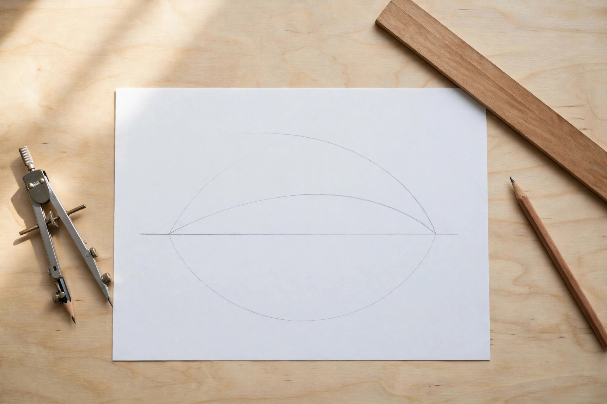

# Lesson 03 — Building with Circles: Bisectors, Perpendiculars, Parallels, and Inscribed Polygons

**Unit 01 · Week 4, Session 6 · ~50 minutes**

**Goal (learner-facing):** I can construct angle bisectors, perpendicular
bisectors, perpendiculars, parallels, and inscribed equilateral triangles,
squares, and regular hexagons — and justify each one from definitions and
the equidistance property.

**Materials:** compass, straightedge, plain paper, pencil, protractor,
millimeter ruler, this lesson.

**Readiness check (5 min):** Copy a 5 cm segment (Lesson 02). Then answer:
*if point P is the same distance from A as from B, what does that tell you
about where P sits relative to segment AB?* (Hold the thought — this
lesson proves the answer and then uses it as a construction engine.)

---

## Part 1 — The equidistance engine (explicit teaching, 10 min)

**Perpendicular-bisector equidistance theorem** (stated; proved in
Unit 02 as enrichment): *A point lies on the perpendicular bisector of a
segment exactly when it is equidistant from the segment's endpoints.*

This single fact powers three constructions below. The reasoning pattern
is always the same: (1) use arcs to *find* two points that are each
equidistant from the endpoints; (2) the theorem says both points lie on
the perpendicular bisector; (3) two points determine a line (postulate),
so the line through them *is* the perpendicular bisector. Finding points
with a property, then drawing the line they determine — that is how
classical construction thinks.

## Part 2 — The construction set (explicit teaching, 20 min)

**A. Bisect an angle.** Given angle *ABC*: center the compass at *B*,
draw an arc crossing both sides (points *X*, *Y*); with the same width,
draw arcs centered at *X* and *Y* that cross at *P*; draw ray *BP*. Ray
*BP* is the **angle bisector**. *Why it works:* the construction makes
triangles *BXP* and *BYP* have three pairwise-equal sides (SSS, proved in
Unit 02), so their angles at *B* match.

**B. Perpendicular bisector of a segment.** Given segment *AB*: draw arcs
of equal radius centered at *A* and at *B* (radius more than half of *AB*),
letting them cross above the segment at *P* and below at *Q*; draw line
*PQ*. *Why it works:* *P* and *Q* are each equidistant from *A* and *B*
(each lies on both circles), so by the equidistance theorem both lie on
the perpendicular bisector, and two points determine the line.

**C. Perpendicular from a point to a line.** Given line *l* and point *P*
not on *l*: draw an arc centered at *P* crossing *l* at *A* and *B*; then
construct the perpendicular bisector of segment *AB* (construction B) —
it passes through *P*. *Why it works:* *P* is equidistant from *A* and
*B* (same arc), so *P* is on the perpendicular bisector by the
equidistance theorem; the bisector is perpendicular to *l* by definition.

**D. Parallel through a point.** Given line *l* and point *P* not on *l*:
draw any transversal through *P* crossing *l* at *Q*; copy the angle at
*Q* to vertex *P* on the same side (Lesson 02's angle copy); the new
ray's line is parallel to *l*. *Why it works:* we built equal
corresponding angles, and equal corresponding angles guarantee parallel
lines (the converse of the Corresponding Angles Postulate — stated here,
proved in Unit 02; Lesson 05 uses the forward direction).

**E. Inscribed polygons (G-CO.13).** Given a circle with center *O*:
- *Regular hexagon:* keep the compass at the circle's radius and mark
  six consecutive arcs around the circle; connect the six points. *Why:*
  each chord equals the radius, so each central angle is 60°
  (360° ÷ 6), and six 60° steps close the loop exactly.
- *Equilateral triangle:* take every other vertex of the hexagon and
  connect them. *Why:* skipping one vertex doubles the central angle to
  120°, and three 120° steps give three equal chords.
- *Square:* draw a diameter, construct its perpendicular bisector
  (another diameter), and connect the four endpoints. *Why:* the
  diameters cross at 90°, giving four equal central angles and four
  equal chords.

## Worked example 1 — Reading a construction in progress

Study the generated illustration below. It shows a real construction
midway through.

*Caption: A perpendicular-bisector construction in progress: equal arcs from each endpoint cross above and below the segment. The bisector line has not been drawn yet. (AI-generated illustration.)*

**Text-only alternative:** The image shows a sheet of paper on a wooden
desk with a metal compass, a wooden straightedge, and a pencil nearby. On
the paper is a horizontal pencil segment. Two large pencil arcs cross
above the segment and two cross below it; each arc is centered on one of
the segment's endpoints, and all four arcs were drawn with the same
compass width.

*Questions.* (a) Which construction from Part 2 is in progress? (b) Which
steps are already complete? (c) What is the very next step, and which
tool performs it? (d) After that step, how will you check the result?

*Solution.* (a) Construction B — the perpendicular bisector of the
segment. (b) The equal-radius arcs from both endpoints are drawn, giving
the two crossing points *P* (above) and *Q* (below). (c) Place the
straightedge through *P* and *Q* and draw line *PQ* — the straightedge's
one legal move. (d) Fold the paper so the segment's endpoints meet: the
crease should lie exactly on line *PQ*; also measure the two halves with
a millimeter ruler (they should match) and check the crossing angle with
a protractor (90°). Note the N-Q.3 caution: the fold-and-measure checks
confirm the drawing to the ruler's precision — they verify the *work*,
while the equidistance theorem guarantees the *method*.

## Worked example 2 — The hexagon's 60° secret

*Problem.* You inscribed a regular hexagon by marking the radius around
the circle six times, but your sixth mark lands slightly past the first
one. Is the method wrong, or is something else going on? Explain with
the central-angle reasoning.

*Solution.* The method is exact: six chords each equal to the radius give
six central angles, and 6 × 60° = 360° closes the circle perfectly. A gap
means the compass width drifted between marks (a transfer error, Lesson
02) or the arcs were misread — the *hand*, not the *geometry*. Check: did
you re-set the compass after the first mark? The fix is to lock the width
once and mark all six points without touching the hinge.

---

## Guided practice (with hints)

1. Bisect a 100° angle drawn by the adult. Measure the two halves with a
   protractor. (Mark the arc crossings *X* and *Y* before drawing the
   crossing arcs — the "why it works" needs the points.)
2. Construct the perpendicular bisector of a 7 cm segment. Verify by
   measuring both halves to the nearest millimeter. (Radius must exceed
   half the segment or the arcs never meet.)
3. From a point *P* 4 cm above a line, construct the perpendicular to
   the line. Explain in one sentence why your line must pass through *P*.
   (Same arc ⇒ *P* equidistant from *A*, *B* ⇒ on the bisector.)
4. Inscribe a regular hexagon in a 4 cm-radius circle. Measure one
   central angle with a protractor. (Expect ~60°, ±1° of hand error.)
5. **Explain your reasoning:** In construction D, we copy an angle to get
   a parallel. Which postulate-or-theorem from this unit is secretly
   doing the work, and in which direction (forward or converse)?
   (Corresponding Angles — converse direction: equal corresponding
   angles ⇒ parallel lines. We prove the forward direction in Lesson 05;
   the converse is proved in Unit 02.)

## Independent practice

1. Construct an equilateral triangle inscribed in a 3.5 cm-radius circle
   using the hexagon method. Measure all three sides to the nearest
   millimeter and report the largest discrepancy.
2. Construct a square inscribed in a 4 cm-radius circle using the
   double-diameter method. Check with a protractor that adjacent sides
   are perpendicular (to the nearest degree).
3. From memory (no lesson open), construct the perpendicular bisector of
   a segment, narrating each step and its justification aloud as you go.
4. A learner constructs a "parallel" by eyeballing equal spacing with a
   ruler. Give two reasons this is not a construction in the classical
   sense. (The ruler is used as a measuring device, violating the
   unmarked-straightedge rule; and equal spacing at two points does not
   guarantee the lines never meet — no postulate backs it.)
5. **Precision task (N-Q.3):** Your protractor reads to the nearest
   degree. Your partner reports a constructed angle as 60.00°. Write two
   sentences explaining what is wrong with the report. (The tool supports
   "about 60°," not hundredths of a degree; extra digits are false
   precision.)
6. Draw a circle of radius 5 cm. Mark six radius-length arcs around it
   *without* connecting them. Label the center *O* and two adjacent marks
   *A*, *B*. In writing, prove that triangle *OAB* is equilateral, citing
   the circle definition and the construction. (OA = OB = radius by
   definition; AB = radius by construction; three equal sides ⇒
   equilateral by definition.)
7. **Error analysis:** A learner's angle bisector misses the vertex by
   2 mm — the ray starts at the arc crossing instead of at *B*. Explain
   why the resulting ray still bisects the *marked* angle but the drawing
   is wrong, and state the fix. (The ray through the crossing point
   parallel to the true bisector keeps the angle split, but a bisector
   must have its vertex at the angle's vertex by definition; redraw from
   *B*.)

## Application

A circular garden bed has lost its center marker, but its edge is intact.
Using only the inscribed-polygon ideas (no measuring of the radius),
describe how to recover the exact center with compass and straightedge,
and justify each step. (Inscribe a square: draw any chord, construct its
perpendicular bisector — a diameter; repeat with a second chord; the two
diameters cross at the center. Justification: each bisector passes
through the center because it is perpendicular to a chord at its
midpoint — a diameters-bisect-chords fact; the crossing of two diameters
is the center by the circle definition.)

## Exit check

(1) Without looking, construct an angle bisector and state the "why it
works" in two sentences. (2) Answer: your hexagon's sixth mark overshoots
by 3 mm — method error or hand error, and what is the one corrective
habit? (3) State the equidistance theorem from memory. The adult checks
against Parts 1–2 before Session 7.

---

## Supports

- **Reading/language access:** Keep a one-page "construction recipe
  card" per construction: numbered steps on the left, the justification
  phrase on the right. Read the recipe aloud before starting.
- **Alternate response mode:** Any construction may be built in GeoGebra
  Geometry (circle tool, line tool, point tool); the recipe card with
  justifications is still completed on paper. The image-observation task
  may be answered orally with the adult scribing.
- **Extension:** Construct a regular hexagon *given one side* (not given
  the circle): build the equilateral triangle outward logic in reverse —
  the hexagon's vertices lie on a circle of radius equal to the side.
  Justify why the circumscribed circle must have that radius.

## Teacher note

This lesson is the unit's heaviest tool session — do not rush it. The
two durable misconceptions: (1) that the arcs themselves are the answer
(the arcs are *scaffolding*; the constructed line or ray is the answer);
(2) that "looks right" equals "proved" (the fold-and-measure check
verifies the drawing; only the equidistance theorem proves the method).
Keep SSS justifications honest: "on loan until Unit 02" is a feature,
not a gap — it teaches the difference between *using* a result and
*having proved* it. See `teacher-guide.md` (Lesson 03) and
`answer-key.md` (Practice Set C).
