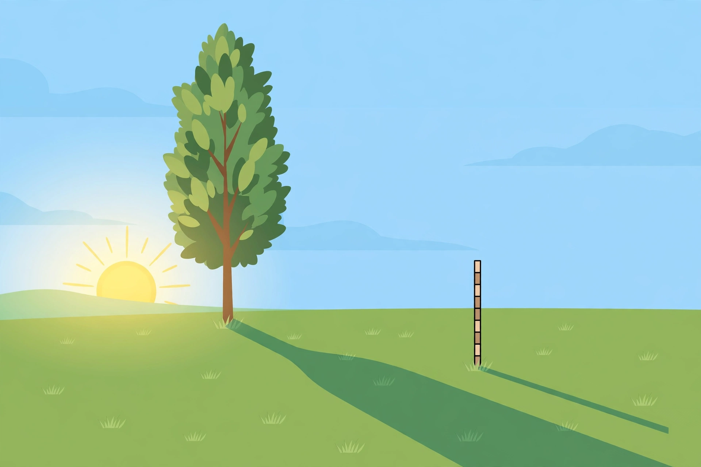

# Lesson 04 — Applications: Indirect Measurement, Scale Drawings, and Scaling Area and Volume

**Goal:** You will measure what you cannot reach by setting up a
correct similarity proportion, read and use scale drawings and
maps, and explain why area scales by k² and volume by k³.
**Time:** ~50 minutes. **Materials:** notebook, ruler, measuring
tape or metre stick, a straight stick or dowel, a small flat
mirror (optional), grid paper.

## Readiness check (5 minutes)

1. A stick 2 m tall casts a shadow 3 m long. At the same time, a
   pole casts a shadow 12 m long. Set up the proportion for the
   pole's height (do not solve yet). (Answer: 2/3 = h/12.)
2. A map scale is 1:25,000. What does 1 cm on the map represent
   in reality? (Answer: 25,000 cm = 250 m.)
3. A square has side 2 cm and area 4 cm². Double every side.
   What is the new area? (Answer: side 4 cm, area 16 cm² — four
   times, not twice. This is today's third idea.)

## Teaching

### The observation: the shadow picture

*Caption: AI illustration for the shadow method. A tree and a
measuring stick stand on flat ground; their shadows fall in the
same direction because the sun's rays are effectively parallel.
This illustration is a qualitative anchor only — never measure
from it.*

**Text-only alternative:** "A tall tree and a short vertical
stick stand on flat ground in sunlight. Each casts a shadow on
the ground to the same side. The stick, its shadow, and the sun
ray form a small right triangle; the tree, its shadow, and the
sun ray form a larger right triangle. Because the sun's rays are
parallel, the two triangles have equal angles and are similar."

**Questions about the picture:** (1) Why are the two triangles
similar — which angle pairs match? (Answer: both have a right
angle where the object meets the ground, and the sun-ray angles
are equal because the rays are parallel — AA.) (2) What would
break the similarity? (Answer: sloped ground, so the ground
angles are not right angles; or measurements taken at different
times, so the sun angle changed.) (3) Why must you not measure
lengths off this picture? (Answer: it is an AI illustration
with approximate proportions, not a scaled diagram — the lesson
and `assets/README.md` state this explicitly.)

### Method 1: shadow measurement

The sun's rays reach the ground effectively parallel, so the
object, its shadow, and a sun ray form a right triangle, and two
objects measured at the same time give similar triangles:

> (object height) / (shadow length) is the same for both objects.

So: height of tree / shadow of tree = height of stick / shadow
of stick. Measure three of the four quantities, solve for the
fourth. Conditions: flat ground, same time (the sun moves!),
vertical objects. Accuracy: your answer is only as good as your
shortest measurement — a 5 cm error in a 1.8 m shadow is about
3%, so report the height to a sensible precision (see below).

### Method 2: mirror measurement

Lay a small flat mirror on the ground between you and the tall
object. Walk until you see the top of the object in the mirror.
The line of sight reflects, so the angle of incidence equals the
angle of reflection — and the two triangles (your eye height
over your distance to the mirror; the object's height over its
distance to the mirror) are similar by AA (both have a right
angle at the ground and equal reflection angles). So:

> (object height) / (distance from mirror to object) =
> (eye height) / (distance from mirror to you).

This method needs no sun and no shadow — useful on cloudy days —
but it needs flat ground and a careful eye-height measurement
(measure to your eyes, not to the top of your head).

### Method 3: scale drawings and maps

A scale drawing states a ratio, e.g., 1:50 or 1:50,000: one unit
on the drawing represents 50 (or 50,000) of the same units in
reality. To convert: real length = drawing length × scale
number, then convert units. To draw to scale: drawing length =
real length ÷ scale number. Two warnings: (1) keep units
consistent before multiplying — convert cm to m or km at the
end, deliberately; (2) a scale is a *similarity* claim: the
drawing and the real object must be similar, with the same
proportions in every direction. A drawing stretched in one
direction only is not to scale.

### Area scales by k², volume by k³ — why

Take a rectangle a by b, area ab. Scale every length by k: the
new rectangle is ka by kb, area (ka)(kb) = k²ab. So area scales
by k². The same argument works for any figure: area is built
from two length dimensions, and each contributes a factor k.
For volume, three length dimensions each contribute k, so volume
scales by k³. Length scales by k¹. Remember: **length k,
area k², volume k³** — the exponent counts the dimensions.

A classic trap: doubling a recipe's pan size (k = 2) quadruples
the area, so a cake baked in the doubled pan is much thinner
unless the batter is also quadrupled; tripling a model's linear
size multiplies its volume (and weight, at the same material) by
27.

### Accuracy (N-Q.3)

Report results to a precision your measurements support. If your
stick is measured to the nearest centimetre and shadows to the
nearest 5 cm, a tree height computed as 9.03 m should be
reported as "about 9.0 m" — the third significant figure is
not earned. In this unit's work, two or three significant
figures are the norm; the answer key shows the unrounded
computation and then the sensibly rounded report.

## Worked Example 1 — shadow method

A 1.2 m stick casts a 1.8 m shadow. At the same time, a tree
casts a 13.5 m shadow. How tall is the tree?

*Reasoning.* Same time, flat ground, vertical objects — the
triangles are similar by AA (right angles at the ground, equal
sun angles). Set up the proportion with matching parts:
(tree height)/(tree shadow) = (stick height)/(stick shadow),
so h/13.5 = 1.2/1.8. Then h = 13.5 · (1.2/1.8) = 13.5 · (2/3) =
9.0 m.

*Check and accuracy.* 1.2/1.8 simplifies to 2/3 exactly, and
13.5 · 2/3 = 9.0. Report "about 9.0 m" — the shadow measurements
(1.8 m, 13.5 m) support two or three significant figures, not
four. If the tree's shadow had been measured to the nearest
10 cm, "about 9 m" would be the honest report.

## Worked Example 2 — mirror method, scale drawing, and area scaling

(a) *Mirror.* Your eye height is 1.6 m. You stand 0.8 m from a
mirror on flat ground; the mirror is 20 m from the base of a
building. The building's height h satisfies h/20 = 1.6/0.8 = 2,
so h = 40 m.

(b) *Map.* A map has scale 1:50,000. Two towns are 3.4 cm apart
on the map. Real distance = 3.4 · 50,000 = 170,000 cm = 1,700 m
= 1.7 km.

(c) *Area.* A photograph 4 in. by 6 in. (area 24 in²) is enlarged
by k = 2.5 to 10 in. by 15 in. New area = 150 in². Check by
k²: 24 · 2.5² = 24 · 6.25 = 150. ✓ The area grew by a factor
6.25, not 2.5 — the trap from the readiness check, avoided.

## Guided practice (with hints)

**G1.** A 0.9 m stick casts a 1.2 m shadow; a flagpole casts a
16 m shadow at the same time. Find the flagpole's height.
*Hint: h/16 = 0.9/1.2.* (Answer: h = 16 · 0.75 = 12 m.)

**G2.** On a 1:25,000 map, a trail measures 8 cm. How long is
the trail in kilometres? *Hint: 8 · 25,000 cm, then convert.*
(Answer: 200,000 cm = 2 km.)

**G3.** A model car is built at scale 1:24. The real car is
4.32 m long. How long is the model? A real wheel has area
0.09 m² (face area); what is the model's wheel-face area?
*Hint: length scales by 1/24; area by (1/24)².*
(Answer: length 4.32/24 = 0.18 m = 18 cm; area 0.09/576 =
0.00015625 m² ≈ 1.56 cm².)

**G4 (error analysis).** A learner measures a tree's shadow at
10:00 and a stick's shadow at 10:30, then computes the tree's
height from the proportion. Why is the result unreliable?
*Hint: what changed between the measurements?* (Answer: the
sun angle changed, so the two triangles are not similar — the
equal-angle condition fails. Same-time measurement is a
condition of the method, not a convenience.)

## Independent practice

Do Practice Set D (`practice.md`). It continues this lesson's
skills: shadow and mirror problems, map and scale-drawing
conversions with unit changes, area/volume scaling, and
accuracy reporting.

## Application

A builder enlarges a rectangular deck design by k = 1.5 in each
linear direction. The original deck is 4 m by 6 m (area 24 m²)
and needs 24 m² of boards. The enlarged deck is 6 m by 9 m
(area 54 m²). How many square metres of boards does the enlarged
deck need, and by what factor did the board area grow? (Answer:
54 m²; factor 54/24 = 2.25 = 1.5². A learner who multiplies the
boards by 1.5 (36 m²) will run short — the k² rule is a
budgeting rule, not just a geometry fact.)

## Exit check

A stick 1 m tall casts a 2 m shadow; a building casts a 30 m
shadow at the same time. How tall is the building? And: a solid
is scaled by k = 3 — by what factor does its volume change?
(Answers: h/30 = 1/2, so h = 15 m; volume factor 3³ = 27.)

## Supports and extensions

- **Support:** for every indirect-measurement problem, draw
  the two triangles side by side, label the four quantities
  (two known lengths on each triangle), and circle the unknown
  before writing the proportion.
- **Support:** use a unit-conversion ladder (mm → cm → m → km,
  factors of 10) on the notebook's inside cover for map problems.
- **Extension:** a cube's edge is scaled by k; show the
  surface area scales by k² and the volume by k³ from the
  formulas (surface 6s², volume s³) — then explain why small
  animals lose heat faster (surface-to-volume ratio scales as
  1/k) in two or three sentences.
- **Extension:** research the "shadow method" of Thales
  measuring a pyramid's height (the traditional story) and
  write a paragraph assessing it: what would Thales have
  needed to assume, and how would he have checked it?

## Teacher note

The two method conditions — same time for shadows, flat ground
for both methods — are the content, not fine print: every
indirect-measurement error analysis in the quiz and assessment
turns on them. Also enforce the accuracy rule: an unrounded
calculator string (e.g., 9.027777… m) as a final answer loses
the accuracy mark in the project rubric. Answer-key reference:
`answer-key.md`, Lesson 04 and Practice Set D.
