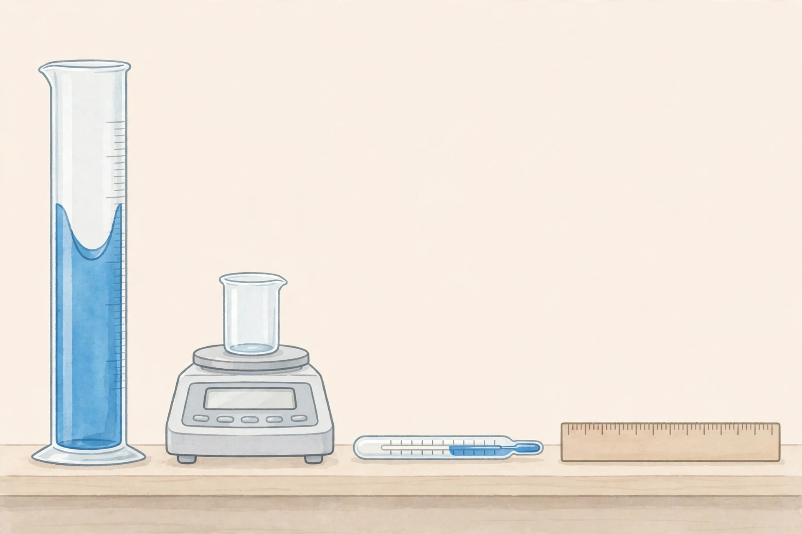
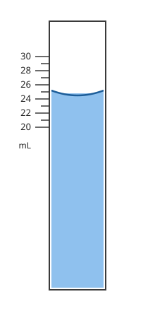

# Lesson 03 — Reading Instruments to Their Precision

**Goal:** You will read a graduated cylinder, a digital balance, a thermometer, and a metric ruler
to each instrument's precision and record the value with correct units.
**Time:** ~50 minutes · **Materials:** notebook; the two images in `../assets/`.
**Readiness check (2 min):** Look at the generated illustration below. Name each instrument and the
quantity it measures before reading further.

*Caption: The four instruments of this unit on the bench — graduated cylinder (volume), digital
balance (mass), thermometer (temperature), ruler (length). The tick marks in this illustration are
decorative; exact readings in this lesson come from the labeled scale diagram and the text-only
descriptions below.*

**Text-only alternative:** the station holds four instruments left to right: (1) a tall graduated
cylinder containing blue liquid; (2) a digital balance with an empty beaker on its pan; (3) a glass
thermometer lying horizontally; (4) a wooden metric ruler. Every question about this image can also
be answered from the written descriptions in §2–§5.

## 1. The precision rule

Every instrument has a smallest marked division. The rule: **record one estimated digit beyond the
smallest marking.** That estimated digit is uncertain — and admitting the uncertainty is the honest
part of measurement (Lesson 05 builds on this).

- Smallest mark = 1 mL → record to 0.1 mL (e.g., 24.5 mL).
- Smallest mark = 1 mm → record to 0.1 mm = 0.01 cm.
- Digital display → record every digit shown (the last digit is the instrument's estimate).

Writing *fewer* digits throws away information; writing *more* digits pretends to a precision you
do not have. Both are errors.

## 2. The graduated cylinder and the meniscus

Water clings to glass, so the surface curves upward at the edges — the **meniscus**. Read the
**bottom** of the curve, with your eye level with the surface (reading from above or below causes
**parallax error**).

**Worked example 1 — meniscus reading.** Using the exact diagram above:
Reasoning: marks are every 1 mL, so the estimated digit is the 0.1 mL place. The bottom of the
meniscus sits halfway between 24 and 25 → **24.5 mL**. Writing "24 mL" discards the estimate;
writing "24.50 mL" claims a 0.01 mL precision this cylinder does not have.

**Worked example 2 — eye level.** Two learners read the same cylinder: Ana crouches so her eye is
level with the meniscus and reads 24.5 mL; Ben stands and reads from above, seeing the ellipse of
the surface against the 26 mL mark, and reads 25.8 mL.
Reasoning: the liquid did not change — the viewing angle did. Ben's error is **parallax error**,
a systematic error (Lesson 05). Correct practice: eye level with the bottom of the meniscus.

## 3. The digital balance

**Tare** the balance (zero it with the empty container on the pan), add the sample, and record
**every digit** the display shows, with the unit: e.g., **52.48 g**. The last digit flickers —
that flicker *is* the instrument telling you its precision limit. Never round a balance reading in
your data table; rounding happens later, in calculations (Lesson 04).

## 4. The thermometer

Thermometer scale (fictional practice reading): marks every 1 °C; the top of the liquid column
sits halfway between 21 °C and 22 °C. Estimated digit → **21.5 °C**. Read at eye level, and never
lift an alcohol thermometer out of the liquid to read it — the column starts moving immediately.

## 5. The metric ruler

Ruler (fictional practice reading): marks every 1 mm. A copper strip starts exactly at the 2.0 cm
mark and ends halfway between 86 mm and 87 mm from the ruler's zero. Length = 86.5 mm − 20.0 mm =
**66.5 mm = 6.65 cm**. Two checks: the strip was aligned to the zero mark (not the ruler's end),
and the estimated digit (0.1 mm) is kept.

*All readings in this lesson's examples are fictional practice values, not observations you made.*

## Guided practice

1. Using the exact meniscus diagram: if the bottom of the meniscus sat exactly on the 24 mL mark,
   what would you record, and why does it still have a decimal digit?
2. A balance displays `13.2 g` for one sample and `13.20 g` for another. Do these mean the same
   thing? Explain using the precision rule.
3. Name the error: a learner reads a thermometer while it is held above the desk, sighting down at
   an angle. What should they do instead?

## Independent practice

4. A 100 mL cylinder has 1 mL marks. The meniscus bottom is one quarter of the way from 41 mL
   toward 42 mL. Record the volume.
5. A ruler with 1 mm marks measures a strip from the 5.0 cm mark to a point 3/10 of the way from
   132 mm to 133 mm past zero. What is the strip's length in cm? Show the subtraction.
6. **Error analysis:** "I read 25 mL because the meniscus was between 24 and 25 and 25 is closer
   to the top of the curve." Identify two errors in this reasoning.

## Application

Measure four real objects on your bench (or describe four from the illustration + text
alternative): the volume of water in a cylinder, the mass of a dry beaker, the room temperature,
and the length of a pen. Record each in a data table with the instrument, the smallest marking,
and the reading — every reading at full precision. The adult checks your eye level on the
cylinder reading.

## Exit check

1. State the precision rule in one sentence.
2. Where do you read a meniscus, and what error comes from reading at an angle?
3. A cylinder with 0.5 mL marks shows the meniscus at 17.25 mL by your estimate. Is that a legal
   reading? Explain.

## Supports and extensions

- **Reading access:** the precision rule is a single bolded sentence — keep it visible during all
  practice.
- **Alternate response mode:** readings may be called out aloud while the adult records, then the
  learner verifies the written digits.
- **Extension:** research why analytical balances are kept behind glass doors (air currents) and
  why volumetric flasks — not graduated cylinders — are used to prepare solutions of exact
  concentration. Summarize in half a page; this foreshadows Unit 06.

## Teacher note

Common misconception: learners read the *top* of the meniscus or the highest wetting point. Have
them trace the curve with a finger and mark the lowest point before reading a number. Another
frequent error: dropping the estimated digit ("24 mL") out of a false sense of honesty — teach
that the estimate *is* the honest part. Answer-key reference: `answer-key.md`, Lesson 03. The
generated illustration is intentionally number-free; all graded readings come from the exact SVG
or the text descriptions, never from the illustration.
