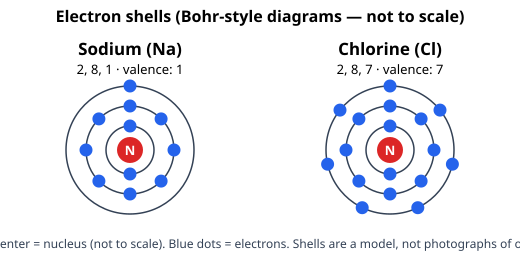

# Lesson 03 — Electron Configurations and Valence Electrons

**Goal:** By the end of this lesson you can write electron configurations for main-group
elements with atomic numbers 1–20, identify their valence electrons, and explain why elements
in the same group behave similarly.

**Time:** ~50 minutes. **Materials:** periodic table, diagram
`../assets/electron-shells-sodium-chlorine.svg`, Practice Set C.

## Readiness check (5 minutes)

1. Sodium has 11 electrons. If its shells hold 2, then 8, then the rest, how many electrons are
   in its outermost shell?
2. Why might the outermost electrons matter more for chemistry than the inner ones? (Guess
   before reading on: they are the ones that meet other atoms first.)

## Teaching

### From shells to orbitals — the minimum you need

The quantum-mechanical model describes electrons by **orbitals**: regions where an electron
is likely to be found. Orbitals group into energy levels (shells, numbered n = 1, 2, 3, 4…),
and each level contains subshells labeled s, p, d, f. For this unit you need only the filling
pattern for elements 1–20, which follows a simple capacity rule:

- The **s** subshell holds at most 2 electrons.
- The **p** subshell holds at most 6 electrons.
- The **d** subshell holds at most 10 electrons (you will meet it only as a pattern note for
  heavier elements; configurations in this unit stop at the p subshell for elements 1–20,
  except that calcium fills 4s before 3d — see the note below).

An **electron configuration** lists the occupied subshells in filling order, with the number
of electrons as a superscript. Example: oxygen (8 electrons) is 1s²2s²2p⁴. Read it as: "2
electrons in level 1, subshell s; 2 electrons in level 2, subshell s; 4 electrons in level 2,
subshell p." Check: 2 + 2 + 4 = 8 ✓ — always check that the superscripts add up to the
electron count.

The filling order for elements 1–20 is:

1s → 2s → 2p → 3s → 3p → 4s

That is: hydrogen and helium fill 1s; lithium and beryllium fill 2s; boron through neon fill
2p; sodium and magnesium fill 3s; aluminum through argon fill 3p; potassium and calcium fill
4s. (A careful note: after argon, the 3d subshell begins to fill for transition metals, but
this unit assesses main-group patterns only, per the HS-PS1-1 boundary.)

**Valence electrons** are the electrons in the outermost occupied energy level — the ones an
atom can gain, lose, or share in chemistry. **Core electrons** are all the rest. For
main-group elements, the group number (for groups 1, 2, and 13–18) tells you the valence
count: group 1 → 1 valence electron; group 2 → 2; group 13 → 3; group 14 → 4; group 15 → 5;
group 16 → 6; group 17 → 7; group 18 → 8 (except helium, with 2). That is why elements in the
same group behave similarly: they have the same valence-electron count and therefore similar
bonding behavior.

Study the shell diagrams below alongside the configurations. They are Bohr-style simplifications
— useful for counting shells, but remember from Lesson 02 that real electrons occupy
probability regions (orbitals), not fixed circular tracks.

*Caption: Bohr-style shell diagrams for sodium (2, 8, 1) and chlorine (2, 8, 7). The shells are
a model and are not to scale; electrons do not travel in fixed circular paths.*

**Text-only alternative:** Sodium's electrons divide 2 in shell 1, 8 in shell 2, 1 in shell 3
(configuration 1s²2s²2p⁶3s¹, valence 1). Chlorine's divide 2, 8, 7 (configuration
1s²2s²2p⁶3s²3p⁵, valence 7). Sodium tends to lose its single outer electron; chlorine tends to
gain one electron to complete its outer shell — the pairing that, in Unit 03, becomes the
ionic bond in table salt.

### Worked example 1 — magnesium

*Write the electron configuration of magnesium (Z = 12) and state its valence electrons.*

Fill in order: 1s takes 2 (total 2), 2s takes 2 (total 4), 2p takes 6 (total 10), 3s takes the
remaining 2 (total 12). Configuration: **1s²2s²2p⁶3s²**. Check: 2 + 2 + 6 + 2 = 12 ✓.
Outermost level is n = 3, with 2 electrons → **2 valence electrons**. This matches its group:
magnesium is in group 2 ✓.

### Worked example 2 — reading a configuration backwards

*A neutral atom has configuration 1s²2s²2p⁶3s²3p⁵. Identify the element, its group, and the
ion it most likely forms.*

Step 1 — Count electrons: 2 + 2 + 6 + 2 + 5 = 17. Neutral, so Z = 17 → chlorine.
Step 2 — Outermost level is n = 3: 2 + 5 = 7 valence electrons → group 17 ✓.
Step 3 — With 7 valence electrons, gaining 1 electron completes the outer level (8), so the
likely ion is **Cl⁻**. This is the HS-PS1-1 move: outer-electron pattern → predicted behavior.

### Why this matters for the whole unit

Almost everything in Lessons 05 and 06 is a consequence of this lesson. A group-1 element with
one valence electron loses it easily (low ionization energy, high reactivity as a metal). A
group-17 element with seven valence electrons gains one eagerly (high electronegativity). A
group-18 element with a full outer level barely reacts at all. Learn the valence pattern and
the periodic table stops being a poster to memorize and becomes a prediction machine.

## Guided practice

1. Write the configuration of fluorine (Z = 9) and state its valence electrons. [Fill 1s, 2s,
   2p: 1s²2s²2p⁵; valence 5? No — count the outer level: 2 + 5 = 7. Watch this trap: valence
   means the whole outer *level*, not just the p subshell.]
2. Write the configuration of potassium (Z = 19). [1s²2s²2p⁶3s²3p⁶4s¹; valence 1.]
3. An element is in group 16, period 3. What is its valence count, and what is the element?
   [6 valence electrons; sulfur.]

## Independent practice

Complete Practice Set C (in `practice.md`). Then answer: argon has configuration
1s²2s²2p⁶3s²3p⁶. Explain in two sentences why argon is unreactive, using the words "valence"
and "full."

## Exit check

Without looking back: write the configuration of nitrogen (Z = 7), state its valence count,
and predict whether it gains or loses electrons to reach a full outer level — and how many.

## Supports and extensions

- **Reading/language access:** read configurations aloud as "one-s-two, two-s-two, two-p-six…"
  and always finish with the superscript-sum check.
- **Alternate response mode:** draw shell diagrams (like the SVG above) instead of writing
  subshell notation, then translate one diagram into notation with your adult.
- **Extension:** look up the configuration of iron (Z = 26) in the resource pack's periodic
  table and notice where the 3d subshell appears; write one sentence on why this unit stops its
  assessments at main-group patterns.

## Teacher note

Likely misconceptions: (1) counting only the last subshell as valence (fluorine trap above) —
always sum the whole outermost level; (2) writing 3d before 4s for potassium/calcium — for
elements 1–20 the taught order is 1s, 2s, 2p, 3s, 3p, 4s; (3) treating Bohr shells as literal
orbits — repeat that orbitals are probability regions. Answer-key reference: `answer-key.md`,
Set C.
