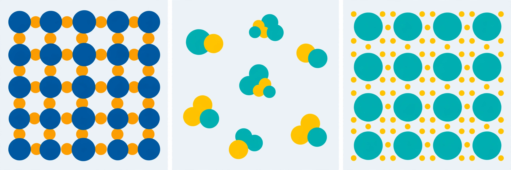

# Lesson 01 — Why Atoms Bond: Ionic, Covalent, and Metallic

**Goal:** By the end of this lesson you can classify a bond as ionic, polar covalent, or
nonpolar covalent from the elements involved and their electronegativity difference, and you can
tell the electron story behind each kind of bond.

**Time:** ~50 minutes. **Materials:** periodic table, the electronegativity table in this
lesson, notebook, Practice Set A.

## Readiness check (5 minutes)

1. From Unit 02: sodium has 1 valence electron and chlorine has 7. What ion does each one tend
   to form, and why?
2. What do you think holds two atoms together in a molecule — a hook, a magnet, or something
   else? Write one sentence before reading on.

(If the readiness check is shaky, re-read Unit 02, Lesson 03: valence electrons are the
outermost electrons, and atoms tend toward a full outer shell — 8 electrons for most
main-group elements, 2 for hydrogen and helium.)

## Teaching

### A bond is an electrical attraction

Atoms do not stick together with hooks. Every chemical bond is an attraction between electric
charges: negatively charged electrons attracted to positively charged nuclei. The three kinds of
bond differ only in **what the valence electrons do**:

- **Ionic bond:** one atom *gives* valence electrons to another. The giver becomes a positive
  ion (cation), the receiver becomes a negative ion (anion), and opposite charges attract.
  The result is not a molecule but a repeating lattice of ions.
- **Covalent bond:** two atoms *share* valence electrons. Each shared pair counts toward both
  atoms' outer shells. The result is a molecule — a definite group of atoms joined by shared
  pairs.
- **Metallic bond:** metal atoms pool their valence electrons into a shared, moving "sea" that
  belongs to the whole piece of metal at once. Positive metal ions sit in that sea, and the
  attraction between them and the moving electrons holds the metal together.

### Electronegativity: how hard an atom pulls

**Electronegativity** is a number for how strongly an atom in a compound attracts shared
electrons toward itself. The Pauling scale runs from about 0.8 (very weak pull, e.g. caesium)
to 3.98 (fluorine, the strongest pull). Noble gases have no Pauling value: they already have
full outer shells and do not form bonds in this unit's chemistry, so never use them in a
difference calculation.

| Element | H | Li | C | N | O | F | Na | Mg | Si | P | S | Cl | K | Ca | Br |
|---|---|---|---|---|---|---|---|---|---|---|---|---|---|---|---|
| Pauling EN | 2.20 | 0.98 | 2.55 | 3.04 | 3.44 | 3.98 | 0.93 | 1.31 | 1.90 | 2.19 | 2.58 | 3.16 | 0.82 | 1.00 | 2.96 |

The **electronegativity difference**, ΔEN, is the larger value minus the smaller value. It is
the quickest classifier chemists have, and this unit uses these guides:

- ΔEN **≥ 1.7** — predominantly **ionic** (electron transfer; usually a metal with a nonmetal).
- ΔEN **0.4 to 1.7** — **polar covalent** (unequal sharing; the stronger puller gets a partial
  negative charge, δ−, and the weaker puller a partial positive charge, δ+).
- ΔEN **< 0.4** — **nonpolar covalent** (sharing close enough to equal that no useful partial
  charge appears; identical atoms always give ΔEN = 0).

These are **guides on a continuum, not laws**. Bonding shades gradually from equal sharing to
transfer; no single cut-off is exact, and Lesson 06 shows a case (hydrogen fluoride) where the
1.7 guide alone misleads. Always check the elements too: a metal with a nonmetal and a large
ΔEN is the classic ionic pattern, while two nonmetals almost always share, even when ΔEN is
large.

### Activity A — the generated image

*Caption: Stylized particle-level models of three bonding types (not to scale; spheres are not
real atoms and colours do not identify elements). The lesson text below, not the image, defines
each panel's meaning — use the caption and the text alternative, not colour, to answer.*

**Text-only alternative:** The image has three panels. Left panel: a regular repeating grid of
alternating large dark-blue spheres and smaller orange spheres, packed in rows and columns with
no gaps between neighbouring spheres. Center panel: several small separate clusters, each made
of two or three overlapping teal and yellow spheres, with empty space between one cluster and
the next. Right panel: a regular grid of identical large teal spheres, with many tiny yellow
dots scattered freely in all the spaces between the spheres.

**Questions (answer in your notebook):**

1. In which panel are the particles locked in one continuous repeating pattern with no separate
   clusters? What does that suggest about what holds them together — transfer, sharing within
   clusters, or a shared sea?
2. In which panel do the particles form small separate groups with space between groups? Why
   would a substance built that way melt easily (a hint for Lesson 04)?
3. In which panel is there something small and free-moving between all the large particles?
   What could those small dots represent, and which bond type does that match?

(Answers are in the answer key. The point of the activity is the reasoning: a lattice means
every particle is held by its neighbours in all directions; separate clusters mean only the
clusters are strongly held together; a free-moving sea means charge can move through the whole
piece.)

### Worked example 1 — sodium chloride

*Classify the bond in NaCl. EN(Na) = 0.93, EN(Cl) = 3.16.*

Step 1 — ΔEN = 3.16 − 0.93 = **2.23**.
Step 2 — 2.23 ≥ 1.7, so the guide says **ionic**.
Step 3 — Check the elements: sodium is a metal, chlorine a nonmetal — the classic ionic
pattern, and it agrees with Unit 02: sodium tends to lose its 1 valence electron (Na⁺) and
chlorine tends to gain 1 (Cl⁻). The attraction between Na⁺ and Cl⁻ ions in a lattice is the
bond. There are no NaCl molecules: the formula NaCl is a **formula unit**, the simplest ratio
in the lattice.

### Worked example 2 — water, O–H bond

*Classify one O–H bond in H₂O. EN(O) = 3.44, EN(H) = 2.20.*

Step 1 — ΔEN = 3.44 − 2.20 = **1.24**.
Step 2 — 1.24 is between 0.4 and 1.7, so the guide says **polar covalent**.
Step 3 — Check the elements: two nonmetals sharing — consistent. Oxygen pulls the shared pair
toward itself, so oxygen carries δ− and each hydrogen δ+. The bond is polar; whether the whole
molecule is polar is a separate question, answered by shape in Lesson 03.

### Two common traps

- **"Ionic compounds have molecules."** They do not. NaCl, MgO, and CaCl₂ form lattices of
  ions. Saying "a molecule of salt" is the single most common error in this unit — the answer
  key marks it wrong every time.
- **"Metallic bonding is weak because electrons move."** The opposite: the sea of electrons
  attracts every metal ion at once, which is why metals are strong, conduct electricity, and
  can be bent without shattering (Lesson 04).

## Guided practice

Work these with your adult or a partner; hints are in brackets.

1. Classify the bond in MgO. EN(Mg) = 1.31, EN(O) = 3.44. [Subtract first; then check
   metal/nonmetal.]
2. Classify the C–H bond in methane. EN(C) = 2.55, EN(H) = 2.20. [Is the difference under
   0.4?]
3. Copper wire conducts electricity and bends without breaking. Which bond type is that, and
   which part of the electron story explains both properties? [Think about what moves.]

## Independent practice

Complete Practice Set A (in `practice.md`). Then answer this application question in your
notebook: a new compound is made from potassium (EN 0.82) and fluorine (EN 3.98). Predict its
bond type with a ΔEN calculation, and predict one bulk property it should have (high or low
melting point? conductor or not when solid?) with a one-sentence reason. Lesson 04 will let you
check that prediction.

## Exit check

Without looking back: (a) state the three ΔEN guides; (b) ΔEN = 0.15 — what bond type, and why
can you be sure it is not ionic? (c) In one sentence, what is a metallic bond?

## Supports and extensions

- **Reading/language access:** say each classification as a full sentence ("ΔEN is 2.23, which
  is above 1.7, so the bond is ionic") before writing a bare label.
- **Alternate response mode:** sort element-pair cards into three piles (transfer / unequal
  sharing / equal sharing) and only then write the ΔEN numbers.
- **Extension:** research (resource pack) why the 1.7 cut-off is only a guide: find one source
  that calls bonding a continuum and write two sentences on what "predominantly ionic" means.

## Teacher note

See `teacher-guide.md`, Lesson 01. Key misconceptions: "molecules of salt"; metallic bonding
as "no bonding"; ΔEN cut-offs treated as exact laws. The image activity is deliberately
colour-independent: learners must use structure (lattice vs. clusters vs. free dots), not
colour, to match panels.
