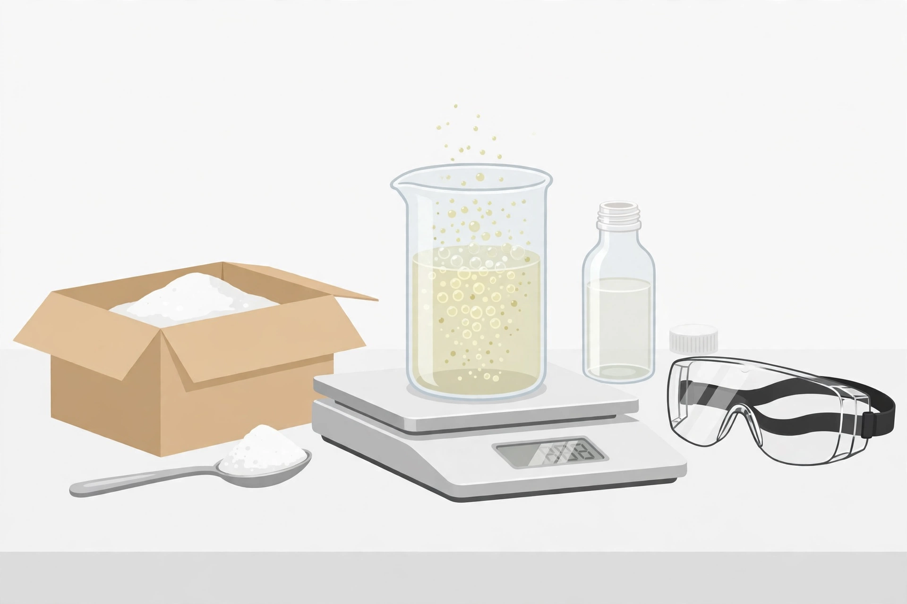

# Lesson 01 — Evidence of Change and the Five Reaction Types

**Goal:** By the end of this lesson you can tell a chemical change from a physical change using
evidence, and you can classify a reaction as synthesis, decomposition, single replacement,
double replacement, or combustion from its equation pattern.

**Time:** ~50 minutes. **Materials:** notebook, this lesson, the bench illustration in the
activity below, Practice Set A.

## Readiness check (5 minutes)

1. From Unit 03: what does the subscript in H₂O tell you, and why can you not change it to H₃O
   to "fix" an equation? (Answer: the subscript says how many atoms of that element are in one
   unit of the compound. Changing it changes the substance itself — H₃O is not water.)
2. Write one change you saw in your kitchen this week (melting, burning, dissolving, rusting).
   Is it chemical or physical? One sentence with your reason.

(If the readiness check is shaky, re-read Unit 03, Lesson 02: a formula is a substance's
identity card. Coefficients say *how many* units react; subscripts say *what the unit is*.)

## Teaching

### Chemical change vs. physical change

A **physical change** changes how a substance looks or where it is, but not what it is. Ice
melts to water, salt dissolves in water, paper tears. The particles are the same; only their
arrangement or state changed. You can usually reverse it.

A **chemical change** makes new substances with new properties. The atoms are rearranged into
different compounds. Evidence that a chemical change happened includes:

- a gas is produced (bubbles that are not from boiling),
- a **precipitate** forms — a solid appearing in a liquid where there was none,
- a colour change that is not just mixing colours,
- a temperature change with no heating or cooling applied,
- light given off,
- an odour that was not there before.

No single piece of evidence is proof by itself. Bubbles can come from boiling (physical).
Colour can change when two coloured liquids mix (physical). That is why chemists look for
several lines of evidence together, and why Session 2 has you test each observation against a
control.

### The five reaction patterns

Every reaction in this unit fits one of five patterns. Learn the pattern, and you can predict
the products of a reaction you have never seen.

| Type | Pattern | In words |
|---|---|---|
| **Synthesis** | A + B → AB | Two or more simple substances combine into one compound |
| **Decomposition** | AB → A + B | One compound breaks into two or more simpler substances |
| **Single replacement** | A + BC → AC + B | A more reactive element takes the place of a less reactive one in a compound |
| **Double replacement** | AB + CD → AD + CB | The partners swap: two compounds exchange parts |
| **Combustion** | Fuel + O₂ → CO₂ + H₂O | A substance burns in oxygen, making carbon dioxide and water (for fuels containing C and H) |

Combustion is the one pattern with a fixed product pair: if a hydrocarbon burns completely in
oxygen, the products are carbon dioxide and water. That fact is used constantly in Lessons 04–05.

### Worked example 1 — Classifying from a word description

*Methane gas burns in oxygen, producing carbon dioxide and water. What type of reaction is this,
and what is its skeleton equation?*

**Reasoning.** Burning in oxygen is the combustion pattern: fuel + O₂ → CO₂ + H₂O. The fuel is
methane, CH₄. So the skeleton equation (unbalanced, formulas only) is:

CH₄ + O₂ → CO₂ + H₂O

The evidence that this is chemical, not physical: new substances (CO₂ and H₂O) with properties
unlike methane or oxygen, plus heat and light given off. Balancing this equation is Lesson 02's
job — here, only the pattern matters.

### Worked example 2 — Single replacement with evidence

*A zinc strip is placed in blue copper sulfate solution. After ten minutes the blue colour fades
and the strip is coated with a reddish-brown solid. Classify the reaction and explain the
evidence.*

**Reasoning.** The pattern is single replacement: Zn + CuSO₄ → ZnSO₄ + Cu. Zinc takes copper's
place in the compound; copper metal appears as the reddish-brown coating. The evidence is
chemical: the blue colour of dissolved copper ions fades (Cu²⁺ leaves the solution) and a new
solid with new properties (copper metal) appears. This is not dissolving — dissolving does not
create a new solid or destroy the blue colour permanently. A common error is to call this
"mixing": mixing keeps both substances; here copper sulfate is consumed and zinc sulfate is made.

### Activity — Reading the bench illustration

Look at the illustration in `../assets/reaction-bench-illustration.png` (also described in the
text alternative below).

1. Name each item you can identify: the open box, the spoon, the beaker, the bottle, the cap,
   and the goggles. Which item measures mass, and which item protects the eyes?
2. The liquid in the beaker is fizzing and bubbles are rising. Name two things that fizzing
   could mean, and state which extra observation would decide between them (hint: is the
   beaker being heated?).
3. The adult in this scene has put the beaker on the balance *before* the reaction finishes.
   Why would a chemist weigh a reacting mixture while it is still reacting? (Answer in the
   project: to catch the mass that escapes as gas.)
4. Safety check: list three things in this picture that show safe practice, and one thing you
   would still check before starting (for example: is the vinegar bottle labelled, and what
   percentage does it say?).

**Text-only alternative (same information, no picture needed):** A laboratory bench holds: an
open cardboard box of white powder (baking soda); a metal spoon holding a heap of the same white
powder; a glass beaker of pale fizzing liquid standing on a digital balance; a small clear bottle
of colourless liquid (vinegar) with its cap beside it; and a pair of clear safety goggles with a
black strap. The fizzing liquid is bubbling without being heated. Every question above can be
answered from this description alone.

*Caption: AI illustration of the bench setup for the Unit 04 project. It shows equipment and
safety gear, not a real experiment — the learner's own measurements are the project's data.*

## Guided practice

Work these with the adult or a partner; check your reasoning, not just your label.

1. Hydrogen gas and oxygen gas combine to form water. Type? Skeleton equation?
2. Calcium carbonate is heated and breaks into calcium oxide and carbon dioxide. Type? Why is
   heating mentioned — is heating itself the evidence of chemical change?
3. Silver nitrate solution and sodium chloride solution are mixed and a white solid appears.
   Type? What is the evidence, and what is the white solid's likely identity? (Hint: the two
   compounds swap partners; one product is insoluble.)

## Independent practice

Do Practice Set A (reaction types and evidence). Show the pattern you matched for each item.

## Application

Write a two-sentence explanation a younger student could understand: why is rusting a chemical
change but melting an ice cube a physical change? Use the word "new substance" in your answer.

## Exit check

1. Name two pieces of evidence of chemical change and one observation that is *not* good
   evidence on its own.
2. Classify: 2Mg + O₂ → 2MgO. Which pattern, and how do you know?

## Supports and extension

- **Support:** keep the five-pattern table open while classifying. Say the pattern aloud
  ("two things become one — synthesis") before writing the label.
- **Extension:** a reaction produces a gas and the temperature drops. Is the temperature drop
  evidence for or against a chemical change? Defend your answer in three sentences (hint: a
  temperature change with no external heating or cooling *is* listed evidence — but what else
  could cool a mixture? Evaporation. So you still need a second line of evidence).
- **Alternate response mode:** you may answer the exit check orally.

## Teacher note

Common misconceptions: "bubbles = chemical change" (boiling also bubbles — Session 2's control
exists for this reason); "dissolving = chemical change" (salt water still contains salt and
water); "colour change always means reaction" (mixing paint changes colour physically).
Answer-key reference: `../answer-key.md`, Lesson 01.
