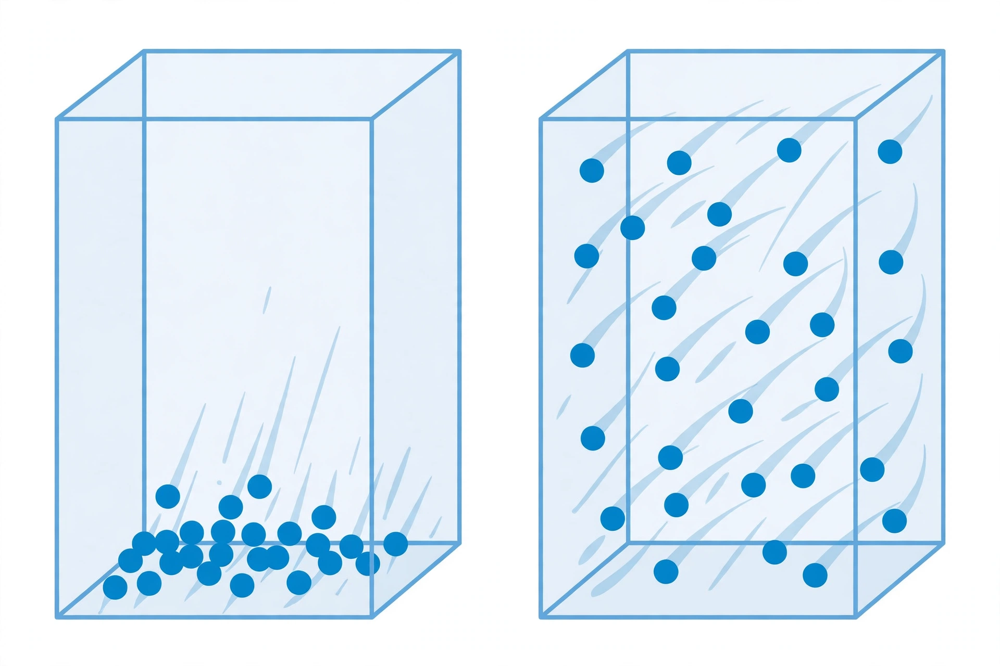

# Lesson 01 — Kinetic Molecular Theory: Particles in Motion

**Goal:** By the end of this lesson you can state the five postulates of kinetic molecular
theory (KMT), use them to explain why a gas fills its container, and spot what a particle
picture gets right and what it exaggerates.

**Time:** ~50 minutes. **Materials:** the generated illustration
(`../assets/gas-particles-cool-hot.png`), notebook, Practice Set A.

## Readiness check (5 minutes)

1. From grade 8: what does the particle model say is different about the particles in a solid,
   a liquid, and a gas?
2. A balloon left in a hot car gets tighter. A balloon left in a freezer goes soft. What do you
   think the gas particles inside are doing differently in the two cases?

(If the readiness check is shaky, re-read the grade-8 idea first: all matter is made of tiny
particles in constant motion, and the amount of motion depends on temperature.)

## Teaching

### What kinetic molecular theory claims

Kinetic molecular theory is a **model** — a set of ideas that explains what we observe about
gases. It has five postulates (starting assumptions):

1. **A gas is mostly empty space.** Its particles are tiny compared with the distances between
   them. That is why gases can be squeezed into much smaller volumes.
2. **Gas particles are in constant, random, straight-line motion.** They move in every direction
   until they hit something — another particle or a wall — and then they bounce off.
3. **Collisions are elastic.** "Elastic" means no kinetic energy is lost in the collision
   itself; the particles just trade energy and speed. (Energy can still be added or removed by
   heating or cooling the gas as a whole.)
4. **Gas particles exert no attractive or repulsive forces on each other.** In the ideal model,
   particles ignore each other between collisions. Real gas particles do attract each other
   slightly — that is exactly what Lesson 04 is about — but for most gases at ordinary
   pressures the attraction is small enough to ignore.
5. **The average kinetic energy of the particles is directly proportional to the absolute
   temperature.** Hotter gas means faster particles, on average. "Absolute temperature" means
   the kelvin scale (see below), not Celsius.

Two consequences follow immediately. First, a gas **fills its container**: particles in random
straight-line motion spread out until they hit walls in every direction, so the gas takes the
shape and the volume of whatever holds it. Second, gas **pressure is the result of collisions**:
each time a particle hits a wall it pushes on it, and pressure is the total push of countless
collisions divided by the wall's area.

### The image activity

Look at the illustration in `assets/` (reproduced below). It shows the same number of blue
particles in two identical glass boxes.

*Figure 1 — The same gas, cool (left) and hot (right). Generated illustration; see
`assets/README.md` for the generation record. Caption: cool gas particles move slowly
(short trails); hot gas particles move fast (long trails) and spread through the box.*

**Text-only alternative:** Both boxes hold the same number of identical blue particles. In the
left box the particles sit low in the box and have short motion trails, meaning slow motion.
In the right box the particles are spread through the whole box and have long motion trails,
meaning fast motion. The question below asks what the picture exaggerates.

Now the important part: **the picture is useful, but it is not perfectly true.** It gets two
things right and one thing wrong.

- **Right:** hotter particles move faster (longer trails), and the same number of particles is
  in each box.
- **Wrong (the exaggeration):** the cool gas is drawn clustered at the bottom, as if cold gas
  settles like a liquid. In reality a gas fills its container at *any* temperature — cool gas
  particles are still spread through the whole box, just moving more slowly and hitting the
  walls less often and less hard. The clustering is a drawing shortcut to make "slow" visible,
  not a fact about gases.

That is why this course always asks you to critique its own pictures: a model that helps you
see one idea can quietly smuggle in a wrong one.

### Absolute temperature and the kelvin scale

Postulate 5 says average kinetic energy is proportional to **absolute** temperature. The
Celsius scale cannot be used for that, because 0 °C is not "no motion" — particles still move
at 0 °C. The kelvin scale starts at **absolute zero, 0 K = −273.15 °C**, the temperature at
which particle motion would (in the classical picture) stop. Convert with:

> **K = °C + 273** (273.15 for exact work; 273 is enough for this unit)

So 0 °C = 273 K, 25 °C = 298 K, and 100 °C = 373 K. Notice that doubling a Celsius temperature
means nothing for particle energy — but doubling a kelvin temperature really does double the
average kinetic energy. Lesson 03 will show why forgetting this conversion breaks every gas-law
calculation.

### Worked example 1 — reading the model

*A sealed rigid box of gas is heated from 300 K to 600 K. What happens to the average kinetic
energy of its particles, and what happens to the pressure?*

Step 1 — Kinetic energy: postulate 5 says average kinetic energy is proportional to kelvin
temperature. 600 K is twice 300 K, so the average kinetic energy **doubles**.
Step 2 — Pressure: faster particles hit the walls more often and harder, so the pressure
**increases** — it also doubles, because the volume is fixed (this is Gay-Lussac's law, proved
in Lesson 03).
Step 3 — What does *not* change: the number of particles, and the mass of gas in the box.

### Worked example 2 — what the model rules out

*A student says: "If I cool a gas to 0 °C, its particles stop moving." Use KMT to explain the
mistake.*

Step 1 — Convert: 0 °C = 273 K, not 0 K. Particle motion stops (in the model) only at 0 K.
Step 2 — At 273 K the particles still have substantial kinetic energy; they move more slowly
than at 373 K, but they do not stop.
Step 3 — The correct statement: cooling from 373 K to 273 K lowers the average kinetic energy
to 273/373 ≈ 0.73 of its old value — about a 27% drop, not a stop.

### A common trap

"Gas particles attract each other, so a gas should collapse into a puddle." Postulate 4 says the
*ideal* model ignores attractions — and that is why the model works well for real gases at
ordinary pressures: the attractions are real but weak compared with the particles' kinetic
energy. When the gas is cooled or squeezed enough, the attractions *do* win, and the gas
condenses. That boundary — where the ideal model breaks — is the subject of Lessons 04 and 05.

## Guided practice

Work these with your adult or a partner; hints are in brackets.

1. A gas is pumped out of a rigid container until half the particles are gone, at the same
   temperature. What happens to the pressure, and why? [Fewer particles means fewer wall
   collisions per second.]
2. Two identical balloons hold the same gas. One is at 200 K, the other at 400 K. Which
   balloon's particles have the greater average kinetic energy, and by what factor?
   [Postulate 5; use kelvin, not Celsius.]
3. Look at Figure 1 again. Name one thing the picture gets right, one thing it exaggerates,
   and write the correct statement for the exaggerated part. [The exaggeration is the
   clustering; a gas fills its container at any temperature.]

## Independent practice

Complete Practice Set A (in `practice.md`). Then answer this application question in your
notebook: a car tire reads 32 psi in the morning at 10 °C and 35 psi in the afternoon at
30 °C. The tire's volume barely changes. Explain in two or three sentences, using KMT, why
the pressure went up — and say whether the number of particles inside changed.

## Exit check

Without looking back: (a) state postulate 5 in your own words; (b) convert 25 °C to kelvin;
(c) a gas is heated from 250 K to 500 K at fixed volume — what happens to its average kinetic
energy?

## Supports and extensions

- **Reading/language access:** say each postulate aloud as a plain sentence ("the particles
  never stop moving") before writing the formal version.
- **Alternate response mode:** act out the model — walk slowly in a marked square for the cool
  gas, then quickly for the hot gas, and count how often you touch the boundary. The count is
  your pressure.
- **Extension:** research (resource pack) what happens to KMT at extremely high pressures, and
  write two sentences on why the "no volume, no attraction" postulates fail there.

## Teacher note

Likely misconceptions: (1) learners think cold gas sinks or settles — the image critique in
this lesson is the antidote, and it should be revisited whenever a learner draws gas particles
clustered at a bottom; (2) learners use Celsius in proportional reasoning — drill "kelvin
first, always" from this lesson onward; (3) learners think pressure comes from particles
pushing each other — stress that pressure is particles hitting the *walls*. Answer-key
reference: `answer-key.md`, Set A.
