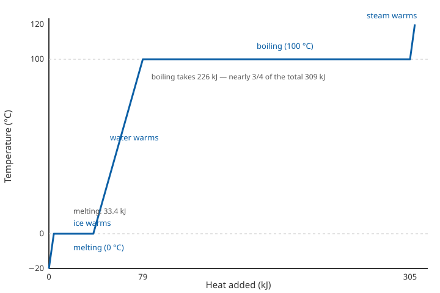

# Lesson 05 — Phases, Heating Curves, and Phase Diagrams

**Goal:** By the end of this lesson you can describe what happens at the particle level in each
phase change, read a heating curve (including its flat plateaus), and read a phase diagram
qualitatively.

**Time:** ~50 minutes. **Materials:** notebook, the heating-curve diagram
(`../assets/heating-curve-water.svg`), Practice Set E.

## Readiness check (5 minutes)

1. From Lesson 04: what must happen, at the particle level, for a liquid to boil?
2. Why does ice stay at 0 °C while it melts, even though heat is still being added?
3. What is the difference between evaporation and boiling?

(If the readiness check is shaky, re-read Lesson 04 on IMFs and vapor pressure first.)

## Teaching

### Phase changes: energy in, energy out

A phase change rearranges particles; it does not change what the particles *are*. The six
changes are:

| Change | From → to | Energy | Particle picture |
|---|---|---|---|
| Melting (fusion) | solid → liquid | absorbed | particles gain enough energy to slide past each other |
| Freezing | liquid → solid | released | particles lock into fixed positions |
| Vaporization (boiling/evaporation) | liquid → gas | absorbed | particles escape the liquid entirely |
| Condensation | gas → liquid | released | particles are captured back into the liquid |
| Sublimation | solid → gas | absorbed | particles escape directly from the solid |
| Deposition | gas → solid | released | particles lock straight into a solid |

**Evaporation** happens only at the surface, at any temperature: the fastest surface molecules
escape. **Boiling** happens throughout the liquid, only when the vapor pressure equals the
outside pressure — that temperature is the **boiling point**. At lower outside pressure (a
mountaintop), water boils below 100 °C, because its vapor pressure reaches the lower outside
pressure sooner. That is why recipes change with altitude.

### The heating curve: plateaus mean work, not rest

The diagram below is the heating curve for water, drawn to scale from the constants in the
unit README. Study it before reading on.

*Figure 2 — Heating curve for 100 g of water, from ice at −20 °C to steam at 120 °C. Flat
segments are phase changes: melting at 0 °C and boiling at 100 °C. Exact diagram; see
`assets/README.md`.*

**Text-only alternative:** The curve has five segments. (1) Ice warms from −20 °C to 0 °C.
(2) Flat at 0 °C while the ice melts. (3) Liquid water warms from 0 °C to 100 °C. (4) Flat at
100 °C while the water boils. (5) Steam warms from 100 °C to 120 °C. The boiling plateau is
much longer than the melting plateau, because vaporizing water takes far more energy than
melting ice.

Why is the curve flat during a phase change? The added energy is not raising the temperature —
it is **breaking intermolecular forces**. While ice melts, every joule goes into pulling water
molecules out of their fixed lattice; the average kinetic energy (temperature) stays at 0 °C
until the last crystal is gone. The same happens at 100 °C: energy breaks the remaining
hydrogen bonds so molecules can escape as gas. Only when the change is complete does the
temperature rise again.

The numbers make the point. For 100 g of water, using the given constants (specific heats:
ice 2.09, water 4.18, steam 2.01 J/g·°C; heat of fusion 334 J/g; heat of vaporization
2,260 J/g):

- Warm ice −20 °C → 0 °C: 100 × 2.09 × 20 = **4,180 J**
- Melt at 0 °C: 100 × 334 = **33,400 J**
- Warm water 0 °C → 100 °C: 100 × 4.18 × 100 = **41,800 J**
- Boil at 100 °C: 100 × 2,260 = **226,000 J**
- Warm steam 100 °C → 120 °C: 100 × 2.01 × 20 = **4,020 J**
- **Total: about 309,400 J (≈ 309 kJ)** — and nearly three-quarters of it is the boiling step
  alone. That is why a kettle takes so long to boil dry after it reaches 100 °C.

### Phase diagrams: a map of stability

A **phase diagram** plots pressure (vertical axis) against temperature (horizontal axis) and
shows which phase is stable in each region. Three features matter:

- **Lines** are the boundaries where two phases coexist in equilibrium: the melting line
  (solid–liquid), the boiling line (liquid–gas), and the sublimation line (solid–gas).
- **The triple point** is where all three lines meet — the single temperature and pressure at
  which solid, liquid, and gas coexist. For water it is 0.01 °C at 0.006 atm.
- **The critical point** ends the boiling line: beyond it, liquid and gas become
  indistinguishable (a "supercritical fluid"). For water it is 374 °C at 218 atm.

Two readings of the water diagram are worth remembering. First, below 0.006 atm, liquid water
cannot exist at any temperature — ice sublimes straight to vapor, which is why freeze-drying
works and why exposed water on the Moon would not sit as a puddle. Second, carbon dioxide's
triple point is −56.6 °C at 5.11 atm, *above* normal pressure — so at 1 atm there is no
temperature at which liquid CO₂ is stable, and dry ice sublimes at −78.5 °C instead of melting.
That single fact explains dry ice.

### Worked example 1 — reading the heating curve

*How much energy is needed to melt 50.0 g of ice at 0 °C, and how much to boil 50.0 g of water
at 100 °C?*

Step 1 — Melting: q = m × ΔH_fusion = 50.0 g × 334 J/g = 16,700 J (16.7 kJ).
Step 2 — Boiling: q = m × ΔH_vaporization = 50.0 g × 2,260 J/g = 113,000 J (113 kJ).
Step 3 — Comparison: boiling takes 113,000 / 16,700 ≈ 6.8 times as much energy as melting —
because vaporization must break essentially *all* the hydrogen bonds, while melting only
loosens the lattice.

### Worked example 2 — reading a phase diagram

*A sample of water is held at 25 °C while the pressure is slowly lowered from 1 atm to
0.001 atm. What happens?*

Step 1 — At 25 °C and 1 atm, water is a liquid (right of the melting line, below the boiling
line).
Step 2 — Lowering the pressure crosses the boiling line at the vapor pressure of water at
25 °C (23.8 mmHg ≈ 0.031 atm): the water begins to boil at room temperature.
Step 3 — Below 0.006 atm, the liquid region is gone entirely: any remaining liquid boils away
and the water ends as vapor. The sample never freezes in this path — freezing would need the
temperature to fall, not the pressure.

### A common trap

"The temperature stays the same during melting, so no energy is being added." Wrong — energy
*is* being added the whole time; it is being stored as potential energy as intermolecular
forces are broken, instead of showing up as faster motion. A plateau on a heating curve is
evidence of energy doing invisible work, not of nothing happening.

## Guided practice

Work these with your adult or a partner; hints are in brackets.

1. Use Figure 2: at which temperatures are the plateaus, and what is happening at each one?
   [0 °C melting; 100 °C boiling.]
2. How much energy melts 200 g of ice at 0 °C? How much boils 200 g of water at 100 °C?
   [Multiply the 100 g values by 2 — or recompute from the constants.]
3. A hiker at high altitude finds water boiling at 90 °C. Is the air pressure there higher or
   lower than at sea level? Explain with vapor pressure. [Boiling happens when vapor pressure
   equals outside pressure; lower boiling point means lower outside pressure.]

## Independent practice

Complete Practice Set E (in `practice.md`). Then answer this application question in your
notebook: dry ice (solid CO₂) is used to keep food cold without leaving a puddle. Explain why
it never melts at normal pressure, using the triple-point values from this lesson.

## Exit check

Without looking back: (a) name all six phase changes; (b) why is a heating curve flat during
boiling? (c) What is the triple point?

## Supports and extensions

- **Reading/language access:** trace Figure 2 with a finger while narrating each segment aloud
  ("warming… melting… warming… boiling… warming") before answering any question about it.
- **Alternate response mode:** build the heating curve as a table first (segment, temperature
  range, energy) and only then sketch it — the table is the text-only alternative.
- **Extension:** research (resource pack) why water's melting line slopes the "wrong" way
  (ice is less dense than water) and write two sentences on what that means for lakes in
  winter.

## Teacher note

Likely misconceptions: (1) learners think evaporation and boiling are the same — contrast
surface-only vs. throughout, any-temperature vs. one-temperature, every lesson until it sticks;
(2) learners read a plateau as "nothing happening" — the energy-accounting calculation in this
lesson is the fix; (3) learners think the triple point is where a substance *changes* phase —
it is where three phases *coexist*. Answer-key reference: `answer-key.md`, Set E.
