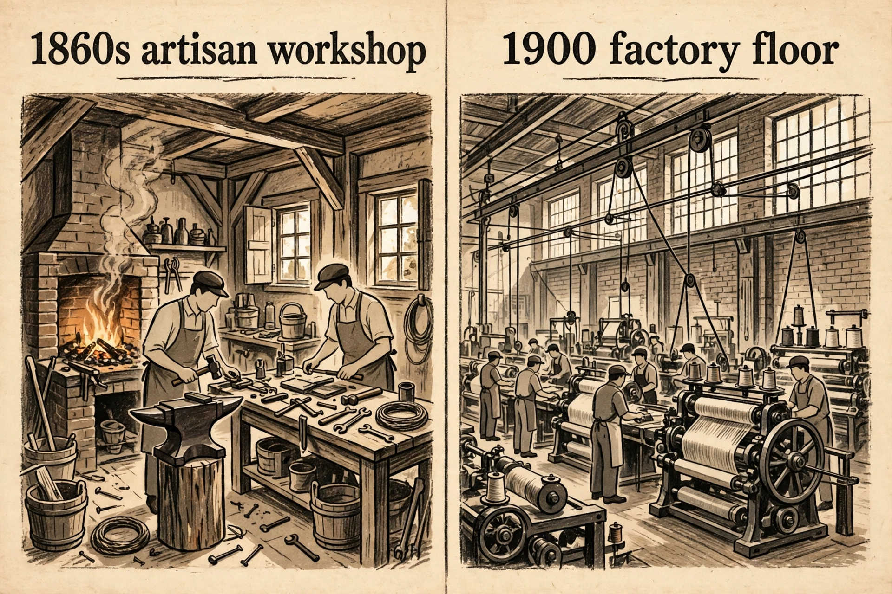

# Lesson 4 — Industrialization: Railroads, Steel, and the Corporation

**Goal:** You will explain how railroads, steel, and the corporate form
transformed American production and markets between 1865 and 1900, read
industrial-growth data accurately, and use the generated illustration to
analyze change and continuity in work.

**Time:** about 50 minutes. **Materials:** this lesson, notebook, the
unit's generated image (`../assets/workshop-vs-factory-illustration.png`).
**Readiness check:** Name two causes of Reconstruction's end from Lesson 3.
Today the economy takes center stage — but keep citizenship in mind: the
unit's question is who industrial America *included*.

## Part 1 — The railroad as the first big business

Between 1865 and 1900, U.S. railroad track grew from about **35,000 miles
to about 193,000 miles** — the network multiplied more than fivefold, and
by 1916 it would peak near 254,000 miles. (Sources: U.S. Census Bureau
railroad statistics via census.gov, May 2023; American Association of
Railroads chronology; checked 2026-10-14.)

The railroad was not just transportation. It was America's first truly
national, capital-intensive industry, and it invented the modern
corporation's toolkit:

- **Scale of capital.** A transcontinental line cost tens of millions of
  dollars — far beyond any individual or partnership. Railroads sold
  **stocks and bonds** to thousands of investors, creating the first mass
  securities markets.
- **The transcontinental link.** On **May 10, 1869**, the Central Pacific
  and Union Pacific met at Promontory Summit, Utah — 1,776 miles of track
  joining the coasts. Over 13,000 Chinese laborers built the Central
  Pacific's share through the Sierra Nevada. Travel that had taken four to
  six months by wagon now took about a week. (Source: Gilder Lehrman
  Institute transcontinental railroad fact sheet; checked 2026-10-14.)
- **Management.** Running a continent-spanning railroad required
  timetables, standardized gauges (4 ft 8½ in became standard), division
  managers, cost accounting, and telegraph coordination — the first modern
  managerial hierarchy. Every later big corporation copied the railroad's
  playbook.
- **Land and power.** Federal and state land grants gave railroads over
  170 million acres — more land than the area of Texas — making them the
  nation's largest landlords and giving them enormous political leverage.

**Why it mattered beyond transport:** the railroad created a *national
market*. A farmer in Kansas could sell wheat in New York; a factory in
Pittsburgh could sell steel rails everywhere. That single market made
mass production profitable — and made the factory system possible.

### Worked example 1 — Reading growth data honestly

*Question:* "Railroad mileage grew 450% between 1865 and 1900." Is this
accurate, and what does it leave out?

*Model reasoning:* The math checks: 35,000 → 193,000 is about a 5.5×
increase, i.e., roughly 450% growth. But the percentage hides the
*shape* of growth: the 1880s alone added about 70,000 miles (the fastest
decade in American history), while growth slowed sharply in the 1890s
after the Panic of 1893 bankrupted overbuilt lines. A single percentage
for a 35-year span is true and misleading — always ask *when* the growth
happened and *why it stopped*. Data answers "how much"; history answers
"why then."

### Worked example 2 — Cause and effect chains

*Question:* Trace one cause-and-effect chain from railroad expansion to a
change in ordinary people's daily lives.

*Model reasoning:* Railroad expansion → cheap long-distance freight →
national brands and mail-order catalogs (Montgomery Ward, 1872; Sears,
1886) → a farm family in Nebraska buys factory-made tools, cloth, and
furniture instead of making or buying locally → local artisans lose
customers; family consumption depends on cash income from distant markets.
Each arrow must be defensible: the catalog companies really did ride the
rails, and local craft production really did decline. If any link in your
chain is asserted without evidence, the chain breaks there.

## Part 2 — Steel, oil, and the new industrial giants

**Steel.** The Bessemer process (Henry Bessemer in Britain; developed
independently by American William Kelly) blew air through molten iron to
burn out impurities, making steel cheap for the first time. In **1877**,
American mills made about **432,000 tons of steel rail** — more than the
333,000 tons of iron rail that year, the crossover moment. By about
**1890 the United States had overtaken Britain** as the world's leading
steel producer; by 1900 American mills produced more steel than Britain
and Germany combined. (Sources: MRS "Carnegie" module; eng.libretexts.org
steel history; checked 2026-10-14.) Andrew Carnegie's mills drove costs
down relentlessly through **vertical integration** — owning the Minnesota
iron mines, the Great Lakes ore ships, the railroads, and the Pittsburgh
mills, so no middleman took a cut at any stage.

**Oil.** John D. Rockefeller's Standard Oil (founded 1870) did for
kerosene — then gasoline — what Carnegie did for steel, using **horizontal
integration**: buying or bankrupting competing refineries until one
**trust** controlled refining and prices. By the early 1880s Standard Oil
controlled the overwhelming share of U.S. refining.

**The corporation and the trust.** The limited-liability corporation let
investors pool vast capital without risking more than their shares; the
trust let a few men coordinate entire industries. Defenders said this
brought cheaper goods (steel rails, kerosene, and later electricity really
did get cheaper). Critics said it concentrated power beyond any democratic
control — the question the Sherman Antitrust Act (1890) tried, weakly, to
answer. Notice the citizenship echo: the 14th Amendment's "person" would
eventually be read to protect *corporations* too — the same text that
failed Black citizens in *Plessy* served corporate litigants well.

## Part 3 — Image study: the workshop and the factory

Open `../assets/workshop-vs-factory-illustration.png`.

*Caption: AI-generated illustration (not historical evidence) contrasting
an 1860s artisan workshop with a 1900 factory floor. Generated 2026-10-14
for change-and-continuity analysis; see `assets/README.md` for the full
record.*

**Text-only alternative:** The left panel shows a small timber-framed
workshop: a brick forge with fire, an anvil, a workbench covered in hand
tools (hammers, wrenches, files), and two adult workers shaping metal by
hand. The right panel shows a large brick factory: rows of large machines
connected by overhead belts and shafts, tall windows, and about a dozen
workers each tending one machine. Labels read "1860s artisan workshop"
and "1900 factory floor."

Study the image, then answer in your notebook:

1. List **three continuities** (what is the same in both panels: human
   labor, metalwork, daylight, skill?) and **three changes** (scale,
   power source, division of labor, the worker's relationship to the
   finished product).
2. In the workshop, who decides *how* the work is done? In the factory,
   who decides? What did the artisan lose, and what did the factory
   worker gain (if anything)?
3. **Limitation check:** This image is an AI reconstruction. Name one
   thing it *cannot* tell you about real 1860s or 1900s workplaces, and
   one kind of source that could.

## Guided practice

1. Using the railroad figures, compute the approximate mileage added in
   the 1880s (93,000 → 163,000) and state in one sentence why the 1880s
   were the peak building decade. *(Check: ~70,000 miles.)*
2. Explain vertical integration using Carnegie's steel empire in 3
   sentences. Then explain horizontal integration using Standard Oil.
3. Write a 4-sentence cause/effect paragraph: how did cheap steel change
   what railroads could build, and how did bigger railroads change what
   steel mills could sell? (This is a **feedback loop** — name it as
   such.)

## Independent practice

4. A textbook says "industrialization made everyone richer." Using the
   workshop/factory image and Part 2, write a 5-sentence evaluation:
   who got richer, who paid costs, and what the sentence hides.
5. Explain the connection between railroad land grants and political
   power in 4 sentences: why would a railroad's 170-million-acre land
   holdings translate into influence over Congress and state
   legislatures?
6. **Error analysis.** A classmate's chain reads: "The Bessemer process
   → cheap steel → more railroads → national market → factories."
   Identify the **missing link** between "more railroads" and "national
   market" (hint: what had to be *standardized* for freight to move
   seamlessly?), and add one **branching effect** the chain ignores
   (e.g., what happened to local producers).

## Application

7. **Data task.** Using the railroad-mileage figures (35,000 in 1865;
   193,000 in 1900) and the 1877 steel-rail crossover (432,000 tons
   steel vs. 333,000 tons iron), write a 6-sentence briefing for a
   fictional 1880 investor: is American industry a good bet? Cite both
   datasets, note one risk (overbuilding, the coming 1893 panic —
   flagged, not explained), and give a recommendation.

## Exit check

8. Define in one sentence each: *corporation*, *vertical integration*,
   *trust*. Then write one sentence connecting industrialization to the
   unit's essential question.

## Supports, extensions, teacher note

- **Reading support:** The adult pre-teaches "securities," "gauge," and
  "feedback loop" before Part 1; the data tasks allow calculators.
- **Alternate response mode:** The image-study answers may be recorded
  as an annotated printout with arrows and labels instead of prose.
- **Extension:** Research the 1886 "Day of the Dead" gauge
  standardization (Southern railroads converted ~11,500 miles to
  standard gauge in 36 hours). Write 6 sentences on why standardization
  was an economic revolution disguised as a technical fix.
- **Teacher note:** The image is deliberately *not* evidence — Part 3's
  limitation check teaches that AI illustrations organize thinking but
  prove nothing. Answer key: `../answer-key.md` (Lesson 4).
  Misconception watch: "technology caused industrialization by itself"
  — press on capital, law (corporations, land grants), and labor as
  co-causes.
