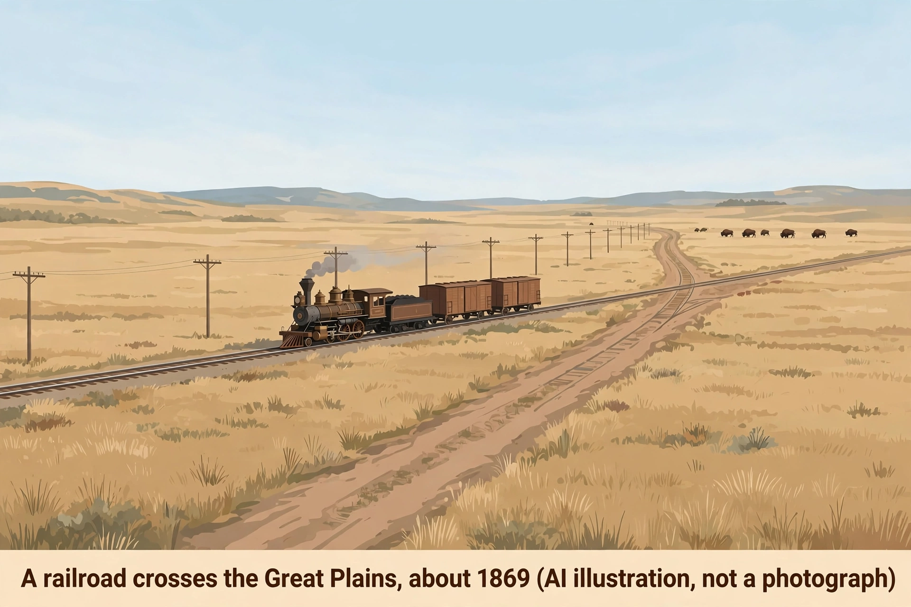

# Lesson 1 — The Transcontinental West: Railroads, Land Policy, and Native Dispossession

**Goal:** You will explain how railroads, federal land policy, and war
remade the West between 1865 and 1890, and why Native nations lost land
even when treaties promised to protect it.

**Time:** about 50 minutes. **Materials:** this lesson, a notebook,
timeline space. **Adult note:** this lesson covers conquest and a
massacre. Sources are documentary and textual; no graphic imagery is
used. Preview the Wounded Knee discussion and frame it around evidence
and remembrance.

**Readiness check (2 minutes):** From Unit 01, name one thing the
federal government did during Reconstruction that changed citizenship
on paper. (If you can't: re-read Unit 01, Lesson 2 — the Reconstruction
Amendments. This lesson asks a parallel question: what did federal
policy change on paper in the West, and what happened in practice?)

## Part 1 — A railroad across a continent that was already inhabited

On May 10, 1869, at Promontory Summit, Utah, the Central Pacific and
Union Pacific railroads were joined, completing the first
transcontinental railroad. A journey that had taken months by wagon now
took about a week by rail. Railroads did three things at once: they
moved settlers, cattle, and crops cheaply; they moved soldiers quickly;
and they made the land along the tracks valuable. Railroad companies
received huge federal land grants — alternating sections of land along
their lines — which they sold to settlers to finance construction.

Settlers came under the Homestead Act of 1862: 160 acres to any adult
(or head of household) who lived on the claim and improved it for five
years. The offer sounded generous, but it assumed the land was empty.
It was not. The Plains were home to Native nations — Lakota, Cheyenne,
Arapaho, Comanche, Kiowa, Pawnee, and others — who hunted bison,
farmed river valleys, and had treaty rights to large territories.

Two economies collided. The bison herds that fed Plains nations were
hunted nearly to extinction in the 1870s and 1880s — by commercial
hide hunters, by railroads feeding construction crews, and, as some
Army officers openly admitted, as a deliberate way to destroy the
Plains nations' food supply and force them onto reservations. When the
food base collapsed, the choice offered to Native peoples was stark:
accept reservation life and government rations, or starve.

### Worked example 1 — On paper vs. in practice

*Question:* The Treaty of Fort Laramie (1868) created a Great Sioux
Reservation of about 60 million acres and promised that the Lakota
would keep it. By 1877 it had shrunk to about 21.7 million acres, and
after the Dawes Act (1887) to about 12.7 million. What does this
sequence show about treaty promises?

*Model reasoning:* A treaty is a promise between governments, but this
sequence shows a promise can be broken in stages. First, the
reservation shrank when gold was found in the Black Hills (inside the
reservation) and the government forced a new agreement in 1877. Then
allotment divided what remained into individual parcels and sold the
"surplus." The lesson is not that treaties never mattered — Native
nations have used them in court ever since — but that a promise on
paper is only as strong as the power willing to enforce it. Note the
method: the answer uses three dated figures, not a general claim like
"the government was unfair."

### Worked example 2 — Cause, or excuse?

*Question:* A textbook says "the railroad brought progress to the
West." A Lakota account says the railroad brought soldiers, hunters,
and land loss. Can both be true?

*Model reasoning:* Yes — because "progress" depends on whose story you
tell. For a settler in Nebraska, the railroad meant cheaper freight and
a market for wheat: real progress. For a Lakota family, the same
railroad meant bison herds cut in half by the tracks, hide hunters, and
soldiers arriving faster: real loss. A good historical answer does not
pick one side's word ("progress" or "disaster") and stop. It names who
gained, who lost, and by what mechanism — here, the mechanism was land
grants, hunting, and military supply. That is the difference between a
slogan and an explanation.

## Part 2 — Allotment: the policy that broke up the land

The Dawes General Allotment Act of February 8, 1887, divided
communally held tribal land into individual allotments — typically 160
acres per family head — and declared the remaining land "surplus," to
be sold to settlers. Supporters, including many sincere reformers,
argued that private property would turn Native people into farmers and
citizens. The mechanism produced the opposite of what its supporters
claimed for Native welfare: between allotment and later sales, tribal
landholdings fell from about 138 million acres in 1887 to about 48
million by 1934. Individual allottees, often without farming capital
or credit, lost parcels to taxes, fraud, or forced sales.

Allotment was paired with assimilation policy: boarding schools, often
far from home, where Native children were forbidden to speak their
languages or practice their religions. The policy's stated goal was
absorption into Euro-American culture; its practical effect was
cultural damage that Native communities are still repairing. When you
read a reformer's claim from this era, always ask: reform *for whom*,
and who decided what "improvement" meant?

## Part 3 — Wounded Knee, and why numbers need care

In 1890 a spiritual movement called the Ghost Dance spread across the
Plains. It taught that Native peoples' renewal was coming and that
they should return to traditional ways. U.S. officials, alarmed,
treated it as a military threat. On December 15, 1890, reservation
police killed the Hunkpapa Lakota leader Sitting Bull during an
attempted arrest. Two weeks later, on December 29, 1890, the U.S. 7th
Cavalry surrounded the band of the Lakota chief Big Foot (Spotted Elk)
at Wounded Knee Creek, South Dakota, and demanded their weapons. A shot
fired during the disarmament — no one agrees who fired first — and the
soldiers opened fire with rifles and Hotchkiss guns on men, women, and
children.

How many Lakota died? The honest answer is a range. The Army buried
146 in a mass grave; others were carried away by relatives or died
later of wounds and exposure. Modern estimates run about 150–300.
Giving a single precise number would pretend to know more than the
record allows. The Army lost 25 soldiers, some likely to friendly fire
in the chaos. Wounded Knee is often called the end of the Indian Wars;
more precisely, it ended organized armed resistance on the Plains. It
did not end Native nations, which continued to fight for their rights
in courts, in Congress, and in their own communities.

*Caption: A railroad crosses the Great Plains, about 1869 (AI
illustration, not a photograph). A generated reconstruction of typical
features — a steam locomotive, telegraph poles, a wagon road, and a
distant bison herd — not a record of a real place or day.*

**Image study — observation vs. inference (use the picture or its
text-only alternative below):** The illustration shows a steam
locomotive and freight cars on a straight track crossing open prairie;
telegraph poles run beside the track; a dirt wagon road parallels the
rails; a small bison herd grazes far away; low hills sit on the
horizon. *Observations* (what is visible): the train, the poles, the
road, the bison, the empty horizon. *Inferences* (what you conclude):
the railroad brings fast transport and communication; the wagon road
suggests older travel is being replaced; the bison's distance hints at
a shrinking food base. *What the image cannot prove:* that this
particular place existed, how any real community experienced the
railroad, or how many bison remained. An illustration is a teaching
reconstruction, never historical evidence.

**Text-only alternative:** "A flat-color illustration of a steam
locomotive with freight cars crossing wide prairie grassland on a
straight track; telegraph poles beside the track; a dirt wagon road
running parallel; a small bison herd in the far distance; low hills on
the horizon." Every question below can be answered from this
description alone.

## Guided practice

1. In your own words, explain why the transcontinental railroad made
   western land more valuable. Name two mechanisms (not just "it
   helped settlers").
2. Worked-example style: A settler in 1875 writes home, "I got 160
   acres free from the government." A Lakota leader the same year
   says, "The government gave away land that was ours by treaty."
   Identify one fact each writer gets right, and explain why the two
   statements do not contradict each other.
3. Use the image study: list two observations and two inferences from
   the illustration, and one thing it cannot prove.
4. Explain the Dawes Act's mechanism in three steps: divide, declare
   surplus, sell. What did each step do to tribal landholdings?

## Independent practice

5. Sequence these events and give one cause/effect link between two
   neighbors: Homestead Act (1862); Treaty of Fort Laramie (1868);
   transcontinental railroad completed (1869); Little Bighorn (1876);
   Dawes Act (1887); Wounded Knee (1890).
6. A student writes: "The Ghost Dance caused Wounded Knee." Revise
   that sentence into a historically careful claim that names at
   least two causes and avoids single-cause language.
7. Error analysis: A classmate claims "the Dawes Act gave Native
   Americans citizenship and solved the Indian problem." Identify two
   errors in that sentence and correct each with evidence from the
   lesson.
8. Explain why historians report Wounded Knee deaths as a range
   (about 150–300) instead of one number. What does the range tell you
   about the evidence?

## Applied task

Write one paragraph answering: *Did federal western policy between
1865 and 1890 aim to help Native nations, hurt them, or both?*
Support your answer with two pieces of evidence from the lesson and
name one limitation of your evidence (for example: a policy's stated
goal is not proof of its effect).

## Exit check

Name the three federal policies in this lesson (Homestead Act, treaty
reservations, Dawes allotment) and, for each, state in one sentence
what it did to Native land.

## Supports and extensions

- **Reading access:** read Part 2 aloud in pairs; the adult pre-teaches
  *allotment*, *surplus*, and *assimilation* before reading.
- **Alternate response mode:** the exit check may be answered as a
  three-row table or a labeled timeline instead of sentences.
- **Extension:** research one boarding school's history from a
  reputable museum or university source (adult-selected) and write
  three sentences on what its records show and what they leave out.

## Teacher note

Likely misconceptions: (1) "The West was empty" — correct with the
treaty and bison evidence; (2) "Allotment helped Indians become
farmers" — correct with the 138-million-to-48-million acre figures and
the mechanism; (3) treating Wounded Knee's death toll as a settled
number — insist on the range and its reason. Answer-key reference:
`answer-key.md`, Lesson 1.
