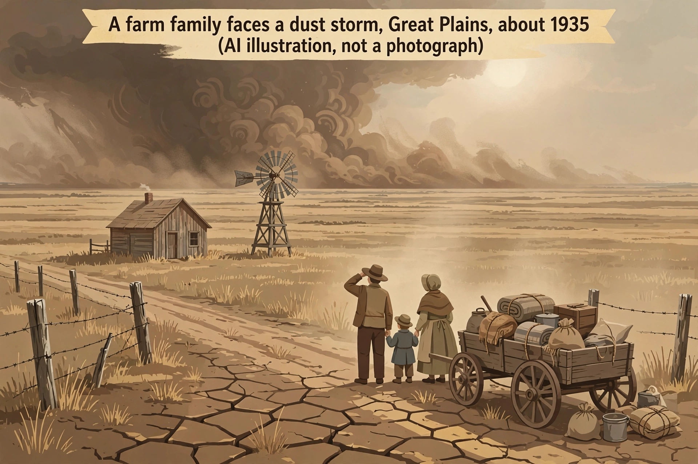

# Lesson 3 — The Human Cost: Unemployment, Hoovervilles, and the Dust Bowl

**Goal:** You will describe what the Depression cost ordinary people
— jobs, savings, homes, and, on the Plains, the land itself — and
you will practice reading an illustration as a reconstruction, not
as evidence.

**Time:** about 50 minutes. **Materials:** this lesson, a notebook,
the illustration (`assets/dust-storm-farm-illustration.png`) and its
text-only alternative below. **Adult note:** this lesson covers
hunger, eviction, homelessness, and the dispersal of protesters.
Sources are documentary and textual; the adult may offer a
reflection alternative for any activity the learner finds
overwhelming.

**Readiness check (2 minutes):** From Lesson 2, state the 1933
unemployment estimate and one reason it is an estimate rather than
a measurement made in 1933. (Answer: about 24.9%, roughly one worker
in four; no modern monthly unemployment survey existed then.)

## Part 1 — A city without work

By 1933, about 13 million Americans were unemployed by later
estimates. What that meant, day by day, was breadlines (long queues
for free food), soup kitchens, families doubling up in single rooms,
and evictions when rent went unpaid. Shantytowns built from scrap
wood, tin, and cardboard sprang up on vacant land near cities; people
named them **Hoovervilles** after President Herbert Hoover, whom
many blamed for insisting that relief was mainly a local and private
responsibility rather than the federal government's job. Hoover was
not inactive — he created the Reconstruction Finance Corporation
(1932) to lend to banks, railroads, and businesses — but his
program aimed at restoring business confidence from the top down,
and it did not put food or wages directly into jobless households.

In the summer of 1932, tens of thousands of World War I veterans —
the "Bonus Army" — marched on Washington to demand early payment of
a bonus Congress had promised for 1945. Congress refused; most
marchers left, but a remaining encampment was dispersed in July
1932 by federal troops under General Douglas MacArthur, with tanks
and tear gas, and their shacks were burned. The images of soldiers
driving veterans from the capital damaged Hoover politically and
became, for many Americans, a symbol of a government that would use
force against its own veterans but not feed its own jobless. Ask
what the episode proves and what it does not: it proves the
government chose force in that confrontation; it does not by itself
prove Hoover's whole policy, which is a larger question for Lessons
4–5.

### Worked example 1 — From a statistic to a household

*Question:* A town has 1,000 workers. In 1929, about 3.2% are
unemployed; in 1933, about 24.9%. How many more workers are jobless
in 1933 than in 1929, and what does the difference hide?

*Model reasoning:* 1929: 3.2% × 1,000 = 32 workers. 1933: 24.9% ×
1,000 = 249 workers. Difference: 249 − 32 = 217 more jobless
workers. What the arithmetic hides: the 249 includes people whose
savings are gone, whose banks failed, and whose families depend on
them — the statistic counts workers, not hungry children, evicted
tenants, or the shopkeepers who lose customers when 217 more
households stop spending. Statistics measure scale; testimony and
photography (used carefully, in Lesson 5's evidence lab) show what
scale felt like. Neither alone is the whole story.

### Worked example 2 — A composite voice, labeled honestly

*Question:* Read this original composite (invented by this unit to
stand for common experiences — **not** a real person's words): "We
queued at six for soup. My husband had built the house we lost.
The bank that held our savings closed on a Tuesday and never
opened." What can a historian safely conclude from this composite,
and what can she not?

*Model reasoning:* Safely: it illustrates mechanisms this unit has
documented — breadlines existed, foreclosures happened, and bank
failures destroyed savings. Not safely: anything about a specific
real family, town, or date — because the composite has none. A
composite is a teaching illustration, like the generated image
below: useful for understanding typical experience, useless as
proof that a particular event happened. When you meet an
unattributed quotation in any source, ask first: who said it, when,
and where is the record? If no answer exists, treat it as
illustration, not evidence.

## Part 2 — The Dust Bowl: when the land itself failed

On the southern Plains, the Depression met an ecological disaster.
During and after World War I, farmers had plowed up native grasses
— the deep-rooted plants that held the soil — to plant wheat, and
in the 1920s they expanded further with tractors. When drought
struck in the early 1930s, the exposed topsoil had nothing to hold
it. "Black blizzards" of windblown soil blocked out the sun, buried
fences and farm buildings, killed livestock, and caused dust
pneumonia. The worst day, Black Sunday, was April 14, 1935, when a
wall of dust hundreds of miles wide swept the Plains.

About 2.5 million people left the Plains states during the 1930s,
and over 200,000 of them reached California, where they were often
called "Okies" regardless of which state they came from, and where
they faced low wages, crowded camps, and hostility from residents
who feared competition for scarce jobs. Note the double causation:
drought alone did not make the Dust Bowl — deep plowing and the
wheat boom's economics prepared it — and the Depression alone did
not cause the migration — the loss of the land itself did. Human
choices, markets, and weather interacted, exactly as in Lesson 2.

### Image study — a reconstruction, not a photograph

*Caption:* "A farm family faces a dust storm, Great Plains, about
1935 (AI illustration, not a photograph)." A generated
reconstruction of typical features — a farmhouse, windmill, dust
wall, and a family leaving with belongings — not a record of a real
place or day.

*Text-only alternative (contains everything needed to answer the
questions):* A small wooden farmhouse with a windmill stands on
flat, dry prairie. A tall, dark wall of blowing dust fills the
horizon behind it. In the foreground, two adults and a child stand
beside a wagon loaded with bundles, bedding, a trunk, and sacks,
facing the dust wall; the ground at their feet is cracked and dry,
and a wire fence runs along a dirt road. No real people, place, or
day is depicted.

*Limitation check (answer before moving on):* What can this image
prove about the Dust Bowl, and what can it not? It can show what a
dust storm's approach and a family's departure might have looked
like in general terms. It cannot prove that any particular family
left on any particular day, what they owned, or how they traveled
— and one detail is a caution: most Dust Bowl migrants actually
traveled by car or truck, not by horse-drawn wagon, so the wagon
here is symbolic of leaving with belongings, not typical transport.
For real evidence, use the public-domain photographs of the Farm
Security Administration (for example, Dorothea Lange's and Arthur
Rothstein's work, in the Resource Pack) — and even those were
government-commissioned images with their own purposes, which is
why Lesson 5's evidence lab asks what a photograph can and cannot
prove.

## Guided practice

**G1.** Using Worked example 1's method, compute jobless workers in
a town of 2,000 in 1933 (24.9%). Then name one thing the number
still hides.

**G2.** From the image study (or its text alternative), list three
observed features and, for each, state whether it is an observation
(what is shown) or an inference (what you conclude from it).

**G3.** Name two human causes and one natural cause of the Dust
Bowl, and explain in one sentence how they interacted.

## Independent practice

**I1.** Write a paragraph explaining why the Bonus Army episode
damaged Hoover politically, using two facts from Part 1 and one
limit on what the episode alone proves.

**I2.** A classmate says, "The Dust Bowl was just bad weather."
Correct the claim with two human decisions from Part 2 and one
economic pressure behind them.

**I3.** Compare two kinds of evidence about Depression hardship: a
statistic (24.9% unemployment) and a photograph. Give one strength
and one limit of each. (Four sentences total.)

**I4.** Error analysis: a caption online calls the generated
illustration "a 1935 photograph of a Dust Bowl family." Identify
two errors in that caption and rewrite it correctly.

## Applied task

Choose one: (a) write a 150-word original composite diary entry,
dated April 15, 1935, from a Plains teenager's point of view,
labeled "original composite — not a real person's words," showing
one Dust Bowl cause and one decision the family faces; or
(b) draw a two-panel scene (before the storm / during the storm)
with captions, using the text alternative's details. Either way,
add one sentence stating what your work illustrates and what it
cannot prove.

## Exit check

In one sentence, answer: why did the Depression hurt even people
who had never owned a stock? (Your sentence must name one
mechanism from Lessons 2–3: bank failure, layoffs, falling prices,
or lost customers.)

## Supports and extensions

- **Reading access:** the image study's text alternative carries
  every detail the questions need; no learner must interpret the
  image visually to succeed.
- **Alternate response mode:** the applied task may be dictated,
  drawn, or recorded orally.
- **Extension:** read one Resource Pack reference on Dust Bowl
  migration and add one sourced fact (with its source named) to
  your applied task, distinguishing it from your composite's
  invented details.

## Teacher note

Likely misconceptions: (1) "a picture proves it happened" — press
on reconstruction vs. photograph, and on the wagon caution;
(2) "the Dust Bowl was only weather" — press on plowing and wheat
economics; (3) "statistics tell the whole story" — press on what
counts hide. Answer-key reference: Lesson 3, G1–G3 and I1–I4 in
`answer-key.md`.
