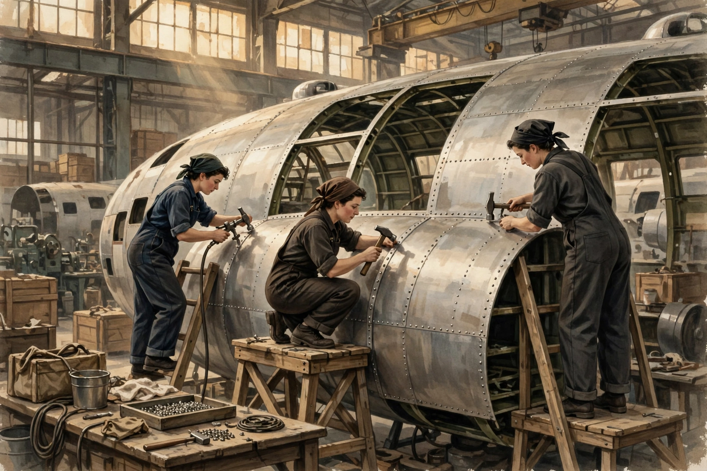

# Lesson 2 — Mobilization and the Home Front: The Arsenal at Work

**Goal:** You will explain how the United States converted its economy
to total war, who did the new work, what daily life cost, and how to
read the production numbers as evidence — not just as impressive
figures.

**Time:** about 50 minutes. **Materials:** this lesson, a notebook,
the aircraft-production chart (`../assets/aircraft-production-1940-1944.svg`).
**Adult note:** this lesson covers wartime labor, migration, and
rationing. The generated illustration is a labeled AI reconstruction;
frame it as an artist's imagining, never as a photograph of a real
factory or real workers.

**Readiness check (2 minutes):** From Lesson 1, name one step the
United States took toward the Allies before Pearl Harbor. Now ask:
once war was declared, what had to change inside the country — not
just in Washington, but in factories, farms, and kitchens?

## Part 1 — Converting the economy: the War Production Board

Declaring war was the easy part. The hard part was turning an economy
built for cars and refrigerators into one built for bombers and tanks.
In January 1942 Roosevelt created the **War Production Board (WPB)**,
which told factories what to make, allocated scarce materials like
steel, aluminum, and rubber, and set production targets. Automobile
factories stopped making cars entirely in February 1942 — no new
civilian cars were built for the rest of the war — and retooled to
make aircraft engines, tanks, and guns. Shipyards launched Liberty
ships in weeks instead of months. The federal government spent
enormously: taxes covered about 45% of the war's cost, and the
government borrowed nearly $200 billion, much of it by selling war
bonds to ordinary Americans.

The scale is hard to grasp without numbers, so here are the ones this
unit uses. The table below shows **U.S. aircraft production, all
types**, by year (*The Army Air Forces in World War II*, Vol. VI, ch. 10,
comparative table; consistent with John Ellis, *The World War II Databook*). The same numbers
appear in the deterministic chart in `assets/` — use either version;
they are identical.

| Year | Aircraft produced |
|---|---:|
| 1940 | 6,086 |
| 1941 | 19,433 |
| 1942 | 47,836 |
| 1943 | 85,898 |
| 1944 | 96,318 |

In total the United States produced about 300,000 military aircraft
between July 1940 and August 1945, and total industrial production
roughly doubled between 1939 and 1945. But a big number is not an
argument by itself. A number becomes evidence only when you ask what
caused it and what it cost — which is what the worked examples below
practice.

### Worked example 1 — From a number to a claim

*Question:* Aircraft production rose from 6,086 in 1940 to 96,318 in
1944. By what factor did it grow, and does that growth alone prove
that American production won the war?

*Model reasoning:* 96,318 ÷ 6,086 ≈ 15.8 — production grew about
sixteen-fold. But the number alone proves nothing about who won the
war. To turn it into evidence you need a second step: connect the
number to a mechanism. For example: by 1944 the United States was
producing more aircraft than Germany, Japan, and Britain combined in
some months, which meant Allied pilots could replace losses faster
than Axis pilots could — and pilot training, fuel, and tactics also
mattered. A common error is to quote a big number as if it were a
conclusion. Numbers support conclusions; they are not conclusions.

### Worked example 2 — Who did the work? Reading a percentage honestly

*Question:* In 1940 about 12 million women worked — 27% of the
workforce. By 1945 over 19 million women worked — 37% of the
workforce. A poster says "Women won the war on the home front." What
do the numbers support, and what do they not support?

*Model reasoning:* The numbers support a real, large change: about
6–7 million women entered or re-entered work between 1942 and 1945,
and women went from about 1% of aircraft-industry workers in 1938 to
65% in 1943. The numbers do not support "women won the war" by
themselves — men still held most industrial jobs, and the workforce
also grew through migration, teenagers, and older workers. They also
do not tell you what happened after the war: many women were pushed
out of factory jobs when veterans returned, though married women's
employment stayed higher than before the war (15% of married women
worked in 1940; 25% by war's end). The careful sentence is: the war
opened industrial work to millions of women, and it did not fully
close again — but it did not end workplace inequality either. Women
workers rarely earned more than half what men earned for similar work.

## Part 2 — Image study: the factory floor

Study the generated illustration
`../assets/home-front-factory-illustration.png`.

*Caption: AI reconstruction of women workers building a bomber on a
1940s aircraft-assembly line. This is an artist's imagining, not a
photograph — use it to observe and ask questions, never as evidence
that any particular factory or person looked this way.*

**Text-only alternative:** The image shows the inside of a large
1940s aircraft factory. In the center, three women in dark overalls
and headscarves work on the curved, riveted metal fuselage of a large
bomber airplane. One stands on a ladder at the left, one crouches on
a wooden workbench in the middle, and one stands on a platform at the
right; each holds a riveting hammer. Crates, a tray of rivets, tools,
and a bucket sit on a workbench in the foreground. Tall windows and
steel beams fill the background. No words or labels appear in the
image.

Answer these three questions in your notebook:

1. What three details in the image show that this factory is doing
   *new* work — work it was not designed for in peacetime?
2. What does the image *not* show that the numbers in Part 1 tell
   you must also be true (think about who is missing, and what the
   factory needed besides workers)?
3. If a historian wanted to prove that women built bombers in 1943,
   could this image be the proof? Why or why not?

## Part 3 — Daily life: rationing, migration, and the Bracero Program

Total war reached the kitchen table. The Office of Price
Administration rationed scarce goods with coupon books: sugar from
May 1942, then coffee, gasoline, tires, meat, butter, and shoes.
Families planted "victory gardens," saved cooking fat and scrap
metal, and mended clothes. Rationing was shared sacrifice — but not
equally shared: rural families could grow food, city families could
not; wealthy families could still afford black-market goods.

The war also moved people. With 12 million men leaving the labor
force for military service, employers recruited where they had not
recruited before. The **Second Great Migration** accelerated: more
than a million Black southerners moved north and west during the
1940s (about 5 million between 1940 and 1970), seeking defense jobs
in Detroit, Chicago, Los Angeles, and Seattle — and meeting crowded
housing, segregated neighborhoods, and competition that sometimes
turned violent (Lesson 4). On farms, the **Bracero Program** (1942)
brought Mexican workers to the United States under government
contracts to harvest crops. About 350,000 American women served in
uniform — as nurses, clerks, mechanics, and pilots (the WASPs flew
military aircraft in non-combat roles) — though none were allowed in
combat.

**Teacher note (misconception):** learners often conclude that the
war "ended the Depression" and therefore helped everyone. The war did
end mass unemployment — but it did so by government spending on a
scale the New Deal never attempted, and its benefits were unevenly
distributed: Black workers gained jobs and also faced new forms of
discrimination; women gained wages and then lost many factory jobs
after the war; Japanese Americans lost homes and businesses entirely.
See the answer key for the guided-practice solutions.

## Guided practice

1. Using the aircraft table: (a) In which year was the largest
   *absolute* increase over the previous year? Show the subtraction.
   (b) In which year was the largest *percentage* increase over the
   previous year? Show the division.
2. ★ A classmate says, "Aircraft production grew sixteen-fold, so
   American factories were sixteen times better in 1944 than in
   1940." Explain the error in that sentence in 2–3 sentences.
3. Name two goods that were rationed and one thing rationing did not
   ration. What does that tell you about what the government thought
   mattered most?

## Independent practice

4. Women went from 27% of the workforce in 1940 to 37% in 1945.
   (a) How many percentage points did the share rise? (b) If the
   total workforce were 50 million in both years, how many more women
   would be working in 1945 than in 1940? (Practice arithmetic with
   the given figures.)
5. Explain in 4–5 sentences why the government needed *both* the War
   Production Board and rationing — what problem did each one solve
   that the other could not?
6. ★ The Bracero Program and the Second Great Migration both moved
   workers to where jobs were. Name one way they were alike and one
   way they were different (think about who arranged the move and
   what rights the workers had).

## Applied task

7. Design a one-page ration-book page for a fictional household of
   four in 1943: choose four rationed goods, set a weekly coupon
   allowance for each, and write a 3-sentence note explaining one
   trade-off the household must make. Then write one sentence naming
   something your ration book cannot show about that household's life.

## Exit check

8. In one sentence each: (a) What did the War Production Board do?
   (b) How many aircraft did the United States produce in 1944, and
   how does that compare with 1940? (c) Name one group whose wartime
   work expanded and one cost that group still paid.

## Supports and extensions

- **Reading/language access:** the aircraft table is duplicated in
  the SVG chart with text labels; the adult reads the image-study
  questions aloud and defines *retool*, *allocate*, and *ration* in
  context.
- **Alternate response mode:** the data questions may be answered
  with a calculator and a completed table; the ration-book task may
  be drawn and labeled instead of written.
- **Extension:** research one Liberty-ship yard or aircraft plant
  (e.g., Willow Run, Michigan) and write a paragraph on how
  assembly-line methods from Unit 01's industrialization lessons
  were applied to war production — and what was different this time.
