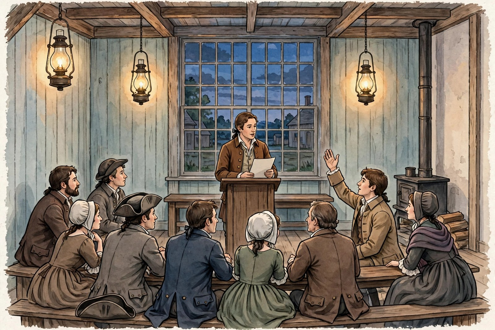

# Lesson 05 — The Bill of Rights as Rhetoric, and Rhetoric Across Founding Texts

**Unit 02 · Sessions S13–S14 · ~50 minutes each**
**Standards:** RI.11-12.5, RI.11-12.9, W.11-12.1

## Student goal

By the end of this lesson I can analyze the Bill of Rights as rhetoric
— its audience, purpose, and negative phrasing — compare how two or
more founding texts treat a shared theme, and use a fictional
illustration as a prompt for analysis without treating it as evidence.

## Materials

Notebook, pen/pencil, the Bill of Rights text (National Archives
transcription), the unit's generated illustration
(`../assets/town-meeting-illustration.jpg`, with its text-only
alternative in `../assets/README.md`), and the comparison table below.

## Readiness check (5 min)

Answer in the notebook before the lesson starts:

1. What is the difference between "Congress shall protect free speech"
   and "Congress shall make no law… abridging the freedom of speech"?
   Which is stronger, and why?
2. Why would a new government *begin* by listing what it may not do?
   Who is that list for?

## Explicit teaching

### What the Bill of Rights is — and what it is not

The Bill of Rights is the first ten amendments to the Constitution,
proposed by Congress in 1789 and ratified December 15, 1791. It did not
arrive with the Constitution: ratification debates produced demands for
explicit protections, and the amendments were the answer. Its preamble
(the joint resolution's introduction) states the purpose plainly: the
amendments were added "in order to prevent misconstruction or abuse of
its powers, that further declaratory and restrictive clauses should be
added." Two words there are the whole rhetorical theory:

- **Declaratory** — the clauses *declare* rights that are understood
  to exist.
- **Restrictive** — the clauses *restrict* government power.

The Bill of Rights is therefore rhetoric in a different key from the
Declaration or Lincoln's speech. It does not argue *for* an act; it
draws a boundary *around* power, in advance, for a future audience
(citizens, courts, officials) that will need the boundary precisely
when it is inconvenient.

### Negative phrasing as argument

Read Amendment I in full:

> "Congress shall make no law respecting an establishment of religion,
> or prohibiting the free exercise thereof; or abridging the freedom of
> speech, or of the press; or the right of the people peaceably to
> assemble, and to petition the Government for a redress of grievances."

Every verb is a restraint: "shall make no law… or prohibiting… or
abridging." The amendment does not grant speech; it forbids Congress
from abridging it. That negative phrasing is a claim about where rights
come from: they pre-exist government (compare the Declaration's
"endowed by their Creator"), so government's job is to refrain, not to
bestow. A learner who paraphrases Amendment I as "the government gives
us free speech" has reversed its rhetoric.

The same pattern runs through the amendments: Amendment II ("shall not
be infringed"), Amendment IV ("shall not be violated"), Amendment VIII
(no excessive bail, fines, or cruel and unusual punishments). Amendment
IX warns against reading the list as exhaustive ("The enumeration in
the Constitution, of certain rights, shall not be construed to deny or
disparage others retained by the people"), and Amendment X reserves
undelegated powers to the states or the people. The last two amendments
are rhetoric about *reading*: they tell future readers how not to
misread the first eight.

Note the scope honestly, as in Lesson 02: in 1791 the Bill of Rights
restrained the *federal* government, not the states, and its
protections did not in practice reach enslaved people, women, or
Native peoples. Later amendments and court decisions extended its
reach — a history the grade-11 social studies track will take up in
its own terms. The language-arts point stands: the document's rhetoric
is boundary-drawing, and boundaries drawn in 1791 did not cover
everyone.

### Worked example 1: Amendment IV, delineated

> "The right of the people to be secure in their persons, houses,
> papers, and effects, against unreasonable searches and seizures, shall
> not be violated, and no Warrants shall issue, but upon probable cause,
> supported by Oath or affirmation, and particularly describing the
> place to be searched, and the persons or things to be seized."

- **Audience:** officials who search and seize, and citizens who will
  invoke the amendment against them.
- **Purpose:** to make one kind of government action (unreasonable
  search) illegitimate and to set a procedure (warrant, probable cause,
  particular description) for the legitimate kind.
- **Reasoning:** the amendment does not argue *why* security matters;
  it assumes the Declaration's premise (rights pre-exist government)
  and proceeds to procedure. That is why it reads like law, not like a
  speech: its persuasion happened earlier, in the ratification debate.
- **Word choice:** "unreasonable" is the amendment's hinge and its
  open question — who decides what is reasonable? The amendment does
  not say, which is why centuries of argument followed. A text that
  settles one question ("warrants need probable cause") while opening
  another ("what counts as unreasonable?") is normal, not defective.

### Worked example 2: a shared theme across three texts

**Theme (full sentence):** *American founding texts claim that
legitimate power comes from the people and is limited by rights that
government does not create.*

- **Declaration:** "Governments are instituted among Men, deriving
  their just powers from the consent of the governed" — consent as the
  source of legitimacy; unalienable rights as the limit.
- **Federalist No. 10:** the republic controls faction not by removing
  liberty but by structure — the extended sphere. Here the limit is
  institutional design, not a list of rights.
- **Bill of Rights:** "Congress shall make no law…" — the limit is
  written as a prohibition, enforceable (in principle) against the
  government itself.

**What is shared:** all three treat rights as prior to government and
power as needing restraint. **What differs:** the *mechanism* —
revolutionary principle, structural design, written prohibition — and
the *audience*: the world (Declaration), ratification voters
(Federalist), future officials and courts (Bill of Rights). A
comparison that only says "they all care about liberty" has not
compared anything; the mechanism and audience differences are the
comparison.

### The applied task: reading a fictional illustration (S14)

The image below is a **modern, AI-generated fictional illustration**
for this lesson. It is **not** a historical document, **not** evidence
about any real meeting, and **not** a portrait of any real person. Its
only job is to give the learner a scene to analyze rhetorically: who is
speaking, who is listening, what claim might be at stake, and what the
scene cannot tell us.

*Caption: Fictional AI-generated illustration for analysis practice
only — not a historical source. See `../assets/README.md` for the
text-only alternative, which contains all the information needed to
answer the task.*

**Text-only alternative (summary; full version in assets/README.md):**
A speaker stands at a plain wooden lectern in a lamplit wooden hall at
dusk, holding a blank sheet of paper. About eight listeners sit on
benches facing the speaker; most watch attentively, and one listener
on the right raises a hand. Three hanging lamps light the room; a
large multi-paned window behind the speaker shows a darkening sky.
No words are visible on the paper or anywhere in the scene.

## Guided practice

Work with the adult, thinking aloud.

1. Paraphrase Amendment I in two sentences without reversing its
   negative phrasing (do not write "the government gives us…").
   Then name its audience in one sentence.
2. Using Worked example 2's theme sentence, add Lincoln's Second
   Inaugural as a fourth text: does it fit the theme, complicate it,
   or both? Quote one Lincoln line in your answer.
3. Look at the illustration (or read its text-only alternative).
   Identify: the speaker, the audience, and one rhetorical situation
   (what kind of claim might be at stake?). Then name one thing the
   image *cannot* tell us about any real founding debate.

## Independent practice

1. Write a rhetorical paragraph (6–8 sentences) on Amendment IV or
   Amendment X: audience, purpose, one key phrase quoted and explained,
   and one open question the text leaves (like "unreasonable").
2. Complete the comparison table for the theme "legitimate power comes
   from the people and is limited": one row each for the Declaration,
   Federalist No. 10, and the Bill of Rights, with a quotation and the
   mechanism (principle / structure / prohibition) for each.
3. Write a 5–7 sentence paragraph on scope: in 1791, whom did the Bill
   of Rights restrain, and whom did it not yet protect in practice?
   Use one concrete fact and avoid present-day claims about later law
   unless the adult approves the source.
4. **Error analysis.** A classmate writes: "The Bill of Rights is not
   rhetoric because it is a law." Explain in 4–5 sentences why that is
   wrong: laws persuade through audience, purpose, and phrasing, and
   this law's negative phrasing and its declaratory/restrictive
   preamble are rhetorical choices.

## Application — text vs. image (S14)

Write a comparison (about 250 words) between the illustration and a
real founding text of your choice:

- Two things the illustration and the text *agree* on about how public
  argument works (for example: a speaker addresses listeners; a
  questioner can interrupt).
- Two things that *differ* (for example: the illustration shows no
  words, so it cannot show reasoning; a real text argues, while an
  image only stages argument).
- One inference about public persuasion that the *pair* supports
  better than either alone — and one sentence stating why the
  illustration, as a fictional image, can never count as evidence for
  a historical claim.

## Exit check

Without notes: state the Bill of Rights' purpose in the preamble's own
terms (declaratory and restrictive, preventing misconstruction or
abuse of power) in two sentences, and name one mechanism difference
between the Declaration and the Bill of Rights from Worked example 2.

## Supports and extensions

- **Reading access:** read one amendment at a time, paraphrasing each
  into modern English before analyzing it; the adult checks the
  paraphrase for reversed phrasing ("gives us" vs. "shall not").
- **Alternate response mode:** the text-vs-image comparison may be
  presented as a two-column table with the same five required points
  (2 agreements, 2 differences, 1 inference, plus the evidence
  sentence).
- **Extension:** trace one amendment's later history with the adult
  (for example, how Amendment I came to restrain state governments
  too). Write 150 words distinguishing the 1791 text from its later
  application, citing the adult-approved source.

## Teacher note

Likely misconception: learners paraphrase negative rights as positive
grants ("the government gives us free speech"). Correct the direction
every time it appears; it reverses the document's theory of rights.
Also police the image boundary firmly: the illustration is a prompt,
never evidence, and learners must say so in the application. Key:
answer-key §L05.
