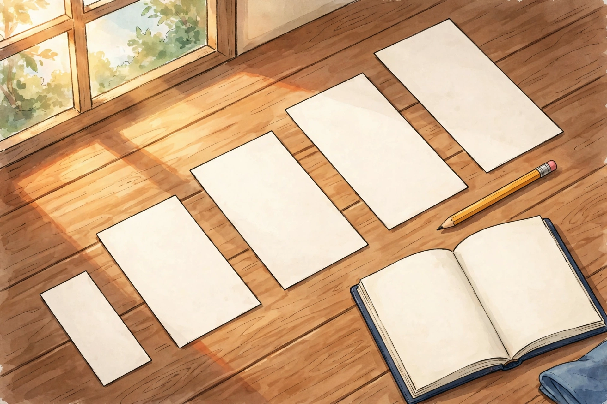

# Lesson 01 — Syntax as Style

**Unit 04 · Sessions S1–S2 · ~50 minutes each**
**Standards:** L.11-12.3.a, RI.11-12.6

## Student goal

By the end of this lesson I can name the structure of a sentence —
periodic, loose, parallel, repetitive, or fragment — and explain, with
a quotation, what that structure does to emphasis, pace, or tone.

## Materials

Notebook, pen/pencil, the sentence-strip illustration in
`../assets/sentence-strips-illustration.png` (or its text-only
alternative in `../assets/README.md`), and the sentences below.

## Readiness check (5 min)

Answer in the notebook before the lesson starts:

1. Write one very short sentence (3–5 words) and one very long
   sentence (25+ words) about the same event — rain starting during a
   walk home. Which one feels more urgent? Why?
2. What is the difference between a sentence's *main clause* (the part
   that could stand alone) and a *subordinate clause* (a part that
   leans on the main clause)? Give a one-clause example of each.

(Adult: question 1 surfaces the lesson's core intuition — length is a
meaning choice, not an accident. Question 2 checks the grammar
vocabulary the lesson builds on; re-teach main vs. subordinate clause
on the spot if needed, using the lesson's first example.)

## Explicit teaching

### Syntax is a choice, not a container

**Syntax** is the arrangement of words into sentences. Two writers can
state the same fact in sentences that feel completely different:

- "The mill closed." (3 words. A door shutting.)
- "When the river fell too low to turn the wheel, when the orders
  stopped coming from the city, and when the last repair bill came due,
  the mill closed." (The same fact, delayed — the sentence makes you
  wait through the causes before it lets you hear the result.)

Nothing about the fact changed. Everything about the *experience* of
reading it changed. That is the whole lesson: sentence shape is
meaning.

### Four structures to name

**1. Loose (cumulative) sentence.** The main clause comes first, and
detail accumulates after it. Effect: direct, natural, easy to follow;
the point lands immediately and the rest colors it.

> "The town kept the library open, even after the budget vote failed,
> even after the roof leaked, even after the winter closed the road
> twice."

Main clause first ("The town kept the library open"), then three
modifying phrases pile on. You know the point at word six.

**2. Periodic sentence.** The main clause is withheld until the end;
subordinate clauses and phrases come first. Effect: suspense,
formality, weight — the sentence builds pressure and releases it in
the final clause. The Declaration's preamble works this way: "When in
the Course of human events, it becomes necessary for one people to
dissolve the political bands which have connected them with another…
" — the main statement ("we hold these truths…") is delayed while the
conditions accumulate.

**3. Parallelism.** Matching grammatical shapes for matched ideas.
Effect: rhythm, balance, memorability, and a sense of completeness —
the form itself argues that the ideas belong together.

> "We came to learn, we came to listen, and we came to decide."

Three clauses, same shape (subject + verb + infinitive). Break the
pattern — "We came to learn, to listen, and deciding" — and the
sentence wobbles; the wobble is audible even before you analyze it.

**4. Repetition (anaphora) and the fragment.** *Anaphora* repeats a
word or phrase at the start of successive clauses; it hammers one idea
and builds momentum. A *fragment* — an incomplete sentence used
deliberately — stops the reader cold. Effect: emphasis through
interruption. A fragment used by accident is an error; a fragment
used on purpose, sparingly, is a spotlight.

> "They asked for a hearing. They asked for records. They asked for a
> vote. Nothing."

The three parallel clauses build a drumbeat; the fragment "Nothing."
breaks it. The break *is* the point.

### A caution

Labeling is not analysis. "This is a periodic sentence" earns nothing
by itself. The analysis is the second half: "…and the delay makes the
verdict feel inevitable rather than hasty, because the reader has
already walked through all three causes before hearing it." Every
practice item in this lesson asks for both halves: **name + effect**.

## Worked example 1 — periodic vs. loose, same fact

Fact: the council voted to fund the library.

**Periodic version:** "After three months of petitions, after two
failed motions, and after a final night of testimony that ran past
midnight, the council voted to fund the library."

- Structure: periodic. The main clause ("the council voted…") is the
  last clause; three subordinate phrases precede it.
- Effect: the delay makes the vote feel earned and hard-won. The
  reader experiences the wait the petitioners experienced. If the
  writer had wanted the vote to feel sudden or routine, this shape
  would be wrong.

**Loose version:** "The council voted to fund the library, after three
months of petitions, two failed motions, and a final night of
testimony that ran past midnight."

- Structure: loose. The main clause comes first; the history follows
  as explanation.
- Effect: the news lands immediately; the detail justifies it after
  the fact. This version suits a news report, where the vote itself is
  the news. The periodic version suits a speech, where the struggle is
  the point.

Same fact, two rhetorical situations, two correct choices — for
different purposes. The question is never "which is better?" but
"better *for what*?"

## Worked example 2 — parallelism, repetition, fragment

Read this original paragraph (written for this unit):

> "The committee promised openness. It promised records. It promised
> answers. Then it met behind a closed door. The promise was not
> broken all at once. It was broken quietly, meeting by meeting, until
> openness was a word the committee used and nothing it did."

- **Repetition/anaphora:** "It promised records. It promised
  answers." repeats the shape of "The committee promised openness,"
  turning one promise into a pattern — which makes the later breaking
  feel like a pattern too.
- **Parallelism:** "meeting by meeting" echoes the earlier rhythm and
  stretches the breaking across time: not one act, but a habit.
- **Fragment effect (near-fragment):** "Then it met behind a closed
  door." is a complete short sentence, not a fragment — but its
  shortness after three longer clauses functions like a door slamming.
  The contrast in length does the work.
- **The closing antithesis:** "a word the committee used and nothing
  it did" balances two parallel phrases ("used" / "did") against each
  other; the balance makes the contradiction sharp.

Modeled reasoning: if you only noticed "the writer repeats things,"
you have described, not analyzed. The analysis adds: the repetition
builds a pattern of promise so that the breaking of the pattern lands
harder. Always ask: *what does the shape make me feel, and what would
change if the shape changed?*

## Guided practice (with hints)

Work in pairs. For each sentence, name the structure and write one
sentence stating its effect. Hints are in parentheses.

1. "Before the first bell, before the announcements, before anyone
   had sat down, Mara had already finished the problem set."
   (Hint: where is the main clause?)
2. "We will repair the roof, we will replace the wiring, and we will
   repaint the hall." (Hint: compare the three clauses' shapes.)
3. "The river rose. The road vanished. The town waited." (Hint: what
   happens to pace when every sentence is short?)
4. "She did not argue. She did not plead. She left." (Hint: the third
   sentence breaks the pattern — on purpose?)

## Independent practice

1. Label each sentence below as periodic, loose, parallel, or
   fragment-effect, and state its effect in one sentence.
   - (a) "When the letter arrived, when the whole street had read it,
     and when the mayor could no longer ignore it, the meeting was
     finally called."
   - (b) "The meeting was finally called, after the letter arrived,
     after the whole street had read it, and after the mayor could no
     longer ignore it."
   - (c) "Not yet."
   - (d) "To listen well, to speak honestly, and to decide together:
     that is the work."
2. Rewrite sentence (a) as a loose sentence without changing any fact.
   Then write two sentences explaining which version better suits a
   speech to an angry crowd, and why.
3. Error analysis: a classmate labeled "The storm passed, the lights
   returned, and the town exhaled" as a periodic sentence. Is the
   label right? Explain what is wrong (or right) about it, and give
   the correct label with an effect statement.

## Applied task — the sentence strips

Look at the illustration below (also in `../assets/`).

*Figure 1 — Sentence strips, shortest to longest. AI illustration for
Lesson 01: each strip stands for one sentence, and the rising lengths
stand for a paragraph that grows sentence by sentence. What happens to
the rhythm when a short sentence follows a long one?*

1. Number the strips 1 (shortest) to 5 (longest). Write one sentence
   about a single event — a door opening — for each strip, making
   sentence 1 the shortest and sentence 5 the longest, so the five
   sentences together read as one paragraph.
2. Read the paragraph aloud. Where does the rhythm speed up, and where
   does it slow down? Mark the place where a short sentence after a
   long one creates emphasis, or revise one sentence so that it does.
3. **Text-only alternative:** if you cannot see the image, use this
   strip order instead — strip 1: about 4 cm; strip 2: about 8 cm;
   strip 3: about 12 cm; strip 4: about 16 cm; strip 5: about 20 cm —
   and complete steps 1–2 from the measurements. The information the
   image carries is exactly this: five lengths in rising order.

## Exit check

In your notebook, in three sentences or fewer: name one structure from
today, quote or invent one sentence using it, and state its effect.
If you cannot state the effect, you have not finished the lesson —
re-read the "caution" box above.

## Supports

- **Reading/language access:** the lesson's example sentences are
  short and self-contained; read each aloud before labeling it, and
  underline the main clause before naming the structure.
- **Alternate response mode:** instead of writing the applied-task
  paragraph, record it aloud, or arrange five real paper strips and
  dictate one sentence per strip to the adult.
- **For learners who label everything "periodic":** use the
  main-clause test — if the sentence could end after its first clause
  and still be complete, it is loose, not periodic.

## Extension

Find one periodic sentence and one loose sentence in a text you are
reading for another subject (or in Unit 02's Declaration passage).
Copy both, label them, and write a paragraph arguing which one better
suits its author's purpose. Bring it to S3.

## Teacher note

The most common misconception is that long = periodic and short =
loose. Length is not structure: a long sentence can be loose (main
clause first, detail after), and a short sentence can be periodic
("When the bell rang, we left" — main clause last). Drill the
main-clause position, not the word count. Answer-key reference:
`../answer-key.md`, Lesson 01.
