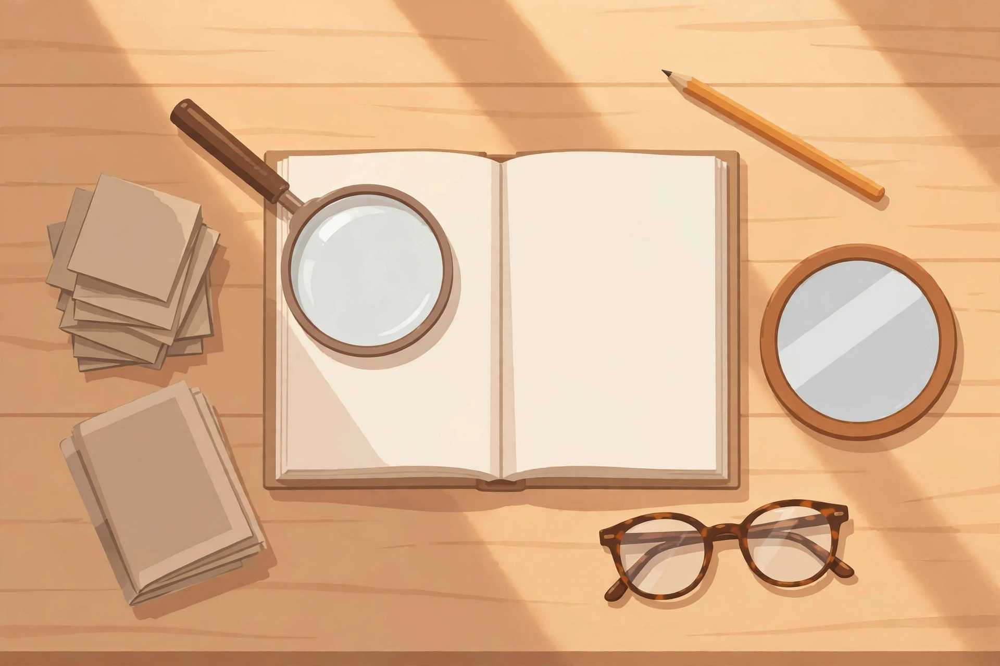

# Lesson 01 — What a Critical Lens Is

**Unit 05 · Sessions S1–S2 · ~50 minutes each**
**Standards:** RL.11-12.1, RL.11-12.3

## Student goal

By the end of this lesson I can explain what a critical lens is — a set
of questions asked on purpose, with evidence that counts and a blind spot
— name the question, the evidence, and the blind spot of the formalist,
historical/biographical, and reader-response lenses, and apply all three
to one short passage.

## Materials

Notebook, pen/pencil, the three-lenses illustration
(`../assets/three-lenses-illustration.png`, printed or on screen), and the
original passage "The Tide Clock" printed below (it appears only in this
lesson; it is an original passage written for this unit, not a published
text).

## Readiness check (5 min)

Answer in the notebook before the lesson starts:

1. In Unit 03 you compared two readers' interpretations of one story.
   Write one sentence about a time you and someone else disagreed about a
   book, film, or song — and one sentence about what would have settled
   the disagreement, if anything could.
2. What is the difference between saying "I liked it" and saying "this
   passage works because…"? Give a one-sentence example of each.

(Adult: question 1 has no wrong answer; it surfaces the learner's working
sense that disagreement can be reasonable. Question 2 previews the unit's
core move — criticism replaces taste with checkable reasons.)

## Explicit teaching

### Criticism is not complaining

**Criticism** is the study, analysis, and evaluation of a work of
literature. A critic is not a person who dislikes things. A critic is a
reader who says *what a text does, how it does it, and whether it does it
well* — and shows the work. "I liked it" is a report about the reader.
"This passage works because the tide image returns three times, each time
smaller" is a claim about the text that another reader can check. This
unit teaches the second kind of sentence.

### A lens is a question-set, not a verdict

A **critical lens** (also called a school of criticism) is a named set of
questions a reader asks on purpose. Each lens has three parts the learner
must be able to state:

- **Its question** — what it asks the text.
- **Its evidence** — what it treats as counting.
- **Its blind spot** — what it cannot see, by design.

A lens is a tool, not a truth. A magnifying glass shows small things and
hides the room. A mirror shows the viewer and hides what is behind the
glass. Neither is "wrong." The skilled reader picks a lens, uses it
honestly, and says what it cannot show. That honesty is what separates
criticism from cherry-picking: a cherry-picker hides the blind spot; a
critic names it.

### The three lenses of this unit

| Lens | Central question | Evidence that counts | Blind spot |
|---|---|---|---|
| **Formalist** (also called New Criticism) | What does the text itself do — how do its parts work together? | Words, images, patterns, structure, tensions inside the text; nothing outside it | History, the author's life, and the reader's experience are set aside on purpose |
| **Historical / biographical** | What did this text mean in its own time, and how did the author's life and world shape it? | Dates, publication facts, letters, the author's stated purpose, the laws and customs of the period | The text as a made object can be under-read; an author's intention is evidence, not a verdict |
| **Reader-response** | What does the text do to a reader, and how does the reader help make its meaning? | The reader's responses, gaps the reader must fill, different readers' different readings | A reading can drift into "anything goes" if it stops quoting the text |

A fourth lens, **feminist criticism**, joins in Lesson 04. It asks who
speaks, who is believed, who does the work, and whose experience the text
treats as normal. Other lenses exist — Marxist, psychoanalytic, New
Historicist — and the Resource Pack names them; they are not assessed in
this unit.

### The three-lenses image

Look at the illustration in `assets/` (also printed below in the applied
task). It is a fictional, AI-generated scene — not a historical source.

*Caption: Fictional AI-generated illustration for analysis practice only.
The objects stand for three ways of reading; the book itself stays blank
because the lenses, not the book, are the subject.*

Three objects sit around one open book:

- The **magnifying glass** on the book's page is the formalist lens: it
  looks *at the text itself*, closer and closer.
- The **stack of letters** beside the book is the historical/biographical
  lens: it looks *around the text*, at the writer's world.
- The **round mirror** beside the book is the reader-response lens: it
  looks *back at the reader*, at what the reader brings and what the
  reader does.

The reading glasses at the bottom of the desk are a reminder the image
itself offers: every reader wears some pair of glasses already. A lens
does not remove that fact; it makes it visible and chosen.

## Worked example 1 — one passage, three lenses

Read this original passage, written for this lesson. (It is not a
published text; no author, date, or history exists for it — that matters
below.)

> **The Tide Clock.** Mara kept the tide clock on the kitchen wall long
> after the sea stopped mattering to her. It had belonged to her father,
> who read it the way other men read newspapers: morning and evening,
> finger on the glass, lips moving. When the house was sold, she packed
> the clock last, wrapped in a tea towel, and set it on the passenger
> seat beside her, where a person would sit. All the way inland she
> watched the hand creep toward high water that would never come, and
> she did not turn the clock to face the wall. She did not need it to be
> right. She needed it to be going.

**Formalist reading (the text itself).** The passage is built on one
pattern: *going without arriving*. The clock "creeps" toward a high water
that "would never come"; Mara watches a hand move toward something that
cannot happen inland. The last two sentences set up a tension — a clock
is supposed to be *right*, and this one cannot be — and resolve it by
replacing one value with another: "She did not need it to be right. She
needed it to be going." The pattern is the meaning: keeping time matters
more than telling it. Evidence: the verbs *creep*, *watched*, *going*,
and the repeated *tide / high water / inland* contrast.

**Historical/biographical reading (around the text).** Here the lens has
almost nothing to work with — and saying so is the analysis. There is no
author, no date, no publication history, no letter explaining the clock.
A historical critic can only note the *kind* of object (a tide clock, a
tea towel, a passenger seat) and observe that these belong to a coastal,
pre-digital household — but without a date, that observation cannot
become evidence about any real writer or period. The lesson: a lens with
no evidence is not a weak reading; it is a *refused* reading, and the
critic says so instead of inventing a history.

**Reader-response reading (the reader's part).** The passage leaves gaps
the reader must fill: why did the sea stop mattering? Who bought the
house? What happened to the father? A reader who has moved house fills
the first gap with their own leaving — the clock becomes *their* kept
object — and reads the last line as comfort. A reader who has never moved
may fill the same gap with puzzlement and read the last line as stubborn
or sad. Both readings quote the same sentences; they differ in what the
reader brings. The check is the quotation: a reader-response claim still
has to point at words on the page.

## Worked example 2 — the same claim, three kinds of support

Claim: "The last line of 'The Tide Clock' changes the meaning of the
whole passage."

- **Formalist support:** the sentence "She did not need it to be right.
  She needed it to be going" repeats the sentence shape (*She did not…
  She…*) while reversing the value (right → going). The reversal is in
  the structure, not only in the idea.
- **Historical support:** none available for this passage — and the
  honest version of the claim says so rather than inventing a biography
  for an invented author.
- **Reader-response support:** the sentence lands differently depending
  on what the reader has kept after a move; the passage's final word,
  *going*, is doing emotional work the reader completes.

Notice what happened: the *claim* stayed the same and the *support*
changed. That is what a lens is. A lens does not choose your conclusion
for you; it tells you what counts as a reason for one.

## Guided practice

Work in the notebook. The adult checks each item before you move on.

1. Copy the three-lens table above (lens, question, evidence, blind
   spot) and add one example of each lens's evidence from Worked
   Example 1.
2. "A reader-response critic never needs to quote the text." True or
   false? Defend your answer in two sentences, using Worked Example 1.
3. Which lens would ask: "What did *tide clock* mean to a coastal
   family in 1950?" Which lens would ask: "Why does the word *going*
   appear in the last line and not the first?" Label each, and say in
   one sentence what evidence each question needs.

## Independent practice

4. Write one paragraph (5–7 sentences) answering: *Which of the three
   lenses is most useful for "The Tide Clock," and which is least
   useful — and why?* Quote the passage at least once. Name the blind
   spot of the lens you rank first.
5. Error analysis: a classmate writes, "The historical lens proves Mara
   is based on the author's grandmother, because the clock feels so
   real." Write a three-sentence correction: what is wrong with this
   sentence, what evidence would the historical lens actually need, and
   what the feeling of realness does prove (if anything).

## Application — the image task

Using the three-lenses illustration:

1. Match each object to its lens: magnifying glass, stack of letters,
   round mirror. Write one sentence per object explaining *what the
   object does* that makes it a good stand-in for that lens.
2. The book in the image is blank. In two sentences, explain why a
   blank book is the right choice for an illustration *about lenses*
   rather than about one story — and what the image cannot show about
   any real text.
3. The reading glasses sit at the bottom of the desk, belonging to no
   lens. In two sentences, say what they stand for and why a critic
   should mention them before claiming a reading is neutral.

**Text-only alternative** (contains all information needed to answer the
task): A top-down view of a plain wooden desk. An open book with blank
pages lies in the center. A large magnifying glass with a dark wooden
handle rests on the book's left page. To the left of the book sit a stack
of blank letters and, below them, a small stack of blank paper. To the
right of the book sits a round mirror in a wooden frame, reflecting a
pale diagonal band of light. A yellow pencil lies diagonally at the top
right of the desk. A pair of tortoiseshell reading glasses lies at the
bottom right. No words are visible anywhere in the scene, and no person
is shown.

## Exit check

In the notebook, without looking back:

1. Name the three lenses and each one's central question.
2. Name one thing each lens cannot see.
3. One sentence: what is the difference between a lens and an opinion?

## Supports and extensions

- **Reading/language access:** the lens table may be copied as a
  bookmark and kept open during every later lesson; the adult may read
  "The Tide Clock" aloud while the learner follows.
- **Alternate response mode:** the paragraph in Independent practice 4
  may be dictated to the adult or recorded, then transcribed; the lens
  sorting in Guided practice 1 may be drawn as three columns with
  pictures instead of sentences.
- **Extension:** choose one lens and write a four-sentence reading of
  Dickinson's "'Hope' is the thing with feathers —" (Unit 01) through
  that lens. State the lens's blind spot for that poem in a fifth
  sentence.

## Teacher note

Likely misconceptions: (1) treating a lens as a label for a text
("this is a formalist story") rather than a method a reader chooses —
correct by asking "what did *you* do with the lens?"; (2) treating
reader-response as permission to ignore the text — the check is always
a quotation; (3) inventing history when the historical lens has no
evidence — praise the learner who writes "there is no evidence" and
treat it as a complete answer. Answer-key references: guided practice
§1–3, independent practice §4–5, application §1–3.
