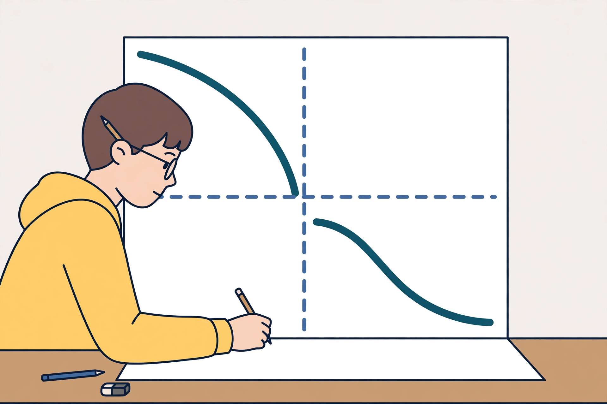

# Lesson 03 — Zeros, Vertical Asymptotes, and Holes: Reading a Graph from Its Factored Form

**Goal (learner hears):** "I can look at a factored rational
function and say where it is zero, where it breaks, where it has a
hole, and where it crosses the y-axis — before I plot a single point."
**Time:** ~50 minutes · **Materials:** paper, pencil, graph paper,
the generated illustration
[`../assets/asymptote-study-scene.png`](../assets/asymptote-study-scene.png).
**Standards:** F-IF.7.d (+), F-IF.4.

## Readiness check (5 min)

For `f(x) = (x - 1)/(x + 2)`: where is `f` zero, and where is it
undefined? (Zero at `x = 1`, where the numerator is zero and the
denominator is not; undefined at `x = -2`, where the denominator is
zero. If the learner answers "zero at 1, undefined at -2" confidently,
the lesson's distinction is already half-built.)

## Explicit teaching

Start from the factored form, and never from a simplified form alone.
For `f(x) = p(x)/q(x)` with `p` and `q` factored:

1. **Domain:** exclude every zero of the *original* denominator `q`.
2. **Zeros (x-intercepts):** the zeros of the numerator `p` that are
   still in the domain. A numerator zero that is also a denominator
   zero is not an intercept — it is a hole (step 4).
3. **Vertical asymptotes:** the zeros of the denominator that remain
   in the denominator *after* cancelling common factors. Near such an
   `x = a`, the function's values grow without bound (positively on
   one side, negatively on the other, or the same sign on both —
   test points decide). The graph never touches the line `x = a`,
   because the function has no value there.
4. **Holes:** a factor common to numerator and denominator. At
   `x = c` where that factor is zero, the original function is
   undefined, but the *simplified* function has a value `L`. The
   graph is the simplified function's graph with the single point
   `(c, L)` removed and drawn as an open circle. A hole is one
   missing point; a vertical asymptote is a whole missing line that
   the graph crowds against.
5. **y-intercept:** `f(0)`, if 0 is in the domain. If 0 is excluded,
   there is no y-intercept — say so, rather than leaving it blank.

**The generated illustration.** Look at
[`asymptote-study-scene.png`](../assets/asymptote-study-scene.png)
(a student studying a large graph with two curved branches and two
dashed lines).

*Caption: AI-generated illustration (see
[`assets/README.md`](../assets/README.md)). The graph in the picture
is schematic — it is not plotted from one named function, so do not
read coordinates off it. The exact plotted graph for this lesson is
the SVG in Lesson 04.*

**Activity — read the illustration, then correct it in words:**

1. The picture shows two separate branches with a gap between them.
   Which dashed line creates that gap, and why can a rational
   function's graph never cross it? (The vertical dashed line: it
   marks an input where the function is undefined, so no point of
   the graph can sit on it, and the two sides cannot join across it.)
2. The branches flatten toward the horizontal dashed line as they
   move away from the centre. In the language of Lesson 04, what is
   that line called? (A horizontal asymptote — the value the
   function approaches as `x` grows large in magnitude.)
3. Text-only alternative (the same information, without the picture):
   a graph in two pieces, left piece above the horizontal dashed
   line and falling toward it as it moves right, right piece below
   that line and falling away from it as it moves right; a vertical
   dashed line separates the pieces; neither piece touches either
   dashed line. If you answered (1) and (2) from this paragraph
   alone, you have shown the picture is a support, not a crutch.

### Modeled example 1 — a hole and a vertical asymptote in one function

Analyse `f(x) = (x^2 - 1)/(x^2 - x - 2)`.

*Factor everything first.* Numerator: `(x - 1)(x + 1)`. Denominator:
`(x - 2)(x + 1)`. So `f(x) = (x - 1)(x + 1) / ((x - 2)(x + 1))`.

*Domain:* `x ≠ 2, -1` (the original denominator's zeros).

*Cancel:* the common factor `(x + 1)` cancels, leaving
`(x - 1)/(x - 2)` — still with `x ≠ 2, -1`.

*Hole:* at `x = -1`, the cancelled factor is zero. The simplified
form at `x = -1` gives `(-1 - 1)/(-1 - 2) = (-2)/(-3) = 2/3`. So
there is a hole at `(-1, 2/3)` — an open circle, not a point on
the graph.

*Vertical asymptote:* the remaining denominator factor `(x - 2)`
gives `x = 2`. Near `x = 2`, values grow without bound; the graph
never touches `x = 2`.

*Zeros:* the simplified numerator is zero at `x = 1`, and 1 is in
the domain, so the x-intercept is `(1, 0)`. (The numerator factor
`(x + 1)` would suggest `x = -1`, but -1 is excluded — that is the
hole, not an intercept. This is the distinction the whole lesson
turns on.)

*y-intercept:* `f(0) = (0 - 1)/(0 - 2) = (-1)/(-2) = 1/2`, so
`(0, 1/2)`.

### Modeled example 2 — no hole, two asymptotes, and a check by table

Analyse `g(x) = 3x/(x^2 - 4)`.

*Factor:* numerator `3x`; denominator `(x - 2)(x + 2)`. No common
factor, so no hole.

*Domain:* `x ≠ 2, -2`. *Vertical asymptotes:* `x = 2` and `x = -2`.
*Zero:* numerator zero at `x = 0`, in the domain, so x-intercept
`(0, 0)` — which is also the y-intercept, since `g(0) = 0`.

*Behaviour near an asymptote (test points, not guesses):* just left
of `x = 2`, say `x = 1.9`: `g(1.9) = 5.7/(3.61 - 4) = 5.7/(-0.39)`,
about `-14.6` — large and negative. Just right of `x = 2`, say
`x = 2.1`: `g(2.1) = 6.3/(4.41 - 4) = 6.3/0.41`, about `15.4` —
large and positive. So the graph dives down on the left of `x = 2`
and shoots up on the right. (The sign on each side is found by
testing, never by assuming both sides match.)

## Guided practice (adult and learner together; 5 tasks)

1. For `h(x) = (x + 2)/(x^2 - 4)`, find domain, hole, asymptotes,
   and intercepts. (Factor: `(x + 2)/((x - 2)(x + 2))`; domain
   `x ≠ 2, -2`; hole at `x = -2` with simplified value
   `1/(-2 - 2) = -1/4`, so `(-2, -1/4)`; vertical asymptote `x = 2`;
   no x-intercept — the only numerator zero, -2, is the hole;
   y-intercept `(0, -1/2)`.)
2. Explain why `h` in task 1 has no x-intercept even though its
   numerator is zero at `x = -2`. (That input is excluded from the
   domain; the numerator zero is cancelled, leaving a hole.)
3. For `k(x) = (x^2 - 9)/(x - 3)`, is `x = 3` a vertical asymptote
   or a hole? Give the hole's coordinates if it is one.
   (Hole: simplified `x + 3`, at `x = 3` gives 6, so `(3, 6)`.
   No vertical asymptote — the only denominator factor cancels.)
4. A graph has a vertical asymptote at `x = 1` and a hole at
   `x = -1`. Write a rational function with exactly those features
   and a zero at `x = 0`. (One answer: `x(x + 1)/((x - 1)(x + 1))`
   — hole at -1 with value `(-1)/((-1) - 1) = 1/2`, i.e.
   `(-1, 1/2)`; asymptote `x = 1`; zero at 0. Any equivalent
   factored form with the same features is accepted.)
5. True or false, with a reason: "A rational function can cross its
   vertical asymptote if you plot enough points." (False — the
   function is undefined at that input, so no point of the graph
   lies on the line, however many points are plotted.)

## Independent practice (learner tries; adult reviews same day; 6 tasks)

1. Analyse `f(x) = (x^2 - 4x)/(x^2 - 2x)`: domain, simplified form,
   hole (if any), vertical asymptotes, intercepts.
2. Analyse `f(x) = (2x + 6)/(x^2 + 3x)`: domain, simplified form,
   hole (if any), vertical asymptotes, intercepts.
3. Analyse `f(x) = (x^2 + 2x + 1)/(x + 1)`: domain, simplified form,
   hole (if any), vertical asymptotes, intercepts.
4. Write a rational function with a hole at `(2, 5)`, a vertical
   asymptote at `x = -1`, and no x-intercept. Justify each feature.
5. For `f(x) = (x - 4)/(x^2 - 16)`, decide: hole or asymptote at
   `x = 4`? At `x = -4`? Give coordinates or the asymptote line.
6. Error analysis: a classmate analysed `(x^2 - 1)/(x - 1)` and
   wrote "vertical asymptote `x = 1`, x-intercept `(1, 0)`." Correct
   both claims. (The function simplifies to `x + 1`, `x ≠ 1`, so
   `x = 1` is a hole at `(1, 2)`, not an asymptote. The simplified
   numerator `x + 1` is zero at `x = -1`, which is in the domain,
   so the actual x-intercept is `(-1, 0)`. The classmate's `(1, 0)`
   is the hole's input mistaken for an intercept.)

## Application

A concert venue's average cost per attendee is modelled by
`A(n) = (2400 + 18n)/n` dollars, where `n` is the number of
attendees. Find the domain in context, the value `A` approaches as
`n` grows large, and explain in words why `n = 0` is not a vertical
asymptote in the context graph even though the formula is undefined
there. (Algebraically `n ≠ 0`; in context `n > 0` and whole, so the
graph is a set of points for positive integers, not a continuous
curve, and "asymptote" language describes the formula's behaviour,
not a line the plotted points crowd against. `A(n) = 18 + 2400/n`,
so as `n` grows, `A(n)` approaches 18 dollars from above: at
`n = 100`, $42; at `n = 600`, $22. The project in this unit builds
on this model.)

## Exit check

1. For `f(x) = (x - 3)/((x - 3)(x + 4))`, give the hole, the
   vertical asymptote, and the x-intercept (if any).
   (Hole at `x = 3`: simplified `1/(x + 4)` gives `1/7`, so
   `(3, 1/7)`; vertical asymptote `x = -4`; no x-intercept —
   the simplified numerator is the constant 1.)
2. In one sentence, state the test that separates a hole from a
   vertical asymptote. (Cancel the common factor: if the factor
   leaves the denominator entirely, it is a hole; if a factor
   remains in the denominator, it is a vertical asymptote.)
3. Does `f(x) = 1/(x - 2)` have a hole? (No — no common factor to
   cancel; `x = 2` is a vertical asymptote.)

## Supports and extension

- **Reading access:** use a four-row feature table (domain / zeros
  / asymptotes / holes) for every analysis; the table is the
  thinking, not extra work.
- **Alternate response mode:** a learner may show a hole as an open
  circle on a number line and an asymptote as a dashed vertical line
  on a sketch, rather than writing coordinates in symbols.
- **Extension:** analyse `f(x) = (x^2 - 5x + 6)/(x^2 - 4x + 4)`:
  factor, and explain why the denominator's repeated factor does not
  create a hole. (Answer: `(x - 2)(x - 3)/(x - 2)^2 =
  (x - 3)/(x - 2)`, `x ≠ 2`. The factor `(x - 2)` cancels once but
  remains once in the denominator, so `x = 2` is a vertical
  asymptote, not a hole; zero at `x = 3`; y-intercept `(0, 3/2)`.
  Partial cancelling does not make a hole — only a factor that
  leaves the denominator entirely does.)

## Teacher note — likely misconceptions

- *Every denominator zero is an asymptote:* the hole/asymptote
  distinction is the unit's central discrimination. Drill it with
  "cancel first, then ask what remains" until it is automatic.
- *A hole's input counted as an intercept:* if the input is
  excluded, it cannot be an intercept, however tempting the
  numerator zero looks.
- *Asymptote behaviour assumed symmetric:* the sign on each side of
  a vertical asymptote must be tested; `1/(x - 2)` and
  `1/(x - 2)^2` behave differently, and only test points (or a
  sign analysis) show which.

**Answer-key reference:** [answer-key.md](../answer-key.md#lesson-03).
