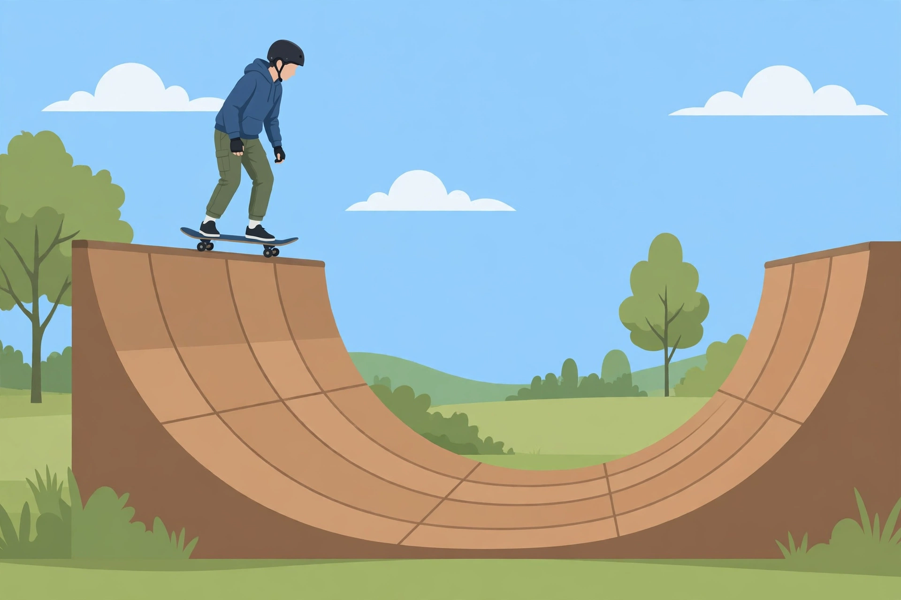
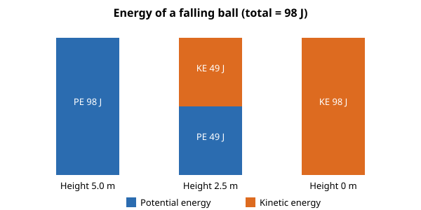

# Lesson 04 — Elastic Potential Energy and Conservation of Mechanical Energy

**Goal:** You will be able to calculate elastic potential
energy and use conservation of mechanical energy to predict
speeds and heights.
**Time:** ~50 minutes. **Materials:** notebook, calculator.
**Readiness check (3 minutes):** A spring is squeezed twice as
far. Does its stored energy double — or quadruple? (Answer:
quadruple, because the energy goes as the square of the
stretch, like kinetic energy goes as the square of speed. If
you said double, watch for the square in this lesson.)

## Teaching

A stretched or compressed spring stores **elastic potential
energy**. For a spring with spring constant `k` (in N/m, a
measure of stiffness) stretched or compressed by a distance `x`
from its relaxed length:

```
PE_elastic = ½kx²
```

The square matters: doubling the stretch quadruples the stored
energy. (Hooke's law, `F = kx`, says the *force* grows linearly
with stretch; the *energy* grows with the square, because the
average force during the stretch is half the final force.)

Now the conservation law. **Mechanical energy** is the sum of
kinetic and potential energy: `E_mech = KE + PE`. When only
**conservative forces** (gravity, spring force) do work on a
system, mechanical energy is conserved:

```
KE_initial + PE_initial = KE_final + PE_final
```

Energy changes form — potential becomes kinetic, kinetic becomes
potential — but the total does not change. This is the
problem-solving shortcut promised in Lesson 02: for a falling
ball, a swinging pendulum, or a spring launch, you can find a
speed from a height (or a height from a speed) in two lines,
without knowing the time or the acceleration at each instant.
Lesson 05 handles the case where friction joins in and the
mechanical total drops.

**Energy bar charts** make conservation visible: draw one bar
per energy form, stacked to the same total height at every
instant. If the total changes, something nonconservative is at
work — or an energy form is missing from the chart.

### Worked example 1 — a compressed spring

A spring with `k = 200 N/m` is compressed by 0.15 m. How much
elastic potential energy is stored?

```
PE = ½kx² = ½(200 N/m)(0.15 m)² = (100)(0.0225) = 2.25 J
```

Keep 2.25 J (three significant figures: the digits 2, 2, and 5).

### Worked example 2 — a falling ball, two heights

A 0.50 kg ball is dropped from rest from a height of 2.0 m
(air resistance ignored). (a) Find its speed just before
hitting the ground. (b) Find its speed when it is 1.0 m above
the ground.

Take the ground as datum. Total mechanical energy at the top:
`KE = 0`, `PE = (0.50)(9.80)(2.0) = 9.8 J`, so `E = 9.8 J`.

(a) At the ground, `PE = 0`, so all 9.8 J is kinetic:
`½(0.50)v² = 9.8` → `v² = 39.2` → `v = 6.3 m/s`.

(b) At 1.0 m: `PE = (0.50)(9.80)(1.0) = 4.9 J`, so
`KE = 9.8 − 4.9 = 4.9 J`. Then `½(0.50)v² = 4.9` →
`v² = 19.6` → `v = 4.4 m/s`. Half the height does not mean
half the speed — speed goes as the square root of the fallen
distance.

### Image activity — the skateboarder at the top of the ramp



*AI-generated illustration for Lesson 04 — a skateboarder at
the top of a half-pipe ramp, momentarily at rest before
dropping in. It is not a photograph and not a source of
measurements; all numbers below come from the problem text.*

**Text-only alternative:** A skateboarder wearing a helmet
stands still on a skateboard at the top edge of a large wooden
half-pipe ramp outdoors, with trees, grass, and sky around. The
ramp curves down from the top edge to a flat bottom in the
middle and back up the other side. The skater is at rest at
the top, about to drop in.

**Questions.** A 60 kg skateboarder stands at rest at the top
of a ramp 3.0 m above the bottom (the datum). Ignore friction
for this activity. (a) What is the skater's gravitational
potential energy at the top? (b) What is the skater's speed at
the bottom of the ramp? (c) Halfway down (1.5 m above the
bottom), what are the skater's kinetic and potential energies,
and what is the speed?

**Working (check after attempting).** (a)
`PE = (60)(9.80)(3.0) = 1764 J ≈ 1.8 × 10³ J`. (b) All of it
becomes kinetic: `½(60)v² = 1764` → `v² = 58.8` →
`v = 7.7 m/s`. (c) At 1.5 m: `PE = (60)(9.80)(1.5) = 882 J`;
`KE = 1764 − 882 = 882 J`; `v = √(2 × 882 / 60) = √29.4 =
5.4 m/s`. At half height the energy is split equally — but the
speed is not half the bottom speed (5.4 vs. 7.7 m/s).

### Deterministic bar chart — a falling ball's energy account

The chart below is drawn from computed values, not measured
data: a 2.0 kg ball dropped from 5.0 m (datum at the ground).
Total mechanical energy: `E = (2.0)(9.80)(5.0) = 98 J` at every
height. At 5.0 m: PE 98 J, KE 0 J. At 2.5 m: PE 49 J, KE 49 J.
At 0 m: PE 0 J, KE 98 J. Speed at the bottom:
`v = √(2 × 98 / 2.0) = √98 = 9.9 m/s`; at 2.5 m:
`v = √(2 × 49 / 2.0) = √49 = 7.0 m/s`.



*Deterministic chart: bar heights are proportional to the
computed energies above (98 J total). Read the chart as an
account, not as data — the numbers come from the calculation.*

## Guided practice

1. A spring with `k = 100 N/m` is stretched 0.20 m. Find the
   stored elastic potential energy.
2. A 1.0 kg ball is dropped from rest from 4.0 m. Find its
   speed just before hitting the ground.
3. A pendulum bob is released from a height of 1.2 m above its
   lowest point. Find its speed at the lowest point (treat the
   bob as a 1.0 kg mass for the energy account; the mass
   cancels, so any mass gives the same speed — check that it
   does).
4. **Bar-chart reading.** A system's total mechanical energy is
   200 J. At one instant its PE bar reads 120 J. What does its
   KE bar read? If the system is a 2.0 kg ball, how high above
   the datum is it at that instant? (Use `PE = mgh`.)

## Independent practice

1. A 0.25 kg ball is dropped from 3.2 m. Find its speed just
   before impact.
2. A spring (`k = 50 N/m`) compressed by 0.10 m launches a
   0.10 kg ball horizontally (ignore gravity during the short
   launch). Find the launch speed.
3. A roller-coaster car starts from rest at the top of a 20 m
   hill (friction ignored). Find its speed at the bottom.
4. **Error analysis.** A learner claims: "Doubling the drop
   height doubles the impact speed." Correct the claim using
   the square-root relationship, and give the right factor.

## Applied task — the playground slide prediction

A slide's top platform is 2.0 m above the ground. (a) Predict
the speed at the bottom if friction were zero. (b) A learner
measures a real slide exit speed of 4.0 m/s. Is the measured
speed higher or lower than your prediction, and what does the
difference tell you? (c) Write two sentences explaining why
real slides are slower than the energy prediction — naming the
energy form the missing energy became. (Lesson 05 formalizes
this accounting.)

## Exit check

1. A spring (`k = 400 N/m`) is compressed 0.050 m. Stored
   energy = ?
2. A 2.0 kg ball is dropped from 5.0 m. Speed at the ground
   (friction ignored) = ?
3. True or false: "In a frictionless drop, half the height
   means half the speed." Correct it if false.

## Supports and extensions

- **Reading access:** the bar chart is the lesson in one
  picture — re-draw it for each problem before computing.
- **Alternate response mode:** answer the image activity orally
  first, pointing to the top, middle, and bottom of the ramp in
  the picture, then write the numbers.
- **Extension:** a 0.30 kg ball is launched upward at 8.0 m/s.
  How high does it rise? (KE = 9.6 J; `h = 9.6 / (0.30 ×
  9.80) = 3.3 m`.)

## Teacher note

Misconceptions to watch: EPE proportional to stretch (not its
square); speed proportional to height (not its square root);
treating the image as a measurement source (all numbers come
from the text). The answer key solves every item independently.
Next lesson: what happens when friction joins — the mechanical
account no longer balances, and the difference is real energy.
