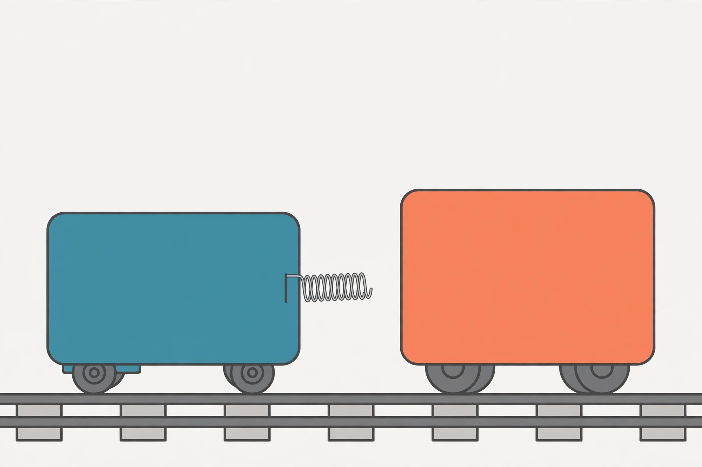

# Lesson 03 — Conservation of Momentum

**Unit 04 · Session S6 · ~50 minutes**
**Standards:** unit objective 3 (track objective 6); HS-PS2-2

## Student goal

By the end of this lesson I can write the before/after momentum
equation for a two-body collision, solve for an unknown velocity, and
state the condition the result depends on.

## Materials

Notebook, pencil, calculator. The image activity below uses the
unit's generated illustration.

## Readiness check (5 min)

3.1. Two identical carts collide and stick together. One cart was
moving, the other was at rest. After the collision, do you expect
the joined carts to move faster, slower, or at the same speed as the
moving cart was before? Give a reason in terms of mass.

3.2. Write, in words, what "total momentum before equals total
momentum after" means for a system of two objects.

## Explicit teaching

During a collision, the two objects push on each other. By Newton's
third law (Unit 02), those pushes are equal in size and opposite in
direction, and they act for exactly the same time — the contact
time. By Lesson 02, then, the impulses are equal and opposite: what
one object gains in momentum, the other loses. The **total** does not
change. This is the **law of conservation of momentum**:

> For a system with no net external force, total momentum before an
> interaction equals total momentum after it.

The two qualifications matter as much as the law:

- **System.** You must say what is in the system. Here the system is
  the two colliding objects. Anything outside it (the track, the
  Earth, a hand pushing a cart) is external.
- **No net external force.** If an external force acts during the
  collision — friction dragging on a cart, a hand holding one back —
  the system's total momentum changes by that force's impulse. Real
  collisions are short, so external impulses during contact are
  usually small compared with the collision impulses, and the law is
  a good approximation. A careful answer always names this condition
  instead of claiming conservation is automatic.

In one dimension, for two objects, the law is one equation:

> `m₁v₁ + m₂v₂ = m₁v₁′ + m₂v₂′`

where unprimed velocities are before the collision and primed
velocities are after it. The routine for every problem in this unit:

1. Choose the system and the positive direction (right = positive).
2. Write the total momentum before, with a sign on every velocity.
3. Write the total momentum after, using one unknown where needed.
4. Set them equal and solve. Check the sign and the size of the
   answer against common sense.

**Stick-together collisions** are the simplest case: after the
collision the two objects share one velocity `v′`, so the right-hand
side becomes `(m₁ + m₂)v′`.

**Recoil and explosions** are the same equation read backwards: a
system at rest (total momentum zero) separates into parts whose
momenta must still add to zero, so the parts move in opposite
directions with momenta equal in size.

## Image activity

Study the unit's generated illustration (an AI illustration, not a
photograph of a real experiment):

*Caption: Two carts on a straight track just before a collision. The
blue cart (left) carries a spring bumper and approaches the orange
cart (right). Cart sizes in the illustration are not to scale; use
the masses and velocities given in the text, not the picture, for
calculations.*

**Text-only alternative (all information needed for the task):** A
blue cart of mass 2.0 kg moves right at 3.0 m/s toward an orange cart
of mass 3.0 kg at rest on the same straight track. The carts collide
and stick together. No other horizontal force acts during the brief
contact.

3.3. **Image task.** Use conservation of momentum to predict the
velocity of the joined carts after the collision. Show the before
total, the after expression, and the solved velocity with sign.

## Worked examples (modeled reasoning)

**Example 1 — Stick together.** A 2.0 kg cart moving right at
3.0 m/s collides with a 1.0 kg cart at rest, and they stick
together. Find their common velocity after the collision.

*Reasoning:* System = both carts; right is positive; no net
external force during the brief contact.

- Before: `p = (2.0)(+3.0) + (1.0)(0) = +6.0 kg·m/s`
- After: `p′ = (2.0 + 1.0)v′ = 3.0v′`
- Set equal: `3.0v′ = 6.0`, so `v′ = +2.0 m/s`

The joined carts move right at 2.0 m/s — slower than the moving
cart was, because the same momentum is now carried by more mass.
That matches the readiness prediction in 3.1.

**Example 2 — Head-on, stick together, total zero.** A 1.5 kg cart
moves right at 4.0 m/s and a 1.5 kg cart moves left at 4.0 m/s. They
collide and stick. Find the velocity after the collision.

*Reasoning:* Signs are essential — the left-moving cart's velocity
is negative.

- Before: `p = (1.5)(+4.0) + (1.5)(−4.0) = 6.0 − 6.0 = 0`
- After: `p′ = (3.0)v′ = 0`, so `v′ = 0`

The joined carts stop dead. Equal and opposite momenta cancel in the
total — not because momentum "disappeared," but because the two
contributions were opposite. (Lesson 04 asks where the kinetic
energy went in this case.)

## Guided practice

Work these with the adult or a partner; write the before total
before solving.

3.4. A 3.0 kg cart moves right at 2.0 m/s and collides with a 2.0 kg
cart moving left at 1.0 m/s. They stick together. Find their common
velocity.

3.5. **Recoil.** Two skaters, 50 kg and 70 kg, stand at rest on
frictionless ice and push off from each other. The 50 kg skater
moves left at 2.8 m/s. Find the velocity of the 70 kg skater.

3.6. **Explosion.** A 4.0 kg cart at rest splits into two 2.0 kg
parts. One part moves right at 3.0 m/s. Find the velocity of the
other part, and explain why the total momentum is still zero.

## Independent practice

3.7. A 0.80 kg cart moves right at 5.0 m/s and collides with a
0.40 kg cart moving left at 2.0 m/s. They stick together. Find
their common velocity (give two significant figures).

3.8. A 5.0 kg cart moves right at 1.2 m/s and sticks to a 3.0 kg cart
at rest. Find the common velocity.

3.9. **Error analysis.** A learner solves a collision problem and
reports that total momentum after the collision is larger than
before, "because the second cart started moving." Identify two
possible causes of this result: one arithmetic (sign) error and one
physics (system/condition) error. For each, say what the learner
should check.

## Application

3.10. **Simulation prediction.** Before opening PhET "Collision
Lab" (Explore 1-D screen, adult previews), predict: a 1.0 kg ball
moving right at 2.0 m/s collides with a 1.0 kg ball at rest and they
stick together (elasticity 0%). Write the predicted common velocity.
In Session S7 you will test this prediction in the simulation and
record whether it matched.

## Exit check

3.11. A 1.0 kg cart moves right at 6.0 m/s and sticks to a 2.0 kg
cart at rest. Find the common velocity, and state the condition
under which conservation of momentum applies.

## Supports and extensions

- **Reading/language access:** Read `m₁v₁ + m₂v₂ = m₁v₁′ + m₂v₂′`
  aloud as "total momentum before equals total momentum after" on
  every problem before substituting numbers.
- **Alternate response mode:** Draw a before/after bar diagram of
  the two momenta (positive bars right, negative bars left) and check
  that the bar totals match before doing algebra.
- **Extension:** A 2.0 kg cart at 3.0 m/s collides with a 4.0 kg cart
  at rest and they stick. The common velocity is 1.0 m/s. Now suppose
  the 4.0 kg cart had instead been moving left at 1.0 m/s: the total
  before is `6.0 − 4.0 = 2.0`, the total mass is 6.0 kg, so the
  common velocity is 0.33 m/s to the right. Verify both results and
  explain why the second case is slower.

## Teacher note

Likely misconceptions: omitting signs; treating "stick together" as
two unknowns instead of one common velocity; claiming conservation
without naming the system or the no-net-external-force condition.
Answers: see the answer key, Lesson 03. The image task (3.3) uses
the generated illustration; its text alternative carries all data.
