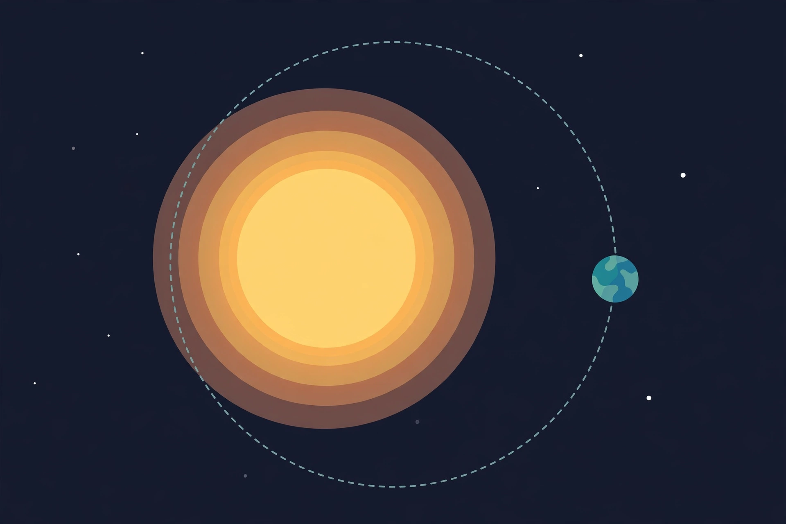

# Lesson 05 — Orbits and Kepler's Laws

**Unit 05 · Session S11 · ~50 minutes**
**Standards:** unit objective 5 (track objective 7)

## Student goal

By the end of this lesson I can derive orbital speed
`v = √(G M / r)` and Kepler's third law from Newton's law of
gravitation; I can test Kepler's third law against the real
planet dataset; and I can state Kepler's three laws in my own
words.

## Materials

Notebook, pencil, calculator. The planet dataset
(`resources/solar_system_planets.csv`): distance from the Sun in
million km, orbital period in days. The orbit illustration
(`../assets/orbit-illustration.png`).

## Readiness check (5 min)

5.1. Mercury orbits at 57.9 million km from the Sun; Neptune at
4,495 million km — about 78 times farther. Which planet moves
faster around the Sun, and which takes longer to complete one
orbit? Guess first, then check against the dataset in the lesson.
5.2. A satellite is in a circular orbit. The gravitational force
on it provides exactly the centripetal force it needs. Write the
equation that says that — one force on each side — before reading
on.

## Explicit teaching

An orbit is a circle (to a good first approximation) held together
by one equation:

`F_gravity = F_centripetal`

That is, `G M m / r² = m v² / r`, where `M` is the mass of the
central body (the Sun, or Earth for an Earth satellite), `m` is
the orbiting body's mass, and `r` is the distance between their
centers. Cancel `m` from both sides and one factor of `r`:

`v² = G M / r`, so `v = √(G M / r)`

Three things to notice. First, the orbiting body's own mass
cancels: a heavy satellite and a light one need the same speed at
the same distance. Second, speed falls as distance grows — inner
planets move faster than outer ones, which answers Readiness 5.1:
Mercury races at about 48 km/s while Neptune strolls at about
5.4 km/s. Third, the period follows from the speed:
`T = 2π r / v`. Substituting `v` gives Kepler's third law:

`T² = 4π² r³ / (G M)`

For planets around the same Sun, `4π² / (G M_sun)` is one constant,
so `T² / r³` is the same for every planet. That is a testable
prediction — and the dataset lets you test it in this lesson.

**Kepler's three laws** (Johannes Kepler, published 1609 and 1619,
from Tycho Brahe's observations — decades before Newton explained
them with gravitation):

1. **Ellipses.** Each planet moves on an ellipse with the Sun at
   one focus. A circle is the special case of an ellipse with
   zero eccentricity; this unit's circular model is an
   approximation that is very good for most planets (Earth's
   eccentricity is only 0.017) and poor for Mercury (0.21) and
   comets.
2. **Equal areas.** A line from the Sun to a planet sweeps out
   equal areas in equal times. A planet moves faster when it is
   nearer the Sun — a consequence of angular momentum conservation
   under a central force.
3. **Harmonic law.** `T² ∝ r³` for planets around the same star
   (the quantitative form above). In Sun–Earth units it is
   beautifully simple: with `r` in astronomical units (AU) and
   `T` in years, `T² = r³`.

**Image activity.** Study the illustration below, then draw your
own diagram on paper: a star, a planet on a circular path, a
velocity arrow tangent to the path at the planet's position, and
a gravitational-force arrow from the planet toward the star.

*AI-generated illustration for Lesson 05 — a planet on a circular
path around a star. Draw the velocity and force arrows yourself;
it is not a photograph and not a source of measurements. The
picture is not to scale: the star and planet are drawn far larger,
relative to the orbit, than in reality.*

**Text-only alternative:** a large glowing star sits at the
center-left of the scene; a small blue-green planet sits on a
dashed circular path around the star, at the right-hand side of
the circle; the background is dark space with a few small white
stars. The activity's numbers come from the problem text and the
planet dataset, never from the picture.

Answer, from your diagram: (a) Which way does the velocity arrow
point — toward the star, away from it, or along the path?
(b) Which way does the force arrow point? (c) If gravity
suddenly switched off, which direction would the planet travel?
(d) If the planet's speed suddenly dropped, would it spiral
inward, spiral outward, or stay on the same circle?

## Worked examples (modeled reasoning)

**Example 1 — The International Space Station.** The ISS orbits
at `r = 6.771 × 10⁶ m` from Earth's center (400 km altitude).
Find its orbital speed and period.

*Reasoning:* `v = √(G M_earth / r) = √(6.67430 × 10⁻¹¹ ×
5.9722 × 10²⁴ / 6.771 × 10⁶) = √(5.887 × 10⁷) = 7.67 × 10³ m/s`,
about 7.7 km/s. The period is `T = 2π r / v = 2π × 6.771 × 10⁶ /
7.67 × 10³ = 5,540 s ≈ 92 min`. The station circles Earth about
16 times a day. Note the check: its centripetal acceleration is
`v² / r = 8.69 m/s²`, which is exactly `g` at that altitude
(Lesson 03's application) — gravity is the centripetal force,
again.

**Example 2 — Testing Kepler's third law with real data.** The
table below is computed from `resources/solar_system_planets.csv`
(distance in million km, period in days; speeds computed as
`v = 2π r / T`; the last column is `T² / r³` in SI units).

| Planet | r (10⁹ m) | T (days) | v (km/s) | T² / r³ (s²/m³) |
|---|---|---|---|---|
| Mercury | 57.9 | 88 | 47.9 | 2.98 × 10⁻¹⁹ |
| Venus | 108.2 | 225 | 35.0 | 2.98 × 10⁻¹⁹ |
| Earth | 149.6 | 365 | 29.8 | 2.97 × 10⁻¹⁹ |
| Mars | 227.9 | 687 | 24.1 | 2.98 × 10⁻¹⁹ |
| Jupiter | 778.6 | 4,333 | 13.1 | 2.97 × 10⁻¹⁹ |
| Saturn | 1,433.5 | 10,759 | 9.7 | 2.93 × 10⁻¹⁹ |
| Uranus | 2,872.5 | 30,687 | 6.8 | 2.97 × 10⁻¹⁹ |
| Neptune | 4,495.1 | 60,190 | 5.4 | 2.98 × 10⁻¹⁹ |

*Reasoning:* The last column is the same for all eight planets
to within about 1.5% — Saturn's 2.93 is the outlier, and it comes
from the dataset's rounded distance and period values, not from
new physics. The predicted value is
`4π² / (G M_sun) = 4π² / (6.67430 × 10⁻¹¹ × 1.989 × 10³⁰)
= 2.97 × 10⁻¹⁹ s²/m³`. Prediction and data agree. Two patterns
are visible at a glance: speed falls with distance, and period
grows with distance — exactly as `v = √(G M / r)` and
`T² = 4π² r³ / (G M)` require. This is the evidence that one
law governs all eight planets.

## Guided practice

Work these with the adult or a partner; write the equation you
are using before substituting numbers.

5.3. A satellite orbits Earth at `r = 2 R_earth`
(`R_earth = 6.371 × 10⁶ m`). Compute its orbital speed and its
period in hours. (Hint: `v = √(G M / r)`; the surface orbital
speed at `r = R_earth` is 7.91 km/s — use it as a check.)
5.4. Use the dataset values for Mercury (r = 57.9 million km,
T = 88 days) and Neptune (r = 4,495.1 million km,
T = 60,190 days) to compute `T² / r³` for each in SI units.
Convert days to seconds and million km to meters first. Compare
your two values with each other and with `2.97 × 10⁻¹⁹ s²/m³`.
5.5. A planet orbits its star at 4 AU. Use `T² = r³` (with `r`
in AU and `T` in years) to find its period in years. Then explain
in one sentence why the same rule, with the Sun's mass replaced
by the star's mass, would give a different constant in SI units.

## Independent practice

5.6. The Moon orbits Earth at `r = 3.844 × 10⁸ m`. Compute its
orbital speed from `v = √(G M_earth / r)` and compare with the
Lesson 01 value of about 1.02 km/s. Then compute its period in
days from `T = 2π r / v` and compare with 27.3 days.
5.7. A geostationary satellite stays above one point on the
equator, so its period must be one day (23.9 h). Use
`T² = 4π² r³ / (G M_earth)` to solve for `r`, and find its
altitude above Earth's surface. (Expected: `r ≈ 4.22 × 10⁷ m`,
altitude ≈ 35,800 km.) Show the rearrangement step.
5.8. (Error analysis.) A learner writes: "Kepler's third law
says bigger planets orbit slower, because they are heavier."
Identify the two errors and rewrite the sentence correctly.

## Application

A newly discovered exoplanet orbits its star (mass equal to the
Sun's) at 0.50 AU. (a) Find its period in years using
`T² = r³`. (b) Find its orbital speed in km/s using
`v = √(G M_sun / r)` with `r = 0.50 × 1.496 × 10¹¹ m`.
(c) Compare its speed with Earth's 29.8 km/s and explain the
difference in one sentence. (Numbers are practice values.)

## Exit check

Derive `v = √(G M / r)` in three lines, starting from
`F_gravity = F_centripetal`. Then state Kepler's third law in
words and in symbols, and say what the planet dataset shows
about it.

## Supports and extension

- **Reading/language access:** say "farther out means slower
  and longer" instead of "Kepler's third law" until the pattern
  is secure, then attach the name.
- **Alternate response mode:** plot `T²` against `r³` for the
  eight planets on graph paper and describe the shape before
  computing any ratio.
- **Extension:** derive `T² = 4π² r³ / (G M)` from
  `v = √(G M / r)` and `T = 2π r / v`, showing each substitution;
  then use it to predict the period of a satellite at
  `r = 3 R_earth` without first computing its speed.

## Teacher note

The durable errors are "heavier planets orbit slower" (mass
cancels — it is distance that matters) and "Kepler's laws are
three unrelated facts" (they are one law's consequences: the
ellipse from the central force, equal areas from angular
momentum, the harmonic law from `F_g = F_c`). Do the table
computation live with the learner — the moment all eight ratios
land on the same number is the payoff of the whole unit. Note
the circular-orbit approximation explicitly: real orbits are
ellipses, and the dataset's mean distances are averages. Answer-key
reference: items 5.1–5.8 and the application.
