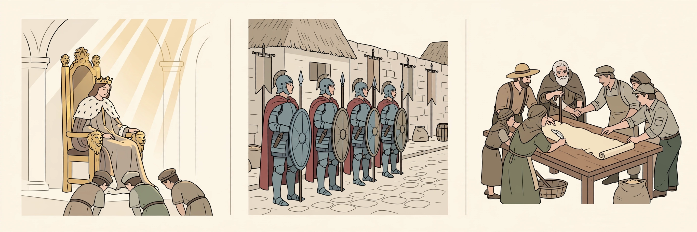

# Lesson 01 — Where Does a Government's Right to Rule Come From?

**Goal:** Explain three theories of political legitimacy — divine right, rule
by force, and the social contract — and identify the natural-rights and
consent-of-the-governed claims that define the social-contract version.
**Time:** ~50 minutes. **Materials:** the triptych image below, notebook.

> **Readiness check (2 min):** Name one rule at school or work that people
> obey *without* anyone forcing them, and say why they obey it.

## Teaching

A government is not just people with power. It is people with power who
*claim the right* to use it. Political thinkers call that claim
**legitimacy**: the reasons a government gives for why people should obey
its laws instead of resisting them. Almost every government in history has
used one of three big theories:

1. **Divine right:** the ruler's authority comes from God (or the gods).
   Disobeying the king is disobeying heaven. This was the standard claim of
   European monarchies — and of many rulers worldwide — for centuries.
2. **Rule by force (or conquest):** the ruler's authority comes from
   overwhelming power. "I rule because I can, and because I won." The claim
   is honest about violence but offers no reason why the ruled *should*
   accept it — only why they *can't* resist.
3. **The social contract:** the ruler's authority comes from an agreement —
   real or imagined — among the people. This is the newest and most radical
   of the three, and it is the one the American founders claimed.

The social-contract theory was developed most fully by the English
philosopher **John Locke** in his *Two Treatises of Government* (1689), a
public-domain text. Locke argued:

- People are born with **natural rights** — rights they hold simply by being
  human, not because any government grants them. Locke named them **life,
  liberty, and property**.
- In the "state of nature" (life without government), everyone is free but
  no one's rights are secure — anyone stronger can take them.
- So people *consent* to form governments whose only legitimate job is to
  **protect those rights**. The government's power comes from the people's
  consent, not from God or from force.
- And the crucial consequence: when a government stops protecting rights
  and starts destroying them, the people may **alter or abolish it** — the
  contract is broken, and consent is withdrawn.

Notice what this theory does to the other two: if authority comes from the
people's agreement, then a king who claims God chose him still needs the
people's consent — and a conqueror with an army has power but no *right*.

### Worked example 1 — Which theory is being used?

*Scenario:* In 1689, a pamphlet defends King James II of England by saying
God appointed him, and that rebelling against him would be a sin even if he
ruled badly.

*Reasoning:* The claim being made is not "the king is strong" (force) and
not "the people agreed" (contract). The authority is traced to a *higher
being*, and disobedience is framed as a *moral* wrong, not just a legal
one. So this is **divine right** — and under Locke's theory it fails the
test, because no consent from the governed is present anywhere in the
argument.

### Worked example 2 — Spotting the consent claim

*Scenario:* A town charter opens: "We, the inhabitants of Millbrook, in
order to secure our safety and welfare, do agree to form a town council and
to obey the laws it makes, so long as those laws serve our safety and
welfare."

*Reasoning:* Break it into Locke's pieces. (1) Natural-rights purpose: the
charter names "safety and welfare" as the *reason* for government — the
rights being protected. (2) Consent: "we... do agree" is an explicit
consent claim. (3) Conditional power: "so long as" makes the government's
authority *conditional* — if the council stops serving safety and welfare,
the agreement's condition fails. This is a textbook social-contract claim,
even in miniature.

## Guided practice

1. **Activity A — Define and sort.** In your own words, write a one-sentence
   definition of *legitimacy*, *natural rights*, *social contract*, and
   *consent of the governed*. Then sort these five claims into the three
   theories: (a) "The pharaoh is a living god"; (b) "We the people...
   ordain and establish"; (c) "Might makes right"; (d) "The king rules by
   God's grace"; (e) "No taxation without representation."

2. **Activity B — Read the image.** Study the illustration (caption and
   alt text below).

   
   *An AI-generated symbolic illustration: three ways rulers have claimed the
   right to rule. Left: a crowned monarch with courtiers bowing. Middle:
   armored soldiers enforcing order. Right: ordinary people signing an
   agreement together. Which panel matches which theory of legitimacy?*

   - a. Match each panel to one theory: divine right, rule by force, social
     contract. For each match, quote or point to one visual detail that
     proves it (e.g., "the rays of light on the crown show the authority
     comes from above, not from the people").
   - b. The right panel shows people *signing*. In Locke's theory, did most
     real governments ever get a literal signed contract? What does the
     signature stand for? (Hint: think about what "consent" can look like
     when there is no actual document — elections? acceptance? the
     possibility of leaving?)
   - c. *Text-only alternative:* Panel A: a monarch on a throne, courtiers
     bowing, light from the sky on the crown. Panel B: armed soldiers
     enforcing order in a village street. Panel C: ordinary people signing a
     shared document and shaking hands. Answer (a) and (b) from these
     descriptions.

## Independent practice

3. A new student government proposes this rule: "The principal appoints the
   student council, and the council's decisions are final." Identify the
   legitimacy theory behind the proposal, then rewrite the proposal's
   opening line so it rests on the *social contract* instead. Keep your
   rewrite under 40 words.
4. **Error analysis.** A classmate writes: "The social contract means the
   government signed a contract with each citizen promising to protect
   them." Explain the two errors in this sentence: (1) who the contract is
   *between*, and (2) what "contract" means here (literal document vs.
   political idea).

## Application

5. Choose one modern government (any country, any era — the adult confirms
   the choice is researchable and nonpartisan in framing). Find one
   *official* statement of why that government has the right to rule — a
   constitution's preamble, a founding charter, a state motto. Write 3–4
   sentences: which theory (or mixture) does the statement use, and what
   words prove it?

## Exit check

6. In two sentences: why does Locke's theory let people *remove* a
   government, while divine right does not?

## Supports and extensions

- **Reading access:** Vocabulary is pre-taught by the adult before this
  lesson (see teacher guide). Locke's 17th-century prose is *described*,
  not assigned, in this unit.
- **Alternate response mode:** Activity B may be answered orally, pointing
  at the image; the exit check may be dictated.
- **Extension:** Read the opening of Locke's *Second Treatise*, §4–§6
  (public domain; the adult supplies a clean excerpt): does Locke think
  natural rights survive *inside* a government, or are they traded away?
  Cite one line.

## Teacher note

Likely misconception: students treat "social contract" as a literal
historical document everyone signed — Activity B(b) and practice 4 target
this directly. Answer-key reference: [answer-key.md](../answer-key.md),
Lesson 01. Image note: the triptych is a symbolic AI illustration, *not*
evidence about any real regime; the lesson says so explicitly in the
assets record and the caption.
