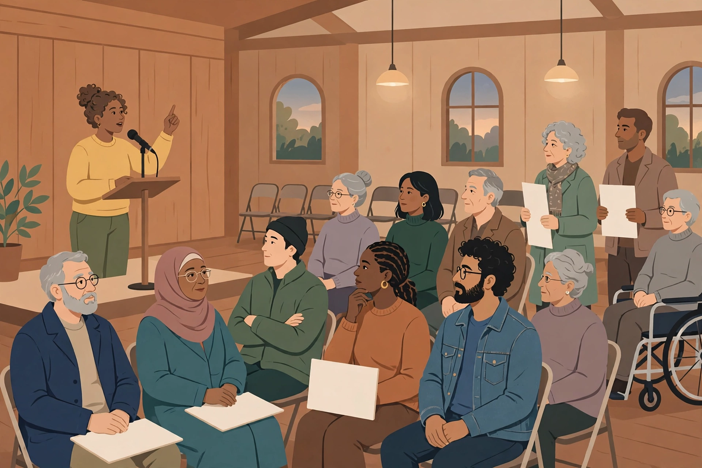

# Lesson 03 — Religion, Press, Assembly, Petition

**Goal:** Explain the Establishment and Free Exercise Clauses, the
heavy presumption against prior restraint, and content-neutral
time/place/manner rules — and argue a public-forum scenario from both
sides. **Time:** ~55 minutes. **Materials:** First Amendment text;
generated forum illustration (below); scenario card (see Applied task).

> **Readiness check (2 min):** Name the First Amendment's five
> freedoms in order. (Answer: religion, speech, press, assembly,
> petition — "RAPPS" is a common memory aid: Religion, Assembly,
> Press, Petition, Speech.)

**Sources:** National Archives Bill of Rights transcription (checked
2026-10-28); Congress.gov, Constitution Annotated, First Amendment
religion and press essays (checked 2026-10-28); Oyez case summaries for
*Engel v. Vitale* (1962), *New York Times v. United States* (1971),
and *Edwards v. South Carolina* (1963) (search-result verified
2026-10-28).

## Teaching

Speech got its own lesson because its tests are the most used. The
other four freedoms share one structure: each protects a liberty, and
each collides with a competing interest the government claims — order,
neutrality, safety, or the rights of others. Learn the collision, and
the case names follow.

### Religion: two clauses, one tension

The First Amendment contains two religion clauses, and they pull in
opposite directions:

- **Establishment Clause:** "Congress shall make no law respecting an
  establishment of religion." Government may not establish, endorse,
  or prefer a religion.
- **Free Exercise Clause:** "or prohibiting the free exercise
  thereof." Government may not burden religious practice.

The tension: a government that accommodates religion too eagerly can
look like it is establishing one; a government that refuses every
accommodation can look like it is burdening exercise. The Court has
moved between approaches over time, and this lesson teaches the arc
honestly rather than pretending one test settled it.

The school-prayer line is the clearest. In *Engel v. Vitale* (1962),
the Court struck down a New York public-school prayer composed by the
state, even though students could opt out: government-composed prayer
in a public school is establishment, and opt-out does not cure it. In
*Lemon v. Kurtzman* (1971), the Court announced a three-part test for
establishment: a law must have a secular purpose, must not principally
advance or inhibit religion, and must not foster excessive government
entanglement with religion. *Lemon* governed for decades — then, in
*Kennedy v. Bremerton* (2022), the Court abandoned it for establishment
cases, holding that the Establishment Clause should be interpreted by
reference to historical practices and understandings. A learner who
cites *Lemon* as current law is out of date; a learner who ignores it
misses fifty years of doctrine. Teach both facts.

On the free-exercise side, *Cantwell v. Connecticut* (1940)
incorporated the clause against the states (a Jehovah's Witness
prosecuted for soliciting without a permit). In *Employment Division v.
Smith* (1990), the Court held that a neutral law of general
applicability — one that does not target religion — does not violate
free exercise merely because it burdens a religious practice. Congress
responded with the Religious Freedom Restoration Act of 1993 (RFRA),
which requires the *federal* government to justify substantial burdens
on religion with a compelling interest pursued by the least restrictive
means; the Court later held RFRA could not be imposed on the states
(*City of Boerne v. Flores*, 1997). The pattern to remember: the
clauses protect belief absolutely and practice strongly, but not
without limit — and the limit's location has moved.

### Press: no prior restraint

Freedom of the press adds one distinctive protection: the ban on
**prior restraint** — government blocking publication *before* it
happens. In *Near v. Minnesota* (1931), the Court struck down a state
law letting judges shut down "malicious" newspapers in advance: the
press may be punished *after* publication (for libel, for example),
but prior restraint bears a "heavy presumption against its
constitutional validity." The high-water case is *New York Times v.
United States* (1971), the Pentagon Papers case: the government sought
to stop two newspapers from publishing a classified Defense Department
study of the Vietnam War. The Court refused, 6–3: the government had
not met its heavy burden of showing that publication would cause grave
and irreparable harm. Note the asymmetry for learners: the same
newspaper that may not be stopped in advance may still be sued after
publication for defamation — prior restraint and subsequent punishment
are different questions with different answers.

### Assembly and petition: the public forum

"the right of the people peaceably to assemble, and to petition the
Government for a redress of grievances." Assembly was incorporated in
*De Jonge v. Oregon* (1937) and petition in *Edwards v. South
Carolina* (1963) (a peaceful march on statehouse grounds). The
governing framework is the **public-forum doctrine** plus
**time/place/manner** rules:

- In a **traditional public forum** (streets, sidewalks, parks),
  government may impose reasonable time, place, and manner restrictions
  — but they must be **content-neutral**, narrowly tailored to serve a
  significant government interest, and leave open ample alternative
  channels of communication.
- In a **limited or nonpublic forum** (a school classroom during
  lessons, a military base, an airport terminal used for travel),
  government has more control, but viewpoint discrimination — allowing
  one side of a debate and banning the other — is still forbidden.
- "Peaceably" does real work: assembly that blocks emergency access or
  turns violent loses the protection that a peaceful march keeps, and
  the *Brandenburg* test from Lesson 02 governs any incitement claim.

Study the illustration below before the deliberation. It is an
**AI-generated illustration** — a teaching prompt, not a photograph of
a real meeting and not evidence about any real event.

*Caption: AI-generated illustration of a public forum — one speaker at
a microphone, an audience listening. Used in this lesson's deliberation
activity. See [assets/README.md](../assets/README.md) for the
generation record.*

**Text-only alternative (contains everything needed for the activity
questions):** A community hall with wooden walls and arched windows.
On the left, one woman stands at a podium with a microphone, speaking
and gesturing with one hand. Facing her are seated adults of different
ages and backgrounds, listening; several hold blank sheets of paper.
On the right, two people stand holding blank sheets, and one man uses
a wheelchair. No words, signs with slogans, or symbols appear anywhere
in the image. Activity questions: (1) Which First Amendment freedoms
are being exercised in this scene, and by whom? (2) The hall is a
government-owned community center. May the city require the group to
end by 9 p.m. and keep the aisles clear? Under what test? (3) Suppose
the city lets groups supporting the mayor use the hall free but charges
opponents a fee. Which rule does that break, and why?

### Worked example 1 — Establishment or free exercise?

*Task:* A public high school football coach prays aloud at midfield
after games, with players joining voluntarily. A parent complains this
is establishment; the coach claims free exercise. (This is the
*Kennedy v. Bremerton* fact pattern, simplified.) Decide under the
post-2022 approach, and state what would have changed the analysis
under *Lemon*.

*Reasoning:* Under *Kennedy*, the question is whether the prayer is
private speech protected by free exercise and free speech, or
government speech establishing religion — and the Court treated a
coach's personal, quiet prayer as private speech, not coercion of
students, rejecting *Lemon* as the test. Under *Lemon*, the analysis
would have asked about secular purpose, primary effect (advancement of
religion), and entanglement — and a court could plausibly have found
the coach's visible, team-associated prayer to have the effect of
endorsing religion to students. Same facts, different tests, different
plausible answers: that is why the lesson insists on naming which test
you are applying.

### Worked example 2 — A time/place/manner rule

*Task:* A city requires all park rallies to end by 8 p.m., bans
amplified sound after 8 p.m., and applies the rule to every group.
A rally organizer claims a First Amendment violation. Decide.

*Reasoning:* The rule is content-neutral (it applies regardless of
message), serves a significant interest (residents' sleep and park
maintenance), and leaves ample alternatives (rallies earlier in the
day, unamplified speech, other venues). It is a valid time/place/manner
restriction. Change one fact — the rule applies only to rallies
criticizing the mayor — and it becomes content-based and presumptively
invalid. Content-neutrality, not the hour itself, decides the case.

## Guided practice

1. **G1.** Answer the three illustration questions from the text-only
   alternative above. For question (2), name the test and apply each
   of its parts.
2. **G2.** A state gives tax exemptions to all nonprofit organizations
   including churches, but denies a tax exemption to a church that
   criticizes the governor. Which clause is violated, and is the
   problem establishment or free exercise? (Hint: the exemption itself
   is neutral; the denial is not.)
3. **G3.** A judge orders a newspaper not to publish the name of a
   defendant in an ongoing trial. Prior restraint or subsequent
   punishment? Which case governs, and what burden must the government
   meet?

## Independent practice

1. **I1.** A public school allows a student religious club to meet
   after school on the same terms as the chess club. A parent claims
   establishment. Decide, distinguishing government speech (the
   *Engel* prayer) from private speech on equal terms.
2. **I2.** A city bans all demonstrations on the sidewalk in front of
   city hall, citing traffic, but allows commercial vendors on the same
   sidewalk. Apply the public-forum doctrine: what kind of forum is
   this, and does the ban survive?
3. **I3.** Error analysis: "The First Amendment requires the
   government to be neutral toward religion, so a state may not fund
   any service a religious organization provides." Identify the error:
   distinguish neutrality toward religion from hostility to religion,
   using the *Smith*/RFRA distinction between targeted burdens and
   neutral laws.
4. **I4.** A citizen petitions the city council for a crosswalk and is
   told petitions are only accepted from property owners. Which
   freedom is burdened, and what is the government's best defense?
   (Answer in [answer-key.md](../answer-key.md).)

## Applied task

**A.** Structured deliberation (used in W12S4): a community center
owned by the city rents its hall to groups. The city proposes three
rules: (1) no events after 9 p.m.; (2) no group may display signs
larger than 3 feet; (3) groups must pay a deposit, refunded if the
hall is left clean. Argue the rules from both sides — the city (order,
safety, equal access) and a group that objects (speech burden) — and
then rule on each rule with a reason. Add a fourth rule that would
clearly violate the First Amendment (for example, a viewpoint-based
fee) and explain why.

## Exit check

**E.** In four short sentences: (1) state the two religion clauses and
the tension between them; (2) state the prior-restraint rule and its
case; (3) state the time/place/manner test's three parts; (4) name the
case that incorporated assembly.

## Supports and extensions

- **Reading access:** Gloss *entanglement* (government becoming
  involved in running or monitoring religious activity), *prior
  restraint* (blocking publication before it happens), and *forum*
  (in this doctrine, a place classified by its openness to speech)
  before assigning case summaries.
- **Alternate response mode:** The deliberation in the applied task
  may be done as a spoken debate with assigned sides instead of in
  writing.
- **Extension:** Compare *Near* (1931) with *New York Times v.
  Sullivan* (1964): why does the Court treat stopping publication
  before it happens as more dangerous than punishing publication after
  it happens? Strong answers discuss the difference between
  preventing public knowledge and remedying a proven harm.

> **Teacher note:** The persistent misconception is that "separation
> of church and state" means religion must be invisible in public life.
> Correct it with the equal-terms distinction: government may not
> establish religion, but private religious speech on equal terms with
> other speech is protected, not banned. Full notes and all answers are
> in [teacher-guide.md](../teacher-guide.md) and
> [answer-key.md](../answer-key.md).
