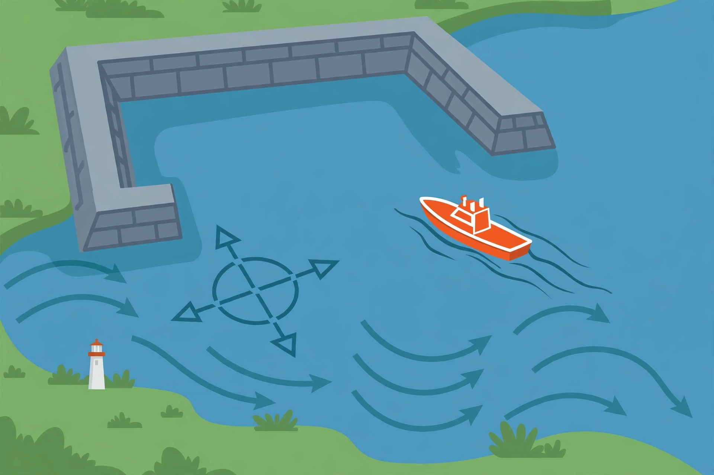

# Lesson 02 — Vector Operations and Applications: Resultants, Dot Products, and the Harbor

**Goal:** Add, subtract, and scale vectors geometrically and
component-wise; compute dot products and angles; solve velocity and
force problems.

**Time:** ~50 minutes. **Materials:** graph paper, Desmos, the
generated harbor illustration in `../assets/harbor-boat-vector-scene.png`.

**Readiness check (5 minutes):** For `v = <3, 4>`, give `|v|` and its
unit vector. (Answers: 5; `<3/5, 4/5>`.) Then sketch `−v` without
computing: same length, opposite direction.

## 1. Adding, subtracting, scaling — two pictures, one arithmetic

**Component-wise** (the arithmetic you will actually compute with):

`u + v = <a₁ + a₂, b₁ + b₂>`, `u − v = <a₁ − a₂, b₁ − b₂>`,
`k·v = <ka, kb>` for a scalar `k`.

**Geometrically** (the picture that tells you what the arithmetic
means):

- **Triangle rule:** place the tail of `v` at the tip of `u`; the sum
  runs from `u`'s tail to `v`'s tip.
- **Parallelogram rule:** place both tails together; the sum is the
  diagonal of the parallelogram they span.
- Subtraction is addition of the opposite: `u − v = u + (−v)`, where
  `−v` has the same magnitude and the opposite direction (N-VM.4.c).
  Geometrically, `u − v` runs from the tip of `v` to the tip of `u`
  when both tails coincide — tips in that order, not the reverse.

Scaling by `k > 0` stretches (`k > 1`) or shrinks (`0 < k < 1`) the
vector without changing its direction; scaling by `k < 0` also reverses
it (N-VM.5.b). Scaling by 0 gives the zero vector `<0, 0>`, which has
magnitude 0 and no direction.

The **resultant** is the single vector that replaces a sum. Its
magnitude is typically *not* the sum of the magnitudes — unless the
vectors point the same way. A 5-unit vector east plus a 12-unit vector
north gives a 13-unit resultant, not 17 units. Forgetting this is the
unit's most expensive error, because it feels like ordinary addition.

**The dot product** is a scalar, not a vector:

`u · v = a₁a₂ + b₁b₂ = |u| |v| cos θ`

where `θ` is the angle between the vectors (0° to 180°). So the angle
can be recovered: `cos θ = (u · v) / (|u| |v|)`. A dot product of zero
means the vectors are **orthogonal** (perpendicular); a negative dot
product means the angle between them is obtuse — they partly oppose
each other.

## 2. Worked examples

**Example 1 — operations, both ways.** Let `a = <4, 3>` and `b = <−1, 2>`.

`a + b = <3, 5>`, `a − b = <5, 1>`,
`2a − 3b = <8, 6> − <−3, 6> = <11, 0>`.

Geometrically, `a + b` is the diagonal from `(0, 0)` to `(3, 5)` of the
parallelogram spanned by `a` and `b`. Its magnitude is `√34 ≈ 5.83`,
which is less than `|a| + |b| = 5 + √5 ≈ 7.24` — as expected, since
`a` and `b` do not point the same way.

Dot product: `a · b = 4(−1) + 3(2) = −4 + 6 = 2`.
`|a| = 5`, `|b| = √5`, so `cos θ = 2 / (5√5) ≈ 0.1789`, and
`θ ≈ 79.7°`. The small positive dot product matches the near-right
angle: the vectors are almost perpendicular, slightly aligned.

**Example 2 — a river crossing (the model for the project).** A boat's
velocity through the water is 12 km/h due north. The river current is
5 km/h due east. The boat's velocity over ground is the resultant:

`v = <5, 12>` km/h (east component from the current, north component
from the boat). Magnitude: `√(25 + 144) = 13` km/h. Direction: measured
from north, the boat drifts `arctan(5/12) ≈ 22.6°` east of north; in
standard position (from east, counterclockwise) that is
`90° − 22.6° = 67.4°`. Both descriptions name the same direction —
**say which reference you are using**. A bearing and a standard-position
angle are different numbers for the same arrow, and mixing them up is a
navigation error, not a rounding error.

If the boat must actually travel due north over ground, it must aim
upstream of north: it needs a westward component of 5 km/h to cancel
the current, so its heading satisfies `sin φ = 5/12` west of north,
`φ ≈ 24.6°`, and its northward speed over ground is then
`√(12² − 5²) = √119 ≈ 10.9` km/h. Aiming straight at the destination
while a current pushes you is the error this calculation exists to
prevent.

**Example 3 — forces.** Two forces act on one object:
`F₁ = <30, 40>` N and `F₂ = <−40, 30>` N.

Resultant: `F = <−10, 70>` N. Magnitude: `√(100 + 4900) = √5000 ≈ 70.7` N.
Direction: reference angle `arctan(70/10) = arctan 7 ≈ 81.9°`, Quadrant II
(negative x, positive y), so `θ ≈ 180° − 81.9° = 98.1°`.

Check with the dot product: `F₁ · F₂ = 30(−40) + 40(30) = −1200 + 1200 = 0`.
The forces are orthogonal — which is why the resultant's magnitude
`√(50² + 50²) ≈ 70.7` is exactly the hypotenuse of the two 50 N forces.
Orthogonality is not a coincidence to admire; it is a check to run.

## 3. The harbor image activity

*Caption: AI-generated illustration for this lesson (see
`../assets/README.md`). The picture carries no measurements: it shows
qualitatively that a boat, a heading, and a current combine. Every
number in the questions below comes from the text, not from the
picture.*

**Text-only alternative (same information, no picture needed):** A
boat leaves a harbor heading due east. A current pushes due south.
The boat's speed through the water and the current's speed are given
in the questions below; the picture adds no further numbers.

1. Describe in words what the curved arrows in the water represent,
   and what would change in the boat's path if they pointed the other
   way.
2. **Numbered version.** The boat's velocity through the water is
   8 knots due east; the current is 6 knots due south. Find the
   boat's velocity over ground as a vector, its speed, and its
   direction (state your reference: south of east, or standard
   position).
3. What heading must the boat steer to travel due east over ground
   against that same current, and what is its eastward speed over
   ground then?

## 4. Guided practice

1. For `u = <2, −1>` and `v = <−3, 4>`, compute `u + v`, `u − v`,
   `3u + 2v`, and `u · v`. Sketch `u + v` by the triangle rule.
2. Find the angle between `<1, 0>` and `<1, 1>`, and between `<1, 2>`
   and `<2, −1>`. What does the second answer tell you geometrically?
3. A plane flies at 200 km/h due west through air moving 50 km/h due
   south. Find its velocity over ground (magnitude and direction,
   with reference stated). If it must travel due west over ground,
   what heading change is needed, in words?

## 5. Independent practice

1. Show that `<3, 4>` and `<−4, 3>` are orthogonal two ways: by dot
   product, and by their magnitudes and the magnitude of their sum.
2. A swimmer swims at 2 m/s due north across a river flowing 1.5 m/s
   east. Find the swimmer's velocity over ground and the angle east
   of north of the actual path. (This is a 3-4-5 triangle in disguise
   only if you scale it: check the ratio.)
3. Forces `<10, 0>` N and `<0, 10>` N act together; a third force must
   cancel their resultant exactly (equilibrium). Find the third force
   as a vector and in magnitude-direction form.
4. **Error analysis.** A classmate adds a 10 N east force and a 10 N
   north force and reports a 20 N resultant northeast. Explain the
   error with a number: what is the actual resultant magnitude, and
   why is "add the magnitudes" wrong in general?

## 6. Exit check

A boat's velocity through water is `<0, 9>` km/h (north) and the
current is `<−4, 0>` km/h (west). Give the velocity over ground, its
speed, and its direction west of north. Then state, in one sentence,
what heading the boat would need to make good a due-north course.

## Supports and extensions

- **Support:** Always draw the triangle or parallelogram before
  computing a sum; the sketch catches reversed subtraction (tip order)
  before it becomes a wrong answer.
- **Alternate response mode:** Direction answers may be given as a
  bearing ("22.6° east of north") or a standard-position angle, as long
  as the reference is stated in the same sentence.
- **Extension:** Prove the parallelogram law for magnitudes,
  `|u + v|² + |u − v|² = 2(|u|² + |v|²)`, component-wise. Then explain
  why it makes the "magnitudes add" error visible: the sum and the
  difference cannot both have the added magnitude unless one vector
  is zero.

## Teacher note

Bearings vs. standard-position angles will generate the most
"right number, wrong label" answers in this lesson; require the
reference in every direction answer and mark an unstated reference as
incomplete, not merely informal. See `../teacher-guide.md` (adults
only) and `../answer-key.md` for worked solutions.
