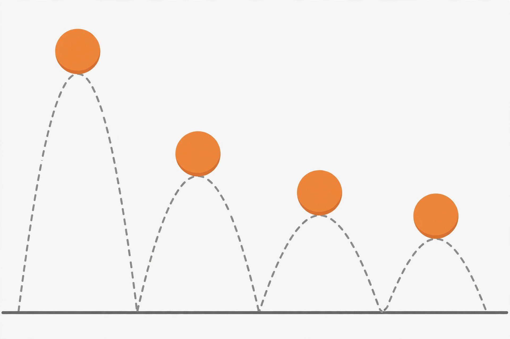

# Lesson 04 — Infinite Geometric Series and Convergence

**Goal:** I can decide whether an infinite geometric series has a
finite sum, compute it when it does, and use it for repeating
decimals and total-distance models.

**Time:** 50 minutes. **Materials:** notebook, calculator, the
image below (or its text alternative).

**Readiness check (5 minutes):** Write the first four partial sums
of `12 + 6 + 3 + …`. (12, 18, 21, 22.5.) Do they look like they are
heading somewhere? Where? (They climb toward 24, gaining half the
remaining distance each step.)

## Teaching

An infinite series is the limit of its **partial sums**
`S_1, S_2, S_3, …` — the running totals after 1, 2, 3, … terms. If
the partial sums settle toward one number, the series
**converges** to that number. If they grow without bound, or
oscillate without settling, it **diverges** and has no finite sum.

For a geometric series with `|r| < 1`, the finite-sum formula
settles the question. Since `r^n → 0` as `n` grows:

```
S_n = a_1·(1 − r^n)/(1 − r)  →  a_1/(1 − r)
```

So a convergent infinite geometric series sums to `a_1/(1 − r)`.
When `|r| ≥ 1`, the terms do not shrink to zero (they grow, stay
the same size, or alternate at full size), the partial sums cannot
settle, and there is no finite sum. The condition is sharp: `r = 0.9`
converges (slowly), `r = 1` diverges, `r = −1` oscillates forever.

A useful intuition: with `r = 1/2`, each new term covers half the
remaining distance to the limit. That is why partial sums approach
but never quite reach the total — and why "infinitely many terms"
can still add to a finite number.



*Figure: a bouncing ball whose successive bounce heights shrink.
This is an AI-generated illustration, not a photograph or a
measurement. The numbers for the activity below come from the text,
not from measuring the picture.*

**Text-only alternative:** A ball is dropped and rebounds to a
smaller height each time. The picture shows four bounces, each peak
lower than the previous one. The activity's numbers are: first
rebound height 6 meters, each rebound 2/3 of the previous height.

### Worked Example 1 — a convergent sum from partial sums

Find the sum of `12 + 6 + 3 + …` (continuing forever).

Here `a_1 = 12`, `r = 1/2`, and `|r| < 1`, so the series converges:

`S = 12/(1 − 1/2) = 12/(1/2) = 24`.

Partial-sum check: `S_1 = 12`, `S_2 = 18`, `S_3 = 21`,
`S_4 = 22.5`, `S_5 = 23.25` — climbing toward 24, each step closing
half the remaining gap. The partial sums are the evidence; the
formula is the shortcut.

### Worked Example 2 — total distance of a bouncing ball

A ball is dropped from 8 meters. Each rebound rises to 2/3 of the
previous height, so the rebound heights are `6, 4, 8/3, …` meters.
How far does the ball travel in total (up and down), in the
idealized model?

Rebound heights form a geometric series with `a_1 = 6`, `r = 2/3`:
their sum is `6/(1 − 2/3) = 18` meters of *upward* travel. The ball
also falls each of those heights, adding another 18 meters of
downward travel after the rebounds, plus the initial 8-meter drop:

Total = `8 + 2·18 = 44` meters.

Assumptions, stated honestly: the ratio stays exactly 2/3 forever,
there is no air resistance, and the ball never stops. In reality
the bounces become too small to see and the ball eventually rests;
the model describes the idealized total, not a measured one.

### Worked Example 3 — a repeating decimal as a series

Write `0.333…` as a fraction using series.

`0.333… = 3/10 + 3/100 + 3/1000 + …`, a geometric series with
`a_1 = 3/10`, `r = 1/10`. So the sum is
`(3/10)/(1 − 1/10) = (3/10)/(9/10) = 1/3` ✓ — the familiar fact,
now proved by series rather than asserted.

## Guided practice

1. Find the sum of `5 + 5/4 + 5/16 + …` (continuing forever), or
   explain why it has none.
2. Does `2 + 4 + 8 + …` have a finite sum? Justify with partial
   sums, not just the rule.
3. Write `0.272727…` as a fraction using the series method.

## Independent practice

1. Find the sum of `9 − 3 + 1 − 1/3 + …` (continuing forever).
2. Find the sum of `1 + 1/2 + 1/4 + …`.
3. A series has `a_1 = 4`, `r = −1`, so its terms are
   `4, −4, 4, −4, …`. Write its first four partial sums and
   explain why it diverges.
4. A square's area is 64 square units. Each later square's area is
   1/4 of the previous one. Find the total area of the infinite
   sequence of squares.

## Application

A patient takes a 100 mg dose each day. Suppose 30% of the drug in
the body remains after each day (the rest is eliminated), so the
amount present just after the `n`th dose follows a geometric
pattern. What amount does the body approach just after a dose, in
the long run? State the series, its ratio, and the assumptions
this model makes. (This is a mathematical model, not medical
advice; real dosing follows a clinician's instructions.)

## Exit check

1. Find the sum of `20 + 16 + 12.8 + …` (continuing forever).
2. In your own words: why does `|r| < 1` decide convergence, and
   what goes wrong when `|r| ≥ 1`?

## Supports and extensions

- **Support:** Before applying any formula, write the first four
  partial sums. If they are not settling, stop — the series may
  diverge.
- **Alternate response mode:** Sketch the partial sums as points
  `(n, S_n)` and describe their trend in a sentence.
- **Extension:** A ball dropped from 10 meters rebounds to 80% of
  each previous height. Find its total travel, then find what
  fraction of that total is traveled through the first three
  rebounds (initial drop plus three up-and-down trips).
  (Total: `10 + 2·(8/0.2) = 90` meters; through three rebounds:
  `10 + 2·(8 + 6.4 + 5.12) = 49.04` meters, about 54.5%.)

## Teacher note

Likely misconceptions: (a) applying `a_1/(1 − r)` without checking
`|r| < 1`; (b) thinking "infinite terms" must mean "infinite sum";
(c) in the ball problem, counting only upward travel or only the
rebound heights and forgetting the initial drop. The partial-sum
table is the cure for (a) and (b). Answer-key reference:
`answer-key.md`, Lesson 04.
