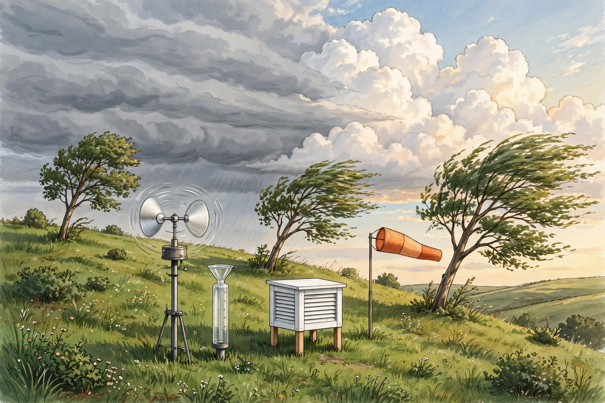

# Lesson 04 — Reading Weather Maps and Explaining Regional Climates

**Goal:** By the end of this lesson you can read a surface-analysis
chart (isobars, fronts, highs and lows), use the unit's weather-station
illustration as an observation exercise, and explain why places at the
same latitude have different climates.

**Time:** ~50 minutes. **Materials:** notebook; the illustration in
`../assets/weather-station-front.png`; a current surface-analysis
chart from the resource pack (adult previews it first).

**Readiness check (2 minutes):** Name the four front symbols and
which way their triangles/semicircles point. If you cannot, re-read
Lesson 03, section 2.

## 1. How to read a surface-analysis chart

A surface-analysis chart is a snapshot of the weather at one time.
Learn to read it in this order — centers, fronts, isobars, then
details:

1. **Find the centers.** A red **L** marks a low-pressure center
   (rising air, clouds, precipitation likely); a blue **H** marks a
   high (sinking air, usually clearer and calmer). Lows are where
   the action is: fronts radiate outward from them.
2. **Trace the fronts.** Cold (blue triangles), warm (red
   semicircles), occluded (purple, both), stationary (alternating).
   The symbols point in the direction of motion. The region between
   a cyclone's warm and cold fronts is the warm sector.
3. **Read the isobars.** Isobars are lines of equal sea-level
   pressure, usually drawn every 4 millibars (hectopascals). Like
   contour lines on a topographic map, their *spacing* is the
   message: closely spaced isobars mean a steep pressure gradient
   and strong winds; widely spaced isobars mean a weak gradient and
   light winds.
4. **Infer the wind.** Around a Northern Hemisphere low, surface
   winds spiral counterclockwise and slightly inward; around a
   high, clockwise and slightly outward. (Inward/outward because
   surface friction weakens the Coriolis deflection — Lesson 01.)
5. **Check the time and the units.** Charts are labeled in UTC
   ("Zulu") time, not local time, and pressure in millibars, which
   equal hectopascals (1 mb = 1 hPa). A chart valid at 12Z is 6:00
   a.m. Central Standard Time (UTC−6) — a conversion worth doing
   explicitly every time until it is automatic.

**Worked example 1 — Read a described chart.** *Description:* A low
centered over the upper Midwest has a cold front trailing southwest
and a warm front extending east. Isobars are tightly packed along
the cold front and widely spaced over the Southeast under a high.

*Reading:* (a) The tight isobars along the cold front mean strong
winds and a steep pressure gradient there — expect gusty winds and
showers along the front. (b) The Southeast high with wide isobars
means light winds and mostly clear skies. (c) A station in the warm
sector between the fronts should expect warm, humid air now, with
the cold-front passage (and its temperature drop and wind shift)
still to come. (d) If the low is moving east, the front will reach
stations to the east later today — the map is a snapshot, and motion
turns it into a forecast.

**Worked example 2 — A fictional five-day station record.**
*Fictional practice data — not observations.* A station records, at
the same time each day: Day 1: 1022 hPa, steady, wind W, high 18 °C,
clear. Day 2: 1018 hPa, falling, wind SW, high 21 °C, increasing
cloud. Day 3: 1012 hPa, falling, wind S, high 23 °C, rain in the
afternoon. Day 4: 1006 hPa then rising, wind shifting SW→NW, high
24 °C then falling to 14 °C, showers then clearing. Day 5: 1016 hPa,
rising, wind NW, high 15 °C, clear.

*Reading:* Days 1–3 show a low approaching (falling pressure,
warming as warm-sector air arrives, cloud increasing). Day 4 is the
cold-front passage: pressure bottoms out and turns, wind shifts
SW→NW, temperature falls 10 °C, showers then clearing. Day 5 is the
cold air mass in place: high pressure, cool, clear. The whole story
is one cyclone passing — five numbers a day, one mechanism.

## 2. Observation exercise: the weather-station illustration

*Caption: AI-generated illustration of a weather observation station
as a front approaches: layered grey cloud and rain on one side, tall
cumulus on the other, instruments in the foreground. This is an
illustration for observation practice, not a photograph of a real
station or a record of real weather.*

**Observe and answer:**

1. Name each instrument you can see and state what it measures:
   the spinning anemometer (wind speed), the rain gauge
   (precipitation amount), the white instrument shelter (houses a
   thermometer and humidity sensor, shielded from direct Sun and
   rain), the windsock (wind direction and rough speed).
2. Which way is the wind blowing? Use the windsock and the bending
   trees: both point the same way, and the wind is named by where
   it comes *from*, so read the direction from the upwind side.
3. What kind of front is suggested by the two cloud banks meeting,
   and what would you expect each instrument's reading to do over
   the next few hours as the front passes? (Pressure: fall then
   rise; wind: shift; rain gauge: accumulate, then stop; shelter
   temperature: change with the air-mass change.)

**Text-only alternative:** If you cannot see the image, use this
description: a grassy hill holds, left to right, a spinning
anemometer on a tripod, a tall clear rain gauge, a white louvered
instrument shelter on legs, and an orange windsock blowing
horizontally. Trees bend strongly. The left sky is grey layered
cloud with rain streaks; the right sky is tall white cumulus under
blue sky. All three questions above can be answered from this
description alone.

## 3. Why places at the same latitude have different climates

Latitude sets the energy budget, but four modifiers rewrite it:

- **Ocean vs. continent (continentality):** water's high heat
  capacity (Lesson 02) mutes seasonal swings near coasts and lets
  interiors swing wildly.
- **Ocean currents:** warm currents warm the coasts they pass;
  cold currents cool them. Same latitude, different current,
  different climate.
- **Mountains and rain shadow:** moist air forced up a mountain
  slope cools (about 6.5 °C per kilometre on average, faster when
  dry), condenses, and rains out on the windward side. The air that
  descends on the lee side is dry and warms as it sinks — the rain
  shadow. The wet west side and dry east side of a coastal range
  are one mechanism, not two climates.
- **Elevation:** temperature falls with height even without a
  mountain barrier — high plateaus are cooler than lowlands at the
  same latitude.

**Worked example 3 — Lapse-rate arithmetic.** Air at 20 °C at sea
level is forced up 2 km without exchanging heat (dry adiabatic
cooling, about 9.8 °C/km). Its temperature becomes
20 − (9.8 × 2) = 20 − 19.6 = 0.4 °C. At that temperature the air can
hold far less water vapor, so condensation and rain are likely if
the air was moist. The calculation is the mechanism: cooling by
expansion, not by "touching something cold."

## Guided practice

1. On a described chart, isobars are 4 mb apart near a low and
   20 mb apart under a high. Where are winds stronger, and why?
2. Convert a chart valid at 18Z to Central Standard Time (UTC−6)
   and to Central Daylight Time (UTC−5).
3. A station's pressure has fallen 12 hPa in 12 hours and the wind
   has shifted from SE to S. Is a low approaching or departing?
   Justify with two observations.
4. Explain the rain shadow in four steps: moist air arrives, air
   rises, air descends, lee side is dry — with the temperature
   mechanism at each step.
5. **Error analysis:** A classmate writes, "Isobars connect places
   with the same temperature." Correct the error (isobars = equal
   pressure; isotherms = equal temperature) and explain why
   confusing them would wreck a wind forecast.

## Independent practice

See Practice Set D in `../practice.md`.

## Application

Find your town on a current surface-analysis chart (resource pack).
Write a one-paragraph "nowcast": where the nearest high/low and
fronts are, what the isobar spacing says about your wind, and what
you expect in the next 12 hours — with the mechanism for each claim.
Record the chart's valid time and the date you accessed it.

## Exit check

Without looking: what do closely spaced isobars mean, and what does
a blue line with triangles mean? If either answer is missing,
re-read section 1.

## Supports and extensions

- **Reading access:** read the chart in the fixed order
  centers → fronts → isobars → wind, saying each step aloud.
- **Alternate response:** annotate a printed chart with arrows and
  labels instead of writing the nowcast in sentences.
- **Extension:** compare the same day's surface chart with a
  500-mb upper-air chart (resource pack): how do the jet stream's
  position and the surface cyclone's position relate?

## Teacher note

Likely misconceptions: chart time read as local time; wind named by
destination; isobars as temperature lines; "the map shows the
forecast" (it shows one analysis time — motion must be inferred).
Answer-key reference: `../answer-key.md` § Set D.
