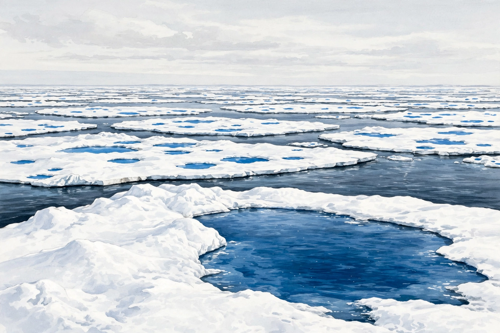

# Lesson 02 — Feedbacks: What Amplifies a Warming and What Damps It

**Goal:** By the end of this lesson you can trace a reinforcing
and a balancing feedback loop, use the feedback-gain teaching
model to estimate amplification, and explain why clouds are the
largest remaining feedback uncertainty.

**Time:** ~50 minutes. **Materials:** notebook, calculator, the
generated image `../assets/arctic-sea-ice-melt-ponds.png` (used in
section 3, not at the start).

**Readiness check (2 minutes):** From Lesson 01: planetary albedo
is about 0.30, fresh snow reflects about 0.8, dark ocean about
0.06. If you can explain why melting snow changes the budget, you
are ready.

## 1. A feedback is a loop, not a single cause

A **forcing** is an initial push on the energy budget: more
greenhouse gas, a brighter Sun, a volcanic veil of aerosols.
A **feedback** is a response to the resulting temperature change
that then feeds back into the budget, pushing further in the same
direction (**reinforcing**, also called positive) or pushing back
(**balancing**, also called negative). The words "positive" and
"negative" here mean direction, not good and bad — a reinforcing
feedback on a cooling can accelerate an ice age, which nobody
would call good.

The test for any claimed feedback is a loop you can walk around
without breaking:

- *Reinforcing:* warming → less ice → lower albedo → more
  absorption → more warming. Each arrow must be true on its own,
  and the last arrow must return to the first quantity.
- *Balancing:* warming → more infrared emitted (Stefan–Boltzmann:
  emission rises as T⁴) → more energy leaves to space → less
  warming. This is the strongest balancing feedback of all, and
  it is why the planet does not run away: every warming increases
  the very emission that cools it. Without it, no stable climate
  could exist.

**Worked example 1 — Walking the ice–albedo loop.** Start with a
small warming. (a) Some sea ice melts, exposing dark ocean.
(b) The area's albedo falls — from about 0.8 for snow-covered ice
toward about 0.06 for open water. (c) The area absorbs more of
the 340 W/m² arriving on average, so it warms further. (d) More
ice melts. The loop is reinforcing because the end of the chain
(warming) is also its beginning. Note what the loop does *not*
claim: it does not say all ice melts at once, and it does not say
the loop runs forever — it is limited by how much ice exists and
by the balancing Planck response (more emission as it warms).

**Worked example 2 — A balancing loop that is often missed.**
Warming → more evaporation → more clouds → more sunlight
reflected → less warming. That chain is balancing *if* the extra
clouds are bright, low clouds. But warming → more evaporation →
more high, thin clouds → more infrared trapped → more warming
is reinforcing. Same first step, opposite sign, depending on
cloud type. Any account that says simply "more clouds cool the
planet" or "more clouds warm it" has skipped the step that
decides the sign. Lesson 05 returns to this as the main reason
models disagree about *how much* warming, even while agreeing
about its direction.

**Misconception check:** "A reinforcing feedback means runaway
warming — Venus!" Not on Earth, for two reasons. First, the
balancing Planck response grows steeply with temperature (T⁴),
so it always eventually catches a reinforcing loop. Second, real
feedbacks saturate: once the ice is gone, the ice–albedo loop
has nothing left to melt. Runaway requires a feedback fraction
of 1 or more in the gain model below; Earth's estimated total
is well below 1. Venus is a different planet with a different
history, not the endpoint of Earth's feedbacks.

## 2. The feedback-gain teaching model

Suppose a forcing alone would warm the planet by ΔT₀ (the
"no-feedback response"). Feedbacks add a fraction f of whatever
warming has already happened, and that added warming feeds back
again, and so on:

Total = ΔT₀ + f·ΔT₀ + f²·ΔT₀ + … = ΔT₀ ÷ (1 − f), provided f < 1.

This is a *teaching model*, not a climate model: it compresses
many feedbacks, acting on different timescales, into one number.
It is useful for one thing — showing why feedbacks matter
out of proportion to their size — and misleading if you treat f
as a measured constant of nature. Real feedbacks are
temperature-dependent, pattern-dependent, and time-dependent.

**Worked example 3 — Gain arithmetic.** A forcing alone gives
ΔT₀ = 1.0 °C (a practice value). With feedback fraction f = 0.4:

Total = 1.0 ÷ (1 − 0.4) = 1.0 ÷ 0.6 ≈ **1.7 °C**.

With f = 0.5, total = 1.0 ÷ 0.5 = **2.0 °C** — the feedbacks
double the direct response. With f = 0.6, total ≈ 2.5 °C. Notice
how sensitive the total becomes as f approaches 1: that
sensitivity *is* the uncertainty in climate projections. Two
models can share the same forcing and the same direct response
and still differ substantially, purely because their feedback
fractions differ — especially their cloud feedbacks.

**Worked example 4 — Water vapor, quantified loosely.** Warm air
holds about 7% more water vapor per 1 °C of warming
(Clausius–Clapeyron, rounded). Water vapor is itself a
greenhouse gas, so that extra vapor absorbs more infrared and
warms the air further — a reinforcing feedback, and the largest
single feedback in most models. But note the logic carefully:
water vapor cannot *start* a long-term warming, because it
rains out within days; its level is set by temperature, not the
other way round. In the vocabulary of section 1, water vapor is
a feedback, while CO₂ — which stays for centuries and whose
level humans set directly by emissions — is a forcing. Confusing
the two is the most common error in popular climate arguments,
in both directions.

## 3. Image observation: Arctic sea ice and melt ponds

Look at `../assets/arctic-sea-ice-melt-ponds.png`.

*Caption: AI-generated illustration of Arctic sea ice in summer:
bright floes, blue melt ponds, and dark open water. This is an
illustration for observation practice, not a photograph of a
particular place or a record of real ice conditions.*

**Text-only alternative (answer every question from this if you
cannot see the image):** The scene shows a wide summer Arctic
seascape. Large flat floes of bright white ice stretch to the
horizon, broken by many vivid blue melt ponds sitting on the ice
surface; the largest pond fills the foreground of one floe.
Between the floes are stretches of dark, nearly black-blue open
water. The sky is pale and overcast. No land, people, animals, or
text appear.

Questions:

- (a) Order these surfaces from highest to lowest albedo:
  snow-covered ice, melt pond, open ocean water. Justify each
  placement from the image's brightness and from Lesson 01's
  numbers (snow about 0.8, ocean about 0.06; a melt pond is
  darker than snow and lighter than deep ocean, roughly 0.2–0.4
  in teaching estimates).
- (b) Walk the loop: as melt ponds spread, what happens to the
  floe's average albedo, to absorbed energy, and to further
  melting? Is this reinforcing or balancing?
- (c) What does the image *not* show that you would need before
  claiming Arctic ice is declining overall? (One summer scene
  cannot show a trend: you need the same measurement repeated
  over many years, in the same season, over the whole Arctic —
  which is Lesson 04's satellite record, not one picture.)

## Guided practice

1. Trace the water-vapor feedback loop in four arrows, starting
   with "warming" and ending with "warming." Label it
   reinforcing or balancing.
2. A forcing alone gives ΔT₀ = 1.2 °C and the feedback fraction
   is f = 0.5. Compute the total warming in the gain model.
3. A learner claims: "Clouds always cool, because they shade the
   ground." Give the two-sentence correction from section 1.

## Independent practice

4. A forcing alone gives ΔT₀ = 0.8 °C. With f = 0.25 the total is
   0.8 ÷ 0.75 ≈ 1.07 °C. With f = 0.75 it is 0.8 ÷ 0.25 = 3.2 °C.
   What does the *difference* between those two totals teach
   about why pinning down f matters more than pinning down ΔT₀?
5. Permafrost thaw releases methane as it warms. Trace the loop
   and classify it. Name one limit that stops it running forever
   in the simple loop (for example, the finite carbon stock, or
   the balancing Planck response).
6. **Error analysis:** A textbook diagram shows: warming → less
   ice → *higher* albedo → more warming. Find the broken arrow,
   fix it, and state whether the corrected loop is reinforcing
   or balancing.

## Applied task

7. Choose one feedback from this lesson and draw its loop as a
   four-arrow diagram with a one-sentence note under each arrow
   justifying it. Then add a "limit" box naming what stops the
   loop. Swap diagrams with a partner (or read yours aloud to
   the adult) and check: does the last arrow return to the first
   quantity? If not, redraw it.

## Exit check

8. Without notes: name two reinforcing feedbacks and one
   balancing feedback, and state in one sentence why a
   reinforcing feedback does not imply runaway warming on Earth.

## Supports and extensions

- **Reading access:** the loop-tracing routine is spoken before
  it is written: say each arrow aloud, then write it.
- **Alternate response mode:** the applied-task diagram may be
  built from cut-out arrows or spoken as a chain, not only drawn.
- **Extension:** research (adult previews) whether the
  ice–albedo feedback is stronger in the Arctic than the
  Antarctic, and why geography — an ocean basin ringed by land
  versus a continent ringed by ocean — changes the answer.

**Teacher note:** learners often label every feedback
"positive = bad." Drill the direction meaning until it is
automatic, and insist every loop returns to its starting
quantity. Answers: see `answer-key.md`, Lesson 02.
