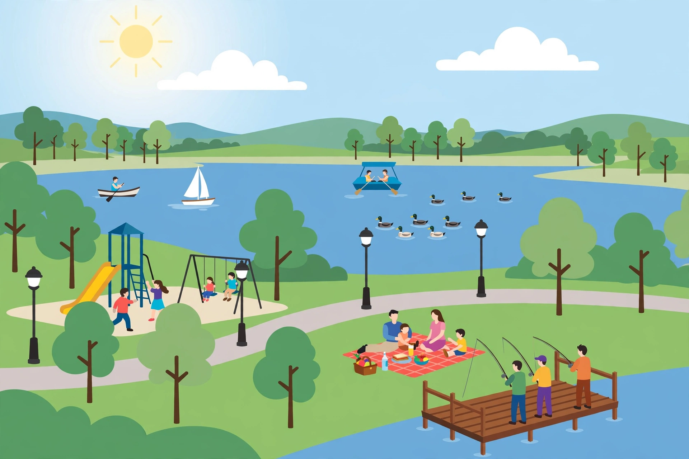

# Lesson 02 — Public Goods, Club Goods, and Common Resources

**Student goal:** I can classify any good with two tests —
excludability and rivalry — and explain the free-rider problem and the
tragedy of the commons.

**Time:** two ~50-minute sessions (Week 15 S3–S4) · **Materials:**
this lesson, the illustration below, Practice Set B.

**Readiness check (5 minutes).** Yesterday's pollution example had a
third party nobody paid. Today the question widens: what happens when
a good *itself* cannot be fenced off, or when one person's use leaves
less for everyone else?

## 1. Two tests, four boxes

Ask two questions about any good or service:

1. **Excludable?** Can people who do not pay be prevented from using
   it? A sandwich: yes — the seller keeps it until you pay. A
   lighthouse beam in the classic textbook story: no — every ship in
   sight gets the warning whether or not it paid.
2. **Rival?** Does one person's use reduce what is left for others?
   A sandwich: yes — once eaten, it is gone. A radio broadcast: no —
   your listening does not dim anyone else's reception.

The two answers give four boxes:

| | Rival | Nonrival |
|---|---|---|
| **Excludable** | **Private good** — sandwich, haircut, pair of shoes | **Club good** — streaming subscription, toll road, gym membership |
| **Nonexcludable** | **Common resource** — open-access fishery, public grazing land, congested road | **Public good** — national defense, street lighting, the lighthouse beam |

Three cautions before you use the table. First, "public" here is a
technical description of *how a good is consumed*, not of *who
provides it*: a government can provide a private good (a public clinic
selling glasses) and a private firm can provide something close to a
public good (a firm broadcasting free radio). Second, most real goods
sit between boxes: a public park is nonrival on a quiet morning and
rival — crowded, noisy, worn — on a packed Saturday. Third, technology
moves goods between boxes: a lighthouse beam was once the textbook
public good; with modern tracking and billing, exclusion became
possible, and the example got messier. Classifications are arguments
about a good *as used, here and now*, not permanent labels.

## 2. Why markets under-provide public goods: the free rider

A **free rider** is someone who uses a good without paying for it.
Because a public good is nonexcludable, a private firm cannot force
payment: anyone can enjoy the streetlight whether or not they chipped
in. Each person reasons, correctly, "If others pay, I benefit for
free; if nobody pays, my one payment alone will not build it." So
everyone waits — and the good is under-provided or never built, even
when everyone together would gladly pay more than it costs.

**Worked example A — the streetlight vote that never happens.**
Ten households on a dark street would each pay up to $30 for a
streetlight that costs $200 total. Together they value it at
10 × $30 = $300, which exceeds the $200 cost: building it is
efficient. But no household will voluntarily pay $200 alone (it is
worth only $30 to them), and no firm will build it hoping to collect
$30 from each household afterward, because a household can enjoy the
light while refusing to pay. The market outcome is no light — a
$100 net benefit ($300 − $200) left on the table. The standard remedy
is collective payment through taxes, which is why public goods are
usually publicly financed even when privately built. Note what the
example does *not* show: it does not prove the light should be built
at any cost, and it does not say who should decide — Lesson 04 and
Lesson 05 take up the cost and distribution questions.

**Worked example B — the commons, in numbers (fictional practice
data).** A lake sustainably yields 100 fish per year: take 100 or
fewer, and the stock replaces itself; take more, and the stock
shrinks. Ten fishers share the lake with no catch limit. Each fisher
reasons: "One more fish for me is worth the full catch; the cost of a
shrinking stock is shared by all ten." If each takes 12, the total is
120 — 20 over the sustainable yield — and the stock falls by 20 fish
that year. Next year the same logic repeats from a smaller stock.
This is the **tragedy of the commons**: a **common resource** is
rival (each fish caught leaves one fewer) but nonexcludable (no one
can be kept off the lake), so individual rationality depletes what
everyone depends on. The remedies differ from the public-good case:
because the problem is overuse, not under-provision, solutions limit
use — catch quotas, licenses, fees, or assigned property rights —
rather than subsidizing provision. Elinor Ostrom's research showed
communities sometimes solve this themselves with agreed rules and
monitoring; the tragedy is a tendency, not a fate.

## 3. Illustration activity — the shared lake park

Study the illustration. It is an AI-generated scene, not a photograph
of a real park, and it is used here to practice classification — not
as evidence about any real place.

*Caption: An AI-generated illustration of a shared lakeside park —
dock fishing, a picnic, a playground, lamps, boats, and ducks. Used
for the classification activity below.*

**Text-only alternative (same information as the picture):** The
scene shows a lakeside park with (a) three people fishing from a
wooden dock, (b) a family picnicking on a blanket with food they
brought, (c) children using a playground slide and swings, (d) lamps
along a walking path, (e) a sailboat, a rowboat, and a covered pedal
boat on the lake, and (f) ducks swimming. No prices, tickets, or
fences are shown.

**Questions:**

1. Classify each of (a) the fish in the lake, (b) the picnic food,
   (c) the playground at a crowded time, (d) the light from a lamp,
   using the two tests. Give one reason per classification.
2. Which item in the scene is most likely to be overused, and which
   is most likely to be under-provided by a private firm? Explain
   each choice with the free-rider or commons logic.
3. A town proposes a $5 daily fishing permit for this lake. Which
   problem does the permit address — free riding or overuse — and
   does the permit turn the fish into a private good? Explain.

## 4. Guided practice

1. Classify: (i) a paywalled news article, (ii) a public fireworks
   display, (iii) a congested free highway at rush hour, (iv) clean
   air over a city. Give the excludability and rivalry answer for
   each.
2. Error analysis: a classmate says, "Public goods are goods the
   government provides." Correct the statement in two sentences.
3. A beach town's lifeguard service costs $50,000 a season. Eighty
   beachfront households would each pay up to $800 for it. Is
   provision efficient? Would a private firm reliably provide it?
   Explain both answers with numbers.

## 5. Independent practice

Complete Practice Set B (in [practice.md](../practice.md)).

## 6. Applied task

Walk (with an adult) or recall one shared space near you — a park, a
library, a bus route. List three goods or services in it, classify
each with the two tests, and name one free-rider or overuse problem
you can actually see or plausibly expect. End with one sentence:
would a fee, a rule, or collective funding fit that problem best?

## 7. Exit check

Write one paragraph answering: why would a private firm under-provide
street lighting even if residents value it more than it costs? Use
the words *nonexcludable* and *free rider* correctly. If the paragraph
does not explain the firm's revenue problem, re-read §2.

**Teacher note.** Likely misconceptions: (a) "public = provided by
government"; (b) treating congestible goods as purely nonrival;
(c) confusing common resources (rival, nonexcludable) with public
goods (nonrival, nonexcludable). Full solutions and reteaching moves
are in the [teacher guide](../teacher-guide.md) and
[answer key](../answer-key.md).
