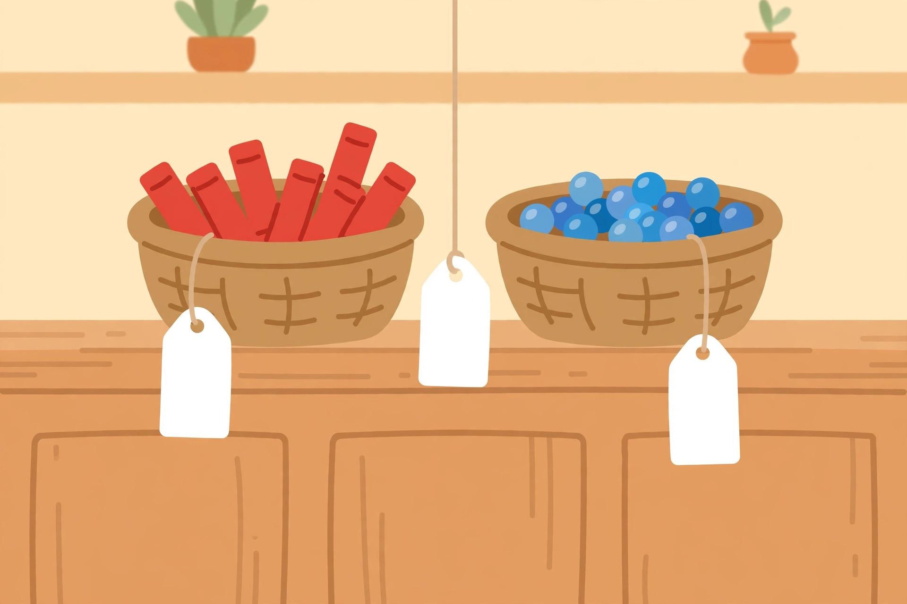

# Project — Two-Digit Tool Shop

**Runs across Sessions 11 and 15.** The learner runs a pretend shop, sets
two-digit prices, fills customer orders with break-apart addition, handles a
return with break-apart subtraction, and explains why each strategy works.
The generated illustration
[`assets/shop-counter-blank-tags.png`](assets/shop-counter-blank-tags.png)
opens the project as the story prompt.

*Caption: The Tool Shop counter. The price tags are blank — you decide what
each basket costs.*
*Alt text: A flat illustration of a wooden shop counter holding two woven
baskets, one with red crayons and one with blue marbles; three blank white
price tags hang from the baskets.*
*Text alternative: Picture a shop counter with two baskets — crayons and
marbles — and three empty price tags waiting for you to write two-digit
prices on them.*

## Materials

- The illustration above (printed or on screen)
- Blank price tags (paper slips), crayons, 4 baskets or bowls with play
  items (crayons, marbles, blocks, shells)
- Order slips (half-sheets of paper), ten-rods and one-cubes
- Explanation cards from Lesson 06

## Part 1 — Stock the shop, Order #1 (Session 11)

1. **Look and imagine (5 min).** Show the illustration. Ask: "What could
   this shop sell? What should each basket cost?" The learner names the
   shop and writes **four two-digit price tags** (adult approves: each
   between 10 and 99, at least two above 40). Hang them on the baskets.
2. **Customer Order #1 (10 min).** The adult (customer) orders the crayon
   basket and the marble basket — e.g., prices 34 and 25. The learner fills
   an **order slip**: draws the break-apart (30 + 4, 20 + 5), adds tens and
   ones, recombines, and writes the total. Blocks must be on the table while
   working.
3. **Shop sign (10 min).** The learner makes a sign with the shop name and
   one sentence: "We add tens with tens and ones with ones."

**Deliverable (Part 1):** shop sign + 1 completed order slip with the
break-apart shown.

## Part 2 — Order #2, a return, and explanations (Session 15)

1. **Customer Order #2 (10 min).** The customer orders **three** baskets
   (up to four allowed) — e.g., 25 + 38 + 41. The learner completes a second
   order slip: groups all tens, groups all ones, hunts make-ten pairs among
   the ones, recombines. (25 + 38 + 41: tens 20 + 30 + 40 = 90; ones 5 + 8 +
   1 = 14; 90 + 14 = **104**.)
2. **A return (8 min).** "The customer brings back the 38-token basket."
   The learner completes a **return slip**: 104 − 38 with step-down or trade.
   (104 − 30 = 74; 74 − 8 = 66. Check: 66 + 38 = 104 ✓.)
3. **Explanation cards (7 min).** The learner finishes two cards: "Order #1
   works because…" and "The return works because…" — each must name tens
   and ones. Sentence frames allowed.

**Deliverables (Part 2):** order slip #2, return slip, 2 explanation cards.

## Rubric (16 points)

| Criterion | 4 — Strong | 3 — Good | 2 — Developing | 1 — Starting |
|---|---|---|---|---|
| Place-value decomposition (order slips) | Every number broken into tens + ones; tens and ones combined separately; trade shown when needed | Break-apart shown; one sorting slip | Numbers broken but tens/ones mixed once | No break-apart; answer only |
| Accuracy | All totals and the return correct; checks (addition) shown | One arithmetic slip, caught by a check | One uncaught slip | Two or more uncaught slips |
| Explanation (2.NBT.B.9) | Both cards name tens and ones and state that only regrouping happened | Both cards complete; one vague | One card complete | Cards missing or "because I said so" |
| Shop completeness | Sign + 4 price tags + 3 slips, neat and labeled | All items present, minor mess | One item missing | Two or more items missing |

**Readiness signal:** 12+ points with no criterion at 1 → ready for Unit 03's
three-digit work. A 1 in decomposition → re-teach Lessons 04–05 with blocks
before Unit 03. A 1 in explanation → redo Lesson 06's cards orally.
