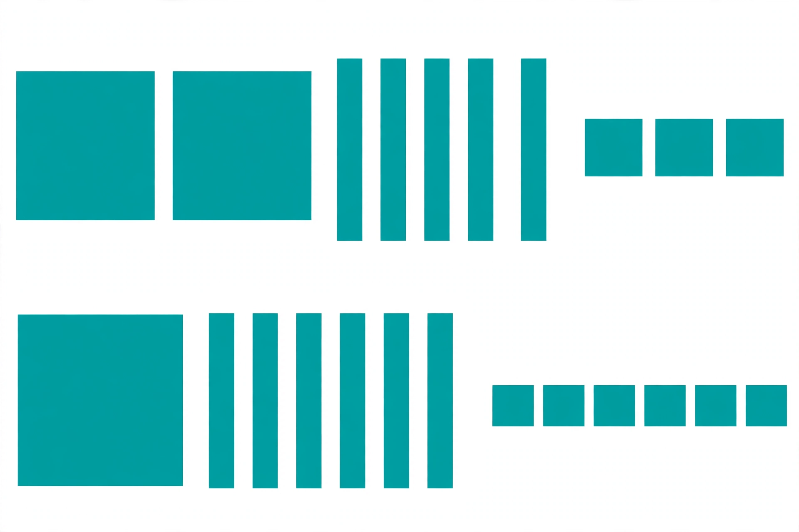

# Lesson 02 — Add and Compose a Ten

**Student goal:** I can add three-digit numbers when the tens column
reaches ten, by composing ten tens into one hundred — and I can show it
with blocks and in the written method.
**Time:** 25–30 minutes · **Unit:** [U03](../README.md) · **Session 3 of 16**

## Materials

- Base-ten blocks: hundred-flats, ten-rods, one-cubes
- Place-value mat
- The generated illustration
  [`assets/add-253-plus-166.png`](../assets/add-253-plus-166.png)

## Readiness check (2 minutes)

"Show me 10 tens with rods. What can we trade them for?" (Expected: bundle
the 10 rods and trade for 1 hundred-flat — ten tens make one hundred, from
Unit 01.) If the trade is shaky, rebuild one flat from 10 rods first.

## Teaching

Sometimes a column holds ten or more. A column may hold only one digit in
the written method, so ten of one kind must become one of the next kind up.
That trade is called **composing** (also called regrouping, or trading up).

1. Add ones first. If the ones total is ten or more, compose: trade 10
   ones for 1 ten, keep the leftover ones, and carry the new ten into the
   tens column.
2. Add tens, **including the carried ten**. If the tens total is ten or
   more, compose again: trade 10 tens for 1 hundred, keep the leftover
   tens, and carry the new hundred into the hundreds column.
3. Add hundreds, including any carried hundred.
4. The total never changes during a trade — 10 tens and 1 hundred are the
   same amount, just bundled differently.

**Key vocabulary:** *compose*, *regroup*, *carry*. "Carry" in the written
method means "a new block arrived in this column from a trade."

## Worked example 1 — the picture: 253 + 166

Look at the illustration together.



*Caption: An AI-generated picture of base-ten blocks. Top row: big squares,
tall bars, and tiny squares. Bottom row: the same kinds of blocks. What
number does each row show — and what happens when we add them?*

**Text-only alternative:** The picture shows 2 hundreds, 5 tens, and 3
ones (253) in the top row, and 1 hundred, 6 tens, and 6 ones (166) in the
bottom row.

Count each row with the learner: top 253, bottom 166. Now add:

> "Ones: 3 + 6 = 9 ones — no trade. Tens: 5 rods + 6 rods = 11 tens. Eleven
> tens is too many for one column, so compose: trade 10 tens for 1
> hundred, keep 1 ten. Hundreds: 2 flats + 1 flat + the 1 new flat = 4
> flats. The sum is 4 hundreds, 1 ten, 9 ones — **419**."

Written method, with the carried hundred shown small above the hundreds
column:

```text
   1
  253
+ 166
-----
  419
```

**Reasoning to name aloud:** the "1" written above the hundreds column is
not an extra hundred we invented — it is the 10 tens we already counted,
re-bundled. 253 + 166 was 419 before the trade and 419 after it.

## Worked example 2 — 318 + 423 (compose from the ones)

Build 318 and 423. Ones: 8 + 3 = 11 ones — compose: trade 10 ones for 1
ten, keep 1 one. Tens: 1 + 2 + the carried 1 = 4 tens. Hundreds: 3 + 4 = 7
hundreds.

> "11 ones became 1 ten and 1 one. Nothing was added or lost — the ones
> were just re-bundled. The sum is **741**."

Written method:

```text
   1
  318
+ 423
-----
  741
```

**Reasoning to name aloud:** composing from the ones is the same move as
composing from the tens — ten of one kind becomes one of the next kind
up. Only the column changes.

## Guided practice (adult stays close, hints allowed)

Do 4–6 short rounds with the blocks.

1. "Build and add 125 + 236." (Expected: ones 5 + 6 = 11 → 1 one, carry 1
   ten; tens 2 + 3 + 1 = 6; hundreds 1 + 2 = 3 — **361**.)
2. "Build and add 216 + 327." (Expected: ones 6 + 7 = 13 → 3 ones, carry 1
   ten; tens 1 + 2 + 1 = 4; hundreds 2 + 3 = 5 — **543**.)
3. "Build and add 253 + 166 again, from the picture, without looking at
   the written method." (Expected: **419**, tens composed to a hundred.)
4. Error analysis: the adult shows "253 + 166 = 319" and asks: "Is it?
   Rebuild the tens." (Expected: wrong — 5 tens + 6 tens = 11 tens, which
   composes to 1 hundred and 1 ten, so the hundreds total is 2 + 1 + 1 =
   4, not 3. Correct sum **419**. The writer composed the ten but forgot
   to add the new hundred.)
5. "When do we compose, and when do we not?" (Expected: compose when a
   column total is ten or more; otherwise leave the column alone.)

## Independent practice

The learner builds and writes, without hints: 328 + 415, 207 + 183,
617 + 236. The adult checks that every carried block is shown as a trade
on the mat before it is written small above the next column.

*Alternate response mode:* act out each trade with real blocks and say
"ten tens become one hundred" (or "ten ones become one ten") aloud; the
adult writes the written method.

## Application

Snack stand: "On Monday the stand sold 248 cups. On Tuesday it sold 131
cups. How many cups in all?" (Expected: ones 8 + 1 = 9, tens 4 + 3 = 7,
hundreds 2 + 1 = 3 — **379** cups. No trade this time — and noticing that
is part of the skill: do not compose when no column reaches ten.)

## Exit check

"Build 318 + 423 and tell me the sum, naming every trade." Expected: ones
11 → 1 one, carry 1 ten; tens 4; hundreds 7 — **741**. Record: secure /
developing / not yet.

## Supports

- **Language access:** always name the trade in a full sentence ("ten
  ones become one ten") before writing any small carried digit.
- **Alternate response mode:** point to the 10 blocks being traded, swap
  them for the single larger block, and say the new column totals aloud.
- **Floor-play variant:** pile the tens rods in one heap; when the heap
  reaches 10, physically sweep 10 rods away and place 1 flat in their spot.

## Extension

"Add 476 + 153 with blocks. How many trades did you make, and where?"
(Ones 6 + 3 = 9, no trade; tens 7 + 5 = 12 → compose to a hundred, keep 2
tens; hundreds 4 + 1 + 1 = 6 — **629**, one trade, in the tens column.)
Or: "Find a pair whose ones compose AND whose tens compose, and prove the
sum two ways (blocks, then written method)."

## Teacher note

**Likely misconceptions:** (1) writing the full two-digit column total in
the answer (e.g., writing "11" in the tens place, giving 3119-style
answers) — the mat rule is "one digit per column; the rest trades up";
(2) composing but forgetting to add the carried block — always re-count
the receiving column after the trade; (3) composing when no column reaches
ten, out of habit — ask "did this column reach ten?" before every trade.

**Answer-key reference:** [answer-key.md](../answer-key.md#lesson-02) has
the expected responses for the guided error-analysis round and exit check.
