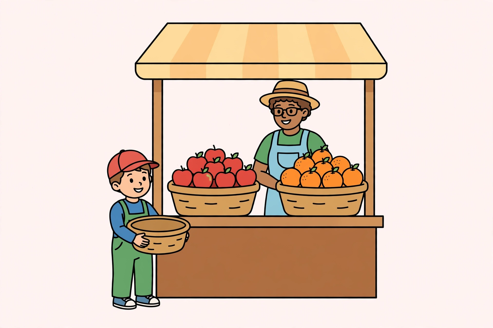

# Lesson 02 — Put Together and Take Apart: Whole and Part Unknown

**Student goal:** I can solve stories where nothing moves — two parts
make one whole — and find a missing whole or a missing part.
**Time:** 25–30 minutes · **Unit:** [U04](../README.md) · **Session 3 of 16**

## Materials

- Counters in two colors (or two kinds)
- Paper and crayons
- The generated illustration
  [`assets/market-stall-story-picture.png`](../assets/market-stall-story-picture.png)

## Readiness check (2 minutes)

"Here are 36 red counters and 29 blue counters. How many counters in
all?" (Expected: 36 + 29 = 65.) If the ones cross ten unsteadily,
break apart: 30 + 20 = 50, 6 + 9 = 15, 50 + 15 = 65.

## Teaching

Some stories have **no action at all**. Nothing joins and nothing
leaves. Instead, two **parts** sit side by side and make one
**whole**. These are put-together and take-apart stories.

- **Whole unknown:** you know both parts, you need the whole.
  Equation: `part + part = □`.
- **Part unknown:** you know the whole and one part, you need the
  other part. Equation: `part + □ = whole`, solved by
  `whole − part = □`.

Draw it as a bar: one long bar for the whole, split into two shorter
bars for the parts. The bar never moves; it just shows how the parts
fit.

**Key vocabulary:** *part*, *whole*, *put together* (parts combine
into a whole), *take apart* (a whole splits into parts).

## Worked example 1 — the picture: whole unknown

Look at the illustration together.

*Caption: An AI-generated picture of a market stall. What stories
could this stall tell? Make up your own numbers — the picture gives
the scene, not the counts.*

**Text-only alternative:** A market stall with a striped awning. A
vendor stands behind two baskets, one holding red apples and the
other holding oranges. A child holding an empty basket stands beside
the stall.

Now tell a story about the picture — with numbers we choose: "At the
stall there are 36 red apples and 29 green apples. How many apples
are there in all?"

> "Nothing is added or taken away; the two groups just sit together.
> Parts 36 and 29, whole □. Equation: 36 + 29 = □. Break apart:
> 30 + 20 = 50, 6 + 9 = 15, 50 + 15 = **65**. Check: 65 is bigger than
> either part, as a whole must be. **65 apples** in all."

**Reasoning to name aloud:** the picture does not tell us the numbers
— we invented 36 and 29 for this story. That is allowed, and it is
different from counting real objects: the picture is a story prompt,
not a counting test. (The counts in the picture's baskets are not used
for any answer in this unit.)

## Worked example 2 — part unknown: the crayon box

"A box holds 74 crayons. 38 are blue and the rest are red. How many
crayons are red?"

Draw the bar: whole 74, one part 38, other part □.

> "Part + part = whole, so 38 + □ = 74. To find a missing part,
> subtract the known part from the whole: 74 − 38 = □. Break apart:
> 74 − 30 = 44, 44 − 8 = **36**. Check: 38 + 36 = 74 — the parts remake
> the whole. **36 red crayons**."

**Reasoning to name aloud:** a part-unknown story is solved by
subtraction even though the story never says "take away." Nothing
left the box. The subtraction undoes the combining, it does not
describe an action.

## Guided practice (adult stays close, hints allowed)

Do 4–6 short rounds with two-color counters.

1. "A jar has 52 stickers: 27 stars and the rest hearts. How many
   hearts?" (Expected: part unknown, 27 + □ = 52, 52 − 27 = **25**.)
2. "A shelf holds 43 picture books and 28 chapter books. How many
   books in all?" (Expected: whole unknown, 43 + 28 = **71**.)
3. "A garden has 61 marbles in a bag: 29 red, the rest blue. How many
   blue?" (Expected: part unknown, 61 − 29 = **32**.)
4. Error analysis: the adult shows "whole 58, one part 31, other part
   37" and asks: "Do the parts remake the whole?" (Expected: no —
   31 + 37 = 68, not 58. The missing part is 58 − 31 = **27**.)
5. "How is this different from yesterday's stories?" (Expected:
   "Nothing moved. The groups were already there; we just combined
   or split them.")

## Independent practice

The learner draws bars and writes, without hints: "A box has 90
buttons: 54 red, the rest blue" (90 − 54 = **36 blue**); "A class
collects 48 cans on Monday and 35 on Tuesday" (48 + 35 = **83 cans**);
"There are 77 beads: 39 glass, the rest wood" (77 − 39 = **38 wood**).

*Alternate response mode:* build each story with two-color counters
and point to the whole bar and each part bar while the adult writes
the equation.

## Application

Garden story: "A class plants 26 carrot seeds and 33 bean seeds. How
many seeds did the class plant in all?" (Expected: whole unknown,
26 + 33 = **59 seeds**. Check: 59 is bigger than both parts.)

## Exit check

"Draw the bar: 87 beads in a bag, 45 glass, the rest wood. How many
wood beads?" Expected: part unknown, 87 − 45 = **42**. Record:
secure / developing / not yet.

## Supports

- **Language access:** use the words "whole" and "part" with a hand
  gesture every time (arms wide for whole, one hand for a part)
  before writing symbols.
- **Alternate response mode:** sort real counters into two piles and
  push them together (whole) or pull one pile away (part) instead of
  drawing bars.
- **Floor-play variant:** lay two ropes as bars on the floor — a long
  whole rope and two shorter part ropes — and stand on the missing
  piece.

## Extension

"Write a take-apart story where the whole is 100 and one part is a
multiple of ten (like 60). Solve it, then write the matching
put-together story for the same three numbers." (Example: whole 100,
one part 60, other part **40**; 60 + 40 = 100.)

## Teacher note

**Likely misconceptions:** (1) adding in a part-unknown story because
"the story gives two numbers and asks how many" — ask "is anything
missing from the whole, or are we making the whole?"; (2) treating a
part as if it could be bigger than the whole — the check "parts remake
the whole" catches this; (3) confusing take-apart with take-from —
name it: "take-apart splits a group that stays put; take-from removes
things from a group."

**Answer-key reference:** [answer-key.md](../answer-key.md#lesson-02) has
the expected responses for the guided error-analysis round and exit check.
