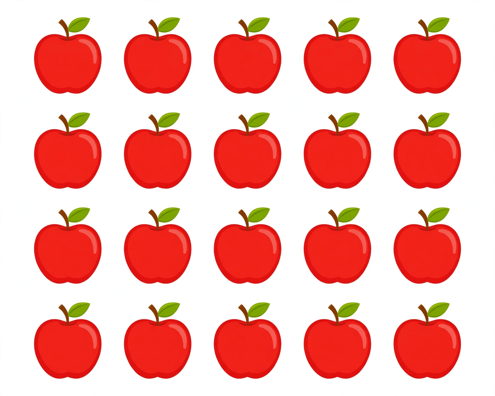

# Lesson 04 — Rectangular Arrays: Rows and Columns

**Student goal:** I can count a rectangular array by rows or by
columns, and I can write the total as a sum of equal addends either way.
**Time:** 25–30 minutes · **Unit:** [U05](../README.md) · **Session 7 of 16**

## Materials

- 25 counters
- The generated illustration
  [`apple-array-4-by-5.png`](../assets/apple-array-4-by-5.png)

## Readiness check (2 minutes)

"Make 3 groups of 4 with counters. What is the equation and the
total?" (Expected: 4 + 4 + 4 = 12.) If equal groups are shaky, replay
Lesson 03 with 3 groups of 4 before starting — an array is equal groups
lined up in rows.

## Teaching

An **array** is equal groups arranged in neat rows and columns — a
rectangle of objects. Every row has the same number, and every column
has the same number.

1. Look at the array. Count the **rows** (the lines that go across)
   and how many objects sit in each row.
2. Write the row equation: the row size, once per row. "4 rows of 5"
   is 5 + 5 + 5 + 5.
3. Now count the **columns** (the lines that go down) and how many
   objects sit in each column. Write the column equation: the column
   size, once per column. "5 columns of 4" is 4 + 4 + 4 + 4 + 4.
4. Both equations give the same total — they count the same objects
   two ways.

**Key vocabulary:** *array*, *row*, *column*. A row goes across, like
a line of chairs facing forward. A column goes down, like a stack of
plates. A rectangle of objects with equal rows and equal columns is an
array.

## Worked example 1 — The apple picture (4 rows of 5)

Look at the picture together. Count the rows first: point to each row
and count the apples in it — 5, 5, 5, 5.

> "By rows: 5 + 5 + 5 + 5. Add left to right: 5 + 5 = 10; 10 + 5 = 15;
> 15 + 5 = 20. **20 apples.**"

Now count the columns: 5 columns, 4 apples in each.

> "By columns: 4 + 4 + 4 + 4 + 4. Add left to right: 4 + 4 = 8;
> 8 + 4 = 12; 12 + 4 = 16; 16 + 4 = 20. **20 apples again.** Same
> apples, counted two ways — so the totals must match, and they do."

**Text-only alternative** (carries every count the activity needs, so
the activity works without the image): "The picture shows 4 rows with
5 apples in each row — 20 apples altogether. It also shows 5 columns
with 4 apples in each column."

## Worked example 2 — Build a 3-by-4 array

Build it with counters: 3 rows, 4 counters in each row.

> "By rows: 4 + 4 + 4 = 12. By columns: 3 + 3 + 3 + 3 = 12. Three rows
> of 4, four columns of 3 — the same 12 counters."

**Reasoning to name aloud:** the row equation and the column equation
look different (4 + 4 + 4 against 3 + 3 + 3 + 3) but they count the
same objects. When the two totals disagree, one count is wrong — recount,
do not guess which.

## Guided practice (adult stays close, hints allowed)

Do 4–6 short rounds with the counters.

1. "Build 2 rows of 5. Write the row equation and the total."
   (Expected: 5 + 5 = 10.)
2. "Build 5 rows of 3. Write the row equation and the total."
   (Expected: 3 + 3 + 3 + 3 + 3 = 15.)
3. "Build the same array as round 2 and count it by columns."
   (Expected: 3 columns of 5 — 5 + 5 + 5 = 15. Same total.)
4. Error analysis: the adult builds 4 rows of 5 and writes
   "4 + 4 + 4 + 4 = 16." Ask: "Is it?" (Expected: wrong — the adult
   added the number of rows instead of the row size. Each row holds 5,
   so the row equation is 5 + 5 + 5 + 5 = 20. Count what is IN a row,
   not how many rows there are.)
5. "Say it two ways: rows, then columns." (Use round 2: "5 rows of 3 —
   3 + 3 + 3 + 3 + 3 = 15; 3 columns of 5 — 5 + 5 + 5 = 15.")

## Independent practice

The learner builds and writes, without hints: a 4-by-2 array (rows
equation and total); a 3-by-3 array (rows equation and total); a 5-by-2
array (columns equation and total). The adult checks that each row is
equal before the equation is written.

*Alternate response mode:* point to each row and say its count aloud
while the adult writes the addends; the learner says the running total.

## Application

Muffin tray: "A tray has 3 rows with 5 muffins in each row. How many
muffins? Write the equation." (Expected: 5 + 5 + 5 = 15 muffins.)
"Count it by columns to check." (Expected: 5 columns of 3 —
3 + 3 + 3 + 3 + 3 = 15. Same total.)

## Exit check

"Build 2 rows of 4 and tell me the row equation and the total."
Expected: 4 + 4 = 8. Record: secure / developing / not yet.

## Supports

- **Language access:** always say the array two ways ("4 rows of 5 —
  5 + 5 + 5 + 5 = 20"); never let a bare equation be the only answer.
- **Alternate response mode:** point to each row and hold up fingers
  for its count; the adult writes the equation.
- **Floor-play variant:** lay the counters in rows on the floor and walk
  along each row counting aloud, then walk down each column.

## Extension

"Build a 5-by-5 array. What is the total by rows? By columns?"
(5 + 5 + 5 + 5 + 5 = 25 either way — the biggest array in this unit:
5 rows, 5 columns.) Or: "Two arrays: 3 rows of 5 and 5 rows of 3. Do
they have the same total? Prove it with counters." (Both are 15:
5 + 5 + 5 = 15 and 3 + 3 + 3 + 3 + 3 = 15. The rows and columns trade
places.)

## Teacher note

**Likely misconceptions:** (1) adding the number of rows instead of
the row size (4 rows of 5 written 4 + 4 + 4 + 4) — always ask "how many
are IN one row?" first; (2) mixing up rows and columns — trace a row
across with a finger, then a column down, before counting; (3) believing
an array must be square — 2 rows of 5 is an array too, and the
rectangular shape is the point.

**Answer-key reference:** [answer-key.md](../answer-key.md#lesson-04) has
the expected responses for the guided error-analysis round and exit check.
