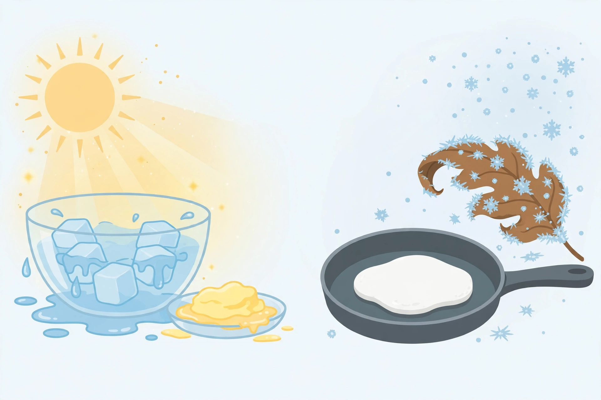

# Lesson 04 — Reversible or Not?

**Time:** 25–30 minutes · **Materials:** science journal, pencil/crayons,
the generated illustration
[reversible-irreversible-changes.png](../assets/reversible-irreversible-changes.png),
two sort cards labeled "CAN GO BACK" and "CANNOT GO BACK" (adult-made),
six picture cards for the sort (ice/water, butter firm/soft, cooked egg,
frozen leaf, browned paper, building bricks)

**Goal (read to the learner):** Today you will learn two new words —
**reversible** and **irreversible** — and sort heating and cooling
changes into the two groups, with a reason for each sort.

**Readiness check:** Adult asks, "Can melted ice become ice again? Can a
cooked egg become raw again?" Any yes/no attempt shows readiness. If the
learner has none, model one: "Melted ice can freeze again. A cooked egg
cannot become raw again."

**Safety note:** No live heating in this lesson. The cooked egg, frozen
leaf, and browned paper are shown as pre-prepared cooled samples or
photographs the adult prepared earlier — the learner observes only.
The adult cooked the egg at the stove away from the learner, and the
paper was browned and cooled by the adult beforehand. Never heat paper
in front of the learner.

## Teaching (adult reads and models)

Some changes can go back. Some cannot. Scientists have names for the
two groups:

- **Reversible** means a change that **can go back** to the way it was.
  Melted ice can freeze back into ice. Soft butter can harden back
  into firm butter. The material is still the same stuff.
- **Irreversible** means a change that **cannot go back** to the way it
  was. A cooked egg cannot become a raw egg again, no matter how much
  you cool it. A frozen plant leaf stays limp and brown when it thaws —
  it does not become a fresh green leaf again. Paper that was heated
  until it browned and curled stays browned and curled.

The test is simple: **try to go back in your mind. If warming or cooling
can undo it, it is reversible. If it cannot, it is irreversible.**

**Worked example 1 — the picture sort (generated image activity):**

Adult shows the illustration (caption read aloud):

> 
>
> *Caption: An AI-generated illustration of two heating and cooling
> scenes. Left: ice melting in sunlight and soft butter. Right: a
> cooked egg in a pan and a frost-covered leaf. This is a practice
> picture, not a photograph of a real experiment.*

> Adult: "Look at the left scene. Ice melting into water in the sun,
> and soft butter in a dish. Can the water freeze back into ice? Yes.
> Can the soft butter harden back into firm butter in the refrigerator?
> Yes. So the left scene shows changes that CAN GO BACK — reversible.
> Now the right scene. A cooked egg, white and firm, in a pan. Can
> cooling make it raw again? No. A brown leaf covered in frost. When
> the frost melts, will the leaf be fresh and green again? No — it
> stays brown and limp. So the right scene shows changes that CANNOT
> GO BACK — irreversible."

**Text-only alternative (so the question works without the picture):**
The picture has two scenes. Left scene: a glass bowl in sunlight with
ice cubes melting into liquid water, plus a small dish of soft,
spreadable butter. Right scene: a frying pan holding a cooked egg that
is white and firm, plus a brown, curled leaf covered with frost
crystals. Question: which scene shows changes that can go back, and
which shows changes that cannot? (Answer: left — can go back; right —
cannot go back. Reasons as in Worked example 1.)

**Worked example 2 — the paper test, reasoned out loud:**

> Adult: "Here is fresh paper — flat, white, smooth. And here is paper
> the adult heated earlier and let cool — brown, curled, stiff. Can
> cooling make the browned paper white and flat again? No. Can warming
> it again fix it? No. It cannot go back, so heating paper is
> irreversible. Compare that with ice: ice melts, water freezes, ice
> again. Ice can go back, so melting ice is reversible. The difference
> is not 'hot or cold' — it is 'can it go back?'"

Key idea to say plainly: **Ask: can it go back? If warming or cooling
can undo it, it is reversible. If it cannot, it is irreversible.**

## Guided practice (adult leads, learner decides)

Adult reads each item; the learner sorts a picture card under
"CAN GO BACK" or "CANNOT GO BACK" and gives a reason. Adult notes are
in parentheses.

1. Ice melts into water. *(CAN GO BACK — water can freeze into ice again.)*
2. Water freezes into ice. *(CAN GO BACK — ice can melt into water again.)*
3. Firm butter softens in warmth. *(CAN GO BACK — soft butter hardens in the refrigerator.)*
4. An egg is cooked. *(CANNOT GO BACK — cooling cannot make it raw again.)*
5. A plant leaf freezes and turns brown. *(CANNOT GO BACK — thawing does not make it fresh and green again.)*
6. Error-analysis: "Sam says, 'Everything can go back if you wait long
   enough.' Give Sam one counterexample." *(A cooked egg — waiting and
   cooling never make it raw again.)*

## Independent practice

The learner sorts all six picture cards alone (or with the adult
reading the labels), then picks one card from each group and finishes
the sentences: "___ can go back because ___." / "___ cannot go back
because ___." The adult scribes as needed.

## Application

Learner adds a "Can it go back?" column to the project poster (see
[project.md](../project.md) step 5): each observed change gets a
reversible/irreversible label and a one-line reason.

## Exit check

Adult holds up two cards: melting ice and a cooked egg. "Which one can
go back? How do you know?" Acceptable: "The ice — it can freeze again"
/ "The egg cannot — cooked stays cooked." Then the learner names the
two group words: reversible / irreversible.

**Table variant:** The learner points to the correct sort card for
each of two new pictures (soft butter; browned paper).

## Supports and extensions

- **Support:** Sort cards stay visible all lesson; the sentence frames
  ("___ can go back because ___") are printed on the sort mat.
- **Language:** Pair each word with a gesture: reversible = hands make
  a circle (round trip); irreversible = hands make a one-way arrow.
- **Extension:** "Is building-brick rebuilding reversible?" (Yes — the
  learner can rebuild the original object from the same pieces. It is
  a reversible change of arrangement, and it previews the argument in
  Lesson 05: some changes reverse, some do not.)

**Misconception note:** "Irreversible means broken or ruined." Counter:
"A cooked egg is not ruined — it is food. Irreversible only means it
cannot go back to raw, not that it is bad." See
[teacher-guide.md](../teacher-guide.md) and
[answer-key.md](../answer-key.md) (Lesson 04).
