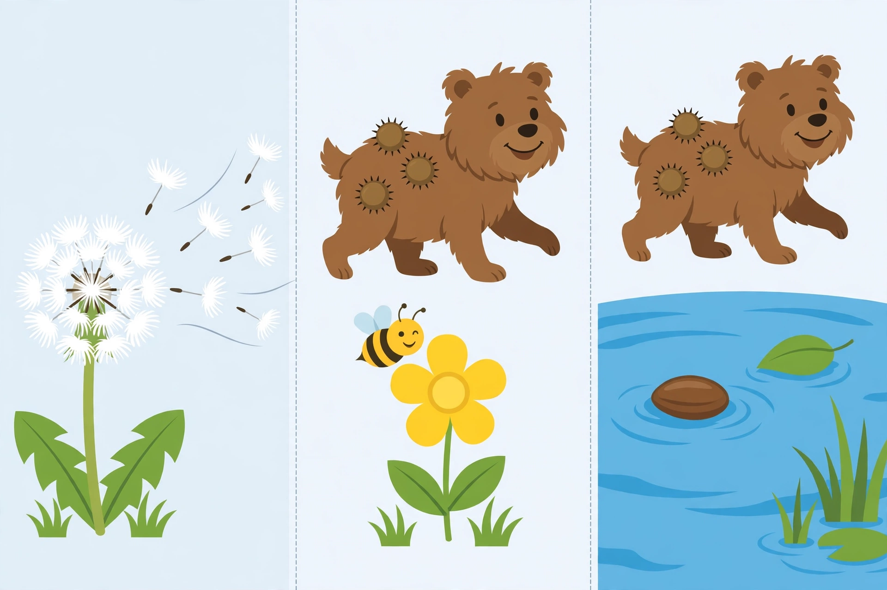

# Lesson 03 — How Seeds Travel

**Student goal:** I can name three ways seeds travel — wind, water,
and animals — and match a seed's shape to how it travels.
**Time:** 25–30 minutes · **Unit:** [U04](../README.md) · **Session 5 of 16**
**Adult directions are part of the lesson.** Look at the picture
together; the learner may answer orally, by pointing, or by drawing.

## Materials

- The generated picture [`seed-travelers-scene.png`](../assets/seed-travelers-scene.png)
- Seed picture cards or real safe examples: a fluffy seed head
  (dandelion, if available), a smooth hard seed, a hooked burr or
  Velcro piece (do not use real burrs with sharp hooks on skin)
- Paper and crayons

## Readiness check (2 minutes)

"Our bean plants are growing (or waiting to sprout). New plants
need a place to grow. If a seed falls right under its parent plant,
what problem might it have?" (Expected: crowding — too many plants
in one spot, sharing the same sunlight, water, and soil. Accept:
"It would be crowded.")

## Teaching

A parent plant cannot walk, but its seeds can travel. Traveling
helps seeds find their own space, sunlight, water, and soil. This
is called **dispersal**: seeds moving away from the parent plant
to a new place. A seed's shape often tells us how it travels —
this is structure fitting function:

- **Wind:** light, fluffy, or winged seeds catch the air. A
  dandelion seed has a feathery parachute; maple seeds have wings
  that spin as they fall. The wind carries them away.
- **Water:** seeds that can **float** ride on water. A coconut can
  float across water to a new shore; other floating seeds ride
  streams and ponds.
- **Animals:** hooked seeds catch on fur (or clothing) and ride
  along until they drop off somewhere new. These are hitchhiker
  seeds. Animals also carry seeds by eating fruit and dropping
  seeds later — but our model work in Lesson 04 uses the
  hitchhiker way, which we can see and test.

Look at the picture and find each way. (The picture is an
AI-generated practice picture, not a photograph of a real
experiment.)

*Caption: An AI-generated picture of seed travelers. On the left,
fluffy seeds blow in the wind. In the middle, hooked seeds ride on
an animal's fur, and a bee visits a yellow flower. At the bottom
of the right panel, a seed floats on water. How does each seed
travel?*

*Alt text: A three-panel cartoon. Left panel: a dandelion flower
with fluffy white seeds blowing away in the wind. Middle panel: a
brown furry animal with round spiky burr seeds stuck to its fur,
and a smiling bee beside a yellow flower. Right panel: at the
bottom, blue water with a smooth brown seed floating on it beside
a green leaf.*

*Text-only alternative (carries everything the activities need,
so the activities work without the image): Left — fluffy white
seeds blow away from a dandelion flower in the wind. Middle — round
spiky seeds stick to a furry animal's fur, and a bee visits a
yellow flower. Right, at the bottom — a smooth brown seed floats
on blue water beside a green leaf. Note: the generator repeated
the furry animal at the top of the right panel; the water-travel
clue is the floating seed at the bottom of that panel, not the
animal above it.*

## Worked example 1 — Reading the picture (modeled reasoning)

> "Left panel: fluffy white bits are flying away from the flower.
> They are light, and the wind is moving them. That is **wind**
> travel. Middle panel: round spiky seeds are stuck to the
> animal's fur. They did not fly there — they caught on. That is
> **animal** travel. Bottom of the right panel: a smooth seed
> sits on the water and does not sink. That is **water** travel.
> Three panels, three travelers — and the seed's shape matches
> its journey: fluffy for wind, floating for water, hooked for
> fur."

**Reasoning to name aloud:** match the feature to the journey,
not just the picture to a word. Fluffy → wind, floating → water,
hooked → animal.

## Worked example 2 — A practice growth log (modeled reasoning)

*This is fictional practice data, not the learner's plants. The
learner's own log stays separate.*

> "Practice Log — Sunlight test. Sunny + water plant: Week 1,
> 2 cm tall. Week 2, 5 cm tall. It grew 5 − 2 = **3 cm** in one
> week. Shady + water plant: Week 1, 1 cm. Week 2, 2 cm. It grew
> 2 − 1 = **1 cm**. Sunny plant, no water: Week 1, 1 cm. Week 2,
> 1 cm. It grew 1 − 1 = **0 cm**. So far, the sunny watered plant
> is growing fastest, and the unwatered plant is not growing at
> all. That is evidence — but the test is not finished. We keep
> measuring."

**Reasoning to name aloud:** growth is the *change* in height
(later height minus earlier height), not the height itself. A
plant that stays at 1 cm has grown 0 cm, even though it is still
1 cm tall.

## Guided practice (adult stays close, hints allowed)

1. "Point to the wind traveler in the picture. What feature tells
   you it travels by wind?" (Expected: fluffy seeds, left panel.)
2. "Point to the animal traveler. What feature tells you?"
   (Expected: hooked seeds on fur, middle panel.)
3. "Point to the water traveler. Where is it, and what tells you?"
   (Expected: floating seed at the bottom of the right panel;
   it floats and does not sink.)
4. "Sort these: a fluffy seed, a seed that floats, a hooked seed.
   Wind, water, or animal?" (Expected: fluffy → wind; floating
   → water; hooked → animal.)
5. "A seed is heavy, smooth, and sinks. Could the wind carry it
   far? Why not?" (Expected: no — it is too heavy and has nothing
   to catch the wind.)
6. Error analysis: the adult says, "This hooked seed must travel
   by wind because it is small." Ask: "Is that right? What does
   the hook do?" (Expected: wrong — small is not the clue; the
   hook catches on fur, so it travels by animal.)

## Independent practice

The learner draws three seeds — one for wind, one for water, one
for animal — and writes or dictates one feature under each
("fluffy," "floats," "hooks"). The adult checks that each feature
matches its travel way.

## Application

"Look around the home or garden (or picture cards): find one real
example of a seed that might travel by wind, and one that might
travel by animal. Tell me the feature you used to decide."
(Expected: any reasonable match with a feature reason, e.g.,
dandelion fluff → wind; a burr-like seed or a seed that sticks
to socks → animal.)

## Exit check

"Name the three ways seeds travel, and give one seed feature for
each." (Expected: wind — fluffy/light/winged; water — floats;
animal — hooked/sticky or carried in fruit.)

## Supports

- **Language access:** travel-way cards (wind / water / animal)
  the learner places on the picture or on seed cards.
- **Alternate response mode:** the learner may point and tell
  instead of drawing; the adult scribes.
- **Seated-table variant:** picture cards sorted on the table.
- **Floor-play variant:** the learner walks a toy seed along
  three floor paths labeled wind, water, and animal.

## Extension

"Some seeds burst out of their pods and fling themselves. Is that
wind, water, or animal travel? Why is it none of the three — and
why does it still count as dispersal?" (Expected: none of the
three — the plant itself throws the seed; it still counts because
the seed moves away from the parent to a new place.)

## Teacher note

Two confusions are common. First, learners may call every flying
thing "wind" — including a seed stuck to a bird. Insist on the
feature: *what carries it?* Second, learners may think the bee in
the middle panel is carrying seeds; it is not — the bee is the
pollination clue for Lesson 05. Name it now so Lesson 05 lands
cleanly: "The bee moves pollen, not seeds. Seeds come later."
Also note the picture's quirk honestly (see the text-only
alternative): the furry animal appears twice. Direct attention to
the bottom of the right panel for the water clue.
**Answer-key reference:** [answer-key.md](../answer-key.md) —
Lesson 03.
