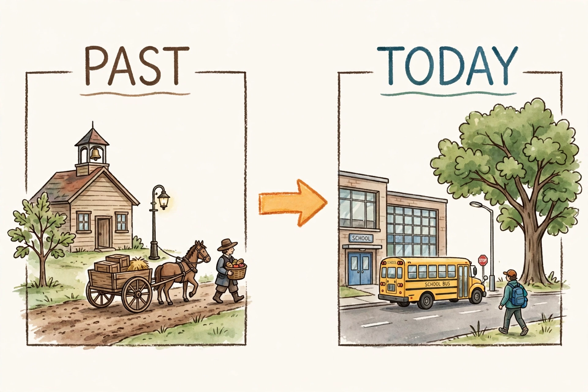

# Lesson 03 — Life Then and Now: The Same Corner, Two Times

**Time:** 25–30 minutes · **Materials:** the printed
[Maple Lane then-and-now illustration](../assets/maple-lane-then-and-now.png),
paper, crayons, word cards: past, present, change, same

**Goal (read to the learner):** Today you will compare life in the past
with life today, using a picture of the same street corner long ago and
now — and you will notice what changed and what stayed the same.

**Readiness check:** Adult asks, "What is one thing that is different now
from when you were a baby?" Accept anything sensible (bigger, in school,
can read). If the learner is stuck, model one: "When I was a baby I could
not walk. Now I can. That is a change."

## Teaching (adult reads and models)

Say: "This picture is an **AI-generated illustration** — a pretend picture
made for practice. It is **not** a photograph of a real place, and it is
not evidence about a real town. It shows a pretend corner called Maple
Lane, in two times: PAST on the left, TODAY on the right. The big orange
arrow points from the past toward today — like a timeline arrow."

*Caption: An AI-generated illustration of the pretend Maple Lane corner —
a practice picture, not a real place and not a photograph. Left (PAST): a
small schoolhouse, a horse-drawn cart, a gas lamp, a small tree. Right
(TODAY): a modern school, a yellow school bus, an electric streetlight, a
big oak tree.*

**Maple Lane then-and-now — text-only alternative (read this aloud if
the picture is not used; every question below can be answered from it):**

> **PAST panel (left):** A small one-room schoolhouse with a bell tower on
> top and a small tree beside it. A horse pulls a wooden cart loaded with
> boxes and hay along a dirt road. A tall gas street lamp stands by the
> road. A person in old-fashioned clothes walks carrying a basket of
> apples.
>
> **TODAY panel (right):** A larger modern school building with big windows,
> a sign that says "SCHOOL," and blue doors. A yellow school bus with
> "SCHOOL BUS" written on its side drives on a paved road with white lines.
> A tall electric streetlight stands by the road, and a red STOP sign is
> near the bus. A person in modern clothes walks carrying a blue backpack.
> The same oak tree is now big and full of leaves.
>
> **The arrow between the panels** points from PAST to TODAY — from
> earlier time to later time.

Say: "Compare means looking at two things and saying how they are the
same and how they are different. Let's compare the two panels, one part at
a time."

**Worked example 1 — school:**

> Adult: "PAST: a small schoolhouse with a bell on top — one small
> building. TODAY: a bigger school with many windows and a sign that says
> SCHOOL. Different: the building got bigger, with more rooms. Same: in
> both panels, children go to a school on this corner to learn. The
> school changed; the idea of school stayed."

**Worked example 2 — travel:**

> Adult: "PAST: a horse pulls a cart on a dirt road. TODAY: a yellow
> school bus drives on a paved road with white lines. Different: how
> people travel, and what the road is made of. Same: in both panels, people
> travel along this road to get where they are going. Now, an important
> caution: this picture shows *one pretend corner*. In real life, not
> every place changed the same way, or at the same time. Some places still
> use dirt roads. Some places never had horse carts. So we say 'in this
> picture' or 'in many places,' never 'everywhere, all at once.'"

Key idea to say plainly: **Comparing past and today means naming what
changed and what stayed the same — and remembering that different places
changed in different ways.**

## Guided practice (adult leads, learner decides)

Adult points to panels or reads the text alternative; the learner answers
orally, by pointing, or by drawing. (Hints in parentheses are for the
adult.)

1. "In the PAST panel, what pulls the cart?" *(a horse)*
2. "In the TODAY panel, what carries children to school?" *(a yellow
   school bus)*
3. "Name one thing that is bigger today than in the past." *(the school
   building, or the oak tree)*
4. "Name one thing that is the same in both panels." *(a school on the
   corner; a road people travel on; a tree; a person walking)*
5. "The PAST lamp burns gas; the TODAY light is electric. Is that a
   change or a sameness?" *(a change)*

## Independent practice

The learner draws two small pictures — "school then" and "school now" —
or points to the matching panel for each of four adult-named items (horse
cart, school bus, gas lamp, electric light), and says "past" or "today"
for each.

## Application

The learner compares two more parts of life, with adult framing: "In the
past, many people sent letters that took days to arrive. Today, many
people can telephone or send a message that arrives fast." The learner
says one way communication changed and one way it stayed the same (people
still send messages to people far away). The adult names that this is a
general contrast for discussion, not a claim about every family.

## Exit check

Prompt: "Look at the two panels (or hear the description again). Tell me
one change and one sameness, and point to where you see each." Accept: any
accurate pair, e.g., change — horse cart vs. school bus; sameness — a
school stands on the corner in both times.

## Supports and extensions

- **Support:** Compare only one pair at a time (travel first); cover one
  panel while the learner describes the other. Let the learner point
  instead of speaking.
- **Reading/language access:** The text alternative is read aloud in full
  before any question; picture-first, word-second for past/today.
- **Alternate response mode:** The learner may sort picture cards into
  PAST and TODAY piles, or record an audio comparison the adult keeps.
- **Extension:** The learner imagines the corner in the future and draws
  one change ("a bus with no driver" is fine as imagination, labeled as
  such) and explains why it belongs after TODAY on a timeline.

## Teacher note

**Likely misconception:** learners often conclude "everything in the past
was worse" or "everything today is better." Re-anchor: "Different is not
the same as better or worse. A horse cart is slower, but the person
walking with a basket knew their neighbors. We compare; we do not rank
whole times." A second common slip: treating the illustration as a
photograph of a real place. Re-anchor every session: "This is a pretend
practice picture made by a computer program. Real evidence looks
different — that is Lesson 04."
**Answer-key reference:** [answer-key.md](../answer-key.md) (Lesson 03).
