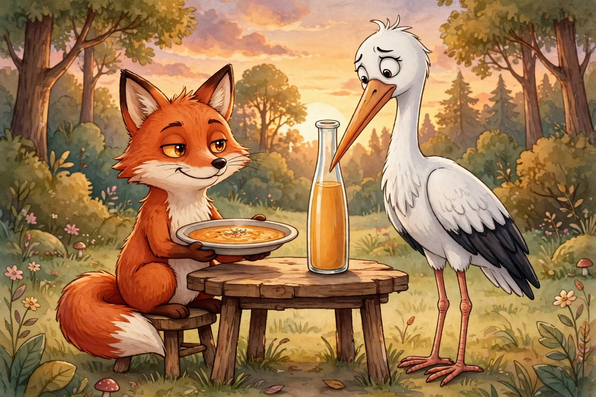

# Lesson 04 — Character Traits, Motivations, and Feelings: What Actions Reveal

**Unit 02 · Grade 3 Language Arts · Session 7**
**Standard:** RL.3.3 (describe characters' traits, motivations, and feelings
and explain how their actions contribute to the sequence of events)
**Time:** 25–30 minutes · **Materials:** notebook, pencil, the illustration
below, "Character Chain" graphic organizer (trait → action → event boxes)

## Student goal

Today I will describe what story characters are like, what they want, and
how they feel — and show how their actions change what happens next.

## Readiness check (2 minutes, retrieval warm-up)

Learner reads *character, action, feeling* from Unit 01/02 word cards and
acts out one feeling word (proud, nervous, generous) for the adult to guess.

## Explicit teaching

Three words for talking about characters:

- A **trait** is what a character is like **on the inside, most of the
  time** — brave, selfish, kind, boastful. You can't see a trait, but you
  can see **actions** that prove it.
- A **motivation** is what a character **wants** — the reason behind the
  action. (Why does she run? She wants to win.)
- A **feeling** is how a character feels **right now** — happy, scared,
  embarrassed. Feelings change; traits stay longer.

The detective tool is the **Character Chain**:

> **Trait → Action → Event.** *What they are like → what they do → what
> happens because of it.*

### Worked example 1 — trait from action

> **Story: "The Fox and the Stork"** (original retelling)
>
> "Fox invited Stork to dinner, smiling his slyest smile. He served the
> soup in a wide, flat dish — perfect for lapping with a tongue, impossible
> for a long beak. Fox lapped up every drop while Stork's stomach rumbled.
> 'Delicious!' said Fox. 'Too bad you cannot enjoy it.'
>
> A week later, Stork invited Fox to dinner. She served the soup in a tall,
> narrow jar — perfect for a long beak, impossible for a tongue. Stork sipped
> happily while Fox stared. 'Delicious!' said Stork. 'Too bad you cannot
> enjoy it.'
>
> Fox walked home hungry, and he never played a mean trick on a dinner
> guest again."

**Character Chain for Fox (first dinner):**

- **Trait:** tricky / unkind (a pattern, not one moment)
- **Action:** serves soup in a flat dish he knows Stork cannot use
- **Event:** Stork goes hungry; Fox eats it all

**Character Chain for Stork (second dinner):**

- **Trait:** clever / fair-minded (she answers trick with trick)
- **Action:** serves soup in a narrow jar Fox cannot use
- **Event:** Fox learns how his trick felt

**Motivation check:** Why did Stork invite Fox back? She wanted Fox to
**understand** what he had done — her motivation was teaching, not just
revenge. The story's last line proves it: Fox "never played a mean trick
on a dinner guest again."

### Worked example 2 — reading the illustration

Look at this AI-generated illustration of the first dinner:

*Caption: An AI-generated illustration of the first dinner in "The Fox and
the Stork." The fox looks pleased with his flat dish; the stork cannot reach
the soup in the tall jar.*

**Text-only alternative** (everything needed to answer, in words): *The
fox sits at a small wooden table in a forest at sunset, holding a shallow
flat plate of soup and smiling in a smug, pleased way. The stork stands
beside the table looking puzzled and left out, staring at a tall narrow jar
of soup on the table that its long beak cannot reach into.*

**Modeled reasoning:** The fox's **face** shows he is pleased — that
feeling tells us the trick was **on purpose**, which proves the trait
*tricky*. The stork's **face** shows she is puzzled and left out — that
feeling proves the trick **worked**, which is the event in the chain. The
illustration adds what words alone might not: the *feelings in the moment*.

## Guided practice

With the adult, build Character Chains for the story:

1. Fox's trait at the start (one word) — which **action** proves it?
2. Stork's feeling at the first dinner — what **detail** (words or picture)
   shows it?
3. What was Fox's **motivation** for the first dinner invitation?
4. What was Stork's **motivation** for the second invitation? Quote one line.
5. How did Stork's **action** change the **events**? (What is different at
   the end?)
6. Look at the illustration again: name one thing the picture shows about a
   character's **feeling** that the words do not say directly.

## Independent practice

Pick **one** character from "The Tortoise and the Hare" (Lesson 02). In your
notebook draw and fill a Character Chain with all three boxes, then add a
fourth box: **Motivation** (what did your character want?). Write one
sentence explaining how the action changed the events.

## Application

Think of a character from a book you are reading at home. Tell the adult
their trait, one action that proves it, and what happened because of the
action. If you can't find an action yet, that is useful data — the book may
still be introducing the character.

## Exit check

Finish the chain: **Trait:** generous → **Action:** ? → **Event:** ?
(One sensible action and one sensible event; any logical pair earns full
marks.)

## Supports and extensions

- **Support:** Adult reads the story aloud; learner draws each character's
  face showing their feeling at the key moment, then dictates the trait.
- **Alternate response mode:** Trait sorting — learner sorts printed trait
  words (kind, tricky, brave, lazy, fair, greedy) under Fox or Stork, citing
  one action per placement.
- **Extension:** Rewrite the last line of the story from **Fox's** point of
  view (one or two sentences, preview of Lesson 06). Does Fox sound sorry,
  angry, or embarrassed? What words prove your choice?

## Teacher note (misconceptions)

- Learners confuse **traits** with **feelings** ("sad" is a feeling, not a
  trait). Test: "Is she like this most of the time, or just right now?"
- Learners confuse **motivation** with **action** ("He wanted to eat the
  soup" vs. "He ate the soup"). Ask: "What was he *hoping* would happen?"
- The illustration is an **AI illustration**, not a primary source; it was
  generated for this lesson to practice reading feelings from faces. Say so
  to the learner.
- Full solutions: [answer-key.md](../answer-key.md#lesson-04).
