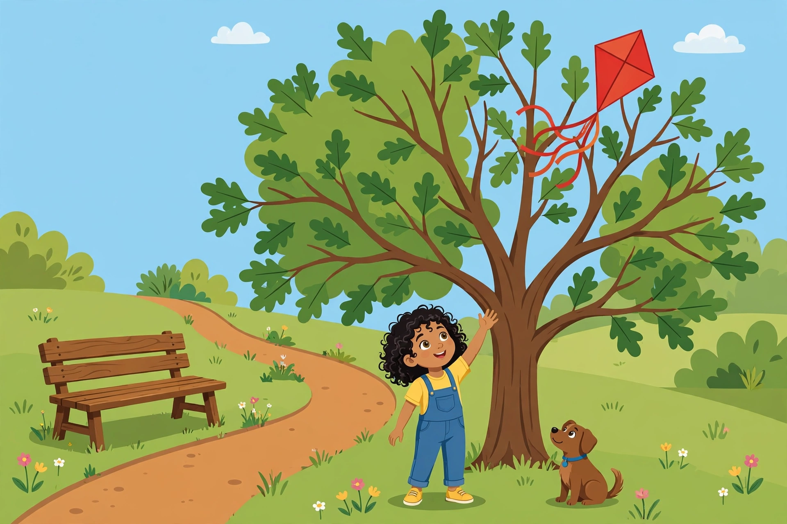

# Lesson 01 — Establish a Situation and Introduce Characters

**Goal (learner hears):** "I can start a story so a reader knows who is
in it, where it happens, and what is going on — and put the events in an
order that makes sense."
**Time:** 25–30 minutes · **Materials:** the kite illustration below; a
pencil and paper; the story-map boxes in the project (or a blank page
ruled into four boxes: Who / Where / When / What happens).
**Standards:** W.3.3, W.3.3.a.

## Readiness check (1–2 min)

The adult asks: "Tell me about the last time something surprising
happened to you — in three sentences." The learner tells it. Then the
adult asks: "Did your listener know *who* was there, *where* it
happened, and *what* happened first? If not, the story started too
fast. A story's beginning has a job: it tells the reader who, where,
when, and what — before the trouble starts."

## Explicit teaching

A **narrative** is a story about real or imagined events. Every narrative
has four building blocks:

1. A **situation** — what is going on, and where and when it happens.
   (The **setting** is the where-and-when part.)
2. **Characters** — the people (or animals) the story is about. The
   **narrator** is whoever tells the story; in this unit the narrator
   is not one of the characters, so the story says "Maya" and "she,"
   not "I."
3. **Events in order** — the things that happen, one after another, so
   that each event follows naturally from the one before it. If you
   swap two events and the story still makes sense, one of them does
   not belong, or they are in the wrong order.
4. An **ending** — what happens last, and how the characters end up
   (Lesson 05).

The beginning of a story must answer four questions in its first few
sentences: **Who? Where? When? What is happening?** If the reader has
to guess at any of these, the beginning is not doing its job. After the
beginning, the middle holds the events — and the middle needs a
**problem**: something goes wrong, or something is wanted, or a choice
must be made. Without a problem, there is no story — only a list.

The "what happens because of what" test: read your events in order and
ask after each one, "Did this happen *because* of the event before it?"
A strong event chain passes the test most of the way. A list of
unrelated things ("We went to the park. I ate a sandwich. My shoe was
blue.") fails it.

## Story starter — the kite illustration (used all unit)

*Caption: An AI-generated illustration for this lesson. It shows Maya
reaching up toward her red kite, tangled in the branches of the big oak
tree in the park, while her dog Biscuit sits beside her looking up too.*

**Alt text:** A sunny park scene. A big green oak tree fills the middle
of the picture. A bright red kite with long red and orange tail ribbons
is tangled in the high branches on the right side of the tree. A young
girl with curly dark hair, wearing a yellow shirt and blue overalls,
stands under the tree reaching up toward the kite with one hand. A small
brown dog with a blue collar sits beside her, looking up at the kite.
A wooden bench stands on the left, a winding dirt path curves through
green grass, and the sky is blue with two small white clouds.

**Text-only alternative:** In a sunny park, a big green oak tree stands
in the middle of the scene. A bright red kite with long red and orange
tail ribbons is tangled in the high branches on the right side of the
tree. A young girl with curly dark hair, wearing a yellow shirt and blue
overalls, stands under the tree reaching up toward the kite with one
hand. A small brown dog with a blue collar sits beside her, looking up
at the kite. A wooden bench stands on the left, a winding dirt path
curves through green grass, and the sky is blue with two small white
clouds.

Look at the picture together before reading. The adult asks: "Who do you
see? Where are they? What has already happened — what must have happened
just before this picture?" (A girl was flying a kite; the kite got away
from her and tangled in the tree; now she is reaching for it and her dog
is watching.) The picture is the middle of the story. This lesson builds
its beginning.

## Model story — "The Kite in the Tree," Part 1 (original, written for this unit)

*Adult reads aloud; the learner follows along.*

> On Saturday morning, Maya carried her new red kite to the park. Her
> dog Biscuit trotted beside her, his tail wagging. The wind was strong,
> and the kite tugged at its string like a fish on a line.

### Modeled example 1 — The beginning answers four questions

*Adult thinks aloud:* "Who? **Maya** — and her dog **Biscuit**. Where?
**The park**. When? **Saturday morning**. What is happening? Maya is
carrying her new red kite, and the wind is already tugging at it. Four
questions, three sentences, and I can picture it. Notice what the
beginning does *not* do: it does not tell me the kite gets stuck yet.
That is the problem, and it comes next — in the middle."

### Modeled example 2 — Events in an order that unfolds naturally

*Adult writes the events on separate cards, then reads them in order:*

1. Maya and Biscuit walk to the park with the red kite.
2. Maya runs, and the kite lifts into the sky.
3. A gust of wind yanks the string, and the kite dives into the oak tree.
4. The kite's tail tangles in the branches.
5. Maya reaches up, but the kite is too high.

"Now the test: does each event follow from the one before it? The kite
lifts *because* Maya runs. The kite dives *because* the wind yanks the
string. It tangles *because* it dives into the tree. Maya reaches
*because* the kite is stuck. Swap events 2 and 4 and the story breaks —
a kite cannot tangle before it flies. That is how I know the order is
right."

## Guided practice

The adult reads each item aloud; the learner answers orally or in writing.
Answers are in the [answer key](../answer-key.md#lesson-01--establish-a-situation-and-introduce-characters).

1. In Part 1 of "The Kite in the Tree," who are the characters? Where
   and when does the story happen?
2. What is happening in the beginning? Answer in one sentence, using
   your own words.
3. The adult reads these two beginnings. Which one does the beginning's
   job better, and why?
   - (a) "Maya went to the park. The kite was red."
   - (b) "On Saturday morning, Maya carried her new red kite to the
     park, and her dog Biscuit trotted beside her."
4. Put these events in the order they happen. Use the "because" test
   to check yourself: Maya reaches for the kite. / The wind yanks the
   string. / The kite tangles in the oak tree. / Maya runs and the kite
   lifts.
5. Which of these is a problem that could drive a story, and which is
   only a fact? (a) "Maya's kite is stuck in the tree." (b) "The park
   has green grass." Explain your choice.
6. Look at the kite illustration again. Name one event that must have
   happened *before* the picture, and one event that might happen
   *after* it.

## Independent practice

7. Write (or dictate) a beginning of two or three sentences for a story
   about a boy named Theo who finds a lost library book. Your beginning
   must answer: Who? Where? When? What is happening?
8. List three events for Theo's story in order, so that each one
   follows from the one before it. Number them 1, 2, 3.
9. Error analysis: Sam wrote this beginning: "It was a day. Stuff
   happened. The end." Explain two things that are missing, and rewrite
   the beginning in two sentences so it answers Who, Where, When, and
   What.

## Application

Draw four quick boxes (or use the story-map boxes in the project).
Fill them with single words or short phrases — not sentences — for a
story of your own: Who (two characters) / Where and when / What happens
first / What goes wrong. Read the four boxes to the adult, who checks:
can a stranger tell who, where, when, and what from your boxes alone?

## Exit check

In your own words: what four questions must a story's beginning answer?
Name one event from the kite story, and say what event it follows from
and why.

## Supports and extension

- **Support:** if the four questions are hard to hold at once, cover
  the passage and ask, "If you could only tell a friend one sentence
  about how this story starts, what would you say?" Then add the
  missing questions one at a time.
- **Alternate response mode:** point to the words in Part 1 that answer
  each question instead of writing them; draw the park scene and label
  who, where, and when.
- **Extension:** write a second beginning for the same kite story, this
  time starting on the walk home the day before ("The kite sat by the
  door all night...") and argue which beginning is stronger and why.

## Teacher note

Likely misconceptions: (1) the beginning *is* the whole story — the
learner retells everything in the first paragraph; teach that the
beginning stops before the problem. (2) A list of facts is a beginning
("The park is big. Trees are green."); facts are not a situation — a
situation has people doing something. (3) Events in any order are fine;
use the "because" test on every pair before accepting an order. See the
[teacher guide](../teacher-guide.md#lesson-01--establish-a-situation-and-introduce-characters)
and [answer key](../answer-key.md#lesson-01--establish-a-situation-and-introduce-characters).
