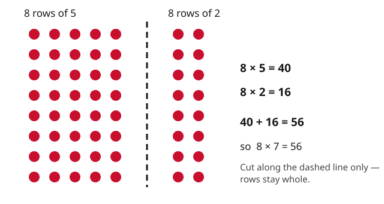

# Lesson 05 — Breaking Arrays Apart

**Session:** 11 · **Time:** 30 minutes · **Goal:** I can break a big array into
two smaller arrays I already know, add the parts, and find the product.

**Materials:** paper and pencil, counters, the reproducible diagram
[`../assets/array-break-apart.svg`](../assets/array-break-apart.svg).

**Retrieval warm-up (2 min):** "Write the turnaround of 6 × 7 = 42." (7 × 6 =
42.) "Round 83 to the nearest 10." (80.)

## Readiness check (3 min)

Ask: "You know 5 × 6 = 30. Can you use that to find 6 × 6?" (Add one more 6:
30 + 6 = 36.) If the learner cannot add one more group to a known fact, practice
"one more group" additions (4 × 5 = 20, so 5 × 5 = 25) before the break-apart
lesson.

## Explicit teaching (8 min)

Some facts are too big to know yet — **8 × 7**, for example. But we can **break
the array apart** into two smaller arrays we *do* know, then add the parts.
Grown-ups call this the **distributive property**; our name is "break apart."

Look at the diagram: the 8-by-7 array is cut (along the dashed line, keeping
every row whole) into an **8-by-5** piece and an **8-by-2** piece.

- 8 × 5 = 40 (the 5s facts are friendly)
- 8 × 2 = 16 (doubles)
- 40 + 16 = 56, so **8 × 7 = 56**

The rules of breaking apart:

1. **Cut along grid lines only** — rows stay whole, columns stay whole. A
   jagged cut breaks the equal groups.
2. Both pieces must use facts you already know (5s, 2s, 10s, doubles are the
   usual suspects).
3. **Add both parts** — forgetting the second piece is the classic error.

Why it works: no dots were added or removed — we just counted the same array in
two chunks. 8 × 7 = 8 × (5 + 2) = (8 × 5) + (8 × 2).

## Worked example 1 — 7 × 6

1. 7 × 6 feels big. Break the 6 into 5 + 1 (facts we know).
2. Draw or imagine: 7 rows of 6, cut after the 5th column → 7-by-5 and 7-by-1.
3. 7 × 5 = 35. 7 × 1 = 7. Add: 35 + 7 = 42.
4. **7 × 6 = 42.**
5. Check with the turnaround: 6 × 7 — break 7 into 5 + 2: 6 × 5 = 30,
   6 × 2 = 12, 30 + 12 = 42. ✓ Both cuts agree.

## Worked example 2 — 9 × 4 by doubling

1. 9 × 4: break the 4 into 2 + 2 (double the 9 × 2 fact).
2. 9 × 2 = 18. The array is two 9-by-2 pieces: 18 + 18.
3. **9 × 4 = 36.**
4. Check: 9 × 4 turned around is 4 × 9; skip count "9, 18, 27, 36." ✓
5. Common slip: breaking 9 × 4 into 9 × 2 and then *stopping* at 18. The rule:
   count the pieces — two pieces means two numbers to add.

## Guided practice (with hints)

Work through these together; the adult gives the hint, the learner draws the
cut.

1. Break **6 × 7** into 6 × 5 and 6 × 2. Find both parts and add.
   *(Hint: 6 × 5 = 30, 6 × 2 = 12 — add them.)*
2. Break **8 × 6** into 8 × 5 and 8 × 1. Find the product.
   *(Hint: the 1s piece is just 8 — do not skip writing it down.)*
3. Break **7 × 8** into 7 × 4 and 7 × 4 (doubling). Find the product.
   *(Hint: 7 × 4 = 28; double it.)*
4. Break **9 × 6** into 9 × 5 and 9 × 1. Find the product.
   *(Hint: 9 × 5 = 45 — count by 5s nine times if needed.)*
5. Error analysis: Kim broke **7 × 8** into 7 × 5 (= 35) and 7 × 2 (= 14) and
   wrote **35** as the answer. What did Kim forget?
   *(Hint: the cut itself is fine — 5 + 2 = 7. What step comes after finding
   both parts?)*

## Independent practice

6. Break **6 × 8** into 6 × 4 + 6 × 4. Find the product.
7. Break **9 × 7** into 9 × 5 + 9 × 2. Find the product.
8. Break **8 × 9** into 8 × 10 − 8 × 1 (take-away cut). Find the product and
   explain why subtracting works here.
9. Find **7 × 7** by breaking it into 7 × 5 + 7 × 2.
10. Draw a 6 × 9 array, draw the cut line, label both pieces with their
    equations, and write the total.
11. Challenge: break **8 × 7** a *different* way than the diagram (not 5 + 2).
    Show both pieces and the total. (e.g., 8 × 4 + 8 × 3 = 32 + 24 = 56.)

## Application

The Array Market needs **7 trays with 8 muffins on each tray**, but the
manager only trusts her 5s and 2s facts. Write her a note: show the break-apart
(7 × 5 and 7 × 3? or 7 × 5 + 7 × 2 + 7 × 1 — pick a clean cut), find the total,
and explain in two sentences why adding the pieces gives the right total.

## Exit check

1. Break **6 × 9** into two known-fact pieces. Write both mini-equations and
   the total.
2. True or false: **8 × 7 = (8 × 5) + (8 × 2)**. Explain with the array.

*Success criterion:* both pieces written and added — a single-piece answer
fails even if the product is right. If the learner cuts jaggedly (breaking
rows), re-draw with grid paper before Session 12.

## Supports and extension

- **Language access:** "break it into friendly pieces" said while drawing the
  cut line; the learner names each piece's equation aloud.
- **Alternate response mode:** build the array with counters, slide the two
  pieces apart physically, count each piece, and add orally.
- **Extension:** prove that 9 × 6 = (9 × 10) − (9 × 4) = 90 − 36 = 54 also
  works. When is a take-away cut easier than an add-up cut? (When one piece is
  a 10s fact.)

## Teacher note

The break-apart is the single most powerful fact strategy in grade 3 — it is
also the distributive property that powers multi-digit multiplication later, so
teach it as *thinking*, not a trick. Insist on the "cut keeps rows whole"
rule; learners who cut mid-row are really just guessing two numbers. The
take-away cut (9 × 6 = 9 × 10 − 9 × 4) is enrichment, not required — do not
assess it on the quiz. Answer key:
[answer-key.md](../answer-key.md#lesson-05).
