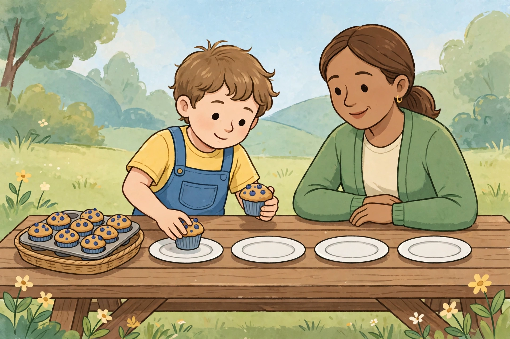

# Lesson 01 — Fair Shares: Sharing Equally

**Session:** 1 · **Time:** 30 minutes · **Goal:** I can share a total equally
into a known number of shares, find how many are in each share, and write the
matching division equation.

**Materials:** 40+ counters, 4 paper plates (or drawn circles), the generated
illustration [`../assets/fair-share-picnic.png`](../assets/fair-share-picnic.png).

**Retrieval warm-up (2 min, Unit 02 bridge):** "6 × 4 = ?" (24 — six groups
of 4.) "4 × 5 = ?" (20.) "What multiplication fact will 20 shared by 4
remind us of?" (4 × 5 = 20 — hold that thought.)

## Readiness check (3 min)

Ask aloud: "Count by 4s to 20." (4, 8, 12, 16, 20.) "Show 3 groups of 4 with
counters." (3 piles of 4; 12 in all.) "What does *equal* mean when we share?"
(Every share gets the same number — no share may have more or fewer.) If
skip counting by 4s is shaky, deal the counters in rounds today and count
each round aloud before writing any ÷ symbols.

## Explicit teaching (8 min)

**Division** answers a sharing question. The symbol is **÷**, read as
"divided by." In **20 ÷ 4 = 5**:

- **20** is the total — everything being shared.
- **4** is the number of shares (plates, friends, tables).
- **5** is the answer, the **quotient**: how many in each share.

The fair way to share is to **deal one at a time, around the plates**, the
way cards are dealt. Dealing one at a time guarantees fairness: nobody gets
a second counter until everybody has a first, nobody gets a third until
everybody has a second. When the counters run out, every plate holds the
same number — if they do not, something was miscounted, and we deal again.

Sharing equally is the opposite of building equal groups. In Unit 02 we
*built* 4 groups of 5 and got 20. Today we *start* with 20 and *undo* that
build: 20 shared into 4 equal shares gives 5 in each share. That is why
4 × 5 = 20 and 20 ÷ 4 = 5 belong together — one fact, read two ways.

*Caption: AI-generated illustration — a child sharing muffins onto four
plates at a picnic table. This is an illustration, not a photograph of a
real picnic, and the muffins are not counted as data.*

**Picture question:** How is the child in the picture sharing fairly? What
should they do so no plate ends up with more muffins than the others?

*Text-only alternative:* A child sits at a wooden picnic table with four
empty plates in a row and a tray of muffins. The child is placing one muffin
onto the first plate while an adult watches. To answer the question you need
only this: there are 4 plates, and the muffins must be shared so every plate
ends with the same number. The fair method is to place one muffin on each
plate, go around again, and keep going around until the tray is empty —
never giving one plate a second muffin before every plate has a first.

## Worked example 1 — 20 apples, 4 plates

1. Read: total 20, shares 4. Write **20 ÷ 4 = ?**
2. Deal: put 4 plates in a row. Place one counter on each plate (round 1:
   each plate has 1; 4 placed, 16 left). Round 2: each plate has 2 (8 placed).
   Round 3: each plate has 3 (12 placed). Round 4: each plate has 4 (16
   placed). Round 5: each plate has 5 (20 placed, none left).
3. Count one plate: 5. Check every plate: 5, 5, 5, 5 — equal. ✓
4. Equation: **20 ÷ 4 = 5.** Say it: "Twenty divided by four equals five."
5. Multiply back to check: 4 shares × 5 each = 20. ✓ The multiplication
   fact 4 × 5 = 20 proves the division.
6. Common slip: giving one plate 8 and another 2 and calling it "shared."
   Sharing is not dividing into piles of any size — every share must match.

## Worked example 2 — 24 stickers, 6 friends

1. Read: total 24, shares 6. Write **24 ÷ 6 = ?**
2. Deal: 6 shares. Round 1: 6 placed, each share has 1. Round 2: 12 placed,
   each has 2. Round 3: 18 placed, each has 3. Round 4: 24 placed, each has 4.
   None left.
3. Equation: **24 ÷ 6 = 4.** Each friend gets 4 stickers.
4. Multiply back: 6 × 4 = 24. ✓
5. Notice: we dealt 4 rounds, and the answer is 4. The number of dealing
   rounds *is* the quotient when you deal one at a time — a useful check.

## Guided practice (with hints)

Work through these together; the adult gives the hint, the learner does the
dealing and writing.

1. Deal **18 counters into 3 shares**. Write the equation and the quotient.
   *(Hint: how many rounds of dealing will it take? Deal one round, count
   each share, then deal the next.)*
2. Deal **30 counters into 5 shares**. Write the equation and the quotient.
   *(Hint: 5 × ? = 30 from Unit 02 — what fact does this remind you of?)*
3. Deal **16 counters into 4 shares**. Is the quotient the same as #1's
   sharing? Why or why not?
   *(Hint: #1 shared 18 into 3 shares; here both the total and the number
   of shares changed — deal it and compare the share sizes.)*
4. Deal **12 counters into 2 shares**. Write the equation.
   *(Hint: half of 12 — deal one at a time and count the rounds.)*
5. Error analysis: Mia shared **15 counters into 3 shares** and said each
   share gets 3. What did Mia mix up? What should the quotient be?
   *(Hint: multiply back — does 3 shares × 3 each use all 15 counters?
   3 × 3 = 9, and 6 counters would be left over. Deal again.)*

## Independent practice

6. Draw 4 plates. Share 28 counters equally. Write the equation and the
   quotient.
7. Share 36 counters into 6 shares. Write the equation and the quotient.
8. Share 45 counters into 5 shares. Write the equation and the quotient.
9. A teacher shares **21 pencils equally among 3 tables**. Write the
   equation and find how many pencils each table gets.
10. True or false: **40 ÷ 8 = 5** because 8 × 5 = 40. Explain by dealing or
    by multiplying back.
11. Error analysis: Sam shared **32 counters into 4 shares** and wrote
    32 ÷ 4 = 6. What is wrong? What is the quotient really? Show the
    multiply-back check.

## Application

Invent a fair-share story for **24 ÷ 4** — choose your own objects and
sharers (not muffins or plates). Deal it with counters, draw the shares,
write the equation, and write one sentence saying how you know the shares
are fair (every share equal, multiply-back check, or rounds counted).

## Exit check

1. Deal or draw **32 counters shared into 4 shares**. Write the equation
   and the quotient.
2. Deal or draw **27 counters shared into 3 shares**. Write the equation
   and the quotient.

*Success criterion:* both exit items correct with equal shares shown
(dealt, drawn, or described) — not just a memorized answer. If the learner
deals uneven piles, re-deal one at a time together before Session 2.

## Supports and extension

- **Language access:** let the learner say the story ("32 shared into
  4 shares") while the adult writes the equation; the learner points to
  each share as they count.
- **Alternate response mode:** deal everything with counters and answer
  orally; the adult records the written equations.
- **Extension:** share 48 counters into 8 shares, then into 6 shares, and
  explain why the shares get bigger when there are fewer shares
  (48 ÷ 8 = 6; 48 ÷ 6 = 8 — same total, fewer shares, more in each).

## Teacher note

The defining misconception in this lesson is **dealing uneven piles and
calling it sharing**, or **subtracting the divisor** (20 ÷ 4 → 16). Both
come from treating ÷ as "take away" or "split somehow." The fix is physical:
no equation is written until the dealing rounds are counted and every share
is checked equal. Answer key: [answer-key.md](../answer-key.md#lesson-01).
