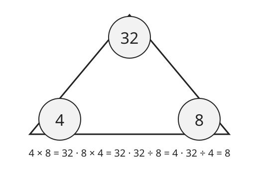

# Lesson 03 — Division as an Unknown-Factor Problem

**Session:** 8 · **Time:** 30 minutes · **Goal:** I can find a quotient by
asking "what times the divisor makes the dividend?", and I can write all
four equations of a fact family.

**Materials:** 40+ counters, blank fact-family cards, the reproducible SVG
[`../assets/fact-family-triangle.svg`](../assets/fact-family-triangle.svg).

**Retrieval warm-up (2 min):** "24 ÷ 6 = ?" (4 — 24 shared into 6 shares,
or 6-count groups: 6, 12, 18, 24.) "What multiplication fact proves it?"
(6 × 4 = 24.) "Today that proof becomes the method."

## Readiness check (3 min)

Ask aloud: "What times 8 makes 32?" (4, because 4 × 8 = 32.) "What times 7
makes 42?" (6, because 6 × 7 = 42.) "What times 5 makes 35?" (7.) If the
learner hunts by adding (8 + 8 + 8 + 8), that is fine today — repeated
addition is a valid bridge to the fact; the goal is the connection, not
speed.

## Explicit teaching (8 min)

Here is the shortcut that makes division fast: **every division problem is
a multiplication problem with a missing factor.**

To find **32 ÷ 8**, do not deal 32 counters. Instead ask: **"What number
times 8 makes 32?"** That is, solve **? × 8 = 32**. We know 4 × 8 = 32, so
the missing number is 4 — and that missing number *is* the quotient:
**32 ÷ 8 = 4**.

This works because multiplication and division undo each other. If
4 × 8 = 32, then splitting 32 back into groups of 8 must give 4 groups,
and sharing 32 into 8 shares must give 4 in each share. One fact family
holds all four readings:

*Caption: Fact-family triangle for 4, 8, and 32 (deterministic SVG — the
numbers are exact, not an illustration estimate).*

**Text-only alternative:** The triangle has 32 at the top and 4 and 8 at
the bottom corners. The two bottom numbers multiply to the top number:
4 × 8 = 32 and 8 × 4 = 32. The top number divided by either bottom number
gives the other bottom number: 32 ÷ 8 = 4 and 32 ÷ 4 = 8. Any one of these
four equations lets you recover the other three.

Three numbers, four equations — that is a **fact family**. The two small
numbers are the factors; the big number is the product (and the dividend).
If you know any one equation, you know all four. From now on, when a
division looks hard, find its multiplication partner first.

Why this matters: dealing works, but it is slow for 72 ÷ 8. Asking
"? × 8 = 72" and remembering 9 × 8 = 72 answers it at once. Strategy,
not speed drills, is what "fluent" means in this unit.

## Worked example 1 — 56 ÷ 7

1. Ask the unknown-factor question: **? × 7 = 56.**
2. Search memory: 7 × 7 = 49 (too small), 8 × 7 = 56. ✓ The missing
   factor is 8.
3. Equation: **56 ÷ 7 = 8.**
4. Write the whole family (7, 8, 56): 7 × 8 = 56, 8 × 7 = 56,
   56 ÷ 7 = 8, 56 ÷ 8 = 7.
5. Check both meanings: 56 shared into 7 shares gives 8 each; 56 in groups
   of 7 gives 8 groups. Either way the quotient is 8.
6. Common slip: answering 7 because "7 is in the problem." The divisor is
   not the answer — the *missing factor* is.

## Worked example 2 — 63 ÷ 9

1. Ask: **? × 9 = 63.**
2. Search: 6 × 9 = 54 (too small), 7 × 9 = 63. ✓ The missing factor is 7.
3. Equation: **63 ÷ 9 = 7.**
4. Family (7, 9, 63): 7 × 9 = 63, 9 × 7 = 63, 63 ÷ 9 = 7, 63 ÷ 7 = 9.
5. Multiply back: 9 × 7 = 63. ✓
6. Notice: 63 ÷ 7 = 9 is the same family's other division. Knowing one
   division gives you its partner for free.

## Guided practice (with hints)

Work through these together; the adult gives the hint, the learner finds
the missing factor and writes the family.

1. Find **42 ÷ 6** by asking ? × 6 = 42. Write the full fact family.
   *(Hint: 6 × 6 = 36 is too small — try the next fact up.)*
2. Find **63 ÷ 7** and explain why its answer is the partner of 63 ÷ 9.
   *(Hint: same family (7, 9, 63) — the two divisions swap divisor and
   quotient.)*
3. Find **48 ÷ 8** by asking ? × 8 = 48. Write the full fact family.
   *(Hint: 5 × 8 = 40, 6 × 8 = 48.)*
4. Find **36 ÷ 4** by asking ? × 4 = 36. Write the equation and the
   multiply-back check.
   *(Hint: 9 × 4 = 36.)*
5. Error analysis: Leo solved **45 ÷ 5** by asking ? × 5 = 45 and wrote
   10. What did Leo mix up? What is the quotient really?
   *(Hint: multiply back — 10 × 5 = 50, not 45. Which fact actually lands
   on 45? 9 × 5 = 45.)*

## Independent practice

6. Find 54 ÷ 6 by asking ? × 6 = 54. Write the full fact family.
7. Find 72 ÷ 9 by asking ? × 9 = 72. Write the equation.
8. Find 81 ÷ 9 by asking ? × 9 = 81. Write the equation.
9. Find 28 ÷ 7 by asking ? × 7 = 28. Write the full fact family.
10. Find 49 ÷ 7 by asking ? × 7 = 49. Write the equation.
11. Find 64 ÷ 8 by asking ? × 8 = 64. Write the equation.
12. Error analysis: Ana solved **56 ÷ 8** and wrote 8, "because 8 is in
    the problem." What is wrong? What is the quotient really, and what
    multiplication fact proves it?

## Application

Pick any division fact within 100 that you do *not* yet know from memory.
Write its unknown-factor question, hunt for the missing factor with a
multiplication chart if needed, write all four family equations, and write
one sentence explaining how the multiplication fact proves the division.

## Exit check

1. Find **36 ÷ 9** by asking ? × 9 = 36. Write the equation.
2. Find **40 ÷ 5** by asking ? × 5 = 40. Write the equation and the
   multiply-back check.

*Success criterion:* both exit items correct with the unknown-factor
question shown ("? × 9 = 36, so 4") — not just a bare quotient. If the
learner deals counters instead, that is still correct work, but ask them
to also say the multiplication fact before Session 9.

## Supports and extension

- **Language access:** let the learner say the question ("What times 8
  makes 32?") while the adult writes it; the learner points to the
  multiplication chart row for the divisor.
- **Alternate response mode:** answer orally with the chart; the adult
  records the written family.
- **Extension:** write the family for 72, 8, 9 and explain why 72 ÷ 8 = 9
  and 72 ÷ 9 = 8 are partners, then find the family for a square number
  (36, 6, 6 — only two distinct equations: 6 × 6 = 36 and 36 ÷ 6 = 6 —
  and explain why the family is smaller).

## Teacher note

The defining misconception in this lesson is **echoing a number from the
problem as the answer** (56 ÷ 8 → 8) or **dividing by repeated subtraction
without checking**. The fix is the question itself: never write a quotient
until the unknown-factor question is asked and answered aloud, and always
multiply back. Answer key: [answer-key.md](../answer-key.md#lesson-03).
