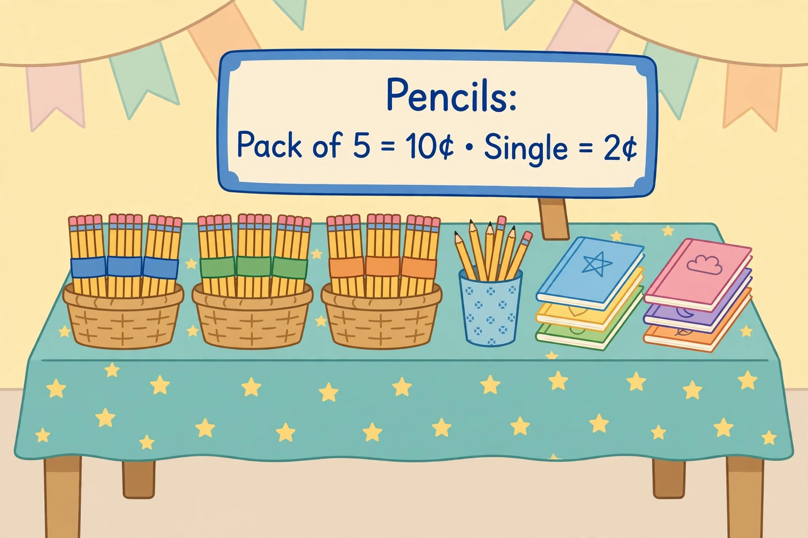

# Lesson 01 — Two Steps, One Story at a Time

**Session:** 1 · **Time:** 30 minutes · **Goal:** I can solve a two-step
word problem by finding the hidden first question, solving one step at a
time, and writing what each step finds.

**Materials:** counters, the generated illustration
[`../assets/two-step-school-store.png`](../assets/two-step-school-store.png),
the two-step-model SVG [`../assets/two-step-model.svg`](../assets/two-step-model.svg).

**Retrieval warm-up (2 min, Unit 03 bridge):** "6 × 4 = ?" (24.) "24 ÷ 6 = ?"
(4.) "What multiplication fact undoes 24 ÷ 6?" (6 × 4 = 24.)

## Readiness check (3 min)

Ask aloud: "Show 3 groups of 4 with counters. How many in all?" (12.)
"Share 12 counters equally into 3 groups. How many in each group?" (4.)
"If a story asks two questions, do we answer both at once?" (No — one
step, then the next, using the first answer in the second step.) If
equal groups are shaky, build groups with counters today before writing
any two-step equation.

## Explicit teaching (8 min)

A **two-step problem** is a story that hides a question inside it. The
story never asks the hidden question out loud — you have to find it.
The method, every time:

1. **Read the question first.** What is the story actually asking for?
   Say it in your own words.
2. **Find the hidden first question.** What number do you need before
   you can answer the real question? That is Step 1.
3. **Solve Step 1.** Write what you found, with its unit ("9 packs").
4. **Solve Step 2.** Use the Step 1 answer. Write the final answer with
   its unit ("45 pencils").
5. **Check.** Does the answer make sense? (Lesson 04 teaches the full
   check; today, just ask: is it bigger or smaller than it should be?)

A bare number is never a finished answer. "45" is not done; "45 pencils"
is done, because it says what was counted.

*Caption: AI-generated illustration — a school store table. The sign
says a pack holds 5 pencils. Count the baskets and the packs in each
basket; do not try to count every single pencil in the picture.*

**Picture question:** The store table has baskets of pencil packs. How
many pencils are in all the packs on the table? Work it in two steps.

*Text-only alternative:* The picture shows a store table with **3
baskets**. Each basket holds **3 packs** of pencils. The sign says each
pack holds **5 pencils**. (The cup of loose pencils and the notebooks
are not part of this question.) Step 1: 3 baskets × 3 packs = 9 packs.
Step 2: 9 packs × 5 pencils = 45 pencils. Answer: **45 pencils**.

## Worked example 1 — The store table (the picture problem)

1. Read the question first: how many pencils are in all the packs?
2. Hidden first question: how many packs are there in all? The picture
   gives baskets and packs per basket, but not the total packs.
3. Step 1: 3 baskets × 3 packs in each basket = **9 packs**.
4. Step 2: 9 packs × 5 pencils in each pack = **45 pencils**.
5. Answer in a sentence: There are **45 pencils** in the packs.
6. Quick check: 9 packs is more than 3 baskets (good — packs are
   smaller groups, so there are more of them), and 45 is 9 groups of 5.
   The two-step map in
   [`../assets/two-step-model.svg`](../assets/two-step-model.svg) shows
   exactly these two steps.

Common slip: adding 3 + 3 + 5 = 11. That adds baskets, packs, and
pencils as if they were the same thing. They are not: baskets hold
packs, packs hold pencils. Multiply within each step; only add or
subtract when the step actually combines or removes same-kind things.

## Worked example 2 — Priya's markers

Priya has 9 markers. She buys 4 packs of 6 markers. How many markers
does she have now?

1. Read the question first: markers now, after buying.
2. Hidden first question: how many new markers did she buy? The story
   gives packs, not new markers.
3. Step 1: 4 packs × 6 markers = **24 new markers**.
4. Step 2: 9 old markers + 24 new markers = **33 markers**.
5. Answer: Priya has **33 markers** now.
6. Notice the steps used different operations: multiply, then add.
   Two-step problems mix operations — that is normal, and it is why we
   name each step before computing.

## Guided practice (with hints)

Work through these together; the adult gives the hint, the learner does
the steps and the writing.

1. A shop has 5 boxes with 7 pencils in each box. The shop sells 13
   pencils. How many pencils are left?
   *(Hint: Step 1 is a multiplication — how many pencils did the shop
   start with? Step 2 removes some.)*
2. Ben has 18 stickers. He buys 3 sheets with 8 stickers on each sheet.
   How many stickers does he have now?
   *(Hint: same shape as Worked example 2 — multiply first, then add to
   what he already had.)*
3. A baker makes 4 trays with 6 muffins on each tray, then sells 9
   muffins. How many muffins are left?
   *(Hint: trays × muffins per tray first. Then take away the sold
   muffins.)*
4. Error analysis: Tom solved "3 packs of 8 pencils, plus 7 loose
   pencils" as 3 + 8 + 7 = 18. What did Tom mix up, and what is the
   correct answer?
   *(Hint: what does the 3 count — packs or pencils? Multiply packs by
   pencils per pack first.)*

## Independent practice

5. A farmer packs 6 bags with 5 apples in each bag, then finds 8 more
   apples. How many apples does she have in all?
6. A hall has 7 rows with 4 chairs in each row. Five chairs are already
   taken. How many chairs are still empty?
7. A reader has already read 12 pages of a book. She then reads
   3 chapters with 9 pages in each chapter. How many pages has she
   read in all?
8. A class buys 8 packs with 3 erasers in each pack and shares them
   equally among 4 tables. How many erasers does each table get?
9. Explain in your own words: in the store-table picture problem, why
   can't you just add 3 + 3 + 5? What does each 3 count?

## Application

Build your own two-step story with counters: make some equal groups,
then add, take away, or share the result. Write the story, name the
hidden first question, solve both steps, and read the story to the
adult — who solves it without looking at your steps, to check that the
story really needs two steps.

## Exit check

A box holds 9 crayons. Sam buys 2 boxes and already owns 6 crayons. How
many crayons does Sam have now? Show both steps.

**Teacher note:** likely misconception — adding all visible numbers
(2 + 9 + 6) without grouping. Answers: [answer-key.md](../answer-key.md),
Lesson 01.
