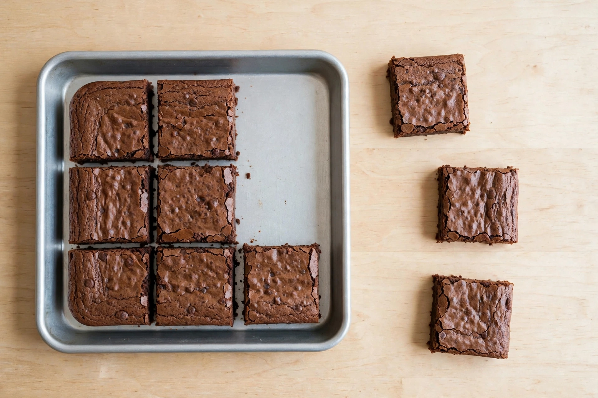

# Lesson 02 — Fractions as Parts of a Whole

 **Session:** 4 · **Time:** 30 minutes · **Goal:** I can read and write a
fraction a/b as a parts, each of size 1/b, shade models to show a fraction,
and count by unit fractions.

**Materials:** paper rectangles and strips, crayons or pencils, fraction
strips (thirds, fourths, sixths, eighths), the generated illustration
[`../assets/fraction-brownie-tray.png`](../assets/fraction-brownie-tray.png).

**Retrieval warm-up (2 min, Lesson 01 bridge):** "One part of a strip cut
into 4 equal parts is...?" (1/4 — one fourth.) "Write one sixth." (1/6.)
"What does the 6 in 1/6 tell us?" (The whole has 6 equal parts.) "What
does the 1 tell us?" (We are counting 1 part.)

## Readiness check (3 min)

Ask aloud: "Count by unit fractions of eighths: 1/8, 2/8, 3/8..." (1/8,
2/8, 3/8, 4/8, 5/8, 6/8, 7/8, 8/8.) "What is 8/8?" (The whole — all 8
parts.) "Split a rectangle into 4 equal parts with your pencil. Point to
one part and name it." (1/4.) "Point to 3 of the parts. How many unit
fractions is that?" (3 parts of size 1/4.) If counting by unit fractions
is shaky, count aloud together while pointing to each part in order
before writing any fraction.

## Explicit teaching (8 min)

A fraction **a/b** means **a parts, each of size 1/b**. The denominator
tells the size of one part; the numerator tells how many of those parts
we have.

So **3/4** means three parts, each of size **1/4**. Read it as "three
fourths." To build 3/4, first split the whole into 4 equal parts — each
part is 1/4 — then count out 3 of them: 1/4, 2/4, 3/4.

The same works for every denominator we use (2, 3, 4, 6, 8):

- **2/3** = two parts, each of size 1/3.
- **5/6** = five parts, each of size 1/6.
- **7/8** = seven parts, each of size 1/8.

To **shade a model** for a fraction, do it in order: (1) split the whole
into b equal parts, (2) check the parts are equal, (3) shade a of them,
(4) count the shaded parts to check — the count must match the numerator.

To **name the fraction** of a shaded model, do it in order: (1) count all
the equal parts in the whole — that is the denominator, (2) count the
shaded parts — that is the numerator, (3) write a/b and read it aloud.

Look at the generated illustration for this lesson — one tray of
brownies cut into equal parts, with some parts set aside:

*Caption: AI-generated illustration — a tray of brownies cut into 8
equal pieces; 3 pieces are set aside beside the tray and 5 pieces are
still in the tray. This is an illustration, not a photograph of a real
tray, and the pieces are not counted as data.*

**Picture question:** The whole tray was cut into 8 equal pieces.
What fraction of the tray is set aside beside the tray? What fraction
is still in the tray? (3 pieces out of 8 equal pieces are set aside, so
**3/8** of the tray is set aside; 5 pieces out of 8 are still in the
tray, so **5/8** of the tray is still there. Check: 3/8 + 5/8 = 8/8 —
the whole tray.)

*Text-only alternative:* A tray holds brownies cut into 8 equal square
pieces. Three pieces have been moved out of the tray onto the table
beside it, and five pieces remain in the tray. To answer the question
you need only this: the whole tray has 8 equal parts; 3 parts are set
aside and 5 parts are still in the tray. The fraction set aside is 3/8
(3 parts of size 1/8) and the fraction still in the tray is 5/8
(5 parts of size 1/8).

## Worked example 1 — Shade 3/6 of a rectangle

1. Read: shade **3/6** of a rectangle. The denominator is 6, so split
   the whole into 6 equal parts. The numerator is 3, so shade 3 of them.
2. Draw a rectangle. Split it into 6 equal parts: draw lines that cut it
   into 6 matching strips. Check the parts: are they all the same size?
   Yes. ✓ Each part is 1/6.
3. Count and shade: shade the first part (1/6), the second part (2/6),
   the third part (3/6). Stop at 3 — the numerator says 3 parts.
4. Check: count the shaded parts — 1, 2, 3. Count all the parts in the
   whole — 6. The shaded fraction is **3/6**. Say it: "Three sixths."
5. Check by unit fractions: 3/6 is three parts, each of size 1/6.
   1/6 + 1/6 + 1/6 = 3/6. ✓
6. Common slip: shading 3 parts of a rectangle split into 6 *unequal*
   parts, or shading 6 parts instead of 3. The denominator is the total
   parts in the whole; the numerator is how many are shaded — shade the
   numerator's count, no more.

## Worked example 2 — Name the fraction of a shaded strip

1. Read: a length strip is split into 8 equal parts, and 5 of the parts
   are shaded. Write the fraction for the shaded part.
2. Count all the equal parts in the whole: 8. That is the denominator.
   Each part is 1/8.
3. Count the shaded parts: 5. That is the numerator.
4. Write **5/8**. Say it: "Five eighths."
5. Check by counting unit fractions: 1/8, 2/8, 3/8, 4/8, 5/8 — five
   parts of size 1/8. ✓
6. Notice: 5/8 means "5 parts of size 1/8." The 8 tells the part size;
   the 5 tells how many parts. If the two numbers are swapped, the
   fraction means something different entirely — the bottom number
   always says how many equal parts are in the whole, so it must be
   counted from the whole, not from the shaded parts.

## Guided practice (with hints)

Work through these together; the adult gives the hint, the learner does
the shading, counting, and writing.

1. Shade **2/3** of a rectangle. Write the fraction and read it aloud.
   *(Hint: split the whole into 3 equal parts first — each part is 1/3.
   Then shade 2 of them.)*
2. A rectangle is split into 6 equal parts, and **4 parts are shaded**.
   Write the fraction for the shaded part.
   *(Hint: count all the parts in the whole first — that is the
   denominator. Then count the shaded parts — that is the numerator.)*
3. Count by unit fractions to **4/8**: 1/8, 2/8, ... Write each step.
   *(Hint: each step adds one more part of size 1/8. Stop when you have
   counted 4 parts.)*
4. Write **"five sixths"** as a fraction. Say what the 5 means and what
   the 6 means.
   *(Hint: "five" counts the parts; "sixths" names the part size — the
   whole has 6 equal parts.)*
5. Error analysis: Ben shaded **2 parts of a rectangle split into 4
   equal parts** and wrote 2/3. What did Ben mix up? What should he
   write?
   *(Hint: count all the equal parts in the whole. Is it 3 or 4? The
   denominator must be the total number of equal parts.)*

## Independent practice

6. Shade **3/4** of a square. Write the fraction and read it aloud.
7. A strip is split into 8 equal parts, and **6 parts are shaded**.
   Write the fraction for the shaded part.
8. Write **4/6** in words. Explain what the 4 means and what the 6
   means.
9. Count by eighths to **7/8**. Write each step: 1/8, 2/8, ...
10. True or false: **"3/4 means three parts, each of size 1/4."**
    Explain your answer.
11. Error analysis: Rosa shaded **5 parts of a bar split into 6 equal
    parts** and wrote 5/5. What is wrong? What should she write? Show
    the counting check.

## Application

Draw a rectangle. Split it into **6 equal parts** and shade **5/6** of
it. Write the fraction, read it aloud ("five sixths"), and write one
sentence explaining what 5/6 means — use the words "five parts" and
"one sixth" in your sentence. Check your work by counting: the whole
must have 6 equal parts, and exactly 5 must be shaded.

## Exit check

1. Shade **2/4** of a rectangle and write the fraction for the shaded
   part.
2. A strip is split into 8 equal parts, and **3 parts are shaded**.
   Write the fraction for the shaded part.

*Success criterion:* both exit items correct with the model split into
equal parts and the shaded count matching the numerator — not just a
memorized answer. If the learner shades the denominator's count instead
of the numerator's, re-count the parts together before Session 5.

## Supports and extension

- **Language access:** let the learner say the fraction in words
  ("three parts of size one sixth") while the adult writes 3/6; the
  learner points to the numerator and the denominator as they name each
  one.
- **Alternate response mode:** shade and count with fraction strips or
  paper pieces and answer orally; the adult records the written
  fractions.
- **Extension:** shade 3/4 of one rectangle and 3/6 of an identical
  rectangle. Which shaded amount is bigger? Explain using part size —
  fourths are bigger than sixths, so 3 parts of size 1/4 cover more than
  3 parts of size 1/6 (3/4 is bigger than 3/6).

## Teacher note

The defining misconception in this lesson is **using the number of
shaded parts as the denominator** (shading 2 of 4 and writing 2/3 or
2/2), or **reading a/b as two unrelated numbers** instead of "a parts of
size 1/b." Both come from treating the fraction bar as a separator
between two counts. The fix is the two-step count, always in order:
count all the equal parts in the whole first (denominator), then count
the parts named or shaded (numerator) — and check by counting unit
fractions aloud (1/4, 2/4, 3/4). Answer key:
[answer-key.md](../answer-key.md#lesson-02).
