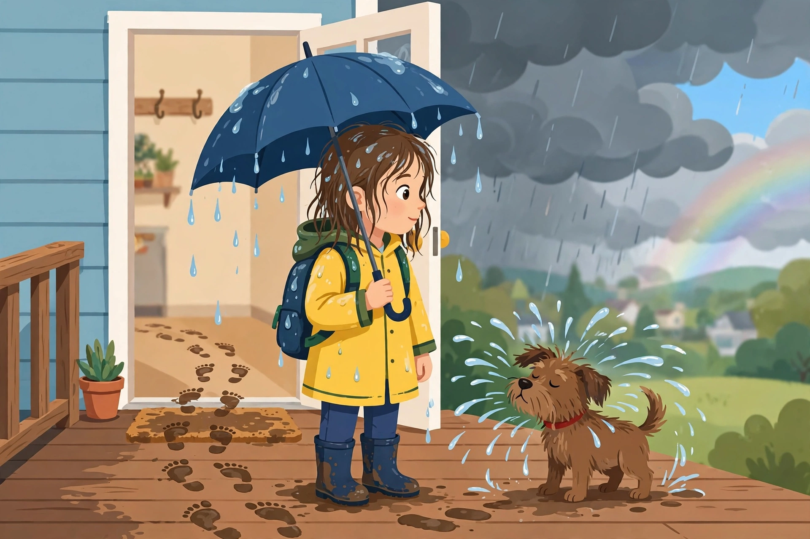

# Lesson 02 — Inference Detective: Details + What You Know

**Goal (learner hears):** "I can figure out what a text hints at but
doesn't say — and prove my idea with details from the text."
**Time:** 30–35 minutes · **Materials:** this lesson; the generated
illustration [inference-window-scene.png](../assets/inference-window-scene.png);
a pencil and paper.
**Standards:** RL.4.1, RI.4.1 (inference).

## Readiness check (1–2 min)

The adult shows the illustration and asks: "Did it rain here — yes or
no? How do you know?" (Yes — the umbrella is dripping, the footprints
are muddy, the dog is shaking off water.) "Nobody *told* you it rained.
You figured it out from clues plus what you know about rain. That is
called an **inference** — a smart conclusion built from evidence."

*An AI-generated illustration. What does the scene tell you without
saying a word? Every inference below must point to something you can
see.*

## Explicit teaching

An **inference** answers a question the text (or picture) does not state
directly. The formula detectives use:

> **Text detail + what I already know = inference**

Both parts are required. A detail with no background knowledge is just a
fact ("the umbrella is wet"). Background knowledge with no detail is
just a guess ("it always rains in April"). Only together do they earn
the name *inference*.

Three rules keep inferences honest:

1. **Name the detail.** Point to the exact words (or the exact thing
   you see).
2. **Name what you know.** Say the real-life knowledge out loud — "I
   know that wet umbrellas mean rain."
3. **Stay checkable.** If new evidence contradicts your inference, you
   change it. Detectives update; they do not defend a busted theory.

### Modeled example 1 — from the illustration

*Question:* Where had the girl just come from?
*Adult models:* "Detail: her umbrella is dripping, her hair is damp,
her boots are muddy. What I know: things get wet and muddy when you
walk through rain. Inference: she just came in from outside, where it
was raining. Check: does anything contradict it? The doorway is dry
inside, and the sky behind her is full of dark clouds — that supports
it. Inference stands."

### Modeled example 2 — from text (original passage, "The Cracked Sidewalk")

> Mr. Abernathy's garden sat behind a cracked sidewalk. Every spring he
> planted tomatoes in neat rows, and every spring the neighborhood kids
> "helped" by picking the green ones. This year he hammered a small
> wooden sign into the soil: PLEASE LET THEM RIPEN. By July, red
> tomatoes hung heavy on the vines. One hot afternoon, Mr. Abernathy
> found the sign face-down in the dirt and three tomatoes missing. He
> smiled, picked up the sign, and set a basket of red tomatoes by his
> front gate with a new note: TAKE ONE.

*Question:* How did Mr. Abernathy feel about the missing tomatoes?
*Adult models:* "Detail: 'He smiled, picked up the sign, and set a
basket of red tomatoes by his front gate.' What I know: people who are
angry do not smile and give away *more* tomatoes. Inference: he was not
angry — he was amused, maybe even pleased someone enjoyed them. The
text never says 'he felt amused,' so this is an inference, not explicit.
My evidence is the smile and the basket."

### Modeled example 3 — a busted inference (error analysis)

*Adult models a mistake on purpose:* "The sign fell face-down. I infer
a huge storm knocked it over!" Then the adult checks: "Detail check —
does the passage mention wind or a storm? No. What I know — signs can
also be knocked down by a person picking tomatoes. My storm idea has no
detail behind it, so I drop it. A better inference: someone knocked the
sign down while taking tomatoes — detail: 'three tomatoes missing,'
plus I know people bump things when they reach past them. Detectives
arrest only the ideas the evidence supports."

## Guided practice (adult does it with the learner; 6 tasks)

1. **Illustration:** "What season is it?" (Likely spring/summer rain —
   detail: green leaves/grass and rain; what I know: heavy leafy green
   + rain fits warm months. Accept any season with both parts stated.)
2. **Illustration:** "Was the dog outside in the rain too?" (Yes —
   detail: shaking off water droplets; what I know: dogs shake when
   wet.)
3. **Illustration:** "Is the rain stopping or starting?" (Stopping —
   detail: patch of blue sky and faint rainbow; what I know: rainbows
   and clearing sky come after rain.)
4. **Text:** "Why did Mr. Abernathy put up the first sign?" (So the
   tomatoes could ripen before being picked — detail: "PLEASE LET THEM
   RIPEN" + kids picked green ones; what I know: green tomatoes are
   unripe.)
5. **Text:** "Who probably took the three tomatoes?" (A neighborhood
   kid — detail: kids "helped" by picking green ones in past springs;
   what I know: the pattern repeated.)
6. **Trap check:** the adult says, "I infer Mr. Abernathy's garden is in
   the countryside." The learner must reject or repair it. (No detail
   supports countryside — "neighborhood kids" and "front gate" suggest a
   neighborhood; the inference is unsupported. Good detectives say so.)

## Independent practice (learner tries; adult observes, 6 tasks)

1. **Illustration:** "What time of day might it be? Give detail +
   knowledge." (Accept defensible answers, e.g., afternoon — detail:
   bright sky behind clouds; knowledge: rainbows need sunlight, so it
   is daytime.)
2. **Illustration:** "How does the girl feel about the rain?" (Accept:
   calm/pleased — detail: she is smiling slightly, prepared with
   raincoat and boots; knowledge: people dressed for rain who smile are
   not upset.)
3. **Text:** "What does the new note 'TAKE ONE' tell you about Mr.
   Abernathy?" (He is generous / has plenty — detail: a whole basket
   with "take one"; knowledge: giving away food you grew is generous.)
4. **Text:** "Why put the basket *by his front gate*?" (So passersby can
   reach it — detail: "by his front gate"; knowledge: gates face the
   street where neighbors walk.)
5. **Explain-your-reasoning:** "What is the difference between the
   answer to 'What did the sign say?' and the answer to 'How did Mr.
   Abernathy feel?'" (The first is explicit — quoted words. The second
   is an inference — built from details + knowledge, never stated.)
6. **Reverse detective:** the adult gives an inference — "The girl was
   prepared for the rain." The learner must supply the supporting
   details. (Raincoat, boots, umbrella, backpack — all visible.)

## Application

"Cold case file." The learner picks any three inference questions from
today (at least one from the illustration, one from the passage) and
writes a full case entry in the Evidence Case File: question, quoted or
described detail, background knowledge stated, inference, and a
one-line check ("nothing contradicts it" or what would change their
mind).

## Exit check

The adult shows the illustration once more and asks: "What is one thing
happening here that the picture never states outright — and what two
things prove it?" Success: a genuine inference (not a visible fact)
with one detail and one piece of background knowledge named.

## Supports and extension

- **Reading/language access:** the adult reads the passage aloud; the
  learner may dictate the detail + knowledge + inference triple for the
  adult to scribe.
- **Alternate response mode:** the learner may point to details in the
  illustration, or draw the "detail" and "knowledge" as two puzzle
  pieces joining into the inference.
- **Extension:** the learner writes a two-sentence "mystery caption"
  for the illustration that states only details, then challenges the
  adult to infer three things — and judges whether the adult's
  inferences hold up.

## Teacher note

**Likely misconception:** treating any guess as an inference, or
treating an inference as certain. Insist on the triple (detail +
knowledge + checkable). **Answer-key reference:**
[answer-key.md](../answer-key.md#lesson-02). Accept any defensible
inference that names both parts; reject "feelings" with no detail.
**Text-only alternative** for the illustration (carries every fact the
activities need): "A girl in a yellow raincoat and blue boots stands in
an open doorway holding a dripping blue umbrella. Muddy footprints trail
across the wooden porch behind her. A small brown dog beside her shakes
water off its fur. Through the door: dark rain clouds, a patch of blue
sky, and a faint rainbow."
