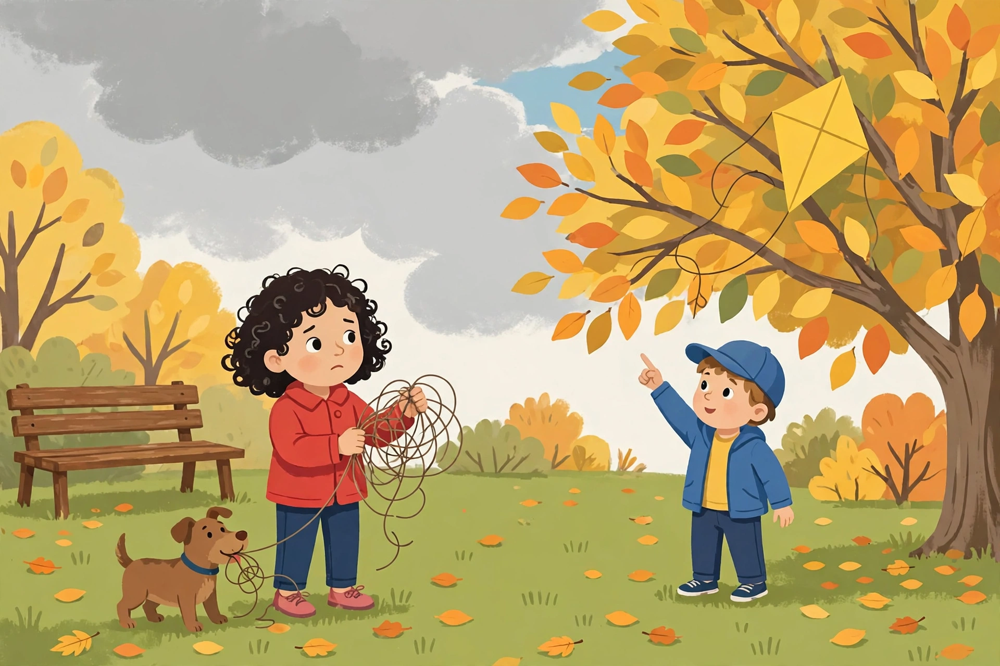

# Lesson 03 — Dialogue That Shows How Characters Respond

**Goal (learner hears):** "I can write dialogue that shows what a
character thinks and feels, and punctuate it correctly with commas
and quotation marks."
**Time:** 30–35 minutes (taught across two sessions: rules and
modeling, then the picture activity) · **Materials:** this lesson;
a pencil and paper (or the unit notebook).
**Standards:** W.4.3.b; L.4.2.b.

## Readiness check (1–2 min)

The adult asks: "Which tells you more about how Mara feels: 'Mara
was upset.' or '"It's stuck!" I shouted.'?" (The second one. The
shout *shows* her feeling; the first one only *tells* it.) "Today
we learn to let characters speak — and to write their exact words
so a reader always knows who is talking."

## Explicit teaching

**Dialogue** is the exact words a character says, written down.
Good dialogue does a job: it shows how a character **responds** to
what just happened — scared, brave, angry, kind, surprised.

Four punctuation rules (the common cases for grade 4):

1. **Quotation marks** go around the exact words spoken:
   `"It's stuck!"`
2. **A new paragraph** every time the speaker changes. Two people
   never share a paragraph when they talk.
3. **A comma** separates the spoken words from the **speaker tag**
   (the "he said" / "I shouted" part): `"Don't pull too hard,"
   he said.` — and the spoken words start with a **capital
   letter**.
4. When the speaker tag comes **first**, put a comma after it and
   then the quotation marks: `Theo said, "Look! It's caught on
   that high branch."`

Speaker tags can say more than "said": whispered, shouted,
laughed, murmured, asked, begged. Pick the tag that matches how
the words sound — but do not use a fancy tag on every line; the
dialogue itself should carry the feeling.

### The lesson passage

Dialogue from the anchor story, with the punctuation to study:

> "It's stuck!" I shouted. My heart thumped like a drum.
>
> Theo pointed up at the branches. "Look! It's caught on that high
> branch," he said. "Don't pull too hard or the string will snap."
>
> "Biscuit, no!" I said. "Drop it!"

### Modeled example 1 — what the dialogue shows

*Adult models aloud:* "'It's stuck!' I shouted — the exclamation
mark and the word 'shouted' show Mara is upset and surprised; she
does not need the sentence 'Mara was upset' after it. Theo's line
does two jobs: 'Look! It's caught on that high branch' tells the
reader what he sees, and 'Don't pull too hard or the string will
snap' shows he is thinking clearly and warning his sister — he is
calm while she is upset. Dialogue shows character: the same
situation, two different responses, and the reader can tell them
apart just from the words they say."

### Modeled example 2 — punctuating step by step

*Adult models:* "Take the unpunctuated line: *theo said look its
caught*. Step 1: capital letter at the start of the spoken words
— 'Look'. Step 2: quotation marks around the exact words — '"Look!
It's caught"'. Step 3: the speaker tag comes first, so a comma
after 'said' — 'Theo said, "Look! It's caught on that high
branch."'. Step 4: new paragraph, because the speaker changed.
Check: who is speaking? Theo — the tag says so, and the paragraph
break proves it."

### A common trap (model it)

A learner writes:

> "Let's go," Mara said. "Okay," Theo said. "Wait for me," Mara
> said. "Hurry up," Theo said.

The adult answers: "Every line says 'said,' so every line sounds
the same — and the reader cannot tell who is excited and who is
tired. Vary the tags only when they add meaning ('whispered' when
it is quiet, 'shouted' when it is loud), and let the words
themselves do the work: 'Wait for me!' already sounds worried
without any tag at all. And remember the new-paragraph rule: if
two speakers share one paragraph, the reader loses track of who is
talking."

## The picture activity

Study the picture below. It shows the same moment as the anchor
story — the kite stuck in the tree. What would Mara and Theo say
to each other right now?

*Caption: The moment the kite gets stuck — Mara holds the tangled
string, Biscuit tugs the loose end, and Theo points at the yellow
kite in the tree. AI-generated illustration for this unit; the
characters and scene are invented for the lesson.*

**Text-only version of the picture (for learners who cannot see
it — it carries every fact the activity needs):** In a park on a
windy autumn day, a big tree with yellow, orange, and green leaves
stands on the right. A bright yellow diamond-shaped kite is caught
in its branches. Under the tree, a girl with curly dark hair, a red
jacket, blue pants, and pink shoes holds a tangled ball of kite
string in both hands and looks worried. A small brown dog with a
blue collar holds the loose end of the string in its mouth. Next
to her, a boy in a blue cap, a blue jacket, and a yellow shirt
points up at the kite and smiles. A wooden bench stands on the
left. Orange and yellow leaves lie scattered on the green grass.
The sky is gray with clouds, except for one small patch of blue.

## Guided practice (adult hints allowed)

1. In the lesson passage, which dialogue line shows that Mara is
   upset, and which shows that Theo is thinking clearly? Quote
   both lines.
2. Punctuate this line: *mara said biscuit drop it* (Hint: the
   speaker tag comes first — comma after "said", capital letter
   at the start of the spoken words.)
3. Look at the picture (or read the text-only version). What is
   Mara feeling, and what is Theo feeling? Name one thing you can
   see in the picture that shows each feeling.
4. Write one line of dialogue for Theo in the picture, using a
   speaker tag that is not "said". Punctuate it correctly.

## Independent practice

1. Write a 4-line dialogue between Mara and Theo at the moment in
   the picture. Start a new paragraph each time the speaker
   changes. Use at least one exclamation and one question.
2. Punctuate these two lines correctly:
   (a) *look out shouted theo the string is tangling*
   (b) *mara said i have an idea*
3. Error analysis: a classmate wrote this dialogue in one
   paragraph: "We should pull it," Mara said. "No, wait," Theo
   said. "It will snap," Mara said. Explain in two sentences what
   is wrong — and rewrite it with correct paragraph breaks.
4. Read the anchor story's dialogue again. Write one sentence
   explaining what the line "Let's pull together, slow and steady"
   shows about Theo.

## Applied task

Open the project draft. Find one place where a character does
something important (a decision, a surprise, a problem). Replace a
telling sentence ("He was scared") with two lines of dialogue that
*show* the feeling. Punctuate both lines, start a new paragraph
per speaker, and read the exchange aloud to check it sounds like
real talking.

## Exit check

Without looking back: "What are the four dialogue punctuation
rules, and what job does good dialogue do?" (Quotation marks
around exact words; new paragraph per speaker; comma with the
speaker tag and capital letter at the start of the spoken words;
comma after a speaker tag that comes first. Good dialogue shows how
a character responds to what happened.)

## Supports, alternate modes, extension

- **Reading support:** the adult reads each dialogue line aloud
  in a different voice per speaker, so the learner hears the
  speaker change before seeing the paragraph break.
- **Alternate response mode:** the learner may act out the
  picture dialogue with the adult (one plays Mara, one plays
  Theo) and dictate the lines while the adult scribes the
  punctuation; the learner then reads the lines back and points
  to each quotation mark.
- **Extension:** rewrite the anchor story's dialogue exchange
  with the speaker tags removed and only the words left — then
  decide, line by line, whether the reader can still tell who is
  speaking, and explain which lines need their tags back.

## Teacher note

Likely misconceptions: (1) quotation marks around thoughts or
narration, not only spoken words; (2) two speakers in one
paragraph; (3) a comma *outside* the closing quotation mark
("…snap", he said — wrong; the comma goes inside: "…snap," he
said); (4) "said" on every line, or a fancy tag on every line.
Reteach with the step-by-step model: capital, quotation marks,
comma, paragraph break — in that order. Full solutions:
[answer key](../answer-key.md) § Lesson 03.
